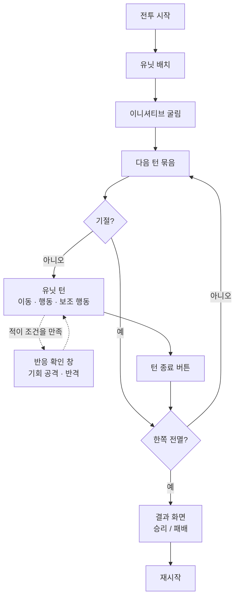
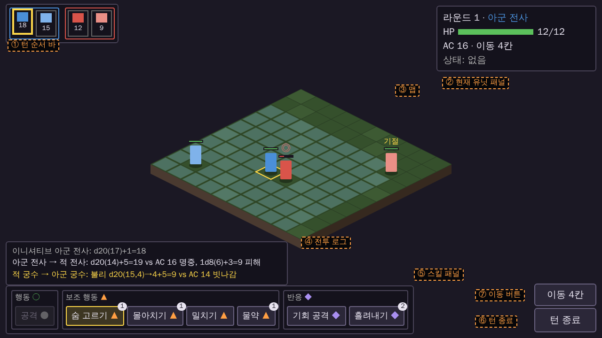
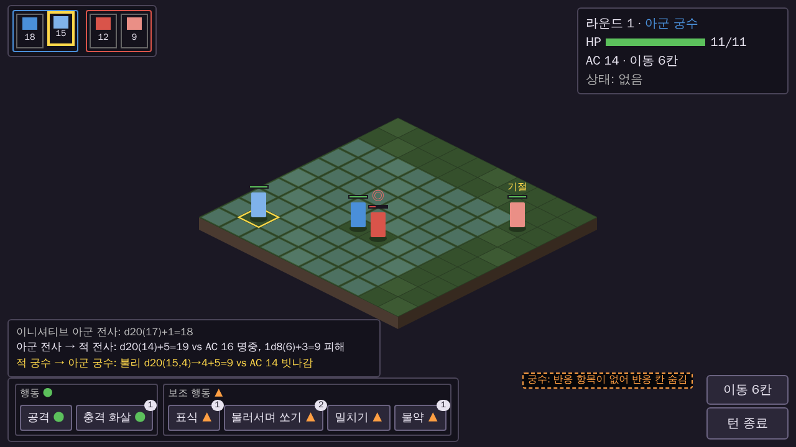
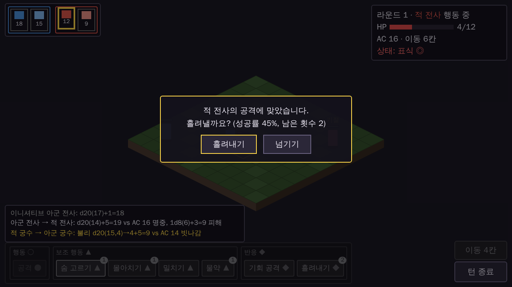

# 전투 시스템 기획서

> 이번 스프린트(~2026-10-11)에 구현할 전투 규칙입니다. 개발은 이 문서를 기준으로 합니다.
>
> - 기준일: 2026-10-02
> - 범위 결정 배경: [기획 현황](DESIGN_STATUS.md)
> - 규칙 근거: SRD 5e (CC-BY-4.0). BG3 고유 명칭, 아이콘, 텍스트는 쓰지 않습니다.
> - 용어: `feat/combat-prototype` 브랜치의 `CONTEXT.md`를 따르고, 새 용어는 [8장](#8-새-용어)에 정리했습니다.
> - **M2 변경**: 사각 높이 격자, 막당 스킬 횟수, 드랍 물약은 [게임 구조 기획서 7장](GAME_STRUCTURE.md#7-전투-시스템-기획서에서-바뀌는-규칙)이 이 문서보다 우선합니다.
> - **능력치·판정 개정 (2026-10-27)**: 능력치(자연 → 건강)와 판정(명중굴림·내성굴림, AC·DC, 피해 공식)은 [능력치와 주사위 판정 기획서](ABILITY_SYSTEM.md)가 이 문서보다 우선합니다. 4장 판정, 5장 스킬 표, 6-3의 해당 서술은 구현 PR이 맞춥니다.
> - **전사 재디자인 (2026-10-30)**: 전사의 컨셉·능력치·최대 HP·이동력·스킬은 [전사 문서](characters/warrior.md)가 이 문서보다 우선합니다. 5-2, 5-3, 5-4, 8장, 9장을 맞췄고, 2장 유닛 표와 4장 판정은 구현 PR이 맞춥니다. 스킬 개수는 고정하지 않습니다.
> - 표시: ❓ 기획 확인 필요

---

## 목차

1. [프로토타입 대비 바뀌는 점](#1-프로토타입-대비-바뀌는-점)
2. [시험 전투](#2-시험-전투)
3. [턴 진행](#3-턴-진행)
4. [판정](#4-판정)
5. [동작](#5-동작)
6. [상태 이상](#6-상태-이상)
7. [적 AI](#7-적-ai)
8. [새 용어](#8-새-용어)
9. [화면과 조작](#9-화면과-조작)
10. [기획 확인 필요](#10-기획-확인-필요)

---

## 1. 프로토타입 대비 바뀌는 점

개발 담당이 먼저 볼 요약입니다.

| 영역 | 프로토타입 | 이번 스프린트 |
|---|---|---|
| 능력치 | 힘, 민첩, 건강 | **힘·민첩·솜씨·지능·의지·건강 주사위** |
| 턴 자원 | 이동 + 행동 | 이동 + 행동 + **보조 행동** + **반응** |
| 턴 순서 | 한 명씩 | 같은 편이 연속이면 **턴 묶음** |
| 기본 공격 | 공격 하나 | **기회 공격 가능/불가** 타입 추가 |
| 원거리 공격 | 사거리 1~12칸 | **사거리 1~6칸**. **공격자 옆에 적이 있으면 불리** |
| 판정 | d20 명중 판정 | **능력치 주사위 명중굴림**(공격 굴림 대 AC), 굴리는 쪽 유리/불리 |
| 능력 | 없음 | 직업 고유 **스킬** (개수는 직업마다 정함, 횟수 단위는 스킬마다 정함) |
| 공용 동작 | 없음 | **밀치기**, **물약** |
| 상태 이상 | 없음 | **기절** |
| 적 AI | 접근 후 공격 | + 스킬 사용, 궁수 거리 벌리기, 반응 자동 사용 |

---

## 2. 시험 전투

| 항목 | 값 |
|---|---|
| 맵 | 10×10 아이소메트릭 격자, 높이 없음, 장애물 없음 |
| 편성 | 아군: 전사 1, 궁수 1 / 적: 전사 1, 궁수 1 |
| 배치 | 맵 반대편 가장자리에 고정 (프로토타입과 같음) |
| 승패 | 한쪽이 모두 전투 불능이 되면 끝 |

### 유닛

[능력치 기획서](ABILITY_SYSTEM.md)와 [#321](https://github.com/minjunkim-dev/BGLike/issues/321)의 현재 규칙입니다. 모든 면은 균등한 `1~n`입니다.

| 유닛 | 힘 | 민첩 | 솜씨 | 지능 | 의지 | 건강 | HP | 방어 가산 | 이동력 |
|---|---|---|---|---|---|---|---|---|---|
| 전사 | d20 | d8 | d6 | d4 | d6 | d12 | 12 | 0 | 6 |
| 궁수 | d6 | d12 | d20 | d6 | d4 | d8 | 14 | 0 | 6 |

| 유닛 | 기본 공격 | 공격 능력치 | 공격 가산 | 피해 | 사거리 | 기회 공격 |
|---|---|---|---|---|---|---|
| 전사 | 근접 | 힘 | 0 | 1d8+3 | 1 (인접) | 가능 |
| 궁수 | 원거리 | 솜씨 (임시, [#386](https://github.com/minjunkim-dev/BGLike/issues/386)) | 0 | 1d6+1 | 1~6 | 불가 |

공격·방어 장비는 결과에 가산합니다. HP·피해·사거리·행동 수는 이번 판정 개편으로 바꾸지 않습니다. 몬스터 시험값은 [능력치 기획서 7장](ABILITY_SYSTEM.md#7-몬스터-시험값)을 따릅니다. 장비 범위 재조정은 #205에서 기획자가 정합니다.

전사의 의지 주사위(d8), 최대 HP 식, 이동력 3, 기본 공격 피해(`힘 d20 + 레벨 + 기타 가산치 0`)는 2026-10-30 재디자인으로 [전사 문서](characters/warrior.md)를 따라 바뀝니다. 위 표는 현재 구현입니다.

> 현재 맵·배치·사거리 근거는 [게임 구조 기획서 6~7장](GAME_STRUCTURE.md#6-사각-높이-격자)과 [스테이지 배치 3장](stages/README.md#3-시작-위치)이 대체합니다.

- 궁수 사거리는 6칸입니다. 10×10 맵의 가장 먼 거리가 9칸이라, 12칸이면 맵 어디든 닿아 위치 선정이 의미가 없어서 줄였습니다.

---

## 3. 턴 진행

### 3-0. 전투 진행 흐름

### 3-1. 이니셔티브

전투 시작 때 민첩 주사위를 한 번 굴립니다. 높은 원본 값이 먼저이고, 동점이면 민첩 주사위의 최대 면 값이 큰 쪽, 그다음 아군이 먼저입니다. 그래도 같으면 배치 순서(스테이지 데이터에 적힌 순서)를 따릅니다.

### 3-2. 턴 묶음

이니셔티브 순서에서 **같은 편 유닛이 연달아 있으면 한 묶음**으로 진행합니다. 2026-10-19 [Issue #140](https://github.com/minjunkim-dev/BGLike/issues/140)의 결정을 반영했습니다.

- 묶음 안에서는 플레이어가 어느 유닛을 먼저 움직일지 고르고, 언제든 다른 유닛으로 바꿔 조작할 수 있습니다. 턴 순서 바의 초상을 누르거나 `Tab`·`Shift+Tab`으로 바꿉니다. (9-4)
- 자원(이동력, 행동, 보조 행동)은 유닛마다 따로입니다.
- 묶음의 모든 유닛이 턴 종료를 누르면 다음 순서로 넘어갑니다. (3-4)
- 전투 불능이 된 유닛은 묶음에서 빠집니다.
- 적 묶음은 AI가 이니셔티브 순서대로 진행합니다.

> 예: 이니셔티브가 `아군 전사 → 아군 궁수 → 적 전사 → 적 궁수`면 아군 둘이 한 묶음, 적 둘이 한 묶음입니다.

#### 새로 이어지는 묶음

같은 편 유닛이 이니셔티브 순환에서 새로 이어지면 한 묶음이 됩니다. 한 묶음에 같은 유닛이 두 번 들어가지 않습니다.

| 경우 | 예 |
|---|---|
| 라운드 경계 | `아군1 → 적1 → 아군2`에서 아군2와 다음 라운드의 아군1이 한 묶음 |
| 전투 불능 | `아군1 → 적1 → 아군2`에서 적1이 사라지면 아군1과 아군2가 한 묶음 |

- 이니셔티브 순서가 아직 오지 않은 유닛은 **처음 조작할 때** 턴을 시작합니다. 이때 매 턴 효과를 처리합니다. 턴 자원은 직전 턴이 끝날 때 이미 채워져 있으므로 이때 채우지 않습니다. (3-3) 조작하기 전까지는 턴을 시작하지 않은 것으로 봅니다.
- 묶음이 없던 순서와 같은 결과를 낼 수 있어야 합니다. 예: 적1이 아군1에게 화상을 걸었으면, 아군2가 먼저 아군1을 물 칸으로 밀어 화상을 풀고 아군1의 턴을 시작할 수 있습니다.
- 기절한 유닛은 묶음의 다른 유닛이 모두 턴을 마친 뒤 턴을 시작해 효과를 처리하고 자동으로 넘어갑니다.
- 라운드 경계 묶음이 처음 생기면 앞쪽 유닛의 초상을 묶음의 마지막 유닛 뒤로 옮깁니다. 예: `아군1 → 적1 → 아군2`는 `적1 → 아군2 → 아군1`로 표시합니다. 옮길 유닛이 여럿이면 함께 옮깁니다. 1초 미만의 짧은 애니메이션으로 합칩니다.
- 옮긴 순서는 이후 라운드에도 유지합니다. 다음 라운드부터는 일반 묶음으로 진행합니다.
- 처음부터 이어진 묶음은 기존 동작을 유지합니다.
- 전투 불능 초상은 즉시 제거합니다. 남은 초상은 합쳐진 위치로0.25초 동안 이동합니다. 기존 라운드 경계 이동과 같은 감속을 씁니다. ([Issue #140 후속 결정](https://github.com/minjunkim-dev/BGLike/issues/140#issuecomment-6298246327), #180)
- 턴 묶음·턴 시작·효과 시계·자원은 즉시 갱신합니다. 초상 이동은 입력을 막지 않습니다. 이동 중 순서가 바뀌면 현재 표시 위치에서 최신 배치로 이동합니다. 처음 표시할 때와 스테이지를 초기화할 때는 이전 이동을 재생하지 않습니다. 전투 불능 없는 일반 소환은 기존 표시를 유지합니다.

### 3-3. 턴 자원

| 자원 | 횟수 | 회복 시점 | 쓰는 곳 |
|---|---|---|---|
| 이동력 | 6칸 | 자기 턴 묶음 확정 | 이동. 나눠 쓸 수 있음 |
| 행동 | 1회 | 자기 턴 묶음 확정 | 기본 공격, 행동형 스킬 |
| 보조 행동 | 1회 | 자기 턴 묶음 확정 | 밀치기, 물약, 보조 행동형 스킬 |
| 반응 | 1회 | 자기 턴 묶음 확정 | 기회 공격, 반응형 스킬. 조건이 맞으면 **자기 턴에도** 사용 |

- 반응은 기회 공격과 반격이 **함께 씁니다.** 한 라운드에 둘 중 하나만 쓸 수 있습니다.
- 반응은 조건이 맞으면 누구의 턴이든 씁니다. 예: 자기 턴에 이동하다 적의 기회 공격이 빗나가면 반격을 쓸 수 있습니다. 이때 쓴 반응은 자기 턴 묶음이 확정될 때까지 회복되지 않습니다. (2026-10-05 결정, 2026-10-19 회복 시점 변경)

#### 회복 시점 (2026-10-19 결정)

턴 자원은 **자기 턴이 끝날 때** 다시 채웁니다. 이전에는 자기 턴이 시작될 때 채웠습니다.

- 채우는 순간은 **묶음이 확정될 때**입니다. 묶음의 모든 유닛이 턴 종료를 눌러 다음 순서로 넘어가기 직전에, 그 묶음의 모든 유닛이 한꺼번에 채웁니다. 유닛 한 명이 턴 종료를 누르는 순간에는 채우지 않습니다. 턴 종료를 누른 유닛을 다시 조작해도 자원은 이어 씁니다. (3-4)
- 전투가 시작될 때 모든 유닛은 자원이 가득 찬 상태입니다. 스테이지를 시작하거나 다시 시작할 때도 같습니다.
- 상대 턴에는 내 자원이 가득 찬 상태입니다. 내 차례에 쓴 자원이 상대 턴에 비어 보이지 않습니다.
- 적 턴에 줄거나 사라진 자원은 **다음 자기 턴이 끝날 때까지** 유지됩니다. 몬스터 스킬 중 상대의 턴 자원을 없애는 스킬을 쓰기 위한 시점입니다. 예: 적이 아군의 행동을 없애면 그 아군은 다음 자기 턴에 행동을 쓰지 못합니다.
- 자기 턴에 쓴 반응은 자기 턴 묶음이 확정될 때 회복해 적 턴에 다시 씁니다. 적 턴에 쓴 반응은 다음 자기 턴 묶음이 확정될 때까지 회복되지 않으므로, 그 자기 턴에는 쓸 수 없습니다.
- 자원을 없애는 구체적인 스킬과 대상 자원, 지속 방식은 몬스터 문서에서 정합니다. ❓ 이동력처럼 개수로 세지 않는 자원을 없애는 방식
- 턴 시작에 처리하는 효과(과부하 자기 피해 등)는 시작 시점을 유지합니다. 자원 회복만 바뀝니다.

### 3-4. 턴 종료

- 턴은 항상 **턴 종료 버튼**으로 끝냅니다. 자동 종료는 없습니다.
- 유닛이 둘 이상인 묶음에서는 턴 종료를 눌러도 바로 확정하지 않습니다. 묶음의 **모든 유닛**이 턴 종료를 누르는 순간 모두 확정하고 다음 순서로 넘어갑니다. 유닛이 하나뿐인 묶음은 바로 확정합니다. ([Issue #140](https://github.com/minjunkim-dev/BGLike/issues/140))
- 턴 종료를 누른 유닛도 다시 골라 조작할 수 있습니다. 조작하면 그 유닛의 턴 종료가 해제됩니다. 남은 자원은 그대로 이어 쓰고 다시 채우지 않습니다.
- 턴이 끝날 때 일어나는 효과는 묶음이 확정될 때 발동합니다. 각 유닛이 턴 종료를 누르는 순간에는 발동하지 않습니다. 턴 자원 회복도 이 효과입니다. (3-3)
- 더 할 수 있는 동작이 없으면 턴 종료 버튼을 **강조**합니다. 색만 바뀌고 깜빡이지 않습니다. (9-3)
- "할 수 있는 동작"은 남은 이동력으로 갈 칸이 있거나, 남은 행동·보조 행동으로 쓸 수 있는 동작에 대상이 있는 경우입니다. 반응은 따지지 않습니다.

---

## 4. 판정

### 4-1. 명중굴림

기본 공격, 기회 공격, 충격 화살은 명중굴림입니다([능력치 기획서 4-1](ABILITY_SYSTEM.md#4-1-판정의-두-종류-)). 공격자의 공격 굴림(공격 능력치 주사위 + 공격 장비 가산)이 대상의 **AC 이상**이면 명중합니다. 동점도 명중이고 대상은 굴리지 않습니다. AC는 민첩 표준값(d4 3, d6 4, d8 5, d10 6, d12 7, d20 11) + 방어 장비 가산이며, 몬스터는 정의에서 직접 지정한 AC로 덮어쓸 수 있습니다. 공격 거리 유형은 AC에 영향을 주지 않습니다. 전사 힘 d20 대 풋내기 야만인 AC 4는 장비 없이 85.0%입니다.

모든 주사위의 첫 면은 절대실패면, d12의 가장 높은 면 하나와 d20의 가장 높은 면 셋은 절대성공면입니다(시험용 시작 상태, [4-11](ABILITY_SYSTEM.md#4-11-절대면-)). 절대성공은 AC와 무관하게 명중, 절대실패는 가산이 있어도 빗나갑니다. 숫자로는 절대성공이 최댓값, 절대실패가 1이라 d20 일반면은 2~17입니다. 치명타와 절대성공의 추가 이점은 비활성입니다. 피해 주사위와 표식 추가 1d6은 각각 한 번만 굴립니다. 절대면 획득·주사위 육성·치명타 재도입은 #322 확정 전에는 구현하지 않습니다.

### 4-2. 유리 / 불리

굴림 하나에 붙은 유리 요인 수와 불리 요인 수를 비교해 많은 쪽을 따르고, 같으면 일반 한 번입니다. 같은 요인은 한 번만 셉니다. 유리면 공격 능력치 주사위를 두 번 굴려 높은 값, 불리면 낮은 값을 쓰며 요인이 여러 개여도 두 번만 굴립니다. 두 값은 숫자 순서로 고르고 고른 굴림이 절대면이면 절대면 효과를 적용합니다. 기절 대상은 유리, 원거리 고지대는 유리, 기절하지 않은 인접 적이 있는 원거리 공격자는 불리입니다. 예를 들어 고지대에서 기절한 대상을 쏘면 인접 적이 있어도 유리 둘 대 불리 하나로 유리입니다. 미리보기는 모든 면 조합을 열거한 정확한 확률을 표시합니다.

### 4-3. 효과 판정

충격 화살은 궁수의 솜씨 명중굴림에 명중하면 피해 후 기절하며 추가 굴림은 없습니다. 보스는 기절 면역입니다. 독 제거는 건강 주사위가 독 강도 이상이면 성공합니다. 독 제거의 판정은 지금 구현 그대로이고, [기획서 8장](ABILITY_SYSTEM.md#8-현재-동작에-적용하는-임시-규칙)은 이 동작을 내성굴림과 임시 규칙으로 바꿉니다. 그 판정 개정은 후속 구현(#389)입니다. 흘려내기는 2026-10-30 전사 재디자인으로 폐지되고 반격(5-3)으로 대체됩니다(#390은 충격 화살만 이관).

### 4-4. 대결과 광역

밀치기·만능팔은 힘 주사위 + 공격 가산 대 힘 주사위 + 방어 가산입니다. 동점은 방어 승입니다. 아군 또는 기절한 대상의 자동 밀치기는 유지합니다.

회전회오리는 공격자 힘 주사위를 한 번 굴려 같은 합계를 각 대상의 힘 방어 굴림과 비교합니다. 공통 공격은 로그 한 줄, 방어는 대상마다 한 줄입니다. 일부 대상만 기절해 유리 조건이 달라지는 조합은 [#326](https://github.com/minjunkim-dev/BGLike/issues/326)에서 모든 대상이 유리 조건을 충족할 때만 공통 굴림에 유리를 주기로 확정했고 [#341](https://github.com/minjunkim-dev/BGLike/issues/341)에서 지원했습니다. 일부만 유리이면 일반 공통 굴림으로 실행합니다. 현재 적에게 아군 기절 공급원이 없어 이 조합은 통제 fixture와 실제 장면의 직접 AI 호출로 검사합니다.

### 4-5. 운과 난수

2026-10-22 [#220 기획자 답](https://github.com/minjunkim-dev/BGLike/issues/220#issuecomment-6331002448) 1·2번입니다.

- **표시 확률을 보정하지 않습니다.** 화면의 명중률이 실제 확률입니다. 사람이 플레이한 뒤 불운이 불만으로 나오면 새 항목으로 다시 엽니다.
- **시드를 고정하지 않습니다.** 새 게임·막 재시작마다 새로 굴립니다. 이어하기는 저장한 난수 상태에서 이어집니다([게임 구조 2-4](GAME_STRUCTURE.md#2-4-저장과-이어하기-), [#281](https://github.com/minjunkim-dev/BGLike/issues/281)).

---

## 5. 동작

### 5-1. 기본 공격

| 항목 | 내용 |
|---|---|
| 소비 | 행동 |
| 횟수 | 제한 없음 (행동이 있는 한) |
| 판정 | 명중 판정 |
| 사거리 | 유닛 표 참고. 원거리도 인접 칸을 공격할 수 있지만, 4-2의 불리 조건을 받음 |

### 5-2. 기회 공격

> 현재 인접 칸은 [게임 구조 기획서 7장](GAME_STRUCTURE.md#7-전투-시스템-기획서에서-바뀌는-규칙)이 대체합니다: 상하좌우4칸, 높이 차1 이하. 점프도 포함합니다.

| 항목 | 내용 |
|---|---|
| 소비 | 반응 |
| 조건 | 기회 공격 **가능** 타입의 근접 기본 공격을 가진 유닛이 쓰는 **공용 동작** |
| 발동 | 적이 **스스로 이동해서** 내 인접 칸(8칸)을 벗어나려 할 때 |
| 효과 | 기본 공격 1회. 벗어나기 직전 칸에서 판정하고, 대상이 버티면 이동을 계속함 |
| 전사의 추가 효과 | 전사는 스킬 **괴력의 사내**로, 기회 공격이 명중하면 대상의 이동력을 그 턴에 즉시 0으로 만듦 (이동 정지). 확인 창에 "명중하면 이동을 멈춥니다"를 표시 |
| 발동 안 함 | 밀치기로 밀려난 경우, 물러서며 쏘기를 쓴 경우 |
| 조작 | 아군은 매번 사용 여부를 묻습니다 (9장). 적은 자동으로 씁니다 |

### 5-3. 스킬

스킬 횟수 단위는 스킬마다 정합니다: **무제한 / 막당 / 전투마다**. 막당은 막이 시작될 때, 전투마다는 새 전투(스테이지)가 시작될 때 회복합니다 ([게임 구조 기획서 7장](GAME_STRUCTURE.md#7-전투-시스템-기획서에서-바뀌는-규칙)). 스킬 설명에는 "전투마다 n회"로 적고, 전투 중 남은 횟수는 "n회 남음"으로 표시합니다.

#### 스킬 뼈대

2026-10-19 [Issue #140](https://github.com/minjunkim-dev/BGLike/issues/140)에서 모든 캐릭터가 공유하는 뼈대를 정했습니다.

| 구성 | 내용 |
|---|---|
| 기본 공격 | 1개 |
| 공용 보조 행동 | 밀치기, 점프, 물약 등 (5-4) |
| 고유 스킬 | **개수 고정 없음.** 직업마다 디자이너가 정함 (2026-10-30). 지금 전사 8개, 궁수 3개 |

- 기본 공격, 공용 동작, 고유 스킬은 모두 **동작**입니다. 조준·범위·전달·효과·판정·비용의 조합으로 정의하며 규칙은 [동작 유형 기획서](SKILL_TYPES.md)를 따릅니다.
- 고유 스킬이 쓰는 자원(행동, 보조 행동, 반응 등)은 스킬마다 정합니다.
- 대부분의 스킬은 자원 하나에 속합니다. 둘 이상의 자원 중 하나로 쓸 수 있는 스킬도 둡니다. 예: 행동 또는 반응. 행동으로 쓰지 않았다면 반응으로 쓸 수 있습니다.
- 여러 자원으로 쓸 수 있는 스킬은 스킬 패널의 해당 자원 컨테이너 모두에 표시합니다. 사용 횟수는 하나로 공유합니다.
- 둘 이상의 자원을 **모두** 소비하는 스킬도 있습니다. 점프(이동력 + 보조 행동)가 선례이고, 십자 베기(행동 + 보조 행동), 강철 돌진(보조 행동 + 이동력 1)도 같습니다. 필요한 자원이 모두 남아 있어야 쓸 수 있고, 비용 문구를 스킬 버튼의 호버에 표시합니다.
- 패시브 스킬은 자원과 횟수가 없고 조건이 맞으면 저절로 적용됩니다. 예: 팔랑크스, 괴력의 사내.
- 스킬은 고정입니다. 출전 전 선택은 스킬 후보가 늘어날 때 다시 검토합니다.
- 고유 스킬 개수는 정하지 않습니다 (2026-10-30). 이전의 "6개 잠정"과 "M7까지 직업마다 3개 유지"([Issue #201](https://github.com/minjunkim-dev/BGLike/issues/201)) 결정을 대체합니다.
- 캐릭터 특색은 [캐릭터 디자인 기획서5장](characters/README.md#5-컨셉에서-스킬-만들기)의 공통 기준으로 검수합니다. 추상 컨셉→키워드3–5개→고유 스킬·장점·단점→수치 순서를 따릅니다. 각 스킬의 근거 키워드와 플레이어가 내릴 판단을 적습니다. 스킬 묶음은 장점과 화면에서 알아볼 단점을 함께 드러내야 합니다.
- 전사의 추상 컨셉과 키워드는 2026-10-30에 확정했습니다. 궁수의 컨셉은 아직 확정하지 않았습니다. 이 기준은 궁수의 미정 컨셉을 확정하지 않습니다. 현재 역할과 기능 요약은 승인된 컨셉·키워드를 대신하지 않습니다. ([Issue #140 후속 결정](https://github.com/minjunkim-dev/BGLike/issues/140#issuecomment-6298246327))

#### 전사

2026-10-30 재디자인입니다. 규칙의 전체와 수치는 [전사 문서](characters/warrior.md)가 기준이며, 아래는 요약입니다. 옛 스킬(숨 고르기, 흘려내기, 몰아치기)은 폐지하고 구현 PR이 맞춥니다.

| 스킬 | 소비 | 횟수 | 대상 | 효과 |
|---|---|---|---|---|
| **휩쓸기** | 행동 | 무제한 | 인접 4칸 중 한 방향 | 정면 **반달 5칸**의 적에게 시계방향으로 각각 힘 명중굴림. 피해 `⌈(힘 d20 + 레벨) ÷ 2⌉ + 기타 가산치` |
| **십자 베기** | 행동 + 보조 행동 | 전투마다 1 | 인접한 적 1명 | 기본 공격 2회 연속, 각각 힘 명중굴림. 첫 타격으로 쓰러지면 둘째는 취소 |
| **강철 돌진** | 보조 행동 + 이동력 1 | 전투마다 1 | 인접한 적 1명 | 힘 명중굴림. 명중하면 피해 `힘 d20 + 레벨`(가산치 없음), 대상을 1칸 밀고 전사가 빈 칸으로 1칸 전진. 밀 수 없으면 피해만 |
| **반격** | 반응 | 무제한 | 전사 자신을 노린 공격의 인접한 공격자 | 그 공격의 명중굴림이 실패하면 확인 창. 명중굴림 없이 필중 반격, 피해 `민첩 d8 + 레벨 + 기타 가산치` |
| **성스러운 장막** | 보조 행동 | 무제한 | 자신 | `건강 d12 + 레벨` 방어막. 모든 피해를 HP보다 먼저 받음. 3턴, 재시전은 큰 값 유지 |
| **팔랑크스** | 패시브 | - | 전사와 인접한 아군 | 인접 아군이 있으면 전사와 그 아군의 AC +1 (중첩 없음) |
| **전투의 함성** | 행동 | 전투마다 1 | 살아 있는 모든 아군(자신 포함) | 시전 때 전사의 의지 굴림값을 한 번 굴려 전원의 명중굴림에 더함. 2턴 |
| **괴력의 사내** | 패시브 | - | 전사의 기회 공격 대상 | 기회 공격이 명중하면 대상의 이동력을 그 턴에 0으로 |

- 반격은 반응이라 **항상 켜져 있고** 쓸 수 있는 순간마다 사용 여부를 확인 창으로 묻습니다 (9-5). 반응 자원은 기회 공격과 나눠 씁니다.
- 지속 효과(성스러운 장막, 전투의 함성)의 시계는 **시전자(전사)의 턴 시작**마다 줄어듭니다. 전사가 전투 불능이 되어도 전투의 함성은 남고, 쓰러진 전사의 턴 자리를 보이지 않는 시계 슬롯으로 보관해 계속 줄입니다.
- 휩쓸기는 시전할 때 영향 칸의 적을 확정하고 시계방향 순서로 한 명씩 판정합니다. ÷2 올림은 휩쓸기 고유 규칙이며 광역 내성 성공 시의 "절반(내림, 최소 1)"과 다릅니다.
- 괴력의 사내의 이동 정지는 디버프·약화 금지 원칙의 유일한 예외입니다.

#### 궁수

| 스킬 | 소비 | 횟수 | 대상 | 효과 |
|---|---|---|---|---|
| **표식** | 보조 행동 | 1 | 적 1명, 사거리 1~6 | 전투가 끝날 때까지, 궁수가 이 대상을 맞히면 피해 `+1d6`. 추가 1d6은 한 번만 굴림 |
| **충격 화살** | 행동 | 1 | 적 1명, 사거리 1~6 | 기본 공격과 같은 원거리 명중굴림(불리 조건 포함). 명중하면 피해를 준 뒤, 추가 굴림 없이 **기절** (보스 면역) |
| **물러서며 쏘기** | 보조 행동 | 2 | 자신 | 이번 턴의 남은 이동은 기회 공격을 받지 않음 |

- 충격 화살은 행동을 쓰는 기본 공격의 대체입니다. 빗나가도 **행동과 사용 횟수를 모두 소비**합니다 ([2026-10-03 결정](https://github.com/minjunkim-dev/BGLike/issues/12#issuecomment-5968702593)).
- 표식은 한 번 걸면 대상을 바꿀 수 없고, 대상이 전투 불능이 되면 사라집니다.

### 5-4. 공용 동작

스킬이 아니며, 모든 유닛이 씁니다.

| 동작 | 소비 | 횟수 | 대상 | 효과 |
|---|---|---|---|---|
| **밀치기** | 보조 행동 | 제한 없음 | 인접한 적 1명 | `힘 주사위 + 공격 가산` 대 대상의 `힘 주사위 + 방어 가산` 대결. 이기면 대상을 **1칸 밀어냄** |
| **물약** | 보조 행동 | 유닛당 1개 | 자신 | HP `2d4+2` 회복. 최대 HP를 넘지 않음 |

기회 공격(5-2)도 근접 기본 공격을 가진 유닛이 쓰는 공용 동작(반응)입니다.

밀치기 세부 규칙:

> 현재 대상·방향·높이는 [게임 구조 기획서 7장](GAME_STRUCTURE.md#7-전투-시스템-기획서에서-바뀌는-규칙)이 대체합니다: 인접한 유닛(아군은 대결 없이 밀림), 상하좌우 4방향, 같거나 낮은 칸.

- 밀리는 방향은 **밀치는 유닛 → 대상** 방향(8방향)입니다.
- 밀려날 칸이 맵 밖이거나 다른 유닛이 있으면 밀치기를 **선택할 수 없습니다.** (미리보기 단계에서 막음)
- 밀려나는 이동은 기회 공격을 일으키지 않습니다.

---

## 6. 상태 이상

### 6-1. 실제 턴 시작과 공통 규칙

[#138 변경 결정](https://github.com/minjunkim-dev/BGLike/issues/138#issuecomment-6249957040)을 따릅니다. 지속 시간은 시전자의 실제 턴 시작에 줄고, 화상·독의 틱은 대상의 실제 턴 시작에 일어납니다. 아래 세부 수치는 [사용자 선택 위임으로 채택한 초기 권장안](https://github.com/minjunkim-dev/BGLike/issues/138#issuecomment-6297067934)입니다. 구현과 검증 범위는 [#178](https://github.com/minjunkim-dev/BGLike/issues/178)을 따릅니다. 최종 밸런스 승인을 뜻하지 않습니다.

1. 턴을 시작하는 유닛이 시전자인 모든 효과와 장판의 남은 기간을1 줄이고,0이 된 항목을 해제합니다. 시전자가 자신인 효과도 먼저 처리합니다. 만료 결과를 로그로 알리기 전에 해당 상태 이상과 장판을 모두 정리합니다.
2. 물 위에 있는 대상의 화상을 해제합니다.
3. 기존 고유 기믹인 과부하의 자기 피해를 처리합니다. 과부하는 화상·독 중첩에 넣지 않습니다.
4. 현재 칸의 살아 있는 장판을 생성 순서대로 적용합니다. 장판이 부여한 새 화상·독도 이번 시작의 FIFO에 들어갑니다. 장판 자체는 즉시 피해나 주사위를 더하지 않습니다.
5. 대상에게 남은 화상·독을 **부여한 순서(FIFO)**로 처리합니다. 각 중첩은 별도 항목입니다. 틱으로 전투 불능이 되거나 전투가 끝나면 뒤의 효과·주사위·내성을 처리하지 않습니다.

묶음의 지연된 유닛은 처음 조작할 때 위 처리를 실행합니다. 재선택·Tab·턴 종료 취소는 같은 실제 시작을 반복하지 않습니다. 기절 유닛도 기존 자동 넘김 순서에서 실제 시작을 처리합니다. 시전자 전투 불능 시 그 시전자가 건 기절·화상·독을 즉시 해제합니다. 전투 전환에서 상태를 초기화합니다. 이 절의 시전자 기준 시계와 시전자 전투 불능 시 해제는 [동작 유형 기획서 8-1](SKILL_TYPES.md#8-1-이미-확정한-규칙은-예외로-유지)의 예외로 유지합니다.

### 6-2. 기절

| 상태 | 거는 수단 | 효과 | 풀리는 시점 |
|---|---|---|---|
| **기절** | 충격 화살 | 이동, 행동, 보조 행동, 반응 모두 불가. 기절한 유닛을 공격하면 공격자 유리. 밀치기 대결에서 자동으로 짐 | **시전자의 다음 실제 턴 시작** 또는 시전자 전투 불능 시 즉시 |

- 기절 지속 시간은 **1 시전자 턴**입니다. 기절 중에 다시 기절하면 최신 성공 적용의 시전자를 기준으로 1턴으로 갱신합니다. 겹치지 않습니다.
- 기절한 유닛도 실제 턴 시작을 처리합니다. 기절이 유지되면 아무것도 하지 못하고 자동으로 넘어갑니다. 대상 턴 종료로 기절을 해제하지 않습니다.
- 턴 묶음의 지연된 유닛은 처음 조작하거나 기절로 차례를 건너뛸 때 실제 턴을 시작합니다. 단순 선택 전환이나 턴 종료 취소는 이미 시작한 턴을 다시 시작하지 않습니다.
- 시전자 전투 불능 시 그 시전자가 건 기절을 즉시 해제합니다. 이미 완료한 차례를 소급해서 다시 주지는 않습니다.
- 시전자 시계와 전투 불능 시 해제는 [#138 최종 결정](https://github.com/minjunkim-dev/BGLike/issues/138#issuecomment-6249957040)을 따릅니다. 초기값 1과 최신 시전자 기준 갱신은 [위임된 권장안](https://github.com/minjunkim-dev/BGLike/issues/138#issuecomment-6294655890)입니다.

### 6-3. 화상과 독

| 상태 | 중첩 하나의 틱 | 지속 시간 | 중첩 상한 |
|---|---|---|---|
| 화상 | 대상 실제 턴 시작에1d4. 중첩마다 별도로 굴림 | 2 시전자 턴 | 대상 전체3 |
| 독 | 대상 실제 턴 시작에 고정1 | 4 시전자 턴 | 대상 전체3 |

- 각 중첩은 자기 시전자·부여 때의 강도·남은 기간·부여 순서를 유지합니다. 시전자가 서로 달라도 같은 상태의 상한을 공유합니다. 상한에서 새 부여는 거부합니다. 기존 중첩의 시전자·기간·순서를 바꾸지 않습니다.
- 첫 독의 순서에 도달하면 **건강 주사위 1회**를 굴립니다. 가장 오래된 독의 강도 이상이면 그 중첩 하나를 피해 전에 제거합니다. 남은 독은 FIFO 위치에서 각각 피해를 줍니다. 같은 실제 턴에는 추가 제거 굴림이 없습니다.
- 현재 독 장판의 강도는 4이며 부여한 중첩에 기록합니다. 시전자가 있는 독 스킬은 그런 스킬이 생길 때 별도 확정합니다. 강도4 제거 확률은 전사(건강 d12) 75%, 궁수(건강 d8) 62.5%입니다.
- 물 칸에 걷거나, 점프로 착지하거나, 밀치기·끌기로 들어가면 화상을 즉시 모두 해제합니다. 물 위에서 턴을 시작해도 틱 전에 해제합니다. 물 위에서는 새 화상을 부여하지 않습니다. 공중에서 물 칸을 건너뛰기만 하면 해제하지 않습니다. 물은 독을 해제하지 않습니다.
- 물에는 추가 이동 비용·피해를 두지 않습니다. 자세한 지형 범위는 [게임 구조6-6](GAME_STRUCTURE.md#6-6-1차-환경-)과 #137을 따릅니다.
- 공통 상태 부여는 기존 충격 화살의 기절에서도 사용합니다. 화상·독을 넣는 새 캐릭터 스킬·몬스터 특성·아이템은 이번 구현 범위가 아닙니다. 기존9전투의 자연 부여 경로는 #207의 공급원 결정이 필요합니다. 물은 #195에서9전투에 배치했고, 공급원에 맞춘 재배치는 #208에서 정합니다. 통제된 전투 fixture 검증과 구분합니다.
- 초기 장판의 종류와 수치는6-5절을 따릅니다. 집중·표식 수명 변경은 별도 후속 기획입니다.

### 6-4. 범위 스킬의 첫 모양과 높이

[#138의 위임된 초기 권장안](https://github.com/minjunkim-dev/BGLike/issues/138#issuecomment-6300011116)을 [#182](https://github.com/minjunkim-dev/BGLike/issues/182)에서 적용합니다. 기획자의 새 직접 답변과 최종 밸런스 승인을 뜻하지 않습니다.

- 첫 모양은 중심에서 `가로 차 + 세로 차`로 잰 **평면 반경**입니다. 반경1은 중심과 상하좌우입니다. 중심과 영향 칸은 맵 안의 막히지 않은 바닥이어야 합니다. 맵 밖·낭떠러지·막힌 칸을 제외합니다.
- 영향 칸은 **중심 바닥과 높이 차이1 이하**여야 합니다. 중간 칸의 높이·벽을 따라 퍼뜨리지 않습니다. 시야·엄폐 판정도 추가하지 않습니다.
- 기존 고철로봇-3000의 회전회오리는 반경1을 씁니다. 살아 있는 반대편 유닛을 기존 유닛 목록 순서로 각각 기본 공격합니다. 사용 가능·AI의 대상2명 이상 판단·실제 공격이 같은 범위를 씁니다. 각 공격 직전 대상의 생존과 영향 칸을 다시 확인합니다.
- 행동1·횟수 무제한·밀어내기 없음·기존 판정·반응·중단 조건을 유지합니다. 일반 단일 대상 사거리는 바꾸지 않습니다.
- 즉시 피해·매 턴 피해·양쪽 적용은 스킬마다 정합니다. 첫 실제 사례인 회전회오리는 즉시 공격입니다. 다른 모양·높이 특성과 실제 추가 스킬은 후속 기획입니다. 초기 장판은6-5절을 따릅니다. 새 아군 스킬이나 빈 바닥 시전 입력을 추가하지 않습니다. 범위 모양과 높이·벽 처리의 일반 규칙은 [동작 유형 기획서 6장](SKILL_TYPES.md#6-범위-모양)을 따르며, 이 절의 반경 규칙은 그 기본값과 같습니다. 칸 조준은 M3 공격 타입 단계에서 도입합니다.

### 6-5. 지속 장판의 첫 두 종류

[#138의 위임된 초기 권장안](https://github.com/minjunkim-dev/BGLike/issues/138#issuecomment-6300826257)과 [#186](https://github.com/minjunkim-dev/BGLike/issues/186)을 따릅니다. 아래 수치는 최종 밸런스 승인이 아닙니다.

| 장판 | 진입·대상 실제 턴 시작의 부여 | 장판 지속 시간 | 시전자 전투 불능 |
|---|---|---|---|
| 불 장판 | 기존 화상 중첩1개 | 2 시전자 턴 | 즉시 사라짐 |
| 독 장판 | 기존 독 중첩1개 | 4 시전자 턴 | 즉시 사라짐 |

- 장판 하나는 막히지 않은 바닥1칸입니다. 높이·점유 유무와 관계없이 생성할 수 있습니다. 맵 밖·막힌 칸·낭떠러지는 거부합니다. 생성·갱신 당시의 점유 유닛에는 부여하지 않습니다.
- 같은 칸의 같은 종류는 하나입니다. 다시 생성하면 남은 기간만2·4로 갱신합니다. 원 시전자·생성 순서·진입 기록을 유지합니다. 다른 시전자가 갱신해도 시계를 넘기지 않습니다. 기간이 끝난 뒤 새로 생성하면 새 장판입니다. 서로 다른 칸은 각각 별개입니다.
- 서로 다른 종류는 겹칩니다. 먼저 생성한 장판부터 적용합니다. 부여한 화상·독의 피해·기간·상한3·독 내성은6-3절을 그대로 따릅니다. 독 장판은 고정 강도4를 상태에 기록합니다. 장판 자체는 즉시 피해나 주사위를 추가하지 않습니다.
- 걷는 매 도착 칸·점프 착지·밀치기·끌기 착지에서 진입을 처리합니다. 공중에서 건너뛴 칸은 밟지 않습니다. 기존 기회 공격·반응·물·낙하·낭떠러지를 먼저 처리합니다. 살아서 도착한 유닛만 부여를 받습니다.
- 같은 대상은 같은 장판의 진입 부여를 다음 자기 실제 턴 시작 전까지1회만 시도합니다. 물이나 중첩 상한으로 거부돼도 시도를 소비합니다. 진입 기록은 대상의 실제 턴 시작에서 초기화합니다. 라운드 변경·자원 사전 초기화·재선택·Tab·턴 종료 취소는 초기화하지 않습니다.
- 장판 위의 실제 턴 시작 부여는 진입 부여와 별개입니다. 시작 부여는 이후 진입1회를 소비하지 않습니다. 묶음의 지연된 유닛은 처음 조작할 때 시작 부여를 받습니다. 새 상태 이상도 그 시작의 FIFO에서 처리합니다.
- 물은 불 장판 자체를 없애지 않습니다. 물 위에서는 화상을 해제하고 새 화상을 거부합니다. 독과 독 장판에는 영향을 주지 않습니다.
- 장판 만료는 이미 부여한 상태 이상을 별도로 해제하지 않습니다. 상태 이상은 자기 시전자 시계로 남은 기간을 줄입니다. 시전자 전투 불능에서는 기존 규칙에 따라 그 시전자의 상태 이상도 해제합니다. 다음 유닛의 턴 시작이나 소멸 로그 전에 정리를 마칩니다. 전투 초기화는 모든 장판과 진입 기록을 정리합니다.
- 바닥의 주황 불꽃과 초록 X로 두 종류를 구별합니다. 아래 점 하나는 남은1시전자 턴입니다. 겹치면 좌우에 모두 표시합니다. 물·높이·이동 미리보기와 함께 표시합니다. 생성·갱신·소멸의 시전자와 칸은 기존 전투 로그로 확인합니다. 상태HUD와 틱 피드백은 기존 표시를 씁니다.
- 새 캐릭터·몬스터·아이템의 장판 시전, 기존9스테이지의 자연 배치, 새 패널·입력·실제 아트, 집중·전파·시전자 사망 후 유지 타입은 이번 범위가 아닙니다. 공통 부여 접점과 통제된 실제 전투 검증을 자연9전투 콘텐츠 완료로 보고하지 않습니다. 이후 동작의 기본값(시전자 전투 불능 시 유지, 시전 즉시 범위 안 유닛에 발동 등)은 [동작 유형 기획서 8장](SKILL_TYPES.md#8-기본값과-예외)이 정하며, 이 절의 불·독 장판은 그 예외로 유지합니다.

---

## 7. 적 AI

아래 전사·궁수 규칙은 M1 시험 전투의 기록입니다. M5에서 구현한 현재 적7종의 수치·스킬·AI는 [몬스터별 문서](monsters/README.md#6-몬스터-목록)를 따릅니다. 현재 풋내기는 몰아치기·표식·충격 화살을 사용하지 않습니다. 아군의 기존 스킬은 유지합니다.

규칙이 늘어난 만큼 AI도 바꿉니다. 아래는 최소한의 행동 규칙입니다.

### 공통

- 반응은 조건이 맞으면 **항상 자동으로** 씁니다. 기회 공격과 흘려내기가 동시에 가능한 일은 없습니다(발동 시점이 다름).
- 대상이 여럿이면 HP가 낮은 쪽을 고릅니다. (프로토타입과 같음)
- 같은 목적지로 가는 경로가 여럿이면 장판 칸을 덜 밟는 경로를 고릅니다. 장판 통과가 불가피하면 그대로 갑니다. 목적지 선택과 회복·이탈·보스 스킬 우선순위는 유지합니다. 장판 위에서 턴을 시작해도 별도 탈출 행동을 추가하지 않습니다 ([#237 기획자 답 1·2번](https://github.com/minjunkim-dev/BGLike/issues/237#issuecomment-6331104503)).
- **개발 결정** ([#308](https://github.com/minjunkim-dev/BGLike/issues/308)): 현재 이동력 안에서 장판 진입 칸 수, 경로 길이, 기존 격자 이웃 순서로 비교합니다. 시작 칸은 진입에 세지 않고 같은 칸의 불·독 중첩은 한 칸으로 셉니다. 도달 가능성과 목적지를 유지하기 위해 무제한 우회나 장판 통행 금지는 쓰지 않습니다. 걷기 경로만 고르며 점프·반응·물·장판 적용은 기존 실행을 따릅니다.
- 화상일 때 물을 찾아가는 행동은 몬스터 성향 기획 뒤로 보류합니다 (#237 3번). 아직 구현하지 않습니다.

### 전사

1. HP가 절반 이하이고 숨 고르기가 남아 있으면 먼저 씁니다.
2. 가장 가까운 대상에게 붙어서 기본 공격을 합니다.
3. 이번 턴에 숨 고르기를 쓰지 않았고, 공격 후에도 공격할 대상이 인접해 있고, 몰아치기가 남아 있으면 몰아치기로 행동을 채워 한 번 더 공격합니다.

숨 고르기와 몰아치기는 둘 다 보조 행동이라 한 턴에 하나만 씁니다. **숨 고르기(1번)가 우선**입니다.

### 궁수

1. 인접한 적이 있으면 불리를 피하려고 거리를 벌립니다. 물러서며 쏘기가 남아 있으면 먼저 씁니다.
2. 첫 공격 전에 표식이 남아 있으면 대상에게 겁니다.
3. 충격 화살이 남아 있으면 기본 공격 대신 씁니다.
4. 사거리 안에 대상이 없으면 사거리 안까지 이동합니다.

---

## 8. 새 용어

`CONTEXT.md`에 추가할 용어입니다.

| 용어 | 뜻 | 피할 말 |
|---|---|---|
| **보조 행동** | 턴마다 1회 쓰는, 행동과 별개인 실행 기회 | 보너스 액션, 부가 행동 |
| **반응** | 조건이 맞으면 누구의 턴이든 쓰는 실행 기회 (자기 턴 포함). 자기 턴 묶음이 확정될 때 회복 | 리액션, 대응 |
| **기회 공격** | 적이 스스로 인접 칸을 벗어날 때 반응으로 하는 기본 공격 | 견제 공격, 추격 공격 |
| **턴 묶음** | 이니셔티브에서 연달아 있는 같은 편 유닛들의 턴 | 그룹 턴, 연속 턴 |
| **유리 / 불리** | 유리·불리 요인 수를 비교해 많은 쪽을 따르고, 공격 능력치 주사위를 두 번 굴려 높은 값 / 낮은 값을 쓰는 판정 | 이점, 어드밴티지 |
| **명중굴림** | 공격자만 공격 굴림을 굴려 대상의 AC 이상이면 명중하는 판정. 동점도 명중 | 명중 판정, 공격 체크 |
| **AC** | 민첩 표준값 + 방어 가산. 굴리지 않는 고정값 | 방어도, 방어 굴림 |
| **대결** | 양쪽이 각자 굴려 높은 쪽이 이기는 판정. 동점은 방어 쪽 승. 밀치기·만능팔·회전회오리에만 남음(#389까지) | 대항 굴림 |
| **스킬** | 직업 고유의 동작. 횟수 단위는 스킬마다 정함 (무제한 / 막당 / 전투마다). 패시브도 스킬 | 기술, 특기 |
| **동작** | 행동·보조 행동·반응을 소비해 하는 행위의 상위 개념. 기본 공격, 공용 동작, 스킬을 포함 | 액션, 기술 |
| **시전** | 동작을 쓰는 순간. 항상 즉시 | |
| **발동** | 동작의 효과가 대상에게 적용되는 순간 | |
| **잔류 효과** | 시전이 남겨 발동을 기다리는 효과 (장판, 상태 이상, 예약 효과) | 객체, 오브젝트 |
| **공용 동작** | 모든 유닛이 쓰는 동작 (밀치기, 물약, 근접 유닛의 기회 공격) | 기본 행동 |
| **패시브** | 자원과 횟수 없이 조건이 맞으면 저절로 적용되는 스킬 | 상시기 |
| **방어막** | HP보다 먼저 피해를 받는 유닛에 붙는 잔류 효과. 기간이 지나면 소멸 | 보호막, 실드 |
| **전투마다** | 새 전투(스테이지)가 시작될 때 횟수가 회복되는 단위 | 전투당 |
| **상태 이상** | 유닛에 일정 기간 붙는 효과 | 디버프, 상태 |
| **기절** | 아무것도 할 수 없는 상태 이상 | 스턴, 마비 |

---

## 9. 화면과 조작

**한 번 누르면 미리보기, 같은 곳을 한 번 더 누르면 확정**합니다. PC 플랫폼의 상세 정보는 호버로 조회합니다. [Issue #58의 기획자 코멘트](https://github.com/minjunkim-dev/BGLike/issues/58#issuecomment-6100264025)와 [구현 범위 결정](https://github.com/minjunkim-dev/BGLike/issues/58#issuecomment-6137867077)을 반영했습니다. 아래 표시 규칙이 M1의 호버 금지와 고정 설명 규칙을 대체합니다.
화면은 규칙을 확인할 수 있는 수준이면 충분하며, 임시 도형 아트를 그대로 씁니다.

### 9-1. 씬 구성

| 씬 | 내용 |
|---|---|
| 전투 | 실행하면 타이틀 화면에서 시작함. 타이틀·일시정지·설정·도움말 화면은 [게임 구조 2-5](GAME_STRUCTURE.md#2-5-전투-밖-화면-)로 정함([#283](https://github.com/minjunkim-dev/BGLike/issues/283), [#285](https://github.com/minjunkim-dev/BGLike/issues/285)~[#287](https://github.com/minjunkim-dev/BGLike/issues/287)) |
| 결과 창 | 전투 씬 위에 띄움. 승리 / 패배와 재시작 버튼 (지금과 같음) |

### 9-2. 전투 화면 배치

기준 해상도 640×360입니다. 아래 그림은 M1의 배치를 보여주는 과거 목업입니다. 현재 표시 규칙은9-3을 따릅니다. 번호는 9-3의 영역입니다.

**아군 전사 턴** (공격을 쓴 뒤)

- 행동 칸 제목이 ○로 바뀌고, 공격 버튼은 회색입니다.
- 몰아치기는 행동을 이미 썼으므로 활성입니다.

**아군 궁수 턴** (아직 아무것도 쓰지 않음)

- 반응 항목이 없어 반응 칸을 숨깁니다.

**적 턴, 반응 확인 창**

- 현재 유닛 패널에 행동 중인 적의 정보가 나옵니다.
- 스킬 패널은 마지막으로 조작한 아군의 것이 회색으로 남습니다.

### 9-3. 영역별 내용

| 영역 | 위치 | 내용 |
|---|---|---|
| 턴 순서 바 | 왼쪽 위 | 이니셔티브 순서의 초상. 숫자는 표시하지 않고 호버에 민첩 주사위 모양과 원본 값을 표시. 턴 묶음을 한 덩어리로 구분. 아군·적 초상에서 정보를 조회. 현재 조작 가능한 아군 초상은 조작도 전환 (9-4). 초상 상태 표시는 아래 표 |
| 현재 유닛 패널 | 오른쪽 위 | 실제 조작·진행 유닛을 따로 표시. 조회 대상의 이름, HP, AC, 능력치 6종, 공격 가산, 사거리, 상태를 표시. 남은 이동·턴 자원 줄은 표시하지 않음. 초상 조회나 공격 미리보기 중이면 그 대상의 정보를 표시 |
| 동작 설명 | 공격·스킬 아이콘 버튼 호버·포커스 | 이름, 효과, 사거리, 피해 또는 회복, 판정, 현재 사용할 수 없을 때의 이유 표시(#226). 비활성 버튼도 조회 가능. 비용·횟수·물약 개수는 버튼 마크·배지로 표시. 왼쪽 고정 패널은 제거하고 공간을 비움 |
| 전투 로그 | 왼쪽 아래, 스킬 패널 위 | 최근 3줄. 유리/불리면 두 주사위를 모두 표시. 명중굴림의 공격 굴림과 AC, 남은 능력치 대결, 독 제거, 반응 사용도 기록. 전투 시작의 이니셔티브 계산식은 기록하지 않음 |
| 스킬 패널 | 맨 아래 | 턴 자원 표시와 스킬 컨테이너 3개(행동, 보조 행동, 반응)를 한 패널에 묶음. **현재 조작 중인 유닛의 스킬만** 표시 |
| 입력 안내 | 이후 튜토리얼 단계 | 오른쪽 상시 조작 안내와 왼쪽 이동 미리보기 설명은 제거. 이동 버튼은 두지 않음 (9-4). 이번 범위에 튜토리얼 구현은 포함하지 않음 |
| 턴 종료 버튼 | 오른쪽 아래 | 더 할 수 있는 동작이 없으면 **색만 바뀜** (깜빡이지 않음) |
| 유닛 위 표시 | 각 유닛 머리 위 | HP 바. 기절이면 "기절" 글자, 표식이 걸렸으면 "◎" |
| 반응 확인 창 | 화면 가운데 | 9-5 |
| 결과 창 | 화면 가운데 | 승리 / 패배, 재시작 버튼 |

#### 턴 순서 바의 초상 상태

2026-10-19 [Issue #140](https://github.com/minjunkim-dev/BGLike/issues/140)의 결정입니다.

| 상태 | 표시 |
|---|---|
| 아직 턴이 오지 않은 유닛 | 원래 색 |
| 현재 턴 묶음의 모든 유닛 | 흰색 테두리 |
| 지금 조작 중인 유닛 | 금색 테두리 |
| 턴을 시작하지 않은 묶음 유닛(조작 대기) | 초상 우측 하단에 모래시계 아이콘. 조작해서 턴을 시작하면 사라짐 |
| 턴 종료를 누른 유닛 | 회색. 턴 종료를 해제하면 원래 색으로 돌아감 |

#### 적 턴의 표시

| 영역 | 적 턴에 보이는 것 |
|---|---|
| 현재 유닛 패널 | 기본은 지금 행동 중인 적의 정보. 초상을 누르면 해당 유닛의 정보만 조회하며 적의 턴은 유지 |
| 스킬 패널 | 마지막으로 조작한 아군의 것을 **회색**으로 남겨 둠 |

#### 스킬 패널

스킬 컨테이너를 행동 → 보조 행동 → 반응 순서로 둡니다. **컨테이너 제목의 기호가 곧 조작 중인 아군의 턴 자원 표시**입니다. 현재 유닛 패널에는 자원 숫자를 표시하지 않습니다.

| 컨테이너 | 자원 기호 | 색 | 남음 | 사용함 |
|---|---|---|---|---|
| 행동 | ● | 초록 | ● | ○ |
| 보조 행동 | ▲ | 주황 | ▲ | △ |
| 반응 | ◆ | 보라 | ◆ | ◇ |

| 유닛 | 행동 ● | 보조 행동 ▲ | 반응 ◆ |
|---|---|---|---|
| 전사 | 공격, 휩쓸기, 십자 베기*, 전투의 함성 | 성스러운 장막, 강철 돌진*, 밀치기, 물약 | 기회 공격, 반격 |
| 궁수 | 공격, 충격 화살 | 표식, 물러서며 쏘기, 밀치기, 물약 | (컨테이너 숨김) |

- 기본 공격과 공용 동작(밀치기, 물약)도 소비하는 자원의 컨테이너에 함께 넣습니다.
- *는 둘 이상의 자원을 모두 소비하는 스킬입니다. 십자 베기는 임시로 행동 컨테이너, 강철 돌진은 보조 행동 컨테이너에 표시하고, 필요한 자원이 모두 있어야 활성입니다. 비용 문구는 버튼 호버에 표시합니다.
- 패시브(팔랑크스, 괴력의 사내)의 표시 위치는 아직 정하지 않았습니다 (10장).
- 버튼 오른쪽에는 **비용을 숫자가 아닌 자원 기호의 개수**로 그립니다. 예: 비용 1이면 ▲, 비용 2이면 ▲▲.
- 남은 사용 횟수는 버튼 **오른쪽 위 모서리의 작은 숫자 배지**로 표시합니다. 비용 기호와 섞이지 않게 합니다.
- 컨테이너 제목의 기호는 유닛이 가진 자원 수만큼 그립니다. 지금은 모든 자원이 1개이므로 기호도 1개입니다. 자원을 다시 채우는 효과는 빈 도형을 다시 채울 뿐, 기호를 늘리지 않습니다.
- 제목에는 자원 이름과 채운/빈 기호만 표시합니다. **남음 / 사용함** 글자는 표시하지 않습니다. 자원 제목의 호버 설명은 제거합니다.
- 버튼은 이름 대신 스킬 아이콘을 보입니다. [Issue #226](https://github.com/minjunkim-dev/BGLike/issues/226)의 개발 결정(2026-10-21 회의)에 따라 버튼 호버는 **이름·효과·사거리·피해 또는 회복·판정·사용 불가 이유**를 표시합니다. [Issue #68](https://github.com/minjunkim-dev/BGLike/issues/68)의 "이름·효과·사용 불가 이유만"을 넓힌 결정입니다. 세부 형식은 [전투 화면 정보 정리](COMBAT_UIUX.md)를 따릅니다. 쓸 수 있으면 사용 불가 이유를 표시하지 않습니다. 비용·남은 횟수·물약 개수와 조작법·기호 설명을 호버에 반복하지 않습니다. 비용 마크와 숫자 배지는 유지합니다.
- 횟수 제한이 없으면 배지를 표시하지 않습니다. 횟수가 있는 스킬은 설명에 "전투마다 n회" 또는 "막당 n회"로 적고, 전투 중에는 "n회 남음"으로 표시합니다.
- 다음 경우 **회색으로 비활성화**합니다.
  - 비용만큼의 자원이 남아 있지 않을 때
  - 남은 횟수가 0일 때
  - 효과가 없을 때 (예: HP가 이미 최대인데 회복)
- 반응 컨테이너의 항목(기회 공격, 반격)은 항상 켜져 있으며, 자기 턴에 눌러도 아무 일도 일어나지 않습니다. 쓸 수 있는 순간에 확인 창이 뜹니다 (9-5).
- 반응 항목이 하나도 없는 유닛은 반응 컨테이너를 숨깁니다.

### 9-4. 동작 사용 흐름

1. 아군 턴 묶음에서는 턴 순서 바의 조작 가능한 아군 초상을 눌러 조작할 유닛을 고릅니다. 처음에는 이니셔티브가 가장 높은 유닛이 선택됩니다. 적과 다른 묶음 아군의 초상은 정보만 조회합니다. 기절한 아군도 정보만 조회합니다. 같은 묶음에서 턴 종료를 누른 아군을 고르면 턴 종료가 해제됩니다 (3-4).
2. 스킬 패널에서 버튼을 누릅니다. 기본은 기본 공격이 선택된 상태입니다.
3. 대상이 필요한 동작이면 필드의 대상을 한 번 좌클릭해 미리보기(명중률, 밀려날 칸 등)를 봅니다. 적이면 현재 유닛 패널 자리에 그 적의 정보가 나옵니다.
4. 같은 대상을 한 번 더 좌클릭하면 실행합니다. 초상 클릭은 공격을 준비하거나 실행하지 않습니다. 필드에는 별도의 정보 선택 동작을 두지 않습니다.
5. 자신이 대상인 동작(성스러운 장막, 전투의 함성, 물러서며 쏘기, 물약)은 버튼을 한 번 더 누르면 실행합니다.
6. 칸을 조준하는 동작(휩쓸기)은 전사에게 인접한 칸을 눌러 정면을 정합니다. 적이 없는 칸도 고를 수 있고, 미리보기에는 영향 칸과 대상마다 명중률을 표시합니다. 같은 칸을 한 번 더 누르면 실행합니다.

명중률 미리보기는 유리/불리를 반영하고, 불리면 이유("옆에 적")도 표시합니다.

#### 단축키

2026-10-19 [Issue #140](https://github.com/minjunkim-dev/BGLike/issues/140)의 결정입니다.

| 키 | 동작 |
|---|---|
| `Tab` | 현재 묶음에서 다음 유닛을 고름 |
| `Shift+Tab` | 현재 묶음에서 이전 유닛을 고름 |

- 아군 턴 묶음일 때만 동작합니다. 현재 묶음의 유닛만 고릅니다.
- 턴 순서 바의 순서대로 한 칸씩 움직이고, 끝에서 처음으로 순환합니다.
- 턴 종료를 누른 유닛도 순환에 포함합니다. 그 유닛을 고르면 초상 클릭과 같이 턴 종료가 해제됩니다.
- 턴을 시작하지 않은 유닛을 고르면 그 유닛의 턴이 시작됩니다.
- 기절한 유닛은 건너뜁니다. 적 턴, 이동 연출 중, 반응·결과 확인 창이 열린 동안에는 동작하지 않습니다.
- 전투 화면에서 `Tab`은 UI 포커스를 옮기지 않습니다.

`Space`를 누르고 있는 동안 적 턴을 빠르게 보여 줍니다. 개발 결정이며 자세한 동작은 [전투 화면 정보 정리](COMBAT_UIUX.md)를 따릅니다 ([#221](https://github.com/minjunkim-dev/BGLike/issues/221)).

숫자 키 `1`~`9`는 스킬 바의 버튼을 왼쪽부터 고릅니다. 좌우 방향키·D-pad로 스킬 바의 포커스를 옮기고 `Enter`·컨트롤러 확인 버튼으로 고릅니다. 개발 결정이며 자세한 동작은 [전투 화면 정보 정리](COMBAT_UIUX.md)를 따릅니다 ([#248](https://github.com/minjunkim-dev/BGLike/issues/248)).

이동 표시의 약한 면/윤곽은 [#347 개발 결정](COMBAT_UIUX.md#이동-범위와-바닥-가독성)을 따릅니다. 색의 의미와 입력은 유지합니다.

이동 버튼은 두지 않습니다. 필드의 칸을 처음 우클릭하면 실제 이동 판정과 같은 범위의 빈 칸을 파랑으로 표시합니다. 그 칸에 도착했을 때 기본 공격할 적이 있고 행동도 남아 있으면 초록으로 표시합니다. 선택한 칸의 경로는 유지합니다. 경로 길이, 남을 이동력, 도착 시 공격 가능한 적 수와 조작 설명은 표시하지 않습니다. 공격할 수 있는 적의 테두리도 표시합니다. 다른 칸을 우클릭하면 이동하지 않고 목적지 미리보기를 바꿉니다. 점유·범위 밖 칸을 우클릭하면 경로를 지우고 이동 가능 범위만 표시합니다. 우클릭은 공격을 실행하지 않습니다.

이 정보는 현재 상태에서 **도착했을 때**의 미리보기입니다. 이동 중 기회 공격을 받아 전투 불능이 될 수 있습니다. 이동의 행동 비용과 반격 주의는 상시 안내하지 않습니다. 물러서며 쏘기의 효과는 스킬 버튼 호버와 유닛 상태에서 조회합니다. 같은 칸을 한 번 더 우클릭하면 이동을 확정합니다. 빠른 더블클릭을 요구하지 않습니다. 좌클릭은 이동을 확정하지 않고 이동 미리보기를 지웁니다. 이동에 성공하면 선택이 기본 공격으로 돌아가므로, 바로 적을 좌클릭해 공격 미리보기와 실행을 이어갈 수 있습니다. 대상의 호버 미리보기는 도입하지 않습니다.

위 설명과 이동 안내는 [2026-10-04 직접 확인 피드백](https://github.com/minjunkim-dev/BGLike/issues/12#issuecomment-5977152229)에 따른 5단계 보완입니다. 전투 규칙과 수치는 바꾸지 않습니다.

입력 분리와 초상 정보 조회는 [2026-10-07 플레이 피드백 승인](https://github.com/minjunkim-dev/BGLike/issues/12#issuecomment-6039883383)을 반영합니다. 정보 조회는 실제 조작 유닛의 스킬 패널을 바꾸지 않습니다. 조회 대상은 UI 갱신에도 유지합니다. 필드 입력·동작 선택·턴 변경 시 조회를 해제합니다. 반응 대기와 전투 종료 중에는 기존 입력 잠금을 유지합니다. 9-2의 목업은 이전 이동 버튼 배치를 담은 참고 그림입니다.

2026-10-08 [프로토타입 종료 결정](https://github.com/minjunkim-dev/BGLike/issues/12#issuecomment-6042178365)에 따라 이 입력과 정보 표시를 기준으로 삼는다. PR #49의 이전 기획은 PR #51로 대체한다. 초상 정보 조회를 유지한다. 입력 안내는 Issue #58의 결정으로 제거한다. 상시 흰 이동 테두리와 노란 공격 범위 제안은 이번 종료에 포함하지 않는다. 해당 제안은 별도 Issue #48에 남긴다.

### 9-5. 반응 확인 창

아군이 반응을 쓸 수 있는 순간에 게임을 멈추고 화면 가운데에 띄웁니다. 적의 턴이든 아군 자신의 턴이든 같습니다.

| 상황 | 문구 예시 | 선택 |
|---|---|---|
| 기회 공격 | "적 궁수가 벗어납니다. 기회 공격할까요? (명중률 65%)" | 공격 / 넘기기 |
| 반격 | "적 풋내기 야만인의 공격이 빗나갔습니다. 반격할까요? (반드시 명중, 피해 민첩 d8)" | 반격 / 넘기기 |

전사의 기회 공격 창에는 "명중하면 이동을 멈춥니다"를 함께 표시합니다. 반격은 명중굴림이 없어 명중률(%) 대신 "반드시 명중"과 피해식을 보여 줍니다. 넘기면 반응은 소비되지 않습니다.

### 9-6. 임시 타격음

2026-10-09 기획자 피드백과 사용자 구현 승인으로 [Issue #62](https://github.com/minjunkim-dev/BGLike/issues/62)에 타격음 하나를 추가한다. 전투 규칙과 수치는 유지한다.

- **모든 HP 감소에 같은 타격음을 한 번 재생한다**(2026-10-22 [#210 기획자 답](https://github.com/minjunkim-dev/BGLike/issues/210#issuecomment-6330540479) 6번). 현재 코드는 공격 피해뿐 아니라 화상·독 틱, 낙하, 바위 충돌, 과부하 자기 피해에도 재생한다. 나무 상자 공격(내구도 감소)도 같은 타격음을 재생한다. 표식의 추가 주사위도 재생 횟수를 늘리지 않는다. 음량(데시벨) 차등은 지금 하지 않는다. 필요하면 기획자가 다시 요청한다.
- 빗나감, 회복, 공격 미리보기에는 타격음을 재생하지 않는다. 기존 로그와 숫자 팝업은 유지한다.
- 자산은 Kenney Impact Sounds의 `impactWood_heavy_000.ogg`다. 길이는 약0.31초다. 원본은 수정하지 않는다. 음량은 `-12 dB`다. 동시 재생은4개로 제한한다. 반복 재생은 하지 않는다.
- 출처와 CC0 조건은 [외부 자산 고지](../THIRD_PARTY_NOTICES.md)에 기록한다. 음색과 음량은 임시 테스트용이다. 사람 청취 후 조정할 수 있다.

사람 확인 절차:

1. Godot 편집기에서 메인 장면을 실행한다. 컴퓨터 음소거를 해제한다.
2. 공격을 미리보기로 선택한다. 소리가 나지 않는지 확인한다.
3. 공격을 확정한다. HP가 줄 때 소리가 한 번 나는지 확인한다. 빗나감은 무음인지 확인한다.
4. 적의 공격과 충격 화살, 화상·독 틱이나 낙하처럼 공격이 아닌 HP 감소를 확인한다. 회복에는 타격음이 없는지 확인한다.
5. 여러 턴을 진행한다. 소리의 크기와 반복 청취의 피로를 확인한다.

자동 검사의 재생·믹서 출력 확인은 사람의 청취와 조작감 검수를 대신하지 않는다.

### 9-7. 이동과 화살 연출

2026-10-13 사용자 피드백과 구현 요청으로 [Issue #70](https://github.com/minjunkim-dev/BGLike/issues/70)에 두 기본 연출을 추가한다. 사각 타일 원본 `feat/combat-prototype`의 `15ff0b3`에서 `_move`와 `_shoot_arrow`를 확인했다. 전투의 규칙·수치·입력 방식은 유지한다.

- 이동은 경로의 각 칸까지0.09초 동안 이어진다. 몸통은3px 올라갔다 내려온다. 한 칸에 도착하면 논리 칸과 남은 이동력을 갱신한다. 기회 공격은 그 칸을 벗어나기 전에 처리한다.
- 아군·적 궁수의 기본 공격과 충격 화살은 같은 작은 화살을0.16초 동안 대상까지 날린다. 화살 도착 후 기존 명중·빗나감·흘려내기·피해·상태 처리를 이어 간다. 빗나가거나 흘려내더라도 화살 비행은 표시한다.
- 이동과 화살 비행 동안 기존 전투 입력 잠금을 유지한다. 연출이 끝나면 기존 전투 흐름을 이어 간다. 화살은 도착 후 제거한다.
- 이번 범위는 두 기본 연출이다. 근접 돌진·피격 번쩍임·쓰러짐 연출·빠르게 보기와 새 자산은 후속 기획에서 다룬다.

사람 확인 절차:

1. 이동을 미리보기로 선택한다. 같은 칸을 다시 우클릭해 확정한다. 칸마다 이동하는지 확인한다.
2. 이동 중 턴 종료와 유닛 전환을 시도한다. 입력을 막는지 확인한다. 이동 중 기회 공격의 사용·넘기기를 확인한다.
3. 아군 궁수의 기본 공격과 충격 화살을 확정한다. 화살이 대상에 도착한 뒤 판정과 피해를 표시하는지 확인한다.
4. 적 궁수의 공격과 아군 반격, 기회 공격 확인 창을 확인한다. 반응을 고른 뒤 전투가 이어지는지 확인한다.
5. 여러 턴을 진행한다. 이동 속도와 화살 비행의 가독성을 확인한다.

자동 입력·렌더링 확인은 사람의 최종 조작감·가독성 검수를 대신하지 않는다.

---

## 10. 기획 확인 필요

이 문서를 쓰면서 기획 결정 없이 채운 부분입니다. 개발 전에 확인합니다.

| 항목 | 문서에 적은 내용 | 확인할 점 |
|---|---|---|
| ✅ M5 적 AI 스킬 사용 조건 | [몬스터별 문서](monsters/README.md#6-몬스터-목록)와 #102 명세로 확정·구현 | 후속 밸런스 조정과 직접 플레이 검수는 별도 기록 |
| ✅ 상세 정보 호버 | 9장: 클릭 미리보기·확정은 유지, 상세 정보는 호버로 조회 | PC 플랫폼 결정과 Issue #58 기획자 코멘트로 호버 금지 폐기. 필드 대상의 호버 미리보기는 이번 범위에 포함하지 않음 |
| ❓ 반응 여러 개가 동시에 가능할 때 | 이번 범위에서는 생기지 않음 (기회 공격과 반격은 발동 시점이 다름) | 반응 스킬이 여러 개인 캐릭터가 생기면 확인 창에 선택지를 함께 보여줄지. M3 또는 M5에서 정함 |
| ❓ 패시브의 표시 위치 | 정하지 않음 (팔랑크스와 괴력의 사내를 스킬 패널에서 제외하거나 별도 줄로 보여 주는 안) | 상시 효과의 상태 표시(상태 줄)와 함께 정함 |
| ❓ 방어막의 화면 표시 | 정하지 않음 | 성스러운 장막의 방어막 양과 남은 기간을 HP 바 위에 둘지, 로그 문구, 방어막이 먼저 받은 피해의 팝업 |
