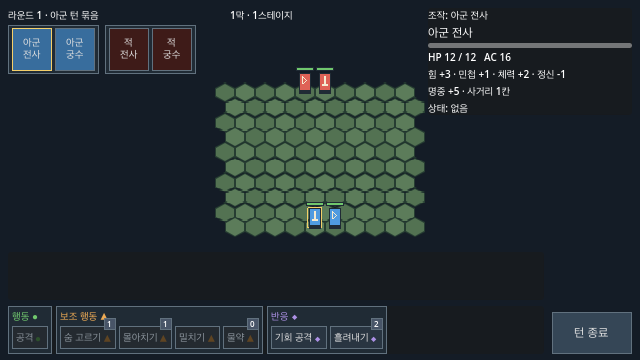
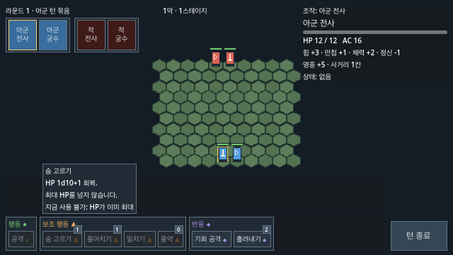

# 전투 화면 정보 정리

[Issue #58](https://github.com/minjunkim-dev/BGLike/issues/58)의 [기획자 코멘트](https://github.com/minjunkim-dev/BGLike/issues/58#issuecomment-6100264025)와 [사용자 구현 결정](https://github.com/minjunkim-dev/BGLike/issues/58#issuecomment-6137867077)을 반영한다. 전투 규칙과 클릭 입력은 유지한다. 상세 표시 규칙은 [전투 시스템 기획서9장](COMBAT_DESIGN.md#9-화면과-조작)을 따른다.

호버 내용은 [Issue #226](https://github.com/minjunkim-dev/BGLike/issues/226)의 개발 결정을 따른다. 2026-10-21 회의 결정으로 [Issue #68](https://github.com/minjunkim-dev/BGLike/issues/68)의 "이름·효과·사용 불가 이유만"을 넓혔다. 기획자가 나중에 바꿀 수 있다. 스킬 버튼은 이름 대신 [#225](https://github.com/minjunkim-dev/BGLike/issues/225)의 아이콘을 보인다. 공격·스킬 호버는 아래 순서로 표시한다.

1. 이름
2. 효과
3. `사거리:` 인접1칸·1~6칸·1~2칸·자신
4. `피해:` 무기 주사위와 장비를 포함한 현재 피해 보너스(공격·기회 공격·충격 화살), 또는 `회복:` 회복량(숨 고르기·물약)
5. `판정:` 공격 능력치 주사위와 공격 가산, 공격 유형별 방어 능력치, 밀치기의 힘 대결, 흘려내기의 민첩 주사위 +3. 판정이 없으면 `없음`
6. 쓸 수 없을 때만 그 이유

예 (비활성 숨 고르기):

```
숨 고르기
HP 1d10+1 회복.
최대 HP를 넘지 않습니다.
사거리: 자신
회복: 1d10+1
판정: 없음
지금 사용 불가: HP가 이미 최대
```

비용은 버튼 오른쪽 마크로 표시한다. 남은 스킬 횟수와 물약 개수는 숫자 배지로 표시한다. 호버에 비용·횟수·개수와 조작법·기호 설명을 반복하지 않는다.

[#182](https://github.com/minjunkim-dev/BGLike/issues/182)의 회전회오리 효과 설명은 `상하좌우1칸·높이 차이1 이하`를 표시한다. 실제 대상 수는 기존 전투 로그에 표시한다. 새 범위 패널·빈 바닥 시전 입력은 추가하지 않는다.

## 정보의 표시 목적

| 표시 시점 | 정보 | 목적 |
| --- | --- | --- |
| 상시 | 막·스테이지·라운드·턴 묶음, 초상, 조작·진행 유닛, HP 바, 스킬 아이콘·비용 마크·횟수 배지, 턴 종료 | 진행 위치와 조작할 유닛, 가능한 행동을 찾음 |
| 유닛 선택·조회 | 이름, HP, 방어 가산, 능력치 6종 주사위, 공격 가산, 사거리, 상태 | 행동 중인 유닛과 조회 대상을 구분. 초상 조회는 조작 유닛의 자원을 바꾸지 않음 |
| 상세 호버 | 초상의 이니셔티브 계산식, 공격·스킬의 이름·효과·사거리·피해 또는 회복·판정·사용 불가 이유 | 필요한 시점에 효과를 조회. 비활성 버튼과 키보드·컨트롤러 포커스도 조회 가능 |
| 미리보기·선택 대기 | 이동 칸 색·경로·도착 시 공격 대상 테두리, 공격 명중률·판정 조건·실행 불가 이유, 반응 확인 창 | 실행 전에 대상과 결과를 확인. 호버는 동작을 실행하거나 자원을 쓰지 않음 |
| 로그·결과 | 최근3줄의 실제 판정·피해·반응, 승리·패배·보상·재시작 | 실행 결과를 확인. 시작 이니셔티브 계산식은 로그에서 제외 |

`개발 결정`([#261](https://github.com/minjunkim-dev/BGLike/issues/261)): 피해 주사위가 없는 고정 피해의 로그는 주사위 부분을 빼고 고정값만 보인다. 예시는 `아군 궁수 피해: 1 · HP 12`다. 주사위가 있는 피해와 표식 추가 주사위의 로그는 `[주사위] + 고정값 = 합계` 형식 그대로다. [#220](https://github.com/minjunkim-dev/BGLike/issues/220)에서 로그는 전체 수식을 유지하기로 정했다([팝업 문구 규칙](#팝업-문구-규칙)). 표시만 바뀌며 규칙은 그대로다. 기획자가 나중에 바꿀 수 있다.

`개발 결정`([#262](https://github.com/minjunkim-dev/BGLike/issues/262)): 확인 창은 프로젝트 공용 테마 `scenes/ui_theme.tres`를 쓴다. 테마는 Godot 기본 회색 대신 정비 패널의 짙은 배경(`121a22`)과 둥근 모서리3, 전투 패널의 회색 테두리(`61717e`), 12px 글자, 정비 화면의 낮은 버튼 모양과 흰 포커스 테두리를 담는다. 체크박스는 어두운 배경에서 보이도록 테두리 있는 상자를 쓴다. 지금 이 테마를 쓰는 창은 반응 확인 창(기회 공격·흘려내기)과 정비 확인 창(정비 종료 확인·가방 아이템 폐기)이다. 테마는 각 확인 창에 직접 지정한다. 다른 버튼과 패널은 지금 모양을 그대로 쓴다. 기본 포커스, Enter·Esc·닫기 동작과 [#122](https://github.com/minjunkim-dev/BGLike/issues/122)의 포커스 수정은 그대로다. 표시만 바뀐다. 기획자가 나중에 바꿀 수 있다.

턴 순서 바 초상의 상태(현재 묶음·조작 중·조작 대기·턴 종료)는 [전투 시스템 기획서 9-3](COMBAT_DESIGN.md#9-3-영역별-내용)의 초상 상태 표를 따른다([Issue #140](https://github.com/minjunkim-dev/BGLike/issues/140)).

[#180](https://github.com/minjunkim-dev/BGLike/issues/180)의 전투 불능 초상은 즉시 제거한다. 남은 초상은 새 묶음 위치로0.25초 동안 이동한다. 묶음의 빈 배경은 이동하는 초상의 클릭을 가로채지 않는다. 초상 선택과 기존 전투 입력은 유지한다. 턴 시작·효과·자원 갱신을 이동이 끝날 때까지 미루지 않는다. 이동 중 순서 변경은 현재 표시 위치에서 최신 배치로 이어 간다. 스테이지 초기화는 진행 중이거나 예약된 이전 이동을 취소한다. 최초 표시와 전투 불능 없는 일반 소환은 기존 동작을 유지한다.

`개발 결정`([#255](https://github.com/minjunkim-dev/BGLike/issues/255)): 턴 순서 바의 오른쪽 끝과 정보 패널 사이에 1 논리px 회색 구분선을 둔다. 오른쪽에 가린 초상이 남아 있으면 바 끝 24 논리px를 화면 배경색으로 흐리게 한다. 끝까지 스크롤하거나 초상이 넘치지 않으면 흐림을 숨긴다. 흐림은 Godot `ScrollContainer`의 스크롤 힌트(`scroll_hint_mode`)를 쓴다. 흐림과 구분선은 입력을 받지 않는다. 가로 스크롤과 초상 상태 표시 규칙은 그대로다. 넘치는 가로 목록의 끝을 표시하는 흔한 UI 관행을 택했다. 기획자가 나중에 바꿀 수 있다.

자원 제목의 채운/빈 모양은 색 없이도 남은 자원을 구분한다. 자원 제목에는 호버 설명을 표시하지 않는다. 유닛의 자원 최대 개수를 기준으로 채운 마크와 빈 마크를 함께 표시한다. 예를 들어2개 중1개를 쓰면●○다. 전부 쓰면○○다. 자기 턴 시작에는 같은 개수의 마크를 다시 채운다. 현재 게임의 턴 자원 최대 개수는 모두1이다. 실제 캐릭터의 수치와 자원당1개 소비 규칙은 유지한다.

우측 유닛 패널의 이동·턴 자원 줄을 제거한다. 남은 이동 칸 수는 표시하지 않는다. 좌측 동작·이동 설명과 우측 조작 안내를 제거한다. 좌측 공간은 비운다. 조작 방법은 이후 튜토리얼 단계에서 다룬다. 이번 변경에는 튜토리얼을 넣지 않는다.

호버 설명은0.5초 뒤에 HUD의 앞쪽에 표시한다. 키보드·컨트롤러 포커스를 받은 버튼도 같은 설명을 띄우고 흰 테두리를 그린다. 클릭으로 받은 포커스의 설명은 포인터가 떠나면 숨긴다. 스킬 설명은 아래 스킬 패널의 위에 띄운다. 설명 전체를 화면 안에 배치한다. 설명은 포인터 입력을 가로막지 않는다. 포인터가 버튼을 벗어나거나 반응·결과 창이 열리면 설명을 숨긴다. 초상도 같은 표시 방식을 쓴다.

[Issue #166](https://github.com/minjunkim-dev/BGLike/issues/166)의 점프는 공용 보조 행동 버튼으로 고른다. 첫 우클릭에 선택한 경로와 착지 칸을 표시한다. 대상 미리보기에는 이동 비용, 보조 행동1, 출발 시 기회 공격 인원과 착지 시 낙하 피해를 표시한다. 같은 착지 칸을 다시 우클릭하면 실행한다. 필드 좌클릭과 유닛 전환은 점프 미리보기를 취소한다. 조건에 맞지 않는 착지와 취소는 자원을 쓰지 않는다. 호버에는 효과·사거리·판정과 사용 불가 이유를 표시한다. 점프 연출 중에는 턴 종료와 유닛 전환을 잠근다.

[#188](https://github.com/minjunkim-dev/BGLike/issues/188)의 나무 상자는 유닛과 별도인 환경 오브젝트다. 기본 공격을 고른 뒤 상자 몸통을 좌클릭하면 내구도와 현재 무기 피해 범위를 미리 보여 준다. 같은 상자를 다시 누르면 행동1로 자동 명중 공격을 실행한다. 기본 공격 외의 유닛 스킬은 상자에 적용하지 않는다. 행동 없음·기절·사거리/높이 조건을 안내한다. 우클릭·동작 전환·전투 초기화는 상자 미리보기를 지운다. 선택 테두리와 HP 막대, 피해·파괴 로그로 결과를 알린다. 파괴 즉시 물체 표시를 지우고 열린 바닥을 기존 이동 미리보기에 반영한다. 기존 높이·물·장판 표시는 유지한다. 실제1막1스테이지에는(2,1)에 상자1개를 배치한다. 상자 큐브는 임시 표시이며 최종 자산 승인이 아니다. 수치와 배치 근거는 [게임 구조6-8](GAME_STRUCTURE.md#6-8-환경-오브젝트와-나무-상자)을 따른다.

[#189](https://github.com/minjunkim-dev/BGLike/issues/189)의 바위는 같은 몸통 선택·재클릭 확정·취소 흐름을 쓴다. 회색 돌 모양과 선택 테두리로 상자와 구분한다. 바위에는 상자 내구도 막대를 그리지 않는다. 기존 대상 안내에 행동1·주사위 없음·방향·예상 경로 길이·정지/소멸/파괴 사유를 표시한다. 충돌할 유닛을 나열하고 아군 피해4를 명시한다. 주황 화살표는 같은 실제 충돌 계산의 굴림 경로다. 붉은 원은 충돌과 정지 위치를 표시한다. 다른 동작·우클릭·초기화는 이 표시도 지운다. 행동 없음/기절/사거리·높이 사유는 확정 전에 다시 안내한다. 로그는 이동·대상당1회 충돌피해·정지·파괴를 알린다. 최종 정지·파괴 로그에도 대상별 충돌피해를 요약한다. 이동·장판 로그가 피해 안내를 밀어내지 않게 한다. 실제 첫 전투에는 바위(4,1), 물(5,1), 낭떠러지(6,1), 높이1/2 대표배치를 둔다. 임시 표시이며 최종 자산 승인은 아니다.

`개발 결정`([#236](https://github.com/minjunkim-dev/BGLike/issues/236)): 강제 이동 미리보기에 착지 결과를 보인다. 밀치기 대상 안내는 밀려날 칸 뒤 같은 줄에 `낙사`, `낙하 피해 N`, 화상인 대상이 물에 떨어지면 `물: 화상 해제`를 붙인다. 결과가 없으면 칸만 보인다. 바위 안내의 충돌 대상에는 그 대상이 밀려서 받는 `낙사`나 `낙하 피해 N`을 붙인다. 값은 실제 처리와 같은 낙하 계산과 바위 경로 계산을 쓴다. 점프 미리보기의 낙하 안내와 같은 이유다. 장판 부여는 진입 기록과 중첩 상한에 따라 달라서 표시하지 않는다([#207](https://github.com/minjunkim-dev/BGLike/issues/207) 뒤 다시 본다). 대안인 바닥 위험 색 칸은 이동 미리보기 색과 겹쳐 문구 안내를 먼저 택했다. 규칙은 바꾸지 않는다. 기획자가 나중에 바꿀 수 있다.

`개발 결정`([#221](https://github.com/minjunkim-dev/BGLike/issues/221)): 적 턴 중 Space를 누르고 있는 동안 적 행동 간 대기와 이동·공격 연출을4배로 빠르게 보여 준다. 손을 떼면 보통 속도로 돌아온다. 적 턴의 첫 이동·공격 연출 전에0.35초 멈춰 행동할 적을 보여 준다. 이동·공격 연출 뒤에도0.35초 기다린다. 이동도 공격도 하지 않은 적 행동 뒤에는 기다리지 않는다. 반응 확인 창이 열리면 가속을 멈추고 선택을 기다린다. 적 턴에는 라운드 표시에 `Space: 빠르게`를 붙인다. 전투 중 Space는 포커스된 버튼을 누르지 않는다. 규칙과 판정은 바꾸지 않는 표시 속도 조절이다. 당시 설정 화면이 없어서 누르고 있는 동안 가속을 택했다([#209](https://github.com/minjunkim-dev/BGLike/issues/209)). 대안인 설정의 적 턴 속도 옵션은 설정 화면이 생긴 뒤 추가할 수 있다. 기획자가 나중에 바꿀 수 있다.

`개발 결정`([#248](https://github.com/minjunkim-dev/BGLike/issues/248)): 아군 턴에 숫자 키1~9는 스킬 바에 보이는 버튼을 왼쪽부터 순서대로 고른다. 반응 버튼도 순서에 들어간다. 고른 버튼에 포커스를 주고 상세 설명을 띄운다. 활성 버튼은 클릭과 같이 선택한다. 비활성 버튼은 포커스와 사용 불가 이유만 보이고 선택하지 않는다. 포커스가 스킬 바에 있으면 좌우 방향키·컨트롤러 D-pad로 버튼 사이를 옮긴다. 끝에서는 멈춘다. 숫자 키는 자판 배열과 관계없이 윗줄 숫자 자리를 쓴다. 키패드 숫자는 쓰지 않는다. Enter·컨트롤러 확인(A) 버튼은 포커스된 활성 버튼을 선택한다. 컨트롤러는 숫자 키가 없어서 포커스가 없을 때 좌우 방향키·D-pad가 첫 버튼에 포커스만 준다. 적 턴, 연출 중, 반응 확인 창, 결과 창, 정비 화면에서는 숫자 키와 이 진입 입력이 스킬을 고르지 않는다. Tab 아군 전환, Space 적 턴 가속과 포커스 버튼 누름 방지, Esc 반응 넘기기는 그대로다. 턴제 전술 게임의 흔한 방식을 택했다. 키 변경 설정은 범위 밖이다([#209](https://github.com/minjunkim-dev/BGLike/issues/209) 4번). 기획자가 나중에 바꿀 수 있다.

## 팝업 문구 규칙

**결정됨, 구현됨.** 2026-10-22 [#220 기획자 답](https://github.com/minjunkim-dev/BGLike/issues/220#issuecomment-6331002448) 4번(개정 후 채택)이다. [전투 팝업 문구 정리](https://github.com/minjunkim-dev/BGLike/issues/289)에서 구현했다.

팝업은 결과 중심이고, 로그는 전체 수식을 유지한다. 팝업에 판정 수식을 넣지 않는다. 팝업은 필드 위, 동작과 관련된 유닛 머리 위에 뜬다. 위치와 쌓이는 방식은 지금 그대로이고 바꾸는 것은 문구다.

| 상황 | 팝업 |
| --- | --- |
| 공격 명중 | 피해 합계만(예: `5`). 앞에 `-`를 붙이지 않음 |
| 공격 빗나감 | `빗나감`. 능력치 주사위의 최솟값·최댓값에 별도 팝업을 붙이지 않음 |
| 치명타 | 현재 비활성. 팝업 없음 |
| 공격자 머리 위 `공격 N` | **없앰.** 유리/불리의 공격 주사위 두 개 표시도 이 팝업에 붙어 있어 함께 사라짐. 유리/불리는 명중률 미리보기와 로그에서 확인 |
| 밀치기 | `밀치기 성공` / `밀치기 실패` |
| 독 제거 성공 | 이름만, 수치 없음(예: `독 제거`) |
| 상태 효과 | 효과 이름. 독·화상 틱 피해는 `독 1`, `화상 3`처럼 원인 이름 + 피해 수치 |
| 흘려내기 성공 | `흘려내기`(수치 없음) |
| 회복 | 수치만, **초록색.** 앞의 `+`도 없앰 |

- 이로운 수치와 해로운 수치의 색은 앞으로 하나씩 정한다. 지금 확정한 것은 회복=초록뿐이다.
- 색만으로 구분하면 색약 플레이어가 회복과 피해를 가리기 어려울 수 있다. 색 규칙을 정할 때 함께 고려한다.
- 로그는 지금처럼 전체 수식을 유지한다(예: `아군 전사 공격(일반): 힘 d20 [11] +0 = 11 / 힘 d10 10 +0 = 10 · 명중`).
- 나중으로 미룬 것: 주사위 시스템의 정리와 명칭(자동 실패 등)은 기획자가 직접 정립한다. 이로운/해로운 수치의 색 전체 규칙.

`개발 결정`([#289](https://github.com/minjunkim-dev/BGLike/issues/289)): 표에 없는 경우는 같은 원칙으로 맞췄다. 기획자가 나중에 바꿀 수 있다.

- 낙하 피해도 피해 합계만 보인다. 과부하 자해는 틱과 같이 `과부하 2`다.
- 충격 화살 명중은 효과 이름 `기절`이다. 독 제거 실패는 따로 팝업을 띄우지 않고, 뒤따르는 `독 1` 틱이 효과 이름을 보인다.
- 흘려내기 실패는 팝업이 없고 피해 팝업만 뜬다.
- 밀치기 결과는 대상 위에 뜬다. 기절한 대상·아군을 대결 없이 밀 때도 `밀치기 성공`이다.
- 표에 없는 `끌어옴`·`만능팔 저항`, `기절 면역`, `물: 화상 해제`, `낙사`는 이미 결과만 보이므로 그대로 둔다.
- 회복 초록색은 HP 막대와 같은 색이다.

## 설정 화면

**결정됨, 구현됨.** [#209 기획자 답](https://github.com/minjunkim-dev/BGLike/issues/209#issuecomment-6330756631) 4번을 [#285](https://github.com/minjunkim-dev/BGLike/issues/285)에서 구현했다. 마스터 음량 슬라이더와 창 모드(`전체 화면` 칸, 끄면 창)만 있다. 음소거 버튼, 키 변경, 언어 선택은 없다.

`개발 결정`([#285](https://github.com/minjunkim-dev/BGLike/issues/285)): 기획자가 나중에 바꿀 수 있다.

- 음량은 0–100%이고 한 단계는 10%다. 처음 값은 80%다. 첫 실행부터 최대 음량으로 놀라지 않게 조금 낮췄다. 방향키·D-pad 좌우 한 번이 한 단계다. 0은 Master 버스를 끄는 음소거이며 값 자리에 `음소거`를 보인다.
- 음량은 Master 버스의 선형 크기(`AudioServer.set_bus_volume_linear`)다. 50%는 약 -6dB다.
- 처음 창 모드는 창이다. 전체 화면은 `DisplayServer.WINDOW_MODE_FULLSCREEN`(경계 없는 전체 화면)이다. 창으로 돌아갈 때 최대화한 창은 건드리지 않는다.
- 값을 바꾸는 즉시 설정 파일(`user://settings.cfg`, [ADR 0003](adr/0003-save-files.md))에 쓰고 적용한다. `저장`·`취소` 버튼은 없다. 파일을 쓰지 못하면 경고를 남기고 바꾼 값은 그대로 적용한다. 그 값은 다음 실행에 남지 않는다. 게임을 시작할 때 타이틀 화면이 저장한 값을 적용한다. 새 게임과 졸업은 게임 저장만 지운다.
- 설정 화면은 `scenes/settings.tscn`(`SettingsScreen`) 하나다. 타이틀이 자식으로 두고 `open()`으로 연다. 닫히면 `closed`를 보낸다. 일시정지 메뉴([#286](https://github.com/minjunkim-dev/BGLike/issues/286))도 같은 장면을 쓴다.
- 조작: 열면 음량 슬라이더에 포커스가 간다. 위아래 방향키·D-pad로 음량 → `전체 화면` → `뒤로`를 오가고 끝에서 멈춘다. 포커스가 설정 화면 밖으로 나가지 않는다. Enter·컨트롤러 A가 `전체 화면`을 켜고 끄며 `뒤로`를 누른다. Esc도 닫는다.

자동 검사: `tests/title_test.gd`가 타이틀에서 키보드·컨트롤러로 설정을 열고 바꾸고 닫는 흐름, 즉시 쓰기와 Master 버스 적용, 새 게임 뒤 유지, 타이틀을 새로 열 때의 적용을 검사한다. 1280×720, 1920×1080, 1440×900 실제 창(논리 640×360, 640×360, 640×400)과 ADR 0002의 나머지 레이아웃 창에서 설정 화면이 화면 안에 겹치지 않고 들어가는지 검사한다. `tests/save_test.gd`는 처음 값, 손으로 고친 음량의 보정, 저장 삭제 뒤 유지를 검사한다. 실제 전체 화면 전환은 headless에서 일어나지 않아 사람의 확인으로 남긴다.

## 일시정지 메뉴

**결정됨, 구현됨.** [#209 기획자 답](https://github.com/minjunkim-dev/BGLike/issues/209#issuecomment-6330756631) 3번과 [3번 정정](https://github.com/minjunkim-dev/BGLike/issues/209#issuecomment-6331003204), [#220 기획자 답](https://github.com/minjunkim-dev/BGLike/issues/220#issuecomment-6331002448) 3번을 [#286](https://github.com/minjunkim-dev/BGLike/issues/286)에서 구현했다. 버튼은 `계속`, `설정`, `도움말`, `전투 포기`(전투 중에만), `타이틀로`, `종료`다. `설정`·`도움말`은 타이틀과 같은 장면(`SettingsScreen`, `HelpScreen`)이다. `전투 포기`의 효과는 [게임 구조 2-5](GAME_STRUCTURE.md#전투-포기)를 따른다.

`개발 결정`([#286](https://github.com/minjunkim-dev/BGLike/issues/286)): 기획자가 나중에 바꿀 수 있다.

- 여는 키: `Esc`와 컨트롤러 Start. 입력 맵의 `pause` 동작이다. 같은 키로 닫는다. 컨트롤러 B는 지금처럼 `ui_cancel`에 넣지 않았다.
- 열 수 있는 순간: 전투 화면이 떠 있는 동안 언제나 연다. 아군 턴, 아군·적의 이동·공격 연출 중, 적 턴 진행 중, 승리·패배 결과 화면, 보상 확인·정비 화면이다. 결과·보상·정비 화면에서는 `전투 포기`를 숨긴다.
- 열 수 없는 순간: 반응 확인 창과 정비 확인 창(정비 종료 확인·가방 아이템 폐기)이 떠 있을 때다. 그 창이 키를 먼저 받는다. `Esc`는 지금처럼 반응을 넘기거나 그 창을 닫는다. 결정을 기다리는 창이라 그동안 흐르는 것이 없다.
- 멈춤: 메뉴를 여는 동안 게임 트리를 멈춘다(`SceneTree.paused`). 전투 입력(클릭·숫자 키·Tab·Space), 이동·공격 연출, 적 행동 사이의 기다림 타이머가 모두 멈춘다. 닫으면 멈춘 자리에서 이어 간다. 메뉴·설정·도움말·확인 창만 움직인다.
- 조작: 열면 `계속`에 포커스가 간다. 위아래 방향키·D-pad와 Tab으로 보이는 버튼 사이를 옮기고 끝에서 멈춘다. 포커스가 멈춘 HUD로 나가지 않는다. Enter·컨트롤러 A로 누른다. `계속`이나 `Esc`로 닫으면 열기 전의 포커스로 돌아간다. 설정·도움말을 닫으면 메뉴의 그 버튼으로 돌아간다.
- 확인 창은 공용 테마(`scenes/ui_theme.tres`)를 쓴다. 정비 확인 창처럼 연속 Enter로 확정하지 않게 `취소`가 기본 선택이다. `Esc`는 확인 창만 닫고 메뉴로 돌아간다.

| 버튼 | 확인 창 제목 | 문구 | 확인 버튼 |
|---|---|---|---|
| `전투 포기` | 전투 포기 | 전투를 포기하면 패배로 처리되고, 이 막을 처음부터 다시 합니다. | `포기` |
| `타이틀로` | 타이틀로 | 타이틀 화면으로 돌아가시겠습니까? | `타이틀로` |
| `종료` | 종료 | 게임을 종료하시겠습니까? | `종료` |

- `타이틀로`·`종료` 문구에는 자동 저장이 있으므로 "진행이 저장되지 않습니다" 안내를 넣지 않는다.
- `전투 포기`를 확정하면 메뉴를 닫고 남은 아군을 모두 전투 불능으로 만든다. 전멸과 같은 상태라 그 뒤는 전멸과 같은 길이다. 패배 결과 화면의 `이 막 다시 시작`이 현재 막의 1스테이지로 돌아가며 HP·전투 불능·스킬 횟수를 회복하고 장비·공용 가방·물약을 유지한다. 전투 기록에 `전투 포기`를 남긴다. 적 턴 중에 포기하면 진행 중인 적 행동이 끝날 때까지 결과 버튼을 잠근다. 전멸과 같다.
- 포기한 순간의 저장: 자동 저장이 켜져 있으면([#281](https://github.com/minjunkim-dev/BGLike/issues/281), `GameSave.autosave`) 포기를 확정한 즉시 전멸 상태의 전투 전체를 저장한다. 적 턴·연출 중에도 기다리지 않는다. 그때 진행 중이던 적 행동이 끝나도 적 턴 시작 상태로 덮어쓰지 않는다. 그래서 강제 종료로 포기를 되돌릴 수 없고, 이어하기는 패배 결과 화면에서 시작한다.

자동 검사: `tests/pause_test.gd`가 실제 게임 장면에서 `Esc`·Start로 열고 닫기, 메뉴가 열린 동안 숫자 키·Tab·클릭 무시와 적 턴 정지(유닛 위치·이동 상태·HP·턴), 키보드·D-pad 포커스 이동, 메뉴에서 연 설정·도움말, 세 확인 창의 문구·기본 선택·`Esc`, 반응·정비 확인 창의 `Esc`·Start, 2-2에서 포기한 뒤 2-1 재시작과 자원 처리, 포기한 순간의 저장, 적 턴 중 포기와 그 저장이 남은 적 행동에 덮이지 않음, 그 저장의 복원(패배 결과), 결과·정비 화면의 버튼, `타이틀로` 전환을 검사한다. 1280×720, 1920×1080, 1440×900 실제 창(논리 640×360, 640×360, 640×400)과 ADR 0002의 나머지 레이아웃 창에서 메뉴·설정·도움말·확인 창이 화면 안에 겹치지 않고 들어가는지 검사한다.

## #58 적용 화면 기록

#58 당시 실제 Godot4.7.2의 Metal 렌더링을 캡처했다. 기본 화면과 비활성 스킬의 호버를 보여 준다. 캡처는 고정한 턴 상태에서 만들었다. 현재 맵 투영은 #170의 아이소메트릭 교정과 [게임 구조6장](GAME_STRUCTURE.md#6-사각-높이-격자)을 따른다. #178의 화상·독·물과 #180의 초상 합류 표시는 각 검증 기록에서 확인한다.





## 검증과 후속 확인

비활성 창 캡처와 게임 진행 보존 검사는 [캡처 검증](CAPTURE_VERIFICATION.md)을 따른다.

[Issue #151](https://github.com/minjunkim-dev/BGLike/issues/151)의 연속 공격 팝업은 다른 유닛의 팝업과 HUD 영역을 함께 피한다. 위로 뜨는 전체 연출 경로를 확보한다. 유닛과 가까운 빈 위치를 사용한다. 표시 내용, 피해 판정과 0.8초의 표시 시간은 유지한다.

`개발 결정`([#260](https://github.com/minjunkim-dev/BGLike/issues/260)): 유닛이 붐벼도 팝업을 대상 가까이에 둔다. 기준 자리는 대상 상태 줄이다. 같은 대상의 이전 팝업이 떠 있으면 새 팝업은 그 팝업보다 위에 둔다. 그래서 같은 대상의 팝업은 순서대로 위로 쌓인다. 같은 대상의 팝업은 같은 속도로 떠오르므로 서로의 상승 경로는 비우지 않는다. 찾는 순서는 다음과 같다. 먼저 기준 자리 40 논리px 안에서 모든 유닛의 새 기절·표식 자리를 비워 두고 찾는다. 없으면 같은 범위에서 다른 유닛의 상태 자리 예약을 풀고 찾는다. 그래도 없으면 기준 자리 위쪽 띠(가로 ±40 논리px)로 쌓는다. 위도 막히면 순서를 포기하고 대상 기준점 40 논리px 안에서 찾는다. 이 단계까지 모두 막힌 경우에만 화면 전체에서 대상에 가장 가까운 빈 자리를 쓴다. 팝업끼리의 겹침, 화면 밖 이탈, HUD 침범, 지금 보이는 상태 글자와 대상 자신의 상태 자리는 모든 단계에서 피한다. 표시 방식만 바꾸며 규칙은 그대로다. 기획자가 나중에 바꿀 수 있다.

[#321](https://github.com/minjunkim-dev/BGLike/issues/321)에서 d20의 치명타·자동 실패를 비활성화했다. #222의 금색 치명타 팝업도 생성하지 않는다. 재도입은 #322의 기획 결정 이후다. 공격자는 능력치 주사위를 굴리고, 광역 공통 공격 로그는 한 번만 표시한 뒤 각 대상의 방어를 기록한다.

[#178](https://github.com/minjunkim-dev/BGLike/issues/178)의 화상·독은 필드의 기존 상태 줄과 우측 유닛 정보에 이름·중첩 수를 표시한다. 예시는 `화상2 독1`이다. 기절·표식과 함께 표시한다. 로그와 팝업은 틱별 피해·자연 주사위의 독 제거·물의 화상 해제를 알린다. 자연 주사위의 독 제거 팝업은 성공할 때만 뜬다. 팝업은 현재 화상·독 상태 줄과 이후 생길 기절·표식의 영역을 피한다. 유닛이 붐벼 근처에 자리가 없으면 [#260](https://github.com/minjunkim-dev/BGLike/issues/260)에 따라 다른 유닛의 이후 기절·표식 자리 예약은 푼다. 새 표시 패널은 만들지 않는다. 물은 #189에서 첫 전투(5,1)에 배치했고 #195에서9전투 모두의 실제 물길·도트 지형으로 확장했다. 현재 배치는 TERRAIN_MAPS.md와 스테이지 자원을 따른다. 새 효과 공급원과 그에 맞춘 재배치는 #207·#208의 기획 답을 기다린다.

자동 HUD 검사는 기본 상태, 유닛 조회, 이동·공격 미리보기, 반응·결과 창과 실제 포인터 입력을 확인한다. 이동 첫 우클릭은 미리보기다. 같은 칸의 두 번째 우클릭은 이동한다. 공격과 자기 대상 스킬의 두 번 클릭도 유지한다. 제거한 설명 패널의 빈 자리는 지도 입력을 막지 않는다. 숫자 키·방향키·D-pad·Enter·컨트롤러 확인 입력과 잠긴 화면의 숫자 키 무시도 실제 입력 이벤트로 검사한다.

[해상도 ADR](adr/0002-resolution.md)의 1280×720, 1920×1080, 16:10 1440×900·2560×1600과 넓은 비율 창(2560×1080), 비정수 배율 창(1366×768)에서 화면 영역과 버튼 배지의 겹침을 검사한다. 활성·비활성 버튼 모두 실제 호버로 툴팁이 나타나는지 검사한다. 1280×720, 1920×1080, 1440×900에서 모든 아군 스킬 버튼의 포커스 설명이 화면과 HUD 안, 스킬 패널 위에 있는지 검사한다. 네이티브 실행은 기본 상태, 조회, 이동·공격 미리보기, 반응 창,2배 창의 호버를 별도로 캡처한다.

기획자 코멘트를 채택안으로 구현했다. 새 결과물의 기획자 재검수와 사람 플레이는 완료했다고 기록하지 않는다. 사람의 최종 가독성과 조작감 검수는 사용자의 결정대로 후속으로 남긴다.

1. Godot 편집기에서 메인 장면을 실행한다.
2. [해상도 ADR](adr/0002-resolution.md#결정)의 검증 해상도에서 초상·HP·자원 마크·버튼의 가독성을 확인한다.
3. 활성·비활성 스킬과 초상에 마우스를 올린다. 숫자 키나 방향키·컨트롤러로 스킬 바에 들어가 포커스를 옮기고 Enter·확인 버튼으로 고른다. 아이콘 구분과 이름·효과·사거리·피해 또는 회복·판정·사용 불가 이유의 잘림을 확인한다. 자원 제목에 호버가 없는지 확인한다. 버튼의 비용 마크와 횟수 배지를 확인한다.
4. 유닛 조회와 이동·공격 미리보기를 확인한다. 클릭 실행 방식이 유지되는지 확인한다.
5. 반응 창에서 사용·넘기기를 고른다. 로그와 결과를 확인한다.
