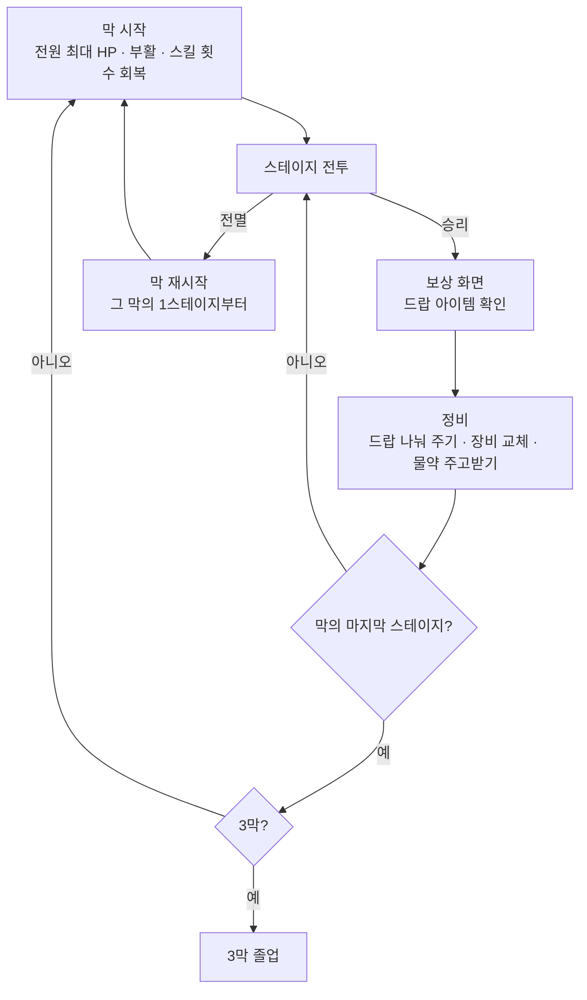

# 게임 구조 기획서

> M2에서 정한 게임 전체 구조입니다. 전투 밖의 진행, 막 단위 자원, 아이템, 격자 변경을 다룹니다.
>
> - 기준일: 2026-10-18 ([Issue #136](https://github.com/minjunkim-dev/BGLike/issues/136) 사각 높이 격자 반영, 2026-10-07 기획 논의, Issue #61 아이템 수치 결정, [Issue #99](https://github.com/minjunkim-dev/BGLike/issues/99) 막별 적 강화 제거 반영)
> - 관련 문서: [기획 현황](DESIGN_STATUS.md) · [기획 로드맵](ROADMAP.md) · [전투 시스템 기획서](COMBAT_DESIGN.md)
> - 이 문서와 전투 시스템 기획서가 다르면 이 문서가 기준입니다. 바뀌는 전투 규칙은 [7장](#7-전투-시스템-기획서에서-바뀌는-규칙)에 모았습니다.
> - 표시: ✅ 정해짐 · ❓ 정해야 함

---

## 목차

1. [게임 목표](#1-게임-목표)
2. [진행 구조](#2-진행-구조)
3. [막 단위 자원](#3-막-단위-자원)
4. [아이템](#4-아이템)
5. [캐릭터](#5-캐릭터)
6. [사각 높이 격자](#6-사각-높이-격자)
7. [전투 시스템 기획서에서 바뀌는 규칙](#7-전투-시스템-기획서에서-바뀌는-규칙)
8. [정해야 할 것](#8-정해야-할-것)

---

## 1. 게임 목표

**캐릭터를 육성하면서 3막의 모든 스테이지를 깨는 것(3막 졸업)이 목표입니다.** ✅

- 육성 수단은 **아이템뿐**입니다. 레벨업, 능력치 성장, 재화는 두지 않습니다.
- 이야기와 세계관은 이 구조 위에 나중에 얹습니다 ([로드맵 M7](ROADMAP.md#10-m7-첫-플레이-가능-구간-기획)).

---

## 2. 진행 구조

### 2-1. 막과 스테이지 ✅

| 항목 | 결정 |
|---|---|
| 구성 | 3막 × 막당 3스테이지 = **전투 9번** |
| 순서 | 1-1 → 1-2 → 1-3 → 2-1 → … → 3-3. 스테이지를 고르지 않음 |
| 스테이지 하나 | 몬스터와 한 번 조우하는 맵 하나 |
| 스테이지 승리 | 몬스터를 **모두** 전투 불능으로 만듦 |
| 스테이지 패배 | 아군 **전원**이 전투 불능 |
| 레벨 디자인 | 9개 맵을 따로 디자인 ([로드맵 M5](ROADMAP.md#8-m5-콘텐츠-기획)) |

### 2-2. 흐름 ✅

- 전멸하면 **그 막의 1스테이지부터** 다시 합니다.
- 막을 다시 시작해도 **그 막에서 얻은 장비는 유지**합니다.
- 물약은 일회성 소모품입니다. 쓴 물약은 막을 다시 시작해도 돌아오지 않고, 얻은 물약은 남습니다 (3-1).

### 2-3. 막별 적 강화 ✅

**막별 적 강화는 없습니다** (2026-10-14, [Issue #99](https://github.com/minjunkim-dev/BGLike/issues/99)). 같은 몬스터는 모든 막에서 같은 수치입니다. 막별 난이도는 몬스터의 수와 종류로 조절합니다 ([스테이지 배치](stages/README.md)). 장비로 강해진 캐릭터가 같은 몬스터를 더 쉽게 잡는 경험을 주기 위해서입니다.

> 이전 결정(2026-10-10)은 2·3막에 적의 명중·AC +2/+5, 최대 HP ×1.5/×2, 피해 +2/+4를 더했습니다. [Issue #107](https://github.com/minjunkim-dev/BGLike/issues/107)에서 이 강화를 제거했습니다. 4-4의 막별 장비 수치는 유지합니다. 장비 수치 재검토는 후속 기획입니다 ❓.

---

## 3. 막 단위 자원

### 3-1. 자원표 ✅

| 자원 | 같은 막의 스테이지 사이 | 막 시작 | 막 재시작 (전멸) |
|---|---|---|---|
| HP | **이어짐** (회복 없음) | 전원 최대 HP | 전원 최대 HP |
| 전투 불능 | **이어짐**. 남은 스테이지에 나오지 않음 | 부활 | 부활 |
| 스킬 사용 횟수 | **이어짐** | 회복 | 회복 |
| 장비 | 유지 | 유지 | 유지 |
| 물약 | 유지 | 유지 | 지금 가진 개수 그대로 |

- 스킬 사용 횟수의 **값은 지금 그대로**입니다(숨 고르기 1, 흘려내기 2 등). 단위만 전투당에서 막당으로 바뀝니다. 횟수 조정은 스킬 디자인 때 정합니다 (5장).
- 물약은 **몬스터 드랍으로만** 얻습니다. 시작할 때는 없습니다.
- 물약은 **캐릭터별로** 가집니다. 전투에서는 자기 물약만 씁니다. 스테이지 사이 정비 단계에서 캐릭터끼리 주고받을 수 있습니다 (4-3).

### 3-2. 막 안에서 전투 불능 ✅

전투 불능이 된 캐릭터는 그 막의 남은 스테이지에 나오지 않습니다. 남은 캐릭터만으로 싸우고, 다음 막 시작에 최대 HP로 부활합니다.

> 파티가 2명이라 1스테이지에서 한 명이 쓰러지면 남은 2스테이지를 혼자 싸웁니다. 난이도는 레벨 디자인과 밸런스(M5, M6)에서 확인합니다.

---

## 4. 아이템

### 4-1. 장비 ✅

| 항목 | 결정 |
|---|---|
| 장착 칸 | 캐릭터마다 **무기 1, 방어구 1** |
| 무작위 수치 | 드랍될 때 성능 수치가 무작위로 정해짐. 같은 아이템도 수치가 달라 다시 얻을 이유가 됨 |
| 교체 시점 | **스테이지 사이마다** 정비 단계에서 (보상 화면 뒤) |
| 막 재시작 | 그 막에서 얻은 장비 유지 |

### 4-2. 드랍 ✅

| 항목 | 결정 |
|---|---|
| 보장 | 스테이지를 깨면 아이템 **1개 보장** |
| 추가 | 몬스터마다 확률로 추가 드랍 |
| 드랍 대상 | 장비(무기, 방어구)와 물약 |

보장 드랍이 있어 운이 나빠도 9전투에서 최소 9개를 얻습니다.

### 4-3. 정비 단계 ✅

스테이지 승리 뒤 보상 화면 다음에 오는 단계입니다.

| 항목 | 결정 |
|---|---|
| 드랍 나눠 주기 | 드랍된 아이템(장비, 물약)을 플레이어가 캐릭터에게 **나눠 줌** |
| 받지 않은 아이템 | 받지 않아도 됨. 정비 단계를 끝내면 **버려짐** |
| 장비 교체 | 캐릭터마다 무기·방어구를 바꿈. **교체로 빠진 장비는 버려짐**. 장착하지 않은 장비는 들고 다니지 않음 |
| 물약 주고받기 | 캐릭터끼리 물약을 넘김. **전투 불능인 캐릭터의 물약도** 다른 캐릭터에게 넘길 수 있음 |
| 물약 한도 | 캐릭터당 **3개**. 한도를 넘게 줄 수 없음 |
| 전투 불능인 캐릭터 | 아이템(장비, 물약)을 **받을 수 있음**. 다음 막에 부활하면 그 장비로 나옴 |

> 지금은 장비를 장착 칸에만 둡니다. 이후에는 RPG답게 얻은 아이템을 모두 보관하는 **전체 루팅**(인벤토리)으로 넓힐 계획입니다. 개발은 장비 보관을 나중에 인벤토리로 바꾸기 쉽게 만듭니다.

### 4-4. 아이템 종류와 수치 ✅

> 2-3의 막별 적 강화를 없앴으므로([Issue #99](https://github.com/minjunkim-dev/BGLike/issues/99)) 아래 막별 수치는 다시 볼 대상입니다 ❓. 다시 정하기 전까지는 이 값을 씁니다.

아이템은 **무기, 방어구, 회복 물약** 3종입니다. 장비는 두 수치를 가지며, 드랍될 때 각 수치를 **따로** 굴립니다. 범위는 아이템을 **얻은 막**의 범위를 씁니다.

| 아이템 | 수치 | 1막 | 2막 | 3막 |
|---|---|---|---|---|
| 무기 | 명중 | +1~2 | +3~4 | +5~7 |
| | 피해 | +1~3 | +4~6 | +7~10 |
| 방어구 | AC | +1~2 | +3~4 | +5~7 |
| | 최대 HP | +2~4 | +5~8 | +9~14 |
| 회복 물약 | 회복 | 2d4+2 | 2d4+2 | 2d4+2 |

- **막끼리 범위가 겹치지 않습니다.** 낮은 막에서 높은 막보다 좋은 수치가 나오지 않고, 높은 막에서 낮은 막의 수치가 나오지 않습니다.
- 같은 막 안에서도 두 수치가 따로 정해지므로 명중이 높은 무기와 피해가 높은 무기를 비교할 이유가 생깁니다.
- 장비 수치는 능력치를 바꾸지 않고 명중·피해·AC·최대 HP에 더합니다.

### 4-5. 드랍 확률 ✅

| 항목 | 결정 |
|---|---|
| 추첨 비중 | 무기 **2**, 방어구 **2**, 회복 물약 **3** |
| 몬스터당 추가 드랍 | **35%** |
| 보장 드랍 풀 | 추가 드랍과 **같은 풀** |

> 스테이지마다 적이 2명이면 9전투에서 평균 약 15개(장비 약 9, 물약 약 7)를 얻습니다. 1막 3전투에서 물약을 하나도 못 얻을 확률은 약 7%입니다.

> 새 배치([Issue #99](https://github.com/minjunkim-dev/BGLike/issues/99))에서는 [새끼 거미](monsters/spiderling.md)가 추가 드랍을 하지 않고, 몬스터가 1마리인 스테이지가 있습니다. 위 기대 개수와 확률은 스테이지마다 적이 2명이던 시험 배치 기준입니다. 새 배치의 기대값 재계산은 후속 기획입니다 ❓. 보장1개·추첨 비중2/2/3·추가 확률35%는 유지합니다.

### 4-6. 최대 HP가 바뀔 때 현재 HP ✅

방어구를 장착·교체·해제해 최대 HP가 바뀌면 **잃은 HP를 유지**합니다.

- 현재 HP는 새 최대 HP에서 보존한 잃은 HP를 뺀 값입니다. 예: HP 8/15에서 최대 HP +5 방어구를 끼면 13/20.
- 최대 HP가 내려가면 현재 HP도 같은 만큼 내려갑니다. 최소 1입니다.
- 최소 1로 제한해도 보정 전의 잃은 HP를 계속 보존합니다. 예: HP 1/17에서 최대 HP +5 방어구를 해제하면 1/12입니다. 다시 장착해도 1/17입니다.
- 장비를 바꿔 끼워 HP를 회복할 수 없습니다.
- 전투 불능 캐릭터는 방어구를 받아도 HP 0 그대로입니다. 아이템 수령은 부활·회복이 아닙니다 (4-3).

### 4-7. 보류한 것 ❓

| 항목 | 언제 |
|---|---|
| 등급 | M5 몬스터 기획과 함께 다시 봄. 막별 수치 상승이 등급 역할을 일부 대신함 |
| 직업 제한 | 직업과 스킬을 늘릴 때. 지금은 모든 캐릭터가 같은 무기·방어구를 씀 |
| 전체 루팅(인벤토리)으로 넓히는 시기와 보관 한도 | 미정 |

---

## 5. 캐릭터

| 항목 | 결정 |
|---|---|
| 파티 | 지금 그대로 전사 1, 궁수 1 ✅ |
| 역할 | **전사 = 탱커, 궁수 = 딜러** ✅ |
| 스킬 | 직업마다 스킬을 늘릴 수 있음. 스킬 디자인은 기획 담당이 정함 ❓ |

> 적 AI가 "사거리 안에서 HP가 낮은 대상"을 노리므로([전투 시스템 기획서 7장](COMBAT_DESIGN.md#7-적-ai)), 지금 규칙으로는 전사가 공격을 끌어 줄 수 없습니다. 탱커 스킬(도발 등)이나 적 AI 조준 규칙은 스킬 디자인과 함께 정합니다.

---

## 6. 사각 높이 격자

2026-10-18 회의와 [Issue #136](https://github.com/minjunkim-dev/BGLike/issues/136)의 [기획자 답변](https://github.com/minjunkim-dev/BGLike/issues/136#issuecomment-6250732550)으로 2026-10-07의 헥사 타일 결정을 대체합니다. 헥사 시안은 [대체된 기록](HEX_GRID_PREVIEW.md)으로 남깁니다.

### 6-1. 타일과 맵

| 항목 | 결정 |
|---|---|
| 타일 | 높이가 있는 사각 타일 ✅ |
| 높이 비율 | 높이 1칸은 바닥 한 변의 절반 ✅ |
| 타일 픽셀 크기 | ❓ 640×360 기준 시안을 개발이 렌더링하고 기획이 승인. [Issue #125](https://github.com/minjunkim-dev/BGLike/issues/125)의 유닛 캔버스 규격과 함께 맞춤. 이후 그래픽 정밀도에 따라 바꿀 수 있음 |
| 맵 크기 | 10열 × 10행 유지 ✅ |
| 맵 가장자리 | 벽 ✅ ([Issue #137](https://github.com/minjunkim-dev/BGLike/issues/137)) |
| 기존 9개 스테이지 | 좌표와 몬스터 구성을 유지하고, 모든 칸의 높이를 0으로 두고 먼저 옮김 ✅. 높이 배치는 후속 기획. 옮긴 뒤 사거리와 접근 경로를 플레이로 검수 |

### 6-2. 거리와 인접 ✅

| 항목 | 규칙 |
|---|---|
| 이동 방향 | 상하좌우 4방향 |
| 거리 | 높이를 빼고 `가로 차 + 세로 차`로 셈. 이동력과 사거리 모두 이 거리를 씀 |
| 인접 | 평면 거리 1칸이면서 높이 차 1 이하 |
| 근접 공격 | 인접한 대상만 공격 |
| 인접을 쓰는 규칙 | 기회 공격, 원거리 공격의 인접 적 불리, 밀치기도 같은 인접 기준을 씀 |
| 시야 | 높이로 원거리 공격을 막지 않음. 높은 지형 너머로도 공격할 수 있음. 차폐와 직사·곡사는 별도 기획 |
| 수치 | 이동력 6칸, 궁수 사거리 1~6칸 그대로 |

고지대 보너스는 아래 6-6의 [Issue #137](https://github.com/minjunkim-dev/BGLike/issues/137) 확정 규칙을 따릅니다. 범위 스킬의 높이 처리는 [Issue #138](https://github.com/minjunkim-dev/BGLike/issues/138)에서 정합니다.

### 6-3. 걷기 ✅

- 높이 차 1은 오르내릴 수 있고 이동력을 더 쓰지 않습니다.
- 높이 차 2 이상은 걸어서 지나갈 수 없습니다.

### 6-4. 점프 ✅

점프는 이동력과 보조 행동을 함께 쓰는 공용 동작입니다. 아군과 몬스터가 같은 기본 규칙을 씁니다.

| 항목 | 규칙 |
|---|---|
| 착지할 수 있는 칸 | 평지에서 이동력 2로 갈 수 있는 모든 칸. 기본 점프 거리는 1칸 건너뛰기 |
| 거리 | 대각선으로 세지 않음(`가로 차 + 세로 차`) |
| 착지 칸 | 비어 있는 바닥 칸. 낭떠러지에는 착지할 수 없음 |
| 위로 | 착지 칸은 출발 높이 + 2까지 |
| 아래로 | 높이 차 2 이상도 가능. 높이 차 2까지는 낙하 피해 없음. 3부터는 [Issue #137](https://github.com/minjunkim-dev/BGLike/issues/137)의 낙하 피해 |
| 이동력 소모 | `점프한 칸 수 + 오른 높이`. 내려가는 점프는 칸 수만큼 |
| 비용 예시 | 평지에서 1칸 건너뛰기 2, 옆 칸으로 높이 2 오르기 3, 1칸 건너뛰며 높이 2 오르기 4 |

건너뛰는 중간 칸의 조건:

- 빈칸, 물, 낭떠러지처럼 막혀 있지 않은 칸은 건너뛸 수 있습니다.
- 벽·장애물과 아군·적이 있는 칸은 건너뛸 수 없습니다.
- 중간 칸의 바닥 높이는 **출발 높이 + 1**까지만 넘을 수 있습니다. 더 높으면 그 경로는 막힙니다. 중간 칸이 없는 옆 칸 점프에는 이 제한이 없습니다.
- 공중의 중간 칸에서는 바닥 효과와 낙하 피해를 받지 않습니다. 착지한 칸의 바닥 효과는 그 환경·스킬 규칙을 따릅니다.
- 가로 1칸·세로 1칸 떨어진 착지 칸은 두 최단 경로 중 하나라도 열려 있으면 갈 수 있습니다. 둘 다 열려 있으면 일정한 순서로 한 경로를 고르고, 고른 경로를 미리보기에 표시합니다.

기회 공격:

- 점프도 스스로 하는 이동입니다. 기회 공격을 면제하지 않습니다.
- 출발 칸에서는 인접하고 착지 칸에서는 인접하지 않게 되는 적의 기회 공격을 점프하기 직전에 처리합니다. 공중의 중간 칸에서는 기회 공격을 받지 않습니다.
- 기회 공격으로 전투 불능이 되면 출발 칸에 남고, 점프의 이동력과 보조 행동을 쓰지 않습니다. 살아남으면 비용을 쓰고 착지합니다.

입력:

- 동작 패널에서 점프를 고릅니다. 첫 우클릭에 경로, 착지 칸, 이동력·보조 행동 비용, 기회 공격과 낙하 위험을 표시합니다.
- 같은 착지 칸을 다시 우클릭하면 실행합니다. 취소하거나 조건이 맞지 않으면 자원을 쓰지 않습니다.

적 AI:

- 기존 회복·이탈·보스 스킬의 우선순위를 유지합니다. 그 동작으로 보조 행동을 썼으면 점프하지 않습니다.
- 이번 턴에 걸어서 갈 수 있는 목적지면 걷습니다. 점프로만 갈 수 있는 공격·접근·후퇴 위치에만 점프합니다.
- 낭떠러지와 낙하 피해가 생기는 착지 칸은 고르지 않습니다.

점프 거리와 높이 한도는 기본값입니다. 이를 늘리는 스킬·장비 효과는 이후 기획에서 다룹니다.

### 6-5. 강제 이동과 소환의 높이 ✅

- 밀치기와 끌기는 대상을 같은 높이나 더 낮은 칸으로만 옮깁니다. 더 높은 칸으로는 옮기지 못합니다.
- 맵 밖과 다른 유닛이 있는 칸으로는 옮기지 못합니다. 낮은 칸의 낙하 피해와 낭떠러지의 낙사는 [Issue #137](https://github.com/minjunkim-dev/BGLike/issues/137)을 따릅니다.
- 끌기는 기존 사거리·대상 조건을 유지합니다. 끌려가는 칸은 끄는 유닛에게 인접한 칸이어야 합니다.
- 새끼 거미는 엄마 거미에게 인접한 빈 바닥 칸에만 태어납니다. 낭떠러지와 막힌 칸은 제외합니다. 그런 칸이 없을 때의 동작은 그대로입니다.

### 6-6. 1차 환경 ✅

[Issue #137](https://github.com/minjunkim-dev/BGLike/issues/137)의 확정 수치입니다. 구현은 [Issue #165](https://github.com/minjunkim-dev/BGLike/issues/165)에서 진행합니다.

| 항목 | 규칙 |
|---|---|
| 고지대 | 공격자가 대상보다 높이 차2 이상 높으면 원거리 명중 판정에 유리. 근접에는 적용하지 않음. 기존 유리·불리 상쇄 유지 |
| 낙하 피해 | 높이 차3부터 `ceil((높이 차 − 2) × 최대 HP × 0.15)`. 주사위·내성 없이 적용. 차2까지는 피해 없음 |
| 낙하 결과 | 점프로 내려가거나 강제 이동으로 떨어질 때 같은 식을 적용. HP0은 전투 불능 |
| 낭떠러지 | 바닥이 없는 맵 안의 칸. 걷기·소환·착지 불가. 점프로 건너뛸 수 있음. 강제 이동으로 떨어지면 아군·몬스터 모두 즉시 전투 불능 |
| 맵 가장자리 | 벽. 맵 밖으로 이동하거나 밀 수 없음 |

낭떠러지에는 착지할 바닥 높이가 없습니다. 강제 이동으로 낭떠러지에 들어가면 높이 비교나 낙하 피해 계산 대신 즉시 전투 불능을 적용합니다. 같거나 낮은 칸의 제한은 바닥에 착지하는 강제 이동에 적용합니다. 끌기는 시전자 옆의 낭떠러지로 대상을 떨어뜨릴 수 있습니다.

새 높이·낭떠러지 배치는 후속 기획입니다. 기존9개 스테이지의 높이0 배치는 유지합니다. 물·부서지는 장애물·돌 굴리기 등2차 환경은 이번 구현에 포함하지 않습니다.

### 6-7. 남은 확인

- ❓ 타일 픽셀 크기 (6-1)
- ❓ 궁수 사거리 6이 사각 맵에 맞는지는 전환 뒤 플레이로 확인합니다. 10×10 사각 맵의 최대 거리는 18칸입니다.

---

## 7. 전투 시스템 기획서에서 바뀌는 규칙

[전투 시스템 기획서](COMBAT_DESIGN.md)의 아래 내용을 이 문서로 대체합니다. 나머지 규칙은 그대로입니다.

| 기획서 위치 | 지금 | 바뀜 |
|---|---|---|
| 2장 맵 | 10×10 아이소메트릭 격자, 높이 없음 | 10×10 사각 높이 격자 (6장) |
| 2장 궁수 사거리 근거 | 10×10에서 가장 먼 거리 9칸 | 사각 맵에서 다시 확인 (6-6) |
| 4-2 원거리 불리 | 공격자의 인접 칸에 기절하지 않은 적 | 인접 기준은 6-2 (높이 차 1 이하) |
| 5-2 기회 공격 | 인접 칸(8칸)을 벗어날 때 | 인접 칸(**상하좌우 4칸, 높이 차 1 이하**)을 벗어날 때. 점프도 포함 (6-4) |
| 5-3 스킬 | 모든 스킬 횟수는 **전투당** | 모든 스킬 횟수는 **막당**. 값은 그대로 |
| 5-4 공용 동작 | 밀치기, 물약 | + **점프** (6-4) |
| 5-4 물약 | 유닛당 1개 | 몬스터 드랍으로 얻는 일회성 소모품. 캐릭터별 보유, 시작 개수 0 |
| 5-4 밀치기 대상 | 인접한 적 1명. 항상 대결 | 인접한 **유닛** 1명. 적은 대결로, 아군은 대결 없이 밀림 ([기획자 답변](https://github.com/minjunkim-dev/BGLike/issues/136#issuecomment-6250732550)) |
| 5-4 밀치기 방향 | 밀치는 유닛 → 대상 방향(8방향) | 밀치는 유닛 → 대상 방향(**상하좌우 4방향**). 인접한 대상이라 방향이 항상 하나로 정해짐. 같거나 낮은 칸으로만 (6-5) |
| 9-3 동작 설명 | 전투당 남은 횟수 | 막당 남은 횟수 |
| 9-4 이동 미리보기 | 사각 격자 칸 | 사각 높이 격자 칸. 표시 규칙은 그대로. 점프 미리보기는 6-4 |

"전투가 끝날 때까지" 유지되는 효과(표식 등)는 그대로 전투 단위입니다.

---

## 8. 정해야 할 것

| 항목 | 담당 | 언제 |
|---|---|---|
| 아이템 등급, 직업 제한, 인벤토리 (4-7) | 기획 | M5 이후 |
| 스킬 추가와 횟수, 탱커 수단 (5장) | 기획 | 스킬 디자인 |
| 궁수 사거리6의 사각 맵 적합성 (6-6) | 기획 | 전환 뒤 플레이 확인 |
| 몬스터 종류 | 기획 | ✅ [몬스터 디자인 기획서](monsters/README.md)의7종을 #107~#112에서 구현. [통합 검수](M5_VERIFICATION.md)는 #113 |
| 9개 스테이지 레벨 디자인 | 기획 | ✅ [스테이지 배치](stages/README.md)를 실제 전투에 연결. 맵 지형은 M3. 직접 플레이 상태는 [통합 검수](M5_VERIFICATION.md) 참조 |
| 막별 장비 수치 재검토 (4-4) | 기획 | 막별 적 강화 제거(2-3) 뒤 |
| 드랍 기대 개수 재계산 (4-5) | 기획 | 새 스테이지 배치 반영 |
| 저장 (게임을 껐다 켤 때) | 기획 | M7 |
