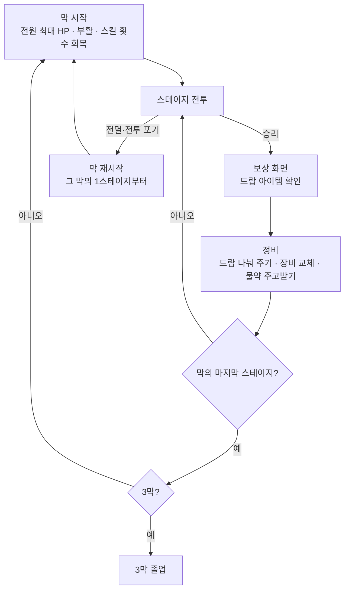

# 게임 구조 기획서

> M2에서 정한 게임 전체 구조입니다. 전투 밖의 진행, 막 단위 자원, 아이템, 격자 변경을 다룹니다.
>
> - 기준일: 2026-10-22 ([Issue #288](https://github.com/minjunkim-dev/BGLike/issues/288) 저장·전투 밖 화면 반영), 2026-10-21 ([Issue #214](https://github.com/minjunkim-dev/BGLike/issues/214) 드랍 기대값과 8장 정리, [Issue #136](https://github.com/minjunkim-dev/BGLike/issues/136) 사각 높이 격자 반영, 2026-10-07 기획 논의, Issue #61 아이템 수치 결정, [Issue #99](https://github.com/minjunkim-dev/BGLike/issues/99) 막별 적 강화 제거 반영)
> - 관련 문서: [기획 현황](DESIGN_STATUS.md) · [기획 로드맵](ROADMAP.md) · [전투 시스템 기획서](COMBAT_DESIGN.md)
> - 이 문서와 전투 시스템 기획서가 다르면 이 문서가 기준입니다. 바뀌는 전투 규칙은 [7장](#7-전투-시스템-기획서에서-바뀌는-규칙)에 모았습니다.
> - 표시: ✅ 정해짐 · ❓ 정해야 함

---

## 목차

1. [게임 목표](#1-게임-목표)
2. [진행 구조](#2-진행-구조)
3. [막 단위 자원](#3-막-단위-자원)
4. [아이템](#4-아이템)
5. [캐릭터](#5-캐릭터)
6. [사각 높이 격자](#6-사각-높이-격자)
7. [전투 시스템 기획서에서 바뀌는 규칙](#7-전투-시스템-기획서에서-바뀌는-규칙)
8. [정해야 할 것](#8-정해야-할-것)

---

## 1. 게임 목표

**캐릭터를 육성하면서 3막의 모든 스테이지를 깨는 것(3막 졸업)이 목표입니다.** ✅

- 육성 수단은 **아이템뿐**입니다. 레벨업, 능력치 성장, 재화는 두지 않습니다.
- 이야기와 세계관은 이 구조 위에 나중에 얹습니다 ([로드맵 M7](ROADMAP.md#10-m7-첫-플레이-가능-구간-기획)).

---

## 2. 진행 구조

### 2-1. 막과 스테이지 ✅

| 항목 | 결정 |
|---|---|
| 구성 | 3막 × 막당 3스테이지 = **전투 9번** |
| 순서 | 1-1 → 1-2 → 1-3 → 2-1 → … → 3-3. 스테이지를 고르지 않음 |
| 스테이지 하나 | 몬스터와 한 번 조우하는 맵 하나 |
| 스테이지 승리 | 몬스터를 **모두** 전투 불능으로 만듦 |
| 스테이지 패배 | 아군 **전원**이 전투 불능 |
| 레벨 디자인 | 9개 맵을 따로 디자인 ([로드맵 M5](ROADMAP.md#8-m5-콘텐츠-기획)) |

### 2-2. 흐름 ✅

- 전멸하면 **그 막의 1스테이지부터** 다시 합니다.
- 막을 다시 시작해도 **그 막에서 얻은 장비는 유지**합니다.
- 물약은 일회성 소모품입니다. 쓴 물약은 막을 다시 시작해도 돌아오지 않고, 얻은 물약은 남습니다 (3-1).
- 플레이어는 전투 중 `전투 포기`로 전멸과 같은 막 재시작을 고를 수 있습니다 (2-5).

### 2-3. 막별 적 강화 ✅

**막별 적 강화는 없습니다** (2026-10-14, [Issue #99](https://github.com/minjunkim-dev/BGLike/issues/99)). 같은 몬스터는 모든 막에서 같은 수치입니다. 막별 난이도는 몬스터의 수와 종류로 조절합니다 ([스테이지 배치](stages/README.md)). 장비로 강해진 캐릭터가 같은 몬스터를 더 쉽게 잡는 경험을 주기 위해서입니다.

> 이전 결정(2026-10-10)은 2·3막에 적의 명중·AC +2/+5, 최대 HP ×1.5/×2, 피해 +2/+4를 더했습니다. [Issue #107](https://github.com/minjunkim-dev/BGLike/issues/107)에서 이 강화를 제거했습니다. 4-4의 막별 장비 수치는 유지합니다. 장비 수치 재검토는 후속 기획입니다 ❓.

### 2-4. 저장과 이어하기 ✅

> **결정됨, 구현 중.** 2026-10-22 [#209 기획자 답](https://github.com/minjunkim-dev/BGLike/issues/209#issuecomment-6330756631) 7~9번(7·8번은 개정 후 채택)입니다. 구현은 [저장 기반 #280](https://github.com/minjunkim-dev/BGLike/issues/280), [전투 상태 저장 #281](https://github.com/minjunkim-dev/BGLike/issues/281), [정비·보상 중 저장 #282](https://github.com/minjunkim-dev/BGLike/issues/282), [새 게임·이어하기·졸업 #284](https://github.com/minjunkim-dev/BGLike/issues/284)에서 합니다. 구현 전까지 현재 게임은 앱을 종료하면 진행을 저장하지 않습니다.

| 항목 | 결정 |
|---|---|
| 슬롯 | **자동 저장 한 슬롯**. 직접 저장 버튼 없음 |
| 저장 대상 | 현재 막, 장착 장비, 공용 가방, 물약(캐릭터별 개수), 그리고 **전투 상태 전체**(모든 유닛의 HP·위치·상태·스킬 횟수, 이니셔티브 순서와 지금 턴인 유닛, 그 턴에 남은 이동·행동·보조 행동·반응, 상자·바위·물·장판·낭떠러지, 늘어난 새끼 거미, 아직 시작하지 않은 묶음 유닛) |
| 저장 시점 | 아군이든 적이든 **행동 하나가 끝날 때마다**. **정비 화면과 보상 확인 화면 중에도** 저장. 가방에 넣거나 물약을 나눈 상태 그대로 이어짐 |
| 난수 | **난수 상태도 저장**. 이어하기로 주사위 결과를 다시 뽑을 수 없음 ([운과 난수](COMBAT_DESIGN.md#4-5-운과-난수)) |
| 저장하지 않는 것 | 확정 전 입력(이동 경로 미리보기, 대상 선택 중, 확인 창이 떠 있는 순간). 이 경우 직전 행동이 끝난 상태로 돌아감 |
| 이어하기 | **마지막으로 끝난 행동 직후의 그 자리에서** 이어함 |
| 새 게임 | 저장이 있으면 덮어쓰기 확인 창을 거침. 창에 저장 내용(예: "3막 2스테이지 진행 중")을 보여 줌. 처음 상태(가방 비어 있음, 물약 0개)로 시작 |
| 3막 졸업 | `3막 졸업` 화면은 `타이틀로`만. 졸업 화면이 뜨는 순간 **저장을 삭제**(보관하지 않음) |

- 저장 기능 개발에 큰 애로사항이 생기면 기획자와 논의합니다. 그렇지 않으면 위 규칙으로 진행합니다.
- 개발 결정으로 남긴 것: 저장 파일의 위치·형식·버전 처리([ADR 0003](adr/0003-save-files.md)), 확인 창 문구.

### 2-5. 전투 밖 화면 ✅

> **결정됨, 구현 중.** 2026-10-22 [#209 기획자 답](https://github.com/minjunkim-dev/BGLike/issues/209#issuecomment-6330756631) 2~6번, [#209 3번 정정](https://github.com/minjunkim-dev/BGLike/issues/209#issuecomment-6331003204), [#220 기획자 답](https://github.com/minjunkim-dev/BGLike/issues/220#issuecomment-6331002448) 3번입니다. 구현은 [타이틀 #283](https://github.com/minjunkim-dev/BGLike/issues/283), [설정 #285](https://github.com/minjunkim-dev/BGLike/issues/285), [일시정지·전투 포기 #286](https://github.com/minjunkim-dev/BGLike/issues/286), [도움말 #287](https://github.com/minjunkim-dev/BGLike/issues/287)에서 합니다.

| 화면 | 결정 |
|---|---|
| 타이틀 | `새 게임`, `이어하기`(저장이 있을 때만 표시), `설정`, `종료`, `출처`(SRD 5.1 표기, [#213](https://github.com/minjunkim-dev/BGLike/issues/213)의 개발 결정). 임시 이름 `BGLike`. 배경 연출·로고 없음 |
| 일시정지 메뉴 | 전투·정비 중 `Esc`. `계속`, `설정`, `도움말`, `전투 포기`, `타이틀로`, `종료`. `전투 포기`는 전투 중에만 표시. `타이틀로`·`종료`는 확인 창. 자동 저장(2-4)이 있으므로 이 확인 창에 "진행이 저장되지 않습니다" 안내는 필요 없음 |
| 설정 | 마스터 음량, 창 모드(창/전체 화면). 껐다 켜도 유지. 키 변경·언어 선택 없음. 음소거 버튼 없음(슬라이더 0으로 갈음). 설정은 게임 저장과 따로 보관하며 새 게임·졸업이 지우지 않음 |
| 난이도 | 옵션 없음 |
| 도움말 | 정적 `도움말` 화면 하나(타이틀·일시정지 메뉴). 조작은 지금 있는 것을 모두 적음. 내용은 조작, 유리/불리, 내성, 반응. 높이·낙하·화상·물 같은 새 메커닉은 이번에 넣지 않음. 처음 실행할 때 자동으로 띄우지 않음 |

개발 결정으로 남긴 것: `Esc`를 눌러 메뉴를 열 수 있는 순간(적 턴 진행 중, 반응 확인 창 중), 음량 기본값과 단계, 확인 창 문구. `전투 포기` 확인 창은 아래 문구를 씁니다.

#### 전투 포기

플레이어가 즉시 패배를 인정하는 것입니다. 게임에서 진 것과 같습니다.

| 항목 | 결정 |
|---|---|
| 위치 | 일시정지 메뉴(`Esc`). 전투 중에만 표시하고 정비·보상 화면에는 표시하지 않음 |
| 확인 창 | 필수. "전투를 포기하면 패배로 처리되고, 이 막을 처음부터 다시 합니다." |
| 효과 | 전멸한 것과 똑같이 처리. 패배 결과 화면 → 현재 막의 1스테이지부터 재시작. HP·전투 불능·스킬 횟수는 초기화, 장비·공용 가방·물약은 유지 |
| 저장 | 포기를 확정한 순간이 하나의 행동으로 저장됨. 강제 종료로 포기를 취소할 수 없음 |

- 전멸 시 막 재시작은 그대로입니다. 전투 중 되돌리기는 없습니다 ([#220 기획자 답](https://github.com/minjunkim-dev/BGLike/issues/220#issuecomment-6331002448) 3번).
- 알려진 우려: 전멸 재시작이 장비·가방·물약을 유지하므로 포기로 드랍을 반복해서 모으는 플레이가 쉬워집니다. 지금 바꾸지 않고 [#205](https://github.com/minjunkim-dev/BGLike/issues/205)(밸런스·드랍 기대값)에서 다룹니다.

---

## 3. 막 단위 자원

### 3-1. 자원표 ✅

| 자원 | 같은 막의 스테이지 사이 | 막 시작 | 막 재시작 (전멸·전투 포기) |
|---|---|---|---|
| HP | **이어짐** (회복 없음) | 전원 최대 HP | 전원 최대 HP |
| 전투 불능 | **이어짐**. 남은 스테이지에 나오지 않음 | 부활 | 부활 |
| 스킬 사용 횟수 | **이어짐** | 회복 | 회복 |
| 장비 | 유지 | 유지 | 유지 |
| 물약 | 유지 | 유지 | 지금 가진 개수 그대로 |

- 스킬 사용 횟수의 **값은 지금 그대로**입니다(숨 고르기 1, 흘려내기 2 등). 단위만 전투당에서 막당으로 바뀝니다. 횟수 조정은 스킬 디자인 때 정합니다 (5장).
- 물약은 **몬스터 드랍으로만** 얻습니다. 시작할 때는 없습니다.
- 물약은 **캐릭터별로** 가집니다. 전투에서는 자기 물약만 씁니다. 스테이지 사이 정비 단계에서 캐릭터끼리 주고받을 수 있습니다 (4-3).

### 3-2. 막 안에서 전투 불능 ✅

전투 불능이 된 캐릭터는 그 막의 남은 스테이지에 나오지 않습니다. 남은 캐릭터만으로 싸우고, 다음 막 시작에 최대 HP로 부활합니다.

> 파티가 2명이라 1스테이지에서 한 명이 쓰러지면 남은 2스테이지를 혼자 싸웁니다. 난이도는 레벨 디자인과 밸런스(M5, M6)에서 확인합니다.

---

## 4. 아이템

### 4-1. 장비 ✅

| 항목 | 결정 |
|---|---|
| 장착 칸 | 캐릭터마다 **무기 1, 방어구 1** |
| 무작위 수치 | 드랍될 때 성능 수치가 무작위로 정해짐. 같은 아이템도 수치가 달라 다시 얻을 이유가 됨 |
| 교체 시점 | **스테이지 사이마다** 정비 단계에서 (보상 화면 뒤) |
| 막 재시작 | 그 막에서 얻은 장비 유지 |

### 4-2. 드랍 ✅

| 항목 | 결정 |
|---|---|
| 보장 | 스테이지를 깨면 아이템 **1개 보장** |
| 추가 | 몬스터마다 확률로 추가 드랍 |
| 드랍 대상 | 장비(무기, 방어구)와 물약 |

보장 드랍이 있어 운이 나빠도 9전투에서 최소 9개를 얻습니다.

### 4-3. 정비 단계 ✅

스테이지 승리 뒤 보상 화면 다음에 오는 단계입니다.

| 항목 | 결정 |
|---|---|
| 드랍 나눠 주기 | 드랍된 아이템(장비, 물약)을 플레이어가 캐릭터에게 **나눠 줌** |
| 받지 않은 아이템 | 정비 종료 때 **공용 가방에 전부 보관**. 공간이 부족하면 정비에 남음. 부분 보관·자동 폐기 없음 |
| 장비 교체 | 캐릭터마다 무기·방어구를 바꿈. **교체한 이전 장비는 공용 가방에 보관**. 가방 장비는 이전 장비와 같은 칸에서 교환 |
| 물약 주고받기 | 캐릭터끼리 물약을 넘김. **전투 불능인 캐릭터의 물약도** 다른 캐릭터에게 넘길 수 있음 |
| 물약 한도 | 캐릭터당 **3개**. 한도를 넘게 줄 수 없음 |
| 전투 불능인 캐릭터 | 아이템(장비, 물약)을 **받을 수 있음**. 다음 막에 부활하면 그 장비로 나옴 |

공용 가방은12칸입니다. 장비1개와 물약1개가 각각1칸을 사용합니다. 정비에서 장착·물약 분배·선택한 한 개의 확인 후 폐기를 합니다. 스테이지·막 전환·전멸 재시작에서 유지합니다. 가방도 자동 저장 대상입니다 (2-4, 결정됨, 구현 중).
미수령 보상이 있으면 종료 확인을 표시합니다. 메시지 생략은 성공한 명시적 확인에서만 적용합니다. 현재 앱 실행에서 유지하며 정비에서 다시 켤 수 있습니다. 생략 설정은 용량 검사와 아이템 폐기 확인을 건너뛰지 않습니다.
이는 [#139의 구현 전 결정](https://github.com/minjunkim-dev/BGLike/issues/139#issuecomment-6295609725)과 [#175](https://github.com/minjunkim-dev/BGLike/issues/175)를 반영합니다. 초기12칸·초과 처리·메시지 설정 수명은 사용자의 선택 위임으로 채택한 권장안입니다. 기획자의 명시 수치와 구분합니다. 자세한 규칙은 [아이템 안내](ITEM_LOOT.md)를 따릅니다.

### 4-4. 아이템 종류와 수치 ✅

> 2-3의 막별 적 강화를 없앴으므로([Issue #99](https://github.com/minjunkim-dev/BGLike/issues/99)) 아래 막별 수치는 다시 볼 대상입니다 ❓. 다시 정하기 전까지는 이 값을 씁니다.

아이템은 **무기, 방어구, 회복 물약** 3종입니다. 장비는 두 수치를 가지며, 드랍될 때 각 수치를 **따로** 굴립니다. 범위는 아이템을 **얻은 막**의 범위를 씁니다.

| 아이템 | 수치 | 1막 | 2막 | 3막 |
|---|---|---|---|---|
| 무기 | 명중 | +1~2 | +3~4 | +5~7 |
| | 피해 | +1~3 | +4~6 | +7~10 |
| 방어구 | AC | +1~2 | +3~4 | +5~7 |
| | 최대 HP | +2~4 | +5~8 | +9~14 |
| 회복 물약 | 회복 | 2d4+2 | 2d4+2 | 2d4+2 |

- **막끼리 범위가 겹치지 않습니다.** 낮은 막에서 높은 막보다 좋은 수치가 나오지 않고, 높은 막에서 낮은 막의 수치가 나오지 않습니다.
- 같은 막 안에서도 두 수치가 따로 정해지므로 명중이 높은 무기와 피해가 높은 무기를 비교할 이유가 생깁니다.
- 장비 수치는 능력치를 바꾸지 않고 명중·피해·AC·최대 HP에 더합니다.

### 4-5. 드랍 확률 ✅

| 항목 | 결정 |
|---|---|
| 추첨 비중 | 무기 **2**, 방어구 **2**, 회복 물약 **3** |
| 몬스터당 추가 드랍 | **35%** |
| 보장 드랍 풀 | 추가 드랍과 **같은 풀** |

> 현재9개 스테이지([스테이지 배치](stages/README.md))에서는 9전투에서 이론상 평균13.2개(장비 약7.5, 물약 약5.7), 최대21개를 얻습니다. 보장9개에 추가 추첨 대상12마리×35%를 더한 값입니다. [새끼 거미](monsters/spiderling.md)는 추가 드랍을 하지 않습니다. 1막 3전투(추가 추첨 대상2마리)에서 물약을 하나도 못 얻을 확률은 약13%입니다. 계산 기준은 [아이템 안내](ITEM_LOOT.md#흐름)와 같으며 실측 균형 검수 결과는 아닙니다. 보장1개·추첨 비중2/2/3·추가 확률35%는 유지합니다.

> 이전의 평균 약15개와 1막 물약0개 확률 약7%는 스테이지마다 적이2명이던 시험 배치 기준입니다([Issue #99](https://github.com/minjunkim-dev/BGLike/issues/99) 이전).

### 4-6. 최대 HP가 바뀔 때 현재 HP ✅

방어구를 장착·교체·해제해 최대 HP가 바뀌면 **잃은 HP를 유지**합니다.

- 현재 HP는 새 최대 HP에서 보존한 잃은 HP를 뺀 값입니다. 예: HP 8/15에서 최대 HP +5 방어구를 끼면 13/20.
- 최대 HP가 내려가면 현재 HP도 같은 만큼 내려갑니다. 최소 1입니다.
- 최소 1로 제한해도 보정 전의 잃은 HP를 계속 보존합니다. 예: HP 1/17에서 최대 HP +5 방어구를 해제하면 1/12입니다. 다시 장착해도 1/17입니다.
- 장비를 바꿔 끼워 HP를 회복할 수 없습니다.
- 전투 불능 캐릭터는 방어구를 받아도 HP 0 그대로입니다. 아이템 수령은 부활·회복이 아닙니다 (4-3).

### 4-7. 보류한 것 ❓

| 항목 | 언제 |
|---|---|
| 등급 | M5 몬스터 기획과 함께 다시 봄. 막별 수치 상승이 등급 역할을 일부 대신함 |
| 직업 제한 | 직업과 스킬을 늘릴 때. 지금은 모든 캐릭터가 같은 무기·방어구를 씀 |
| 판매·갈기·조합·재화·추가 아이템 효과 | 별도 기획. #175 공용 가방 범위에서 제외 |

---

## 5. 캐릭터

| 항목 | 결정 |
|---|---|
| 파티 | 지금 그대로 전사 1, 궁수 1 ✅ |
| 역할 | **전사 = 탱커, 궁수 = 딜러** ✅ |
| 스킬 | 직업마다 스킬을 늘릴 수 있음. 스킬 디자인은 기획 담당이 정함 ❓ |

> 적 AI가 "사거리 안에서 HP가 낮은 대상"을 노리므로([전투 시스템 기획서 7장](COMBAT_DESIGN.md#7-적-ai)), 지금 규칙으로는 전사가 공격을 끌어 줄 수 없습니다. 탱커 스킬(도발 등)이나 적 AI 조준 규칙은 스킬 디자인과 함께 정합니다.

---

## 6. 사각 높이 격자

2026-10-18 회의와 [Issue #136](https://github.com/minjunkim-dev/BGLike/issues/136)의 [기획자 답변](https://github.com/minjunkim-dev/BGLike/issues/136#issuecomment-6250732550)으로 2026-10-07의 헥사 타일 결정을 대체합니다. 헥사 시안은 [대체된 기록](HEX_GRID_PREVIEW.md)으로 남깁니다.

### 6-1. 타일과 맵

| 항목 | 결정 |
|---|---|
| 타일 | 높이가 있는 사각 타일 ✅ |
| 화면 투영 | 논리는 사각4방향 격자이며 화면은 아이소메트릭 마름모. 마름모 윗면과 명암이 다른 두 옆면으로 높이를 표시. 2026-10-20 사용자 화면 교정, [Issue #170](https://github.com/minjunkim-dev/BGLike/issues/170) |
| 높이 비율 | 높이 1칸은 바닥 한 변의 절반 ✅ |
| 타일 픽셀 크기 | ✅ 구현용 V1: 바닥32×16px·높이당8px·viewport640×360. 사용자 선택 위임과 실제 렌더 검수로 채택. [#136 검수 결정](https://github.com/minjunkim-dev/BGLike/issues/136#issuecomment-6304104028). 이후 그래픽 정밀도에 따라 바꿀 수 있음 |
| 맵 크기 | 10열 × 10행 유지 ✅ |
| 맵 가장자리 | 벽 ✅ ([Issue #137](https://github.com/minjunkim-dev/BGLike/issues/137)) |
| 기존 9개 스테이지 | 기존 로스터·스폰·수치·보상을 유지. #189 대표 배치를 보존하고 #195에서9개 맵에 높이1~3·계단·실제 도트 지형을 추가. 현재 정본은 [맵 기준](TERRAIN_MAPS.md)과 스테이지 자원. 아래 궁수 검수는 기록한 과거 SHA의 근거 |

사각 격자는 이동·거리의 논리 구조입니다. 정면 사각형으로 그려야 한다는 뜻이 아닙니다. 아트·UI 레퍼런스는 소드 오브 콘발라리아이며, 2026-10-20 사용자가 제시한 두 번째 이미지의 마름모 바닥·입체 지형을 화면 방향으로 삼습니다. 레퍼런스의 자산은 복제하지 않습니다.

#170의 교정 시안은 바닥32×16px·높이당8px로 렌더링합니다. 바닥 화면의 가로:세로2:1과 게임의 높이 비율은 구분합니다. 2026-10-21의 [#136 검수 결정](https://github.com/minjunkim-dev/BGLike/issues/136#issuecomment-6304104028)에서 사용자 선택 위임에 따라 이 값을 구현용 V1 규격으로 채택했습니다. #170의 표면·깊이·가림 검수와 #189의 두 해상도 원본에서 높이1/2/3·환경 오브젝트·HUD를 직접 대조했습니다. 이는 별도 기획자의 열람이나 최종 아트 승인을 기록한 것이 아닙니다. [외부 유닛 제작 규격](UNIT_IMAGE_TEMPLATE.md)의64×64 프레임 캔버스는scale0.5로32×32 논리 영역에 표시합니다. 타일 바닥과 구분합니다. #194의 선명도 결정에 따라canvas_items로 실제 창 해상도에서 렌더합니다. 실제 자산·화풍·애니메이션과 새 이미지의 가독성은 자산 통합 때 검수합니다.

궁수 사거리6은 현재 사각 맵의 초기값으로 유지합니다. main `9217667`의 실제 첫 전투에서 원래6스폰·스탯·HP·지형을 유지한 채 백그라운드 native 입력을 확인했습니다. 3칸 접근 후 이동3을 남겼습니다. 거리7 대상은 두 번 눌러도 자원을 쓰지 않았습니다. 거리6 대상은 미리보기 후 공격했고 행동을 썼습니다. 이어1칸 후퇴해 이동2를 남겼습니다. 원본123PNG/26event/9입력과 후속 모델·HUD를 대조했습니다. initiative·공격 주사위·AI 중지는 통제했습니다.

현재9개 배치의 공개 경로 질의에서 원래23적의 시작거리는8~12칸이었습니다. 사격 가능한 위치까지 필요한 최소 걷기는2~6칸이었습니다. 제자리 공격 대신 접근 위치를 고를 수 있고, 현재 이동력6 안에 사격 위치가 있습니다. 가장 먼 대상은 접근에 이동6을 모두 씁니다. 이 결과는 초기 사거리 유지의 근거입니다. 9개 자연 전투 완주·새 레벨 배치·통계적 최종 밸런스 검수는 별도입니다.

지형 앞뒤 순서로 몸통이 가린 유닛은 지형 위에 팀색 윤곽을 표시합니다. 윤곽은 기존 몸통 클릭으로 선택·공격할 수 있습니다. 이는 시각 가림의 표시입니다. 아래6-2의 시야·사거리 규칙을 바꾸지 않습니다. 초상은 기존 정보 조회 역할을 유지합니다. [#170 선택 경로 교정](https://github.com/minjunkim-dev/BGLike/issues/170#issuecomment-6291262574)을 따릅니다.

### 6-2. 거리와 인접 ✅

| 항목 | 규칙 |
|---|---|
| 이동 방향 | 상하좌우 4방향 |
| 거리 | 높이를 빼고 `가로 차 + 세로 차`로 셈. 이동력과 사거리 모두 이 거리를 씀 |
| 인접 | 평면 거리 1칸이면서 높이 차 1 이하 |
| 근접 공격 | 인접한 대상만 공격 |
| 인접을 쓰는 규칙 | 기회 공격, 원거리 공격의 인접 적 불리, 밀치기도 같은 인접 기준을 씀 |
| 시야 | 높이로 원거리 공격을 막지 않음. 높은 지형 너머로도 공격할 수 있음. 차폐와 직사·곡사는 별도 기획 |
| 수치 | 이동력 6칸, 궁수 사거리 1~6칸 그대로 |

고지대 보너스는 아래 6-6의 [Issue #137](https://github.com/minjunkim-dev/BGLike/issues/137) 확정 규칙을 따릅니다. 범위 스킬의 높이 처리는 [Issue #138](https://github.com/minjunkim-dev/BGLike/issues/138)에서 정합니다.

### 6-3. 걷기 ✅

- 높이 차 1은 오르내릴 수 있고 이동력을 더 쓰지 않습니다.
- 높이 차 2 이상은 걸어서 지나갈 수 없습니다.

### 6-4. 점프 ✅

점프는 이동력과 보조 행동을 함께 쓰는 공용 동작입니다. 아군과 몬스터가 같은 기본 규칙을 씁니다.

| 항목 | 규칙 |
|---|---|
| 착지할 수 있는 칸 | 평지에서 이동력 2로 갈 수 있는 모든 칸. 기본 점프 거리는 1칸 건너뛰기 |
| 거리 | 대각선으로 세지 않음(`가로 차 + 세로 차`) |
| 착지 칸 | 비어 있는 바닥 칸. 낭떠러지에는 착지할 수 없음 |
| 위로 | 착지 칸은 출발 높이 + 2까지 |
| 아래로 | 높이 차 2 이상도 가능. 높이 차 2까지는 낙하 피해 없음. 3부터는 [Issue #137](https://github.com/minjunkim-dev/BGLike/issues/137)의 낙하 피해 |
| 이동력 소모 | `점프한 칸 수 + 오른 높이`. 내려가는 점프는 칸 수만큼 |
| 비용 예시 | 평지에서 1칸 건너뛰기 2, 옆 칸으로 높이 2 오르기 3, 1칸 건너뛰며 높이 2 오르기 4 |

건너뛰는 중간 칸의 조건:

- 빈칸, 물, 낭떠러지처럼 막혀 있지 않은 칸은 건너뛸 수 있습니다.
- 벽·장애물과 아군·적이 있는 칸은 건너뛸 수 없습니다.
- 중간 칸의 바닥 높이는 **출발 높이 + 1**까지만 넘을 수 있습니다. 더 높으면 그 경로는 막힙니다. 중간 칸이 없는 옆 칸 점프에는 이 제한이 없습니다.
- 낭떠러지에는 중간 바닥 높이가 없습니다. 낭떠러지를 건너뛸 때는 바닥 높이를 비교하지 않습니다.
- 공중의 중간 칸에서는 바닥 효과와 낙하 피해를 받지 않습니다. 착지한 칸의 바닥 효과는 그 환경·스킬 규칙을 따릅니다.
- 가로 1칸·세로 1칸 떨어진 착지 칸은 두 최단 경로 중 하나라도 열려 있으면 갈 수 있습니다. 둘 다 열려 있으면 일정한 순서로 한 경로를 고르고, 고른 경로를 미리보기에 표시합니다.

기회 공격:

- 점프도 스스로 하는 이동입니다. 기회 공격을 면제하지 않습니다.
- 출발 칸에서는 인접하고 착지 칸에서는 인접하지 않게 되는 적의 기회 공격을 점프하기 직전에 처리합니다. 공중의 중간 칸에서는 기회 공격을 받지 않습니다.
- 기회 공격으로 전투 불능이 되면 출발 칸에 남고, 점프의 이동력과 보조 행동을 쓰지 않습니다. 살아남으면 비용을 쓰고 착지합니다.

입력:

- 동작 패널에서 점프를 고릅니다. 첫 우클릭에 경로, 착지 칸, 이동력·보조 행동 비용, 기회 공격과 낙하 위험을 표시합니다.
- 같은 착지 칸을 다시 우클릭하면 실행합니다. 취소하거나 조건이 맞지 않으면 자원을 쓰지 않습니다.

적 AI:

- 기존 회복·이탈·보스 스킬의 우선순위를 유지합니다. 그 동작으로 보조 행동을 썼으면 점프하지 않습니다.
- 이번 턴에 걸어서 갈 수 있는 목적지면 걷습니다. 점프로만 갈 수 있는 공격·접근·후퇴 위치에만 점프합니다.
- 낭떠러지와 낙하 피해가 생기는 착지 칸은 고르지 않습니다.

점프 거리와 높이 한도는 기본값입니다. 이를 늘리는 스킬·장비 효과는 이후 기획에서 다룹니다.

### 6-5. 강제 이동과 소환의 높이 ✅

- 밀치기와 끌기는 대상을 같은 높이나 더 낮은 칸으로만 옮깁니다. 더 높은 칸으로는 옮기지 못합니다.
- 맵 밖과 다른 유닛이 있는 칸으로는 옮기지 못합니다. 낮은 칸의 낙하 피해와 낭떠러지의 낙사는 [Issue #137](https://github.com/minjunkim-dev/BGLike/issues/137)을 따릅니다.
- 끌기는 기존 사거리·대상 조건을 유지합니다. 끌려가는 칸은 끄는 유닛에게 인접한 칸이어야 합니다.
- 새끼 거미는 엄마 거미에게 인접한 빈 바닥 칸에만 태어납니다. 낭떠러지와 막힌 칸은 제외합니다. 그런 칸이 없을 때의 동작은 그대로입니다.

### 6-6. 1차 환경 ✅

[Issue #137](https://github.com/minjunkim-dev/BGLike/issues/137)의 확정 수치입니다. 1차 환경 구현은 [Issue #165](https://github.com/minjunkim-dev/BGLike/issues/165)에서 완료했습니다.

| 항목 | 규칙 |
|---|---|
| 고지대 | 공격자가 대상보다 높이 차2 이상 높으면 원거리 명중 판정에 유리. 근접에는 적용하지 않음. 기존 유리·불리 상쇄 유지 |
| 낙하 피해 | 높이 차3부터 `ceil((높이 차 − 2) × 최대 HP × 0.15)`. 주사위·내성 없이 적용. 차2까지는 피해 없음 |
| 낙하 결과 | 점프로 내려가거나 강제 이동으로 떨어질 때 같은 식을 적용. HP0은 전투 불능 |
| 낭떠러지 | 바닥이 없는 맵 안의 칸. 걷기·소환·착지 불가. 점프로 건너뛸 수 있음. 강제 이동으로 떨어지면 아군·몬스터 모두 즉시 전투 불능 |
| 맵 가장자리 | 벽. 맵 밖으로 이동하거나 밀 수 없음 |

낭떠러지에는 착지할 바닥 높이가 없습니다. 강제 이동으로 낭떠러지에 들어가면 높이 비교나 낙하 피해 계산 대신 즉시 전투 불능을 적용합니다. 같거나 낮은 칸의 제한은 바닥에 착지하는 강제 이동에 적용합니다. 끌기는 시전자 옆의 낭떠러지로 대상을 떨어뜨릴 수 있습니다.

#189의 첫 대표 배치를 유지하고 #195에서9개 맵의 높이·물·낭떠러지·물체 배치를 확장합니다. 현재 배치는 [실제 맵 기준](TERRAIN_MAPS.md)과 스테이지 자원을 따릅니다. 부서지는 장애물·바위 굴리기의 초기 규칙은 [#137 위임 명세](https://github.com/minjunkim-dev/BGLike/issues/137#issuecomment-6301869258)를 따릅니다. 현재 규칙과 대표배치는6-8절입니다.

물은 [#178](https://github.com/minjunkim-dev/BGLike/issues/178)의 화상 연계 범위입니다. 물 칸에 들어가면 화상을 즉시 해제하고, 물 위에서는 화상을 부여하지 않습니다. 걷기 각 도착·점프 착지·밀치기/끌기 도착·실제 턴 시작에 적용합니다. 공중 통과에는 적용하지 않습니다. 독 해제·추가 이동 비용·피해는 없습니다. [#137 위임 결정](https://github.com/minjunkim-dev/BGLike/issues/137#issuecomment-6297076538)을 따릅니다. 물은 칸별 스테이지 데이터와 표시로 전달합니다. #189는 실제 첫 전투에 물(5,1)을 배치합니다. #195는9개 전투에 실제 물길을 배치합니다. [맵 기준](TERRAIN_MAPS.md)과 스테이지 자원을 따릅니다. 화상·독 수치와 처리 순서는 [전투 기획서6장](COMBAT_DESIGN.md#6-상태-이상)을 따릅니다.

### 6-7. 검수와 후속 확인

- ✅ 구현용 V1은 바닥32×16px·높이당8px입니다. 사용자 선택 위임과 실제 렌더 검수 근거는 [6-1](#6-1-타일과-맵)을 따릅니다.
- ✅ 현재 배치의 궁수 초기 사거리6을 유지합니다. 실제 접근·공격·공격후이동과9개 배치 질의 결과는6-1에 있습니다. 10×10 사각 맵 자체의 최대 거리는18칸입니다.
- ✅ #193/#194/#195는 2026-10-21 완료로 닫혔습니다. 실제 유닛·지형과9개 맵의 가독성·직접 입력·원본 화면 근거는 [#194 최종 검증 근거](https://github.com/minjunkim-dev/BGLike/issues/194#issuecomment-6315983770)와 [#195 최종 검증 근거](https://github.com/minjunkim-dev/BGLike/issues/195#issuecomment-6315984269)입니다. [도트 아트 기준](PIXEL_ART.md#검증과-현재-상태)과 [맵 기준](TERRAIN_MAPS.md#검증과-완료-근거)에 정리했습니다. 통계적 최종 밸런스와 출시 패키지 검증은 별도 범위입니다.

### 6-8. 환경 오브젝트와 나무 상자

[#137 위임 명세](https://github.com/minjunkim-dev/BGLike/issues/137#issuecomment-6301869258)의 첫 구현은 [#188](https://github.com/minjunkim-dev/BGLike/issues/188)입니다. 환경 오브젝트는 바닥 한 칸을 차지하는 물체입니다. 유닛의 턴·AC·상태·전투 불능·승리·드랍에 넣지 않습니다. 한 칸에 물체1개만 둡니다. 맵 밖·낭떠러지·정적 장벽·살아 있는 유닛·다른 물체와 겹친 생성은 거부합니다. 물과 기존 장판 위에는 놓을 수 있습니다. 물체는 물·장판 효과를 받지 않습니다.

| 항목 | 나무 상자 규칙 |
|---|---|
| 내구도 | 6. 0이 되면 즉시 제거하고 길을 엶. 전리품 없음 |
| 이동 차단 | 걷기·점프 통과/착지·소환·밀치기/끌기 목적지를 막음. 공격 시야를 새로 차단하지 않음 |
| 공격 수단 | 기본 공격만. 현재 조작/자원·기절·바쁨·전투 종료·기존 사거리·근접 높이 차1 이하를 확인 |
| 비용과 판정 | 행동1. 정지 물체에 자동 명중. d20·치명타·유리/불리·기회 공격 없음 |
| 피해 | 장비를 포함한 현재 무기 피해 주사위+현재 피해 보정값. 최소1. 유닛 대상 표식·충격 화살·밀치기·끌기 등은 적용하지 않음 |
| 조작 | 기본 공격에서 상자 몸통 첫 좌클릭으로 미리보기. 같은 상자 재클릭으로 확정. 우클릭/다른 동작은 미리보기 취소. 확정 때 현재 대상·자원·거리·상태를 재확인 |
| 표시 | 상자·HP 막대·선택 테두리, 내구도/현재 무기 피해 범위/행동 불가 사유, 피해·파괴 로그. 기존 높이·물·장판·이동 미리보기를 유지 |
| AI와 초기화 | 적 AI는 물체를 공격하지 않음. 기존 경로로 물체를 피하며 파괴 후 열린 칸을 사용. 전투를 다시 열면 초기 배치·내구도로 복원 |

#### 바위 굴리기

[#189](https://github.com/minjunkim-dev/BGLike/issues/189)은 같은 환경 오브젝트 기반과 기본 공격의 현재 조작/행동/기절/바쁨/종료/사거리·근접 높이 조건을 재사용합니다. 바위는 상자처럼 무기 피해로 내구도를 깎지 않습니다.

| 항목 | 바위 규칙 |
|---|---|
| 비용과 방향 | 기본 공격 행동1. 명중/내성/무기 피해 주사위 없음. 공격자→바위의 큰축으로 이동. 동률은 x축. 같은칸은 거부 |
| 거리와 지형 | 최대3칸. 같은 높이/내리막만 진행. 맵밖·장벽·상자·다른바위·오르막 앞에서 정지. 낭떠러지는 소멸. 한 단계 높이차2 이상은 즉시 파괴. 소멸/파괴는 도착칸의 유닛 충돌보다 먼저 |
| 충돌 피해 | 아군/적 모두 고정4. 한 굴림의 대상당1회. 충돌 기록은 callback 전에 남김. 판정·주사위·기회 공격 없음 |
| 밀기와 착지 | 생존한 대상을 같은방향1칸 밀 수 있으면 밀고 바위가 비운칸으로 진행. 대상이 전투 불능이어도 빈칸으로 진행. 맵밖·다른유닛·물체·장벽·오르막으로는 못 밀고 대상 앞에 정지. 연쇄 밀기 없음. 같은 대상을 다시 밀 수 있으나 충돌 피해는 반복하지 않음. 유닛은 기존 낭떠러지→물→낙하→장판 착지를 적용 |
| 중단과 초기화 | 전투 종료/reset/물체·대상 제거 callback 뒤 남은 굴림을 중단. 같은칸의 새 물체를 지난 대상으로 사용하지 않음. 전투 재시작은 초기 바위를 새로 생성 |
| 미리보기와 표시 | 실제 굴림과 같은 순수 충돌 계산으로 방향·경로·정지·소멸/파괴·충돌을 예측. 회색 돌/선택테두리, 주황 경로화살표·붉은 충돌/정지 표시와 대상 안내로 아군 피해4까지 경고. 이동·충돌피해·정지·파괴 로그를 기록. 기본공격 몸통 선택/재클릭 확정과 기존 취소를 재사용 |

실제1막1스테이지에는 상자(2,1), 바위(4,1), 물(5,1), 낭떠러지(6,1), 높이(3,0)=1/(4,0)=2/(5,0)=2를 둡니다. #195는 이 대표 배치를 유지하고 중앙 고지와 실제 도트 지형을 추가합니다. 전체 높이는 [현재 맵 기준](TERRAIN_MAPS.md)과 스테이지 자원을 따릅니다. 기존 파티·적 스폰·적수·보상·9전투 진행은 유지합니다. 시험 전투 자원의 기본 배치는 비어 있습니다. 실제9개 스테이지의 물체는 #195의 현재 배치를 따릅니다. [스테이지 배치](stages/README.md)의 좌표와 같습니다. 물체는 물·장판 효과를 받지 않습니다. 적AI 물체공격·다른종류/스킬·연쇄밀기·시야/엄폐는 제외합니다. #195는 실제 생성 PNG와 텍스처를 표시합니다. 자산·화풍과 직접 검수 기준은 [제작 문서](PIXEL_ART.md)를 따릅니다. 초기 수치·배치·접점·티켓 분할은 사용자 선택 위임으로 채택했으며 별도 사람의 최종 밸런스 검수를 뜻하지 않습니다.

---

## 7. 전투 시스템 기획서에서 바뀌는 규칙

[전투 시스템 기획서](COMBAT_DESIGN.md)의 아래 내용을 이 문서로 대체합니다. 나머지 규칙은 그대로입니다.

| 기획서 위치 | 지금 | 바뀜 |
|---|---|---|
| 2장 맵 | 10×10 아이소메트릭 격자, 높이 없음 | 10×10 사각 높이 격자 (6장) |
| 2장 궁수 사거리 근거 | 10×10에서 가장 먼 거리 9칸 | 사각 맵의 최대 평면거리18칸. 현재 배치의 실제 접근·공격·후퇴 검수로 초기 사거리6 유지 (6-1) |
| 4-2 원거리 불리 | 공격자의 인접 칸에 기절하지 않은 적 | 인접 기준은 6-2 (높이 차 1 이하) |
| 5-2 기회 공격 | 인접 칸(8칸)을 벗어날 때 | 인접 칸(**상하좌우 4칸, 높이 차 1 이하**)을 벗어날 때. 점프도 포함 (6-4) |
| 5-3 스킬 | 모든 스킬 횟수는 **전투당** | 모든 스킬 횟수는 **막당**. 값은 그대로 |
| 5-4 공용 동작 | 밀치기, 물약 | + **점프** (6-4) |
| 5-4 물약 | 유닛당 1개 | 몬스터 드랍으로 얻는 일회성 소모품. 캐릭터별 보유, 시작 개수 0 |
| 5-4 밀치기 대상 | 인접한 적 1명. 항상 대결 | 인접한 **유닛** 1명. 적은 대결로, 아군은 대결 없이 밀림 ([기획자 답변](https://github.com/minjunkim-dev/BGLike/issues/136#issuecomment-6250732550)) |
| 5-4 밀치기 방향 | 밀치는 유닛 → 대상 방향(8방향) | 밀치는 유닛 → 대상 방향(**상하좌우 4방향**). 인접한 대상이라 방향이 항상 하나로 정해짐. 같거나 낮은 칸으로만 (6-5) |
| 9-3 동작 설명 | 전투당 남은 횟수 | 막당 남은 횟수 |
| 9-4 이동 미리보기 | 사각 격자 칸 | 사각 높이 격자 칸. 표시 규칙은 그대로. 점프 미리보기는 6-4 |

"전투가 끝날 때까지" 유지되는 효과(표식 등)는 그대로 전투 단위입니다.

---

## 8. 정해야 할 것

| 항목 | 담당 | 언제 |
|---|---|---|
| 아이템 등급, 직업 제한 (4-7) | 기획 | 보류. 시기는 4-7 |
| 스킬 추가와 횟수, 탱커 수단 (5장) | 기획 | 스킬 디자인. [#201 권장안](https://github.com/minjunkim-dev/BGLike/issues/201#issuecomment-6311266130)의 기획자 확인([#210](https://github.com/minjunkim-dev/BGLike/issues/210)) 대기 |
| 막별 장비 수치 재검토 (4-4) | 기획 | 막별 적 강화 제거(2-3) 뒤. [#205](https://github.com/minjunkim-dev/BGLike/issues/205) |

이미 정한 항목은 표에서 뺐습니다.

- 몬스터 종류: [몬스터 디자인 기획서](monsters/README.md)의7종을 #107~#112에서 구현했습니다. [통합 검수](M5_VERIFICATION.md)는 #113입니다.
- 9개 스테이지 레벨 디자인: [스테이지 배치](stages/README.md)를 실제 전투에 연결했습니다. 맵 지형은 #195의 [맵 기준](TERRAIN_MAPS.md)과 스테이지 자원을 따릅니다.
- 인벤토리: 파티 공용 가방12칸입니다 (4-3).
- 저장과 전투 밖 화면: [#209 기획자 답](https://github.com/minjunkim-dev/BGLike/issues/209#issuecomment-6330756631)으로 정했습니다 (2-4, 2-5). 구현은 #280~#287입니다.
- 드랍 기대 개수: 현재 배치로 다시 계산했습니다 (4-5).
