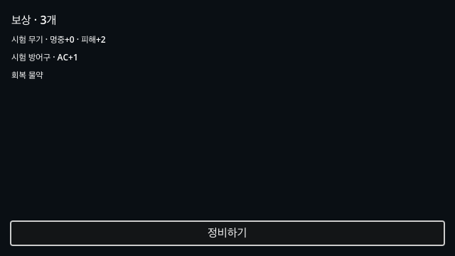
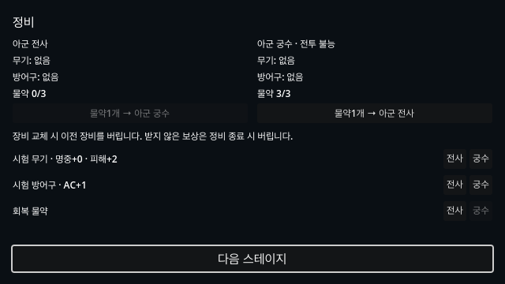
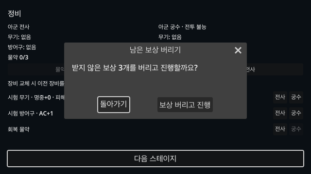

# 드랍·장착과 정비

기준은 [Issue #55](https://github.com/minjunkim-dev/BGLike/issues/55), [Issue #64](https://github.com/minjunkim-dev/BGLike/issues/64)와 [게임 구조 기획서4장](GAME_STRUCTURE.md#4-아이템)이다.
공용 가방은 [Issue #139](https://github.com/minjunkim-dev/BGLike/issues/139)와 [구현 전 결정](https://github.com/minjunkim-dev/BGLike/issues/139#issuecomment-6295609725), [Issue #175](https://github.com/minjunkim-dev/BGLike/issues/175)를 따른다.
기획자 코멘트3개에서 물약 분배·물약 한도·전투 불능 캐릭터 수령을 확정했다.
전투 화면 UI/UX 개선 Issue #58은 이번 범위 밖이다.

## 흐름

승리 → 보상 확인 → 정비 → 다음 스테이지 또는 다음 막으로 간다.
3-3도 보상과 정비를 마친 뒤 졸업한다.
패배하면 보상 없이 현재 막의 첫 전투로 돌아간다.
몬스터 드랍을 승리 시 한 번만 모은다.
승리마다 보장1개와 몬스터별 추가 드랍을 합산한다.
M5에서는 처음 배치한 새끼와 생성한 새끼 모두 추가 드랍에서 제외한다. 엄마 거미와 보스는 일반 몬스터와 같은35%를 사용한다. 1-1은 보장1개뿐이다. 3-1은 엄마2마리분만 추가 추첨한다.

정비에서 각 보상의 `전사`·`궁수` 버튼을 눌러 나눠 준다.
장비는 해당 캐릭터의 무기·방어구 칸에 바로 장착한다.
교체한 이전 장비는 공용 가방에 보관한다.
받지 않은 보상은 정비 종료 시 공용 가방에 전부 보관한다.
가방은 파티 공용12칸이다. 장비1개와 물약1개가 각각1칸을 사용한다. 물약을 겹쳐 쌓지 않는다.
초기12칸과 초과 처리·설정 수명은 사용자의 선택 위임으로 채택한 권장안이다. 기획자의 명시 수치와 구분한다.
현재9개 스테이지의 보상은 이론상 평균13.2개·최대21개다. 이는 보장9개와 추가 추첨 대상12마리×35%로 계산했다. 실측 균형 검수 결과는 아니다.

미수령 보상이 있으면 `받지 않은 아이템이 있습니다. 마치시겠습니까?`를 표시한다.
확인 창의 기본 선택은 `돌아가기`다. `더 이상 이 메시지를 띄우지 않음` 체크박스는 기본 해제다.
명시적으로 확인하고 정비 종료에 성공했을 때만 메시지 생략을 적용한다.
취소·닫기·Esc와 용량 부족은 생략 설정을 바꾸지 않는다.
생략 설정은 현재 앱 실행에서만 유지한다. 정비의 `정비 종료 확인 다시 켜기` 버튼으로 복원한다.

가방에 미수령 보상 전량이 들어갈 때만 정비를 마친다.
부족하면 정비에 남는다. 부족 칸 수와 장착·물약 분배·가방 아이템 폐기 방법을 표시한다.
보상을 부분 보관하거나 자동으로 버리지 않는다. 메시지 생략은 용량 검사를 건너뛰지 않는다.
보상 장비를 교체하려면 이전 장비를 보관할 빈 가방 칸이 필요하다. 실패하면 아이템과 HP를 유지한다.
빈 장비 칸에 장착하거나 캐릭터에게 물약을 분배할 때는 빈 가방 칸이 필요 없다.
정비의 가방 목록에서도 장비를 장착하고 물약을 한 개씩 분배한다.
가방 장비를 장착하면 이전 장비를 같은 가방 칸에 넣는다. 가방이 가득 차도 교환할 수 있다.
정비의 캐릭터 칸에서 `방어구 해제` 버튼으로 장착한 방어구를 공용 가방의 빈 칸에 넣는다 ([Issue #212](https://github.com/minjunkim-dev/BGLike/issues/212)).
해제도 잃은 HP를 유지한다. 예: HP 1/17에서 최대 HP +5 방어구를 해제하면 1/12, 다시 장착하면 1/17이다.

개발 결정 ([Issue #212](https://github.com/minjunkim-dev/BGLike/issues/212)):

- 가방에 빈 칸이 없으면 방어구를 해제하지 못한다. 해제 버튼을 끄고 호버 설명에 이유를 보인다. 방어구와 HP는 바뀌지 않는다. 근거: 보상 장비 교체에 빈 가방 칸이 필요하고 실패하면 아이템과 HP를 유지하는 원칙과 같다. 대안(해제 시 바닥에 버림)은 아이템을 잃게 하므로 택하지 않았다.
- 무기 해제는 넣지 않는다. 기획 문서는 방어구 해제만 다루고, 무기 없는 상태의 기본 공격 규칙이 없다.
- 기획자가 나중에 바꿀 수 있다.

가방의 `폐기` 버튼은 선택한 한 개를 확인 후 제거한다. 기본 선택은 `돌아가기`다.
폐기 취소·닫기·Esc는 아이템을 보존한다. 종료 확인 생략은 폐기 확인을 건너뛰지 않는다.
가방은 스테이지·막 전환·전멸 재시작에서 유지한다. 앱을 종료하면 저장하지 않는다.

물약은 캐릭터마다 보유한다.
가방의 물약은 캐릭터별 보유 한도3개에 포함하지 않는다.
정비의 양도 버튼은 물약1개를 다른 캐릭터에게 넘긴다.
한도에 도달하면 추가 수령과 양도 버튼을 끈다.
전투 불능 캐릭터도 아이템을 받고 물약을 넘긴다.
아이템 수령은 전투 불능 캐릭터를 부활시키지 않는다.
방어구 교체는 잃은 HP를 유지한 채 최대 HP와 현재 HP를 바꾼다.
최소 HP 1 보정 전의 잃은 HP도 보존한다. 반복 교체로 HP를 회복하지 않는다.
전투의 피해·회복은 현재 HP에 적용한다. 막 복구는 장비 포함 최대 HP까지 회복한다.
막 시작·재시작은 장비와 현재 물약 개수를 유지한다.
전투에서 물약은 기존 보조 행동과2d4+2 회복 규칙을 쓴다.

## 한 파일에서 바꾸는 아이템 데이터

`scenes/combat/item_data.json`은 사람이 편집하는 JSON이다.
주석과 마지막 쉼표는 쓰지 않는다.
Issue #61에서 확정한 수치를 적용한다. 범위는 아이템을 얻은 막을 기준으로 한다.

| 항목 | 확정값 |
|---|---|
| 종류와 이름 | 무기, 방어구, 회복 물약 |
| 무기 명중 | 1막 +1~2, 2막 +3~4, 3막 +5~7 |
| 무기 피해 | 1막 +1~3, 2막 +4~6, 3막 +7~10 |
| 방어구 AC | 1막 +1~2, 2막 +3~4, 3막 +5~7 |
| 방어구 최대 HP | 1막 +2~4, 2막 +5~8, 3막 +9~14 |
| 물약 수령 | 보상1개당 물약1개 |
| 추첨 비중 | 무기2, 방어구2, 회복 물약3. 보장·추가 같은 풀 사용 |
| 몬스터당 추가 확률 | 0.35(35%) |
| 물약 보유 한도 | 캐릭터당3개. 기획 확정값 |
| 공용 가방 한도 | 12칸. 사용자 선택 위임으로 채택한 초기 권장값 |
| 등급 | 보류. 막별 수치 상승을 사용 |

지원 수치는 `attack_bonus`·`damage_bonus`·`armor_class`·`max_hit_points`다.
`max_hit_points`는 방어구 전용이다. 무기에 넣으면 디버그 실행의 데이터 검증에서 거부한다.
장비의 두 수치를 독립 추첨한다. 얻은 장비는 다음 막에서도 수치를 유지한다.
장비가 올리는 값은 능력치 자체를 바꾸지 않는다.
명중 미리보기, 일반 공격·기회 공격·충격 화살과 대상AC가 같은 장비 수치를 사용한다.
고정 피해 보정은 치명타에서도 한 번만 더한다.

1. `items`에 아이템 종류를 넣는다. `id`는 식별자, `name`은 표시 이름이다.
2. `kind`를 `weapon`, `armor`, `potion` 중 하나로 넣는다.
3. `weight`에 양의 정수 추첨 비중을 넣는다. `stats`의 각 수치는 `[[1막 최소, 최대], [2막 최소, 최대], [3막 최소, 최대]]`다. 물약의 `stats`는 비운다.
4. `icon`에 `scenes/combat/art/icons/items/`의 파일 이름(확장자 제외)을 넣는다. 장착한 직업마다 다른 아이콘은 `unit_icons`에 `{"archer": "bow"}`처럼 넣는다. 키는 유닛 그림 식별자다. 파일이 없으면 디버그 실행의 데이터 검증에서 거부한다. [아이콘 규격](PIXEL_ART.md#아이템-아이콘)을 따른다.
5. `extra_drop_chance`에0~1 확률을 넣는다. `potion_limit`과 `bag_limit`에 양의 정수 한도를 넣는다.
6. 메인 장면을 다시 실행한다. 변경한 값은 새 실행에서 읽는다.

모든 캐릭터가 두 장비 칸을 사용한다.
직업 제한과 등급은 보류한다.
저장과 플랫폼 내보내기는 이번 범위 밖이다.
플랫폼 내보내기 구현 시 비리소스 파일인 `item_data.json`을 내보내기 포함 필터에 넣어야 한다.

## 검증 경계

`GODOT=/Applications/Godot.app/Contents/MacOS/Godot make check`는 기존 전투 회귀 검사와 새 `combat_loot_test.gd`를 실행한다.
2026-10-11 로컬 전체 검사에서 Python51개와 Godot4042개 검사를 통과했다.
Godot 확인 수는 turns2366·checks61·actions284·HUD1091·AI67·progression104·loot69이다.
드랍 검사에는 고정seed와 추가 확률0·1을 사용한다.
검사 전용 데이터로 범위와 세 종류, 독립 수치, 장비 교체, 한도와 양도, 전투 불능 수령을 검사한다.
검사 전용 데이터와 별도로 실제 기획 데이터의 막별 범위와 추첨 비중을 검사한다.
방어구 HP 하한·반복 교체·전투 불능·막 복구와 실제 물약 회복 상한을 검사한다.
실제3막 적 명중·피해·명중률 미리보기와3막 승리 보상 생성도 검사한다.
실제 공격·명중 미리보기·보조 행동 물약 소비를 검사한다.
실제 메인 장면에서 포인터 입력으로 보상 확인·정비·분배·양도·다음 전투·막 재시작을 검사한다.
가방의 보관·용량 실패 원자성·같은 칸 교환·물약 분배와 HP를 검사한다.
방어구 해제의 1/17→1/12→1/17 HP, 가득 찬 가방의 버튼 비활성·이유·상태 보존, 해제 후 실제 막 전환·전멸 재시작의 장비·가방 유지를 검사한다.
연속 클릭 방지와 확인 창 기본 포커스를 검사한다.
확인 창의 Enter 입력으로 종료 취소·성공과 선택 아이템 폐기를 검사한다.
생략 체크 후 취소·닫기·Esc·용량 부족, 성공한 설정의 다음 정비 적용과 다시 켜기를 검사한다.
실제 막 전환·전멸 재시작의 가방 유지와 새 실행의 빈 가방·기본 확인을 검사한다.
기존 진행 검사는 가방이 차면 실제 폐기 버튼과 확인 신호로 공간을 확보한다.
분배·양도 뒤 키보드 포커스 유지도 검사한다.
승리 조건과 일부 보상·HP는 테스트 값으로 설정한다.
기존 진행 검사는9전투 순서와 최종 정비 후 졸업을 검사한다.
자동 입력과 렌더링은 사람의 직접 플레이·조작감·기획 검수가 아니다.
M5의 실제 배치·승리 연결과35% 경계 검사는 [M5 통합 검수](M5_VERIFICATION.md)를 따른다. 위 전체 검사 수와 아래 캡처는 과거 기록이다.

## 실제 렌더링 화면

아래 캡처는 2026-10-08 Issue #55의 임시 데이터 기록이다. 현재 확정값은 위 표를 따른다.
Godot4.7.2의 실제 장면을640×360에서 렌더링했다.
캡처는 승리와 궁수 전투 불능·물약3개를 테스트 값으로 설정했다.
세 종류를 함께 보여 주려고 추가 확률1로 굴린 고정seed 보상이다.
실제 기본 확률은35%다.

보상 확인:

정비와 전투 불능 캐릭터 분배·양도:

미수령 보상 폐기 확인:

## 사람이 확인할 항목

1. 메인 장면에서 승리한다. `보상 확인`을 누른다. 얻은 아이템과 무작위 수치를 읽는다.
2. `정비하기`를 누른다. 장비를 나눠 주고 다시 바꾼다. 이전 장비의 가방 보관과 가방 장비의 같은 칸 교환을 확인한다. 방어구 교체 전후 잃은 HP 유지를 확인한다. `방어구 해제` 후 가방 보관과 잃은 HP 유지, 가방이 가득 찰 때 버튼 비활성과 호버 설명을 확인한다.
3. 물약을 캐릭터에게3개까지 준다. 전투 불능 캐릭터에게도 주고 양도한다. 한도 이상 받거나 넘길 수 없는지 확인한다.
4. 받지 않은 보상을 남기고 종료 확인의 취소·생략·다시 켜기를 확인한다. 가방이 가득 차면 종료 차단과 부족 칸 수를 확인한다. 아이템 한 개의 폐기 취소·확인 후 전량 보관을 확인한다.
5. 다음 스테이지·막 전환·전멸 재시작에서 가방 유지를 확인한다. 3-3 정비 뒤 졸업을 확인한다. 기준 화면과 정수 배율에서 긴 목록을 스크롤해 확인한다.
