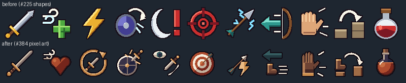
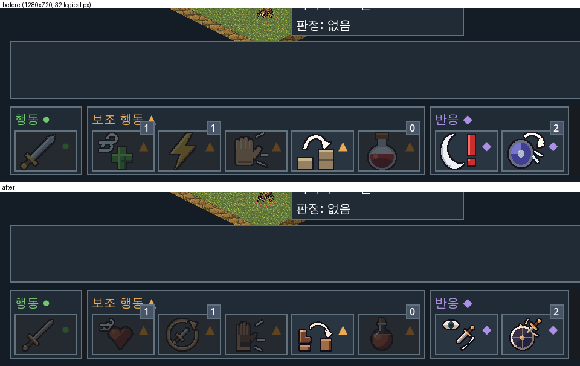
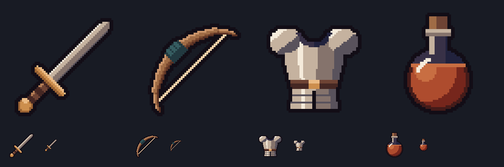
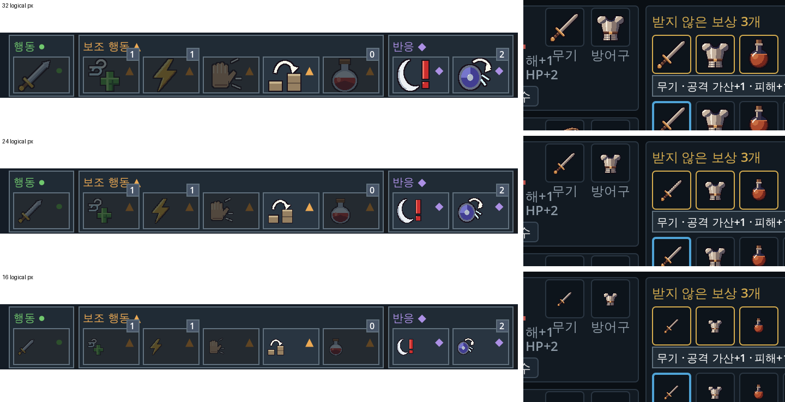
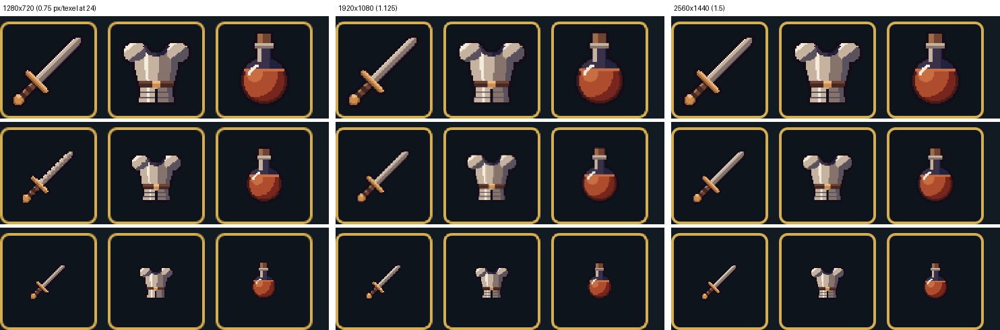
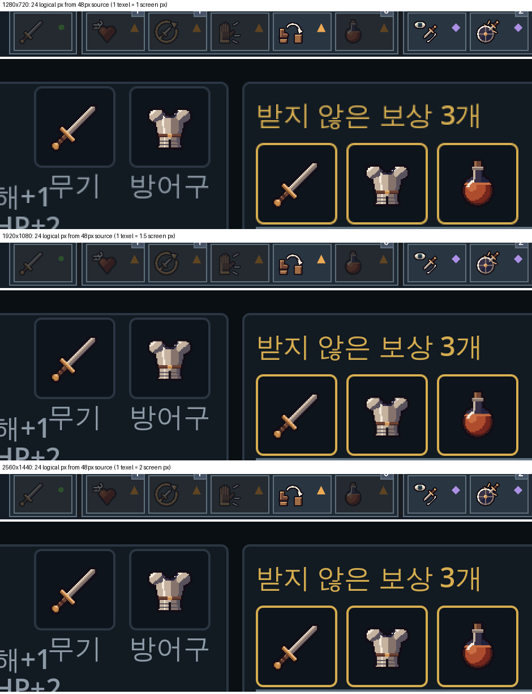

# 도트 아트와 지형 제작

기준 작업은 [#193](https://github.com/minjunkim-dev/BGLike/issues/193)이다. 2026-10-21 사용자가 실제 도트 에셋과9개 지형 맵을 요청했다. 사용자는 필요한 선택을 에이전트의 권장안으로 위임했다. 이 문서는 그 위임에 따른 아트 방향과 제작 기준을 기록한다. 구현·검증 결과는 각 티켓과 아래 상태에 구분해 기록한다.

## 방향

따뜻한 석재, 황토 길, 이끼와 초록 식생, 청록 물을 사용한다. 레퍼런스는 소드 오브 콘발라리아의 아이소메트릭 지형과 도트 밀도다. 바닥과 높이 측면을 구분한다. 유닛이 서 있는 층과 접근 가능한 경로를 읽을 수 있어야 한다. 원본 게임의 캐릭터·지형 이미지를 복제하지 않는다.

유닛의 기능을 실루엣으로 구분한다. 전사는 검·방패·인디고 망토를 쓴다. 궁수는 활·화살통·청록 망토를 쓴다. 풋내기 야만인은 도끼·털 어깨띠·적갈색 옷을 쓴다. 풋내기 궁수는 작은 활·황토 옷·적갈색 후드를 쓴다. 거미는8개 다리와 몸통 크기로 구분한다. 고철로봇1000/2000/3000은 짧은 집게·긴 만능팔·넓은 회전 날 팔로 구분한다. 이는 표시를 위한 권장 선택이다. 이름·세계관·전투 수치를 새로 정한 내용이 아니다.

## 제작과 납품

런타임 파일은 [공통 유닛 이미지 납품 규격](UNIT_IMAGE_TEMPLATE.md)을 따른다. 각 유닛은 idle/move/attack과 left/right의 여섯 조합을 가진다. 첫 납품은 조합마다2프레임이다. idle은3fps, move는24fps, attack은12fps다. 이동 한 칸의0.09초 안에 두 보행 자세를 표시한다. 공격은 한 번 재생하고 대기로 돌아간다. 실제 이동은 기존 이동 연출의 위치와 높이를 따른다. 턴 순서의 초상은 같은64×64 대기 이미지를32 논리px 폭으로 표시한다.

궁수의 화살 출발점은 발밑에서 화면 방향8 논리px·위16 논리px다. 64px 원본의 오른쪽 프레임(48,24), 왼쪽 프레임(16,24)에 해당한다. 높이를 더한 뒤 실제 활 위치에서 발사한다. 유닛의 깊이 정렬 원점은 바닥에 유지한다. 기본 공격은 유닛뿐 아니라 상자·바위에도 같은 방향·공격 자세와 궁수 화살을 표시한다.

HP·상태·피해 팝업은 그 유닛의 실제 그림 높이를 기준으로 배치한다. 작은 거미에 사람 크기의 빈 여백을 적용하지 않는다. 유닛의 모든 프레임 중 가장 높은 그림을 사용하므로 프레임 교체만으로 표시 위치는 흔들리지 않는다. 걷기와 점프에서는 몸통의 수직 이동을 함께 따른다.

아군은 오른쪽, 적은 왼쪽을 보며 시작한다. 실제 이동·공격 때는 목적지의 화면 방향을 본다.

원본은 내장 `image_gen`으로 제작한다. 기준 시안을 고른 뒤 같은 유닛의 전체 상태·방향 시트를 한 번에 생성한다. 좌우 프레임을 따로 그리도록 요청한다. 개별 프레임을 엔진의 좌우 반전으로 대체하지 않는다. 시트는4열×3행이다. 행은 idle/move/attack이다. 열은 right000/right001/left000/left001이다.

시트를 자르고 공통 배율로 nearest-neighbor 축소한다. 픽셀을 새로 그리는 후처리는 하지 않는다. 최종 프레임은64×64 RGBA다. 발밑 기준점은(32,56)이다. 새끼 거미는 최대48×30, 다른 유닛은 최대60×56 안에 들어간다. 같은 유닛은 모든 프레임에 같은 축소 배율을 쓴다. 개별 캔버스를 잘라내서 납품하지 않는다.

사용자는2026-10-21에32px 결과의 가독성과 선명도 개선을 요청했다. [#194 결정](https://github.com/minjunkim-dev/BGLike/issues/194#issuecomment-6305982882)에 따라 원본에서64px로 재추출한다. 32px를 두 배로 확대한 파일을 납품하지 않는다. Sprite scale0.5로 기존 논리 표시 크기와 피벗(16,28)을 유지한다. 기본 레이아웃640×360, 창1280×720, Nearest와 정수 배율을 유지한다. `canvas_items`는2D와 글꼴을 실제 창 해상도에서 렌더한다. 따라서1280×720에서64px 이미지의 세부를 보존한다. 640×360의 축소 화면에서는 같은 세부를 모두 구분할 수 없다. 그래서 `개발 결정`([#263](https://github.com/minjunkim-dev/BGLike/issues/263))으로 최소 창은1280×720이다([해상도 ADR](adr/0002-resolution.md)). [Godot 공식 렌더 설명](https://docs.godotengine.org/en/stable/tutorials/rendering/multiple_resolutions.html)을 따른다.

`개발 결정`([#256](https://github.com/minjunkim-dev/BGLike/issues/256)): 유닛 윤곽 셰이더(`unit_outline.gdshader`)는 이웃 픽셀을 1텍셀과 1화면 픽셀 중 큰 간격으로 샘플한다. 640×360에서는 1텍셀이 0.5화면 픽셀이라 1텍셀 윤곽이 픽셀 사이로 빠져 끊긴 점으로 보였다. 이제 윤곽은 2텍셀(1화면 픽셀) 두께로 이어진다. 1280×720 이상에서는 1텍셀이 1화면 픽셀 이상이라 모양이 그대로다. 가림·선택·미리보기 윤곽과 사물 미리보기 윤곽이 같은 셰이더를 쓴다. 팀색과 윤곽 클릭 규칙은 바꾸지 않는다. 표시 두께만 화면 배율에 맞춘다. 기획자가 나중에 바꿀 수 있다.

`개발 결정`([#264](https://github.com/minjunkim-dev/BGLike/issues/264)): 유닛·지형·사물·아이콘은 sharp bilinear 셰이더로 그린다. 원본을 0.5배로 쓰므로(유닛·지형·사물 64px, 아이콘 48px) 1920×1080(정수 배율3)에서는 1텍셀이 1.5화면 px이다. Nearest만 쓰면 1px과 2px 도트가 섞인다. 셰이더는 텍셀 안쪽을 Nearest처럼 한 색으로 칠하고, 텍셀 경계만 화면 1픽셀(`fwidth`) 폭으로 섞는다. 1텍셀이 1화면 픽셀 이하면 섞지 않는다. 그래서 1280×720과 2560×1440의 모양은 그대로다. 공용 샘플은 `scenes/combat/art/pixel_art.gdshaderinc`의 `SHARP_TEXTURE`다. `pixel_art.tres`(유닛·사물 Sprite, 초상·스킬·아이템 아이콘), `unit_outline.gdshader`(#256 윤곽), `terrain_detail.gdshader`(지형 칸)가 함께 쓴다. 윤곽도 같은 샘플의 알파를 읽어 그림 가장자리와 맞는다. 두께(1텍셀과 1화면 픽셀 중 큰 쪽)와 팀색은 그대로다. `tests/combat_loot_test.gd`가 실제 전투·정비 화면에서 도트 아트를 그리는 노드와 지형 칸의 셰이더를 검사한다. 측정과 캡처는 [해상도 ADR](adr/0002-resolution.md#1080p-도트-표시-264)에 있다. 도트 경계가 조금 부드러워지므로 기획자가 나중에 바꿀 수 있다.

1920×1080 원본 Viewport의 4배 확대: [변경 전(Nearest)](assets/pixel_art_1080p_before.png), [변경 후](assets/pixel_art_1080p_after.png).

제작 원본과 프롬프트는 `scenes/combat/art/sources/`에 보존한다. 이 폴더는 Godot 리소스 가져오기에서 제외한다. `unit_generation.json`은 원본·프롬프트·가공 규격을 기록한다. `normalize_units.py`는 Pillow가 있는 Python에서 시트를 추출한다. 시스템 Python에 Pillow가 없으면 기존 Codex 번들 Python을 사용한다. 프로젝트의 실행 의존성을 추가하지 않는다. 런타임에는 개별 PNG 프레임을 연결한다. 생성 도구와 원본·가공 기록은 [자산 고지](../THIRD_PARTY_NOTICES.md)에 기록한다.

## 스킬 아이콘

스킬 아이콘은 아군 스킬과 공용 동작11종이다. [#225](https://github.com/minjunkim-dev/BGLike/issues/225)의 임시 도형 아이콘을 [#384](https://github.com/minjunkim-dev/BGLike/issues/384)에서 도트 이미지로 다시 그렸다. 런타임 파일은 `scenes/combat/art/icons/skills/<동작 id>.png`다. 동작 id는 `CombatActionRules.NAMES`의 키다. `CombatActionRules.icon_of(id)`로 찾는다. 적 전용 스킬은 아이콘이 없어 null을 돌려준다. HUD 배치는 [#226](https://github.com/minjunkim-dev/BGLike/issues/226)에서 한다.

개발 결정: 48×48 RGBA 원본을 0.5배로 쓴다. 유닛과 같은 2배 원본 규칙이다. 표시 크기는 아래 [표시 크기](#표시-크기-362)를 따른다. 테두리에 비용 자원 색을 넣지 않는다. 배경은 투명하다. 기획자가 나중에 바꿀 수 있다.

`개발 결정`([#384](https://github.com/minjunkim-dev/BGLike/issues/384)): `scenes/combat/art/sources/icons/draw_skill_icons.py`가 [아이템 아이콘](#아이템-아이콘)과 같은 방식으로 픽셀을 찍는다. 팔레트·2px 어두운 윤곽·윤곽 함수를 `draw_item_icons.py`에서 가져오고, 광원은 왼쪽 위다. 안티앨리어싱·축소·생성 모델을 쓰지 않으며 같은 명령은 같은 파일을 만든다. 공격과 물약은 장비의 검·물약과 같은 그림이다. 나머지는 효과를 그림으로 옮긴다.

| 동작 | 효과 | 그림 |
|---|---|---|
| 숨 고르기 | HP 회복 | 붉은 하트와 흰 숨결 |
| 몰아치기 | 쓴 행동을 다시 채움 | 짧은 검을 감싼 금색 순환 화살표 |
| 흘려내기 | 맞은 공격을 피함 | 둥근 방패, 테두리에서 튕기는 칼날과 불꽃 |
| 기회 공격 | 떠나는 적을 침 | 지켜보는 눈과 내리치는 검 |
| 표식 | 그 대상에 추가 피해 | 과녁에 꽂힌 화살 |
| 충격 화살 | 명중하면 기절 | 화살과 번개 |
| 물러서며 쏘기 | 기회 공격 없이 빠짐 | 왼쪽 화살표와 뒤로 미끄러지는 장화 |
| 밀치기 | 1칸 밀기 | 펼친 장갑 손바닥과 미는 선 |
| 점프 | 1~2칸의 빈 바닥으로 점프 | 낮은 단의 장화에서 높은 단으로 가는 호 |

아이콘별 설명은 `skill_icon_generation.json`에 기록한다. 기획자가 나중에 바꿀 수 있다.

## 아이템 아이콘

`개발 결정`([#224](https://github.com/minjunkim-dev/BGLike/issues/224)): 임시 아이템 아이콘은48×48 RGBA 원본을 0.5배로 쓴다. 표시 크기는 [표시 크기](#표시-크기-362)를 따른다. 유닛 프레임과 같은 팔레트·어두운2px(논리1px) 윤곽·왼쪽 위 광원을 쓴다. 도형은 64px 설계 격자에 두고 48px 캔버스의 픽셀 중심에서 찍는다. 그림은 가운데44×44 안에 둔다. 기획자가 나중에 바꿀 수 있다.

`개발 결정`([#224](https://github.com/minjunkim-dev/BGLike/issues/224)): 무기 아이템은 하나이고 직업 제한은 보류다. 그래서 같은 무기에 공용·전사 `sword`와 궁수 `bow`를 연결한다. 대안인 직업 전용 무기 아이템은 아이템 규칙을 바꾸므로 택하지 않았다. 제작은 생성 모델 대신 코드로 픽셀을 찍는다. 같은 결과를 다시 만들 수 있고 외부 권리 조건이 없다. 대안인 내장 `image_gen`은 이 작업 환경에 없었다.

아이콘은 `scenes/combat/art/icons/items/<icon_id>.png`에 둔다. 무기는 `sword`(공용·전사)와 `bow`(궁수), 방어구는 `armor`, 회복 물약은 `potion`이다. `item_data.json`의 `icon`과 `unit_icons`가 파일을 정한다. `CombatLoot.icon_path(item, unit_id)`로 경로를 얻는다. 정비 화면은 장착 칸에 `unit.get_art_id()`를 넘기고 보상·가방 칸은 소유자 없이 부른다([정비 화면 배치](ITEM_LOOT.md#정비-화면-배치)).

생성 모델 대신 `sources/icons/draw_item_icons.py`가 설명문대로 픽셀을 찍는다. 같은 명령은 같은 파일을 만든다. 설명문·팔레트·규격은 `sources/icons/item_icon_generation.json`에 기록한다. 유닛 시트처럼 축소하지 않으므로 별도 정규화 단계가 없다. 원본 폴더는 Godot 가져오기에서 제외한다.

2026-10-21 실제 1-1 전투 위에 아이콘을 놓고 원본 Viewport를 저장했다. [1280×720](assets/item_icons_capture_1280x720.png)에서는 네 아이콘이 윤곽과 색으로 구분된다. [640×360](assets/item_icons_capture_640x360.png)에서도 구분되지만 활시위와 1px 하이라이트 일부가 사라진다. 캡처의 글자 행은 검수용 배치다. 제품 화면 배치가 아니다.

## 표시 크기 (#362)

`개발 결정`([#362](https://github.com/minjunkim-dev/BGLike/issues/362), 2026-10-27 사용자 위임): 스킬·아이템 그림은48×48 원본을 0.5배로 써서24 논리px로 표시한다. 전투 HUD 스킬 버튼, 정비의 장비·보상·가방 칸, 선택 상세, 드래그 미리보기가 `CombatActionRules.ICON_SIZE` 하나를 쓴다. 입력 영역은 줄이지 않는다. 스킬 버튼은52×34, 정비 칸은36×36이다. 턴 순서 초상(32)과 정비 카드 초상(64)은 이 범위 밖이다. 정비 카드의 작은 물약 칸(16)은 크기를 그대로 두고, 같은 0.5배 규칙으로 32px 원본 `potion_pip.png`를 함께 찍는다. 기획자가 나중에 바꿀 수 있다.

원본을 48로 줄여 기존 0.5배 규칙과 [해상도 ADR](adr/0002-resolution.md#결정) 결정3을 지킨다. 두 생성기는 64px 설계 격자의 도형을 48px 캔버스에서 다시 찍는다. 64px 그림을 줄이지 않는다.

후보는 Issue에 적힌32·24·16이다. 실제1-1 전투 HUD와 정비 화면을 Linux Godot 4.7.2 Forward+(llvmpipe) 원본 Viewport로 1280×720, 1366×768, 1440×900, 1920×1080, 2560×1440, 2560×1600에서 저장했다. 64px 원본일 때 1텍셀이 차지하는 화면 px는 다음과 같았다.

| 표시 | 배율2 (1280×720·1366×768·1440×900) | 배율3 (1920×1080) | 배율4 (2560×1440·2560×1600) |
|---|---|---|---|
| 32 | 1 (Nearest와 같음) | 1.5 (#264 셰이더) | 2 (Nearest와 같음) |
| 24 | 0.75 (Nearest 축소) | 1.125 (#264 셰이더) | 1.5 (#264 셰이더) |
| 16 | 0.5 (Nearest 축소) | 0.75 (Nearest 축소) | 1 (Nearest와 같음) |

#264 셰이더는 1텍셀이 화면 1px보다 클 때만 섞는다. 1px 이하로 줄어들면 Nearest로 텍셀 일부를 건너뛴다.

- 32: 정비 칸36에서 그림과 칸 테두리 사이가 논리1px(1280×720의 화면2px)이다. 스킬 버튼에서도 그림이 비용 마크에 붙는다.
- 24(64 원본): 배율2에서 텍셀4줄 중1줄을 건너뛴다. 2텍셀 윤곽은 남지만 검날 가장자리 계단이 고르지 않고 방어구 줄무늬 일부가 빠진다. 그래서 원본을48로 바꿨다. 48 원본은 32 원본과 같이 배율2·4에서 정수(1px·2px), 배율3에서 1.5px다.
- 16: 배율2에서 위 [아이템 아이콘](#아이템-아이콘)의640×360 캡처처럼 활시위, 방어구 무늬, 숨 고르기의 바람 선, 밀치기 손가락이 뭉개진다.

채택 후 같은 화면을48 원본으로 다시 저장했다. 배율2·4에서 도트 크기가 고르고, 배율3은 유닛·지형과 같이 셰이더가 처리한다.

## 검증과 현재 상태

#194의 유닛9종과108개 프레임·애니메이션·초상 연결을 포함한다. #195의 [실제 도트 지형과9개 맵](TERRAIN_MAPS.md)을 함께 통합한다. 각 티켓의 최종 Evidence가 직접 확인·독립 리뷰·CI·병합의 근거다. 파일 존재만으로 그 절차를 완료했다고 판단하지 않는다.

자동 검사는 실제 로드한 프레임 크기·투명 여백·서로 다른 애니메이션 프레임과 실제 전투 동작을 확인한다. 직접 검수는 [해상도 ADR](adr/0002-resolution.md#결정)의 검증 해상도에서 수행한다. #194·#195의640×360 캡처는 당시 기록이다. 비활성 Godot 창에 연결한 입력만 보낸다. 원본 Viewport를 `RenderingServer.frame_post_draw` 뒤에 저장한다. 움직임·발밑·선택·HP·가림 윤곽·화살을 확인한다. 9개 맵의 표시와 이동·점프·환경 상호작용도 확인한다. 자동 검사 성공을 시각 검수로 대신하지 않는다.

최종 head·직접 확인 기록·대표 캡처는 [#194 최종 검증 근거](https://github.com/minjunkim-dev/BGLike/issues/194#issuecomment-6315983770)에 있다. 9개 맵의 근거는 [#195 최종 검증 근거](https://github.com/minjunkim-dev/BGLike/issues/195#issuecomment-6315984269)에 있다. 찾지 못한 근거는 각 코멘트에 "근거 없음"으로 적었다.
