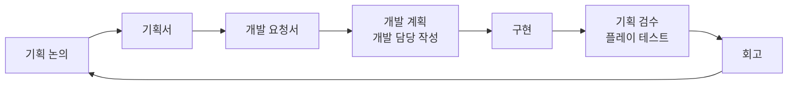
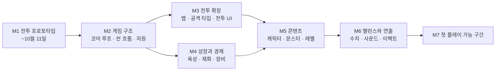

# 기획 로드맵

> 무엇을 어떤 순서로 기획할지 정리한 문서입니다. 개발 일정은 다루지 않습니다.
> 각 단계의 기획 결과는 **개발 요청서**로 개발 담당에게 넘기고, 개발 담당이 그 문서를 보고 개발 계획을 씁니다.
>
> - 기준일: 2026-10-22 (2026-10-02 작성, 2026-10-22 기획자 확인 [#209](https://github.com/minjunkim-dev/BGLike/issues/209)·[#210](https://github.com/minjunkim-dev/BGLike/issues/210)·[#220](https://github.com/minjunkim-dev/BGLike/issues/220)·[#237](https://github.com/minjunkim-dev/BGLike/issues/237) 답변 반영, 2026-10-27 능력치·동작 유형 기획서 색인 반영)
> - 남은 작업: [M7까지 남은 작업 지도](https://github.com/minjunkim-dev/BGLike/issues/200)
> - 관련 문서: [기획 현황](DESIGN_STATUS.md) · [전투 시스템 기획서](COMBAT_DESIGN.md) · [M1 개발 요청서](DEV_REQUEST_M1.md)
> - 표시: ✅ 정해짐 · 🟡 제안(합의 전) 또는 일부만 정해짐 · ❓ 정해야 함 · ⏸ 보류

---

## 목차

1. [기획과 개발의 연결](#1-기획과-개발의-연결)
2. [전체 흐름](#2-전체-흐름)
3. [기획 영역 지도](#3-기획-영역-지도)
4. [M1 전투 프로토타입 기획](#4-m1-전투-프로토타입-기획-10월-2일--10월-11일)
5. [M2 게임 구조 기획](#5-m2-게임-구조-기획)
6. [M3 전투 확장 기획](#6-m3-전투-확장-기획)
7. [M4 성장과 경제 기획](#7-m4-성장과-경제-기획)
8. [M5 콘텐츠 기획](#8-m5-콘텐츠-기획)
9. [M6 밸런스와 연출 기획](#9-m6-밸런스와-연출-기획)
10. [M7 첫 플레이 가능 구간 기획](#10-m7-첫-플레이-가능-구간-기획)
11. [기획 문서 목록](#11-기획-문서-목록)
12. [더 고민할 것](#12-더-고민할-것)

---

## 1. 기획과 개발의 연결

| 단계 | 담당 | 내용 |
|---|---|---|
| 기획서 | 기획 | 규칙과 수치. "무엇을" 만드는가 |
| 개발 요청서 | 기획 | 이번 단계의 목표, 범위, 우선순위, 검수 기준 |
| 개발 계획 | 개발 | 작업 분할, 순서, 일정. "어떻게, 언제" 만드는가 |
| 기획 검수 | 기획 | 개발 요청서의 검수 기준대로 직접 플레이해 확인 |
| 회고 | 함께 | 유지할 것, 바꿀 것. 다음 단계 기획의 입력 |

---

## 2. 전체 흐름

| 마일스톤 | 기획 목표 | 기획 결과물 | 상태 |
|---|---|---|---|
| **M1 전투 프로토타입** | BG3 전투를 구현해 프로젝트의 느낌을 확인 | 전투 시스템 기획서, 개발 요청서, 프로토타입 회고 | ✅ 범위 확정. 구현 완료 ([Issue #12](https://github.com/minjunkim-dev/BGLike/issues/12), [M1 검수 기록](M1_VERIFICATION.md)) |
| **M2 게임 구조** | 무엇을 반복하는 게임인지 정함 | 게임 비전, [게임 구조 기획서](GAME_STRUCTURE.md) (코어 루프, 씬 흐름, 자원, 아이템 구조, 사각 높이 격자) | ✅ 구조 확정, 비전 ⏸ 보류 |
| **M3 전투 확장** | 전투의 깊이와 전투 화면 | 맵, 공격 타입, 전투 UI 기획서 | 🟡 맵·높이·환경 규칙 확정(#136·#137), 구현(#163~#166, [#195](https://github.com/minjunkim-dev/BGLike/issues/195)). 전투 UI는 [#58](https://github.com/minjunkim-dev/BGLike/issues/58) 반영. 주사위 결과 피드백은 [#220](https://github.com/minjunkim-dev/BGLike/issues/220)에서 일부 정함(2026-10-22). 명칭·색 규칙은 기획자 정리 대기. 주사위·판정은 [능력치 기획서](ABILITY_SYSTEM.md)(2026-10-27 개정, 구현 [#377](https://github.com/minjunkim-dev/BGLike/issues/377)). 공격 타입 규칙은 [동작 유형 기획서](SKILL_TYPES.md) 초안, 도입은 후속 |
| **M4 성장과 경제** | 전투 사이에 강해지는 구조 | 아이템 수치·드랍 기획 (육성은 아이템뿐, 2026-10-07) | 🟡 수치·드랍([#61](https://github.com/minjunkim-dev/BGLike/issues/61))과 공용 가방([#175](https://github.com/minjunkim-dev/BGLike/issues/175)) 구현. 장비 수치 재검토는 [#205](https://github.com/minjunkim-dev/BGLike/issues/205) |
| **M5 콘텐츠** | 실제로 만들 것의 목록 | 캐릭터, 몬스터, 레벨 디자인 문서 | 🟡 몬스터7종·9개 배치 구현 (#107~[#113](https://github.com/minjunkim-dev/BGLike/issues/113)). 캐릭터 컨셉·스킬셋, 몬스터 성향은 기획자가 정리 중([#210](https://github.com/minjunkim-dev/BGLike/issues/210)·[#237](https://github.com/minjunkim-dev/BGLike/issues/237), 2026-10-22) |
| **M6 밸런스와 연출** | 수치와 손맛 | 밸런스 표, 사운드·이펙트 목록 | 🟡 밸런스 재검토 [#205](https://github.com/minjunkim-dev/BGLike/issues/205) |
| **M7 첫 플레이 가능 구간** | 처음부터 끝까지 하는 짧은 구간 | 구간 기획서 | 🟡 구간 범위 [#202](https://github.com/minjunkim-dev/BGLike/issues/202), 전투 외 화면·저장은 [#209 기획자 답](https://github.com/minjunkim-dev/BGLike/issues/209#issuecomment-6330756631)으로 정함([게임 구조 2-4·2-5](GAME_STRUCTURE.md#2-4-저장과-이어하기-)), 구현 #280~#287 |

- 각 마일스톤 끝에 그 단계의 개발 요청서를 씁니다.
- M3과 M4는 서로 기대지 않으므로 함께 기획할 수 있습니다.
- M2 이후 기간은 ❓입니다. M1 회고를 보고 정합니다.

---

## 3. 기획 영역 지도

| 분류 | 영역 | 마일스톤 |
|---|---|---|
| **게임 방향** | 게임 비전과 차별점, 사용자 타겟 | ⏸ 보류 (게임 비전을 다시 시작할 때 배치) |
| | 출시 플랫폼 | ✅ PC (2026-10-03) |
| **시스템 기획** | 코어 루프 | M2 |
| | 씬 구성과 씬 흐름도 (정비 시점, 보상 화면 포함) | M1 (전투 안 흐름), M2 (전체) |
| | 자원 시스템 | M2 |
| | 성장: 캐릭터 육성, 장비, 아이템 | M4 |
| | 성장 재화와 경제 | M4 (구조), M6 (밸런스) |
| **전투** | 전투 규칙 | M1 |
| | 공격 타입: 근거리/원거리, 대상/공간 조준, 직사/곡사, 속성 ([동작 유형 기획서](SKILL_TYPES.md)) | M1 (근거리/원거리), M3 |
| | 주사위 종류, 절대성공/절대실패 ([능력치와 주사위 판정 기획서](ABILITY_SYSTEM.md)) | M1 (d20 치명타·자동 실패), M3 |
| **UI/UX** | 전투 화면 레이아웃 | M1 (씬 구성, 화면 배치, 스킬 패널), M3 (완성) |
| | 주사위 결과 피드백 | M1 (로그와 숫자 팝업), M3 (설계) |
| | 전투 외 화면 (정비, 보상, 메뉴) | M2 (흐름), M7 (완성) |
| **콘텐츠** | 맵 기획 | M3 |
| | 캐릭터 기획, 몬스터 기획, 레벨 디자인 | M5 |
| **연출** | 사운드, 이펙트 | M6 |
| **기타** | 이야기와 세계관, 아트, 저장과 난이도 | M7 |

---

## 4. M1 전투 프로토타입 기획 (10월 2일 ~ 10월 11일)

### 4-1. 목표

**BG3 전투 시스템을 그대로 구현해, 이 프로젝트가 어떤 느낌인지 확인합니다.**

- 확인하는 것: 턴 자원, 반응, 스킬, 판정이 만드는 전술 판단이 재미있는가
- 확인하지 않는 것: UI 완성도, 연출, 아트, 밸런스

### 4-2. 기획 작업

| 순서 | 작업 | 산출물 | 기한 | 상태 |
|---|---|---|---|---|
| 1 | 스프린트 범위 결정 | [기획 현황](DESIGN_STATUS.md) | 10월 2일 | ✅ |
| 2 | 전투 규칙 기획 | [전투 시스템 기획서](COMBAT_DESIGN.md) | 10월 2일 | ✅ |
| 3 | 개발 요청 | [M1 개발 요청서](DEV_REQUEST_M1.md) | 10월 3일 | 🟡 초안 |
| 4 | 개발 질문 응답, 기획서 갱신 | 기획서 수정 | 스프린트 중 | |
| 5 | M2 게임 구조 초안 시작 | 게임 비전 초안 | 스프린트 중 | |
| 6 | 기획 검수: 개발 요청서의 검수 기준대로 플레이 | 검수 결과 | 10월 11일 | |
| 7 | 프로토타입 회고 | 회고 문서 | 10월 11일 | |

### 4-3. 범위 우선순위

범위의 우선순위는 기획이 정합니다. 일정이 밀리면 아래 순서로 뺍니다.

| 순서 | 뺄 항목 | 영향 |
|---|---|---|
| 1 | 밀치기 | 공용 동작이 물약만 남음 |
| 2 | 물약 | 공용 동작 없음 |
| 3 | 턴 묶음 | 한 명씩 턴 진행 (프로토타입과 같음) |

턴 자원, 판정, 기회 공격, 스킬, 기절은 빼지 않습니다. BG3 전투의 핵심이기 때문입니다.

### 4-4. 완료 기준

- [ ] 개발 요청서를 개발 담당이 받고, 개발 계획이 나왔다.
- [ ] 기획 검수를 마쳤다.
- [ ] 프로토타입 회고를 썼다. 회고에는 다음을 적는다.
  - 재미있던 점, 지루하거나 어려웠던 점
  - BG3 규칙 중 더 뺄 것, 다시 넣을 것
  - M2 이후 기획에 넘길 질문 (예: 운 관리, 전투 템포)

---

## 5. M2 게임 구조 기획

**입력: M1 프로토타입 회고.** 뒤의 모든 기획이 이 결정을 전제로 하므로 순서대로 진행합니다. 출시 플랫폼은 PC로 정했습니다(2026-10-03).

게임 비전과 사용자 타겟은 2026-10-15에 보류했습니다. 게임 비전을 다시 시작할 때 배치합니다. 보류 동안 M3~M5 기획은 비전 없이 진행합니다.

| 순서 | 영역 | 정할 내용 | 산출물 | 상태 |
|---|---|---|---|---|
| 1 | 게임 비전과 차별점 | 한 줄 소개, 핵심 재미 3가지, 범위와 목표 플레이 시간. 차별점은 캐릭터/스킬, 맵/지형, 진행 구조, 세계관, 전투 목표 중 선택 (2026-10-03: 이 스프린트에서 정함) | 게임 비전 | ⏸ 2026-10-15 |
| 2 | 사용자 타겟 | 누구에게 파는 게임인가. 도트 에셋 출처는 이후 #193의 사용자 위임으로 결정 | 게임 비전 | ⏸ 2026-10-15 |
| 3 | **코어 루프** | 한 번의 반복에서 무엇을 하는가, 한 판의 길이 | [게임 구조 기획서](GAME_STRUCTURE.md) 1~2장 | ✅ 2026-10-07 |
| 4 | **씬 구성과 흐름도** | 필요한 씬 목록, 씬 사이 이동, 정비 시점, 보상 화면 | [게임 구조 기획서](GAME_STRUCTURE.md) 2장, 4-3 | ✅ 2026-10-07 |
| 5 | **자원 시스템** | 전투 사이에 무엇이 남고 무엇이 회복되는가 | [게임 구조 기획서](GAME_STRUCTURE.md) 3장 | ✅ 2026-10-07 |
| 6 | 언어 | 지원 언어와 텍스트 관리 방식 | [기획 현황](DESIGN_STATUS.md) 2-2-2 | ✅ 2026-10-15 |

코어 루프, 씬 흐름, 자원은 [게임 구조 기획서](GAME_STRUCTURE.md)가 기준입니다. 3막 × 3스테이지, 막 단위 자원, 아이템 육성, 사각 높이 격자(2026-10-18, 헥사 격자를 대체)를 정했습니다. 남은 미정 항목은 그 문서 8장에 있습니다.

---

## 6. M3 전투 확장 기획

| 순서 | 영역 | 정할 내용 | 순서 이유 |
|---|---|---|---|
| 1 | 맵 기획 | 맵 크기, 장애물, 지형 요소, 높이 | 시야·엄폐와 직사/곡사의 전제 |
| 2 | 공격 타입 | 대상/공간 조준, 직사/곡사. 규칙은 [동작 유형 기획서](SKILL_TYPES.md)에서 정했고 칸 조준과 직사/곡사는 이 단계에서 도입 | 장애물이 있어야 의미가 생김 |
| 3 | 공격 속성 | 물리/마법 2종 또는 다양한 속성, 저항·취약·면역 | M5 몬스터 기획과 함께 확정 |
| 4 | 주사위와 판정 확장 | 주사위 종류, 절대면 체계. 규칙은 [능력치와 주사위 판정 기획서](ABILITY_SYSTEM.md)에서 정했고 치명타·절대성공의 추가 이점은 ⏸ | M1의 치명타·자동 실패를 확장 |
| 5 | 전투 UI 기획 | M1 배치를 바탕으로 레이아웃 완성, 정보 표시, 주사위 결과 피드백 | 규칙이 늘어난 뒤 한 번에 설계 |

### 주사위 결과 피드백 🟡

> 2026-10-21 [#204](https://github.com/minjunkim-dev/BGLike/issues/204): 치명타·자동 실패·유리/불리 팝업([#222](https://github.com/minjunkim-dev/BGLike/issues/222))과 적 턴 빠르게 보기([#221](https://github.com/minjunkim-dev/BGLike/issues/221))는 개발 결정입니다. 수식 노출은 2026-10-22 [#220 기획자 답](https://github.com/minjunkim-dev/BGLike/issues/220#issuecomment-6331002448)으로 정했습니다([팝업 문구 규칙](COMBAT_UIUX.md#팝업-문구-규칙), 구현 #289).

| 질문 | 결정 |
|---|---|
| 굴림을 어디에 보여주나 | ✅ 유닛 머리 위 팝업(결과 중심)과 전투 로그. 주사위 굴리는 연출은 개발 결정([#222](https://github.com/minjunkim-dev/BGLike/issues/222))으로 넣지 않음 |
| 수식을 얼마나 보여주나 | ✅ 팝업은 결과만(명중이면 피해 합계, 빗나가면 `빗나감`). 로그는 전체 수식([팝업 문구 규칙](COMBAT_UIUX.md#팝업-문구-규칙)의 예) |
| 유리/불리는 어떻게 보여주나 | ✅ 팝업에서는 보이지 않음. 명중률 미리보기와 로그의 두 주사위로 확인 |
| 치명타·자동 실패 연출 | ⏸ 치명타는 비활성, 팝업 없음([#321](https://github.com/minjunkim-dev/BGLike/issues/321), [팝업 문구 규칙](COMBAT_UIUX.md#팝업-문구-규칙)). 빗나감은 `빗나감`. 절대성공의 추가 이점은 [능력치 기획서 4-12](ABILITY_SYSTEM.md#4-12-치명타와-절대성공의-이점-) ⏸ |
| 연출이 턴 속도를 늦추면 | ✅ 빠르게 보기([#221](https://github.com/minjunkim-dev/BGLike/issues/221), 개발 결정) |
| 회복 수치 | ✅ 초록색, 부호 없음. 나머지 이로운/해로운 수치의 색은 ❓ |

---

## 7. M4 성장과 경제 기획

| 순서 | 영역 | 정할 내용 |
|---|---|---|
| 1 | 캐릭터 육성 | 레벨업, 능력치 성장, 스킬 습득. 능력치 성장은 ⏸ [주사위 육성 논의](DICE_GROWTH.md)(단위는 주사위 레벨) |
| 2 | 장비 | 무기와 방어구. 무기가 공격 타입을 정하는지 |
| 3 | 아이템 | 소모품 종류, 획득 경로, 소지 한도 |
| 4 | 성장 재화 | 재화 종류, 얻는 곳, 쓰는 곳 (재화 흐름도) |

이 단계에서는 **구조**만 정합니다. 수치는 콘텐츠가 나온 뒤 M6에서 맞춥니다.

---

## 8. M5 콘텐츠 기획

캐릭터와 몬스터를 디자인할 때 채우는 항목은 [캐릭터 디자인 기획서](characters/README.md)와 [몬스터 디자인 기획서](monsters/README.md)에 있습니다.

| 순서 | 영역 | 정할 내용 |
|---|---|---|
| 1 | 캐릭터 기획 | 직업 수와 역할, 직업별 스킬(직업별 스킬 수는 늘어남, 미정), 파티 규모, 영구 사망 여부 |
| 2 | 몬스터 기획 | 종류, 역할(근접 / 원거리 / 지원), 고유 스킬과 AI(몬스터별 성향은 기획자가 정리 중. 장판은 덜 밟는 경로를 기본으로 함, [#237](https://github.com/minjunkim-dev/BGLike/issues/237)), 속성 저항 |
| 3 | 레벨 디자인 | 전투별 맵·배치·목표(전멸 / 생존 / 탈출 / 호위), 난이도 곡선 |

---

## 9. M6 밸런스와 연출 기획

| 영역 | 정할 내용 |
|---|---|
| 성장 재화 밸런스 | 전투당 획득량, 성장 비용, 목표 플레이 시간에 맞춘 곡선 |
| 전투 밸런스 | 직업·몬스터 수치, 명중률과 피해 기대값 |
| 사운드 | 효과음 목록(공격, 명중, 빗나감, 치명타, 주사위), 배경음 분위기 |
| 이펙트 | 공격·스킬·상태 이상·주사위 연출 목록과 우선순위 |

---

## 10. M7 첫 플레이 가능 구간 기획

| 영역 | 정할 내용 |
|---|---|
| 구간 범위 | ✅ 9전투 전체(1-1 → 3-3, `3막 졸업`). [#209](https://github.com/minjunkim-dev/BGLike/issues/209) |
| 이야기와 세계관 | 배경, 주인공, 대화·선택지 비중, 게임 정식 이름 |
| 아트 | 도트 에셋 제작. 출처는 [#193](https://github.com/minjunkim-dev/BGLike/issues/193)에서 정함([기획 현황](DESIGN_STATUS.md)). 최종 아트 승인은 남음 |
| 저장과 난이도 | 저장 방식, 난이도 옵션. 정함([게임 구조 2-4·2-5](GAME_STRUCTURE.md#2-4-저장과-이어하기-)), 구현 #280~#287 |
| 전투 외 화면 | 타이틀, 정비, 보상, 메뉴, 설정. 타이틀·메뉴·설정은 정함([게임 구조 2-4·2-5](GAME_STRUCTURE.md#2-4-저장과-이어하기-)), 구현 #280~#287 |

---

## 11. 기획 문서 목록

| 문서 | 마일스톤 | 상태 |
|---|---|---|
| [기획 현황](DESIGN_STATUS.md) | 공통 | ✅ |
| 기획 로드맵 (이 문서) | 공통 | ✅ |
| [전투 시스템 기획서](COMBAT_DESIGN.md) | M1 | ✅ |
| [M1 개발 요청서](DEV_REQUEST_M1.md) | M1 | 🟡 초안 |
| M1 프로토타입 회고 | M1 | ❓ 10월 11일 |
| [게임 구조 기획서](GAME_STRUCTURE.md) (코어 루프, 씬 흐름, 자원, 아이템 구조, 사각 높이 격자) | M2 | 🟡 수치 일부 ❓ |
| [막 진행과 자원 검증](ACT_PROGRESSION.md) | M2 | ✅ #54 구현 기록 |
| [헥사 격자 시안](HEX_GRID_PREVIEW.md) | M2 | 대체된 기록 (2026-10-18) |
| 게임 비전 | M2 | ⏸ 보류 |
| [맵 기준](TERRAIN_MAPS.md)과 [게임 구조 기획서 6장](GAME_STRUCTURE.md#6-사각-높이-격자) (맵·높이·환경) | M3 | ✅ 9개 지형 맵 구현 ([#195](https://github.com/minjunkim-dev/BGLike/issues/195)) |
| [전투 화면 정보 정리](COMBAT_UIUX.md) (전투 UI) | M3 | 🟡 [#58](https://github.com/minjunkim-dev/BGLike/issues/58) 반영. 후속 표시 Issue 진행 |
| [동작 유형 기획서](SKILL_TYPES.md) (공격 타입) | M3 | 🟡 초안. 칸 조준·직사/곡사는 M3 공격 타입 단계에서 도입 |
| [아이템 안내](ITEM_LOOT.md)와 [게임 구조 기획서 4장](GAME_STRUCTURE.md#4-아이템) (아이템·드랍·정비) | M4 | 🟡 수치·공용 가방 구현. 장비 수치 재검토 ❓ [#205](https://github.com/minjunkim-dev/BGLike/issues/205) |
| [캐릭터 디자인 기획서](characters/README.md) (뼈대), [전사](characters/warrior.md), [궁수](characters/archer.md) | M5 | 🟡 항목 확정. 캐릭터 컨셉·스킬셋은 기획자가 정리 중([#210](https://github.com/minjunkim-dev/BGLike/issues/210)) |
| [몬스터 디자인 기획서](monsters/README.md) | M5 | ✅ 몬스터7종을 #107~#112에서 구현. #113 [통합 검수](M5_VERIFICATION.md) 완료 |
| [스테이지 배치](stages/README.md) (레벨 디자인) | M5 | ✅ 9개 배치와 시작 좌표 구현. 직접 플레이 상태는 [통합 검수](M5_VERIFICATION.md), 맵 지형은 [맵 기준](TERRAIN_MAPS.md) |
| [도트 아트와 지형 제작](PIXEL_ART.md), [유닛 이미지 납품 규격](UNIT_IMAGE_TEMPLATE.md) | M7 아트 | ✅ #193·#194 채택 |
| 밸런스 표, 사운드·이펙트 목록 | M6 | ❓ |
| 첫 플레이 가능 구간 기획서 | M7 | ❓ |
| 각 마일스톤의 개발 요청서 | 각 단계 끝 | ❓ |

---

## 12. 더 고민할 것

로드맵에 아직 넣지 않은 주제입니다. 넣을지와 시기를 정해야 합니다.

| 주제 | 왜 필요한가 | 권하는 시기 |
|---|---|---|
| **범위와 목표 플레이 시간** | 두 사람이 만들 수 있는 양을 먼저 정해야 콘텐츠 수가 나옴 | ⏸ 보류 (게임 비전에 포함) |
| **운 관리** | d20 게임은 연속 빗나감이 큰 불만. 표시 확률 보정, 시드 고정, 다시 하기 허용 여부 | [#220 기획자 답](https://github.com/minjunkim-dev/BGLike/issues/220#issuecomment-6331002448)으로 정함: 보정 없음, 시드 고정 없음([전투 4-5](COMBAT_DESIGN.md#4-5-운과-난수)), 전투 중 되돌리기 없음과 `전투 포기`([게임 구조 2-5](GAME_STRUCTURE.md#2-5-전투-밖-화면-)) |
| **전투 템포** | 턴제는 연출이 쌓이면 느려짐. 빠르게 보기, 적 턴 가속 | [#204](https://github.com/minjunkim-dev/BGLike/issues/204)에서 개발 결정. 구현 [#221](https://github.com/minjunkim-dev/BGLike/issues/221) |
| **튜토리얼** | 5e 규칙(유리/불리, 내성, 반응)은 처음 보는 사람에게 어려움 | M7. 정적 `도움말` 화면으로 정함([게임 구조 2-5](GAME_STRUCTURE.md#2-5-전투-밖-화면-), 구현 #287) |
| **라이선스 표기** | SRD 5e(CC-BY-4.0)는 게임 안에 출처 표기가 필요. 폰트·무료 에셋 라이선스도 확인 | M7 이전. SRD 고지 문서와 배포 묶음은 [#213](https://github.com/minjunkim-dev/BGLike/issues/213) 완료. 게임 안 출처 화면은 타이틀 화면 [#283](https://github.com/minjunkim-dev/BGLike/issues/283) |
| **플레이 테스트 방법** | 무엇을 보고 재미를 판단할지 (승률, 전투 시간, 막힌 지점) | M1 회고 양식에 반영 |
| **출시 형태** | 스토어, 가격, 데모 공개 시점 | M7 이전 |
