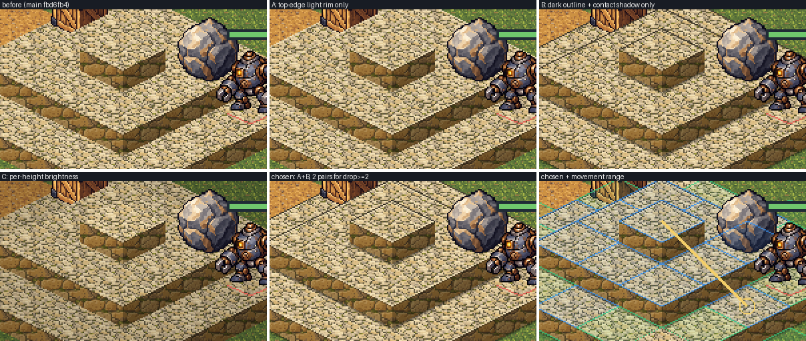
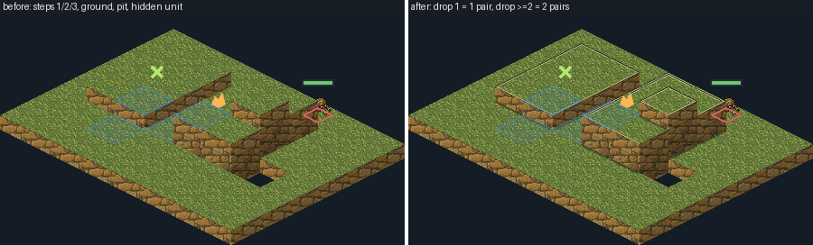
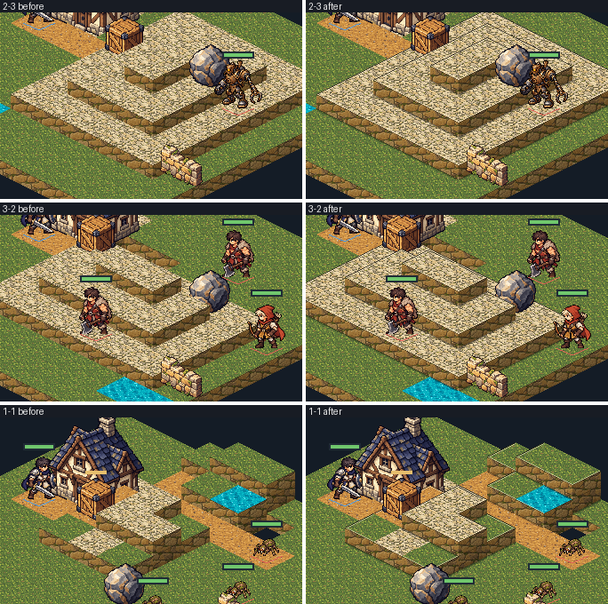

# 실제 도트 지형과9개 맵

[#193](https://github.com/minjunkim-dev/BGLike/issues/193)의 사용자 위임과 [#195](https://github.com/minjunkim-dev/BGLike/issues/195)에 따른 첫 실제 지형 배치다. 아래 이름은 배치를 구분하는 작업명이다. 새 세계관 설정이나 최종 밸런스를 확정하지 않는다. 기존9개 로스터·아군/적 시작 칸·수치·보상·진행 순서를 유지한다. 배치의 정본은 `scenes/combat/stages/act*_stage*.tres`다. [좌표 지도](stages/README.md)는 이 자원의 현재 배치를 함께 표시한다.

## 맵 구성

| 스테이지 | 작업명 | 최대 높이 | 높이 있는 칸 | 배치 의도 |
|---|---|---|---|---|
| 1-1 | 숲길 입구 | 2 | 14 | 입구 집 뒤의 길과 중앙 낮은 단상 |
| 1-2 | 버려진 안뜰 | 2 | 16 | 안뜰의 넓은 계단과 작은 고지 |
| 1-3 | 작은 작업장 | 3 | 25 | 석재 작업장과 높이3 중심 |
| 2-1 | 시냇가 둥지 | 2 | 16 | 여러 건널목이 있는 물길과 둥지 |
| 2-2 | 무너진 돌길 | 2 | 16 | 끊어진 돌길의 우회와 단상 |
| 2-3 | 계단식 작업장 | 3 | 30 | 안쪽으로 한 층씩 올라가는 작업장 |
| 3-1 | 갈라진 숲 | 2 | 16 | 갈라진 숲길과 뒤쪽 고지 |
| 3-2 | 고지대 폐허 | 3 | 24 | 앞쪽 고지와 폐허 사이 접근로 |
| 3-3 | 중앙 주조장 | 3 | 30 | 중앙 석재 단상과 주조장 접근로 |

높이1 계단으로 고지에 걸어갈 수 있다. 점프는 기존 규칙의 지름길로 쓴다. 모든 열린 바닥과 적 스폰에는 보행 경로를 둔다. 상자와 바위가 초기 위치를 막은 상태에서도 확인한다. 엄마 거미 주변에는 소환 여유를 남긴다. 물은 기존 화상 규칙만 적용한다. 새 물 이동 비용·깊은 물·낙하 규칙을 추가하지 않는다.

## 접근로와 물체 배치 (#347)

`개발 결정`([#347](https://github.com/minjunkim-dev/BGLike/issues/347), 2026-10-25 사용자 진행 승인): 각 맵의 기존 상자1개·바위1개를 접근로와 높이에 맞춰 둔다. 상자는 그 오른쪽 진입 칸까지의 짧은 길을 막으며, 부수지 않고 돌아가는 보행 경로도 남긴다. 바위는 왼쪽의 보행 가능한 공격 위치에서 기존 평지/내리막 굴림으로 아래 적과 충돌할 각도를 갖는다. 적이 이동하면 그 각도도 바뀐다. 고정 명중 보장이나 새 시야 차단/엄폐 규칙을 추가하지 않는다.

| 맵 | 상자 → 열린 진입 칸 | 우회/파괴 후 보행 칸 수 | 바위 · 공격 위치 → 초기 충돌 가능 적 |
|---|---|---|---|
| 1-1 | (3,4) → (4,4) | 5 / 3 | (6,6) · (5,6) → 새끼 거미(7,6) |
| 1-2 | (3,4) → (4,4) | 5 / 3 | (6,4) · (5,4) → 야만인(7,4) |
| 1-3 | (4,4) → (5,4) | 6 / 4 | (7,4) · (6,4) → 로봇(8,4) |
| 2-1 | (3,4) → (4,4) | 5 / 3 | (6,4) 유지 · (5,4) → 엄마 거미(9,4) |
| 2-2 | (4,4) → (5,4) | 6 / 4 | (6,6) · (5,6) → 궁수(8,6) |
| 2-3 | (4,4) → (5,4) | 6 / 4 | (7,4) · (6,4) → 로봇(8,4) |
| 3-1 | (4,4) → (5,4) | 6 / 4 | (6,4) · (5,4) → 새끼 거미(7,4) |
| 3-2 | (3,4) → (4,4) | 5 / 3 | (7,4) · (6,4) → 궁수(9,4) |
| 3-3 | (4,4) → (5,4) | 6 / 4 | (7,4) · (6,4) → 로봇(8,4) |

칸 수는 아군 전사 시작 칸에서 실제 높이·장식·물체·초기 적 배치를 반영한 보행 경로다. 상자에 드는 공격 행동·기회 공격·이후 적 이동을 포함한 유불리나 전투 시간을 뜻하지 않는다. 로봇 맵의 진입 상자는 중앙 작업장으로 오르는 짧은 계단길, 바위는 보스 쪽 내리막을 공통으로 활용한다. 2-1은 기존 바위 각도가 이미 유효하므로 유지하고 상자만 진입로로 옮긴다.

높이·물·낭떠러지·장식 footprint·스폰·물체 수·수치·증식 규칙은 그대로다. 모든 열린 바닥/적에 보행 경로가 남고 엄마 거미의 초기 소환 여유3칸을 보존한다. 기존 저장은 저장된 물체의 위치와 내구도를 그대로 복원하며 새 전투/막 재시작부터 새 초기 배치를 쓴다. 위치 변화도 난이도에 영향을 주므로 #205의 이전 측정은 이전 배치의 결과로 보존한다. 이번 배치를 최종 밸런스 승인으로 해석하지 않는다.

## 기능 테스트용 큰 맵 (#394)

`개발 결정`([#394](https://github.com/minjunkim-dev/BGLike/issues/394)): 카메라 이동·확대, 경로 탐색, 많은 유닛을 시험하는 테스트 전용 맵을 `tests/large_map.tres`(적 배치 `tests/large_map_enemies.tscn`)에 둔다. 실제9개 맵의 크기·배치·스폰과 [맵 크기10×10](GAME_STRUCTURE.md#6-1-타일과-맵)은 바꾸지 않는다(#205).

- 크기는28열×20행(560칸)이다. 가로·세로 모두 실제 맵보다 크다. 정사각이 아니므로 가로·세로를 바꿔 쓴 오류가 드러난다. 현재 고정 카메라에서는 사방이 화면 밖으로 넘친다. 20×20은 가로가 거의 화면에 들어가 카메라 이동 시험이 약하다. 더 큰 맵은 자동 검사 시간이 늘지만 시험할 요소는 늘지 않는다.
- 구성은 높이0~3, 높이1 계단, 물, 낭떠러지, 상자·바위, 장식을 모두 쓴다. 높이 차2 이상의 절벽 면도 둔다. 아래 지도는 설명용이며 정본은 자원 파일이다.
- 아군은 기존2명이다. 적13명은 새끼 거미6, 엄마 거미2, 풋내기 야만인2, 풋내기 궁수2, 고철로봇-3000 1이다. 수치·규칙은 그대로이며 난이도 기준이 아니다. 아군 시작 칸은 고정 카메라의1280×720 화면에서 상단 HUD에 가리지 않는 곳이다.
- 진입점은 저장소 루트의 `godot --path . --script res://tests/large_map_battle.gd`다. 실제 게임 장면을 열기 전에 그 세션의1-1 자리만 큰 맵으로 바꾸고 자동 저장을 끈다. 이기고 정비를 마치면 실제1-2로 넘어가고, 지면 큰 맵을 다시 한다. 그 세션은 저장하지 않는다. `타이틀로` 뒤의 새 게임·이어하기는 장면 파일의 실제9개 진행을 새로 연다. 타이틀·새 게임·이어하기·졸업·저장 코드는 바꾸지 않는다. 메인 장면의 실행 인자(`-- --test-map`)는 출시 코드에 개발 분기를 두므로 쓰지 않는다.
- 배포 묶음에는 넣지 않는다. 검증용 PCK 설정의 `exclude_filter`가 이미 `tests/*`를 뺀다. 2026-10-27 로컬 `--export-pack`의 PCK에 `large_map` 경로가 없음을 확인했다.
- `tests/combat_progression_test.gd`가 크기, 높이0~3, 절벽 면, 물·낭떠러지·상자·바위·장식, 모든 열린 바닥과 적 스폰의 보행 연결, 엄마 거미 소환 여유를 확인한다. 진입점과 같은 장면으로 전투를 열어 바닥 표시, 유닛·물체 배치, 아군 이동과 첫 라운드의 적 차례 진행, 자동 저장 없음과 실제9개 진행 유지도 확인한다.

```text
x→ 0         1         2
   0123456789012345678901234567
 0 T......~~.............##....
 1 ..1111.~~.E.T.........##.111
 2 ..1221.~~.....W.......##.122
 3 ..1221.~~T..........E.##.1E2
 4 ..1111.~~.............##.111
 5 .......~~..111111111..##=...
 6 .......~~..122222221.E##=...
 7 .......~~..123333321....=E..
 8 .......~~..R23333321....=...
 9 .......~~..1233E3321....=...
10 ======C~~==123333321======E=
11 .......~~..123333321E...=...
12 ......A~~..123E33321....=...
13 .....#A~~..122222221..##=WW.
14 .....#.~~..111111111..##=...
15 ..HH...~~...........22##=..E
16 ..HH...~~..........122##=.E.
17 .......~~.T....W...122##....
18 .......~~E........T.22##E...
19 T......~~.............##...T
```

`.` 높이0 바닥, `=` 길, `~` 물, `#` 낭떠러지, 숫자는 높이(가운데·북서·동쪽 언덕, 남동쪽 높이2 턱), `T` 나무, `W` 무너진 벽, `H` 집(2×2), `C` 상자, `R` 바위, `A` 아군, `E` 적이다. `A`·`E`·`C`·`R` 칸은 둘러싼 단과 같은 높이다.

## 자산과 좌표

잔디·황토 길·석재·벽·물의 원본은 내장 image_gen으로 제작했다. 바닥은64×32 실제 픽셀의 마름모다. 각 재질은2개 변형을 쓴다. 논리 바닥32×16과 높이당8은 유지한다. 타일의 영역과 깊이는 논리 크기의 프록시 아틀라스를 사용한다. 타일 재질의 셰이더는 같은 UV에서 두 배 밀도의 실제 원본을 sharp bilinear로 읽는다. 1텍셀이 정수 화면 픽셀이면 Nearest와 같다([해상도 ADR](adr/0002-resolution.md#1080p-도트-표시-264)). 표시 크기 override에서 발생하는 타일 영역 잘림을 피한다. 원본 픽셀 데이터는 유지하므로 최소 창1280×720에서 실제 도트 디테일을 읽을 수 있다. 높이 측면에는 벽 텍스처를 붙인다. 이웃과 높이가 다른 윗면 가장자리는 [높이 경계](#높이-경계-392)를 따른다. 높이0의 맵 가장자리에는8 논리px 기초 측면을 표시한다. 기초 측면은 바닥이나 추가 이동 공간이 아니다.

상자·바위·나무·무너진 벽은64px 폭, 나무는96px 높이다. 작은 집은128×128이다. Sprite scale0.5로 표시한다. 발밑은 프레임 아래8 실제px 위의 중앙이다. 상자·바위는 기존 상호작용 규칙을 사용한다. 미리보기는 실제 프레임의 윤곽을 강조한다. 클릭 판정은 PNG의 불투명 픽셀을 사용한다. 나무·무너진 벽은1×1칸, 집은2×2칸을 차지한다. `CombatStage.SCENERY_SIZE`를 표시와 이동 차단이 함께 사용한다. 집은 네 바닥 높이가 같은 곳에 둔다.

그림을 위로 올려도 깊이 정렬 원점은 바닥에 유지한다. 집은2×2 footprint의 앞 칸을 정렬 원점으로 쓴다. 앞 장식이 유닛을 가리면 기존 실제 윤곽 표시를 사용한다. 장식의 투명 여백이 뒤쪽 바닥의 입력을 가로채지 않는다. 초상과 상태 표시 등 전투 UI는 [유닛 아트 기준](PIXEL_ART.md)을 따른다.

원본·정확한 프롬프트·생성 모드는 `scenes/combat/art/sources/world_generation.json`에 보존한다. 선택한10개 원본과 나무의 첫 원본을 함께 보존한다. 나무의 투명 가장자리 교정 프롬프트도 기록한다. `normalize_terrain.py`는 원본의 자르기·nearest 축소·이진 투명도·마름모 투영만 수행한다. 원본을 대신하는 그림을 코드로 그리지 않는다. 런타임에 Pillow를 추가하지 않는다. 출처와 조건은 [자산 고지](../THIRD_PARTY_NOTICES.md)를 따른다.

## 검증과 완료 근거

기존 CombatStage/CombatGrid와 실제 전투 장면이 검사 접점이다. 배치 검사는9개 실제 자원의 스폰·고지·보행 연결과 엄마 거미 소환 여유를 확인한다. 화면 검사는 실제 고밀도 텍스처 데이터, 실제 오브젝트 PNG와 기존 입력·공격·진행을 확인한다. 현재 자동 배치 검사1519개와 HUD 검사1769개가 통과했다. 이 수치는 작성 시점의 검사다. 최종 전체 검사·두 배율 원본 화면·직접 입력·독립 리뷰·CI·병합·main 확인은 #193/#194/#195의 최종 Evidence로 확인한다. 파일 존재나 이 문서만으로 완료를 선언하지 않는다. 통계적 캠페인 밸런스와 출시 패키지 검증은 별도 범위다.

최종 head·두 해상도 9개 맵 직접 확인 기록·대표 캡처는 [#195 최종 검증 근거](https://github.com/minjunkim-dev/BGLike/issues/195#issuecomment-6315984269)에 있다. 점프·화살·상자 공격의 직접 확인은 [#194 최종 검증 근거](https://github.com/minjunkim-dev/BGLike/issues/194#issuecomment-6315983770)에 있다. 엄마 거미 소환은 로그와 원본 캡처가 있지만 그 장면의 화면 검수 기록은 근거 없음으로 기록했다.

#347의 배치 회귀는 실제 자원에서 모든 열린 바닥/적의 보행 연결, 상자 파괴 전후 진입 경로, 도달 가능한 바위 공격 위치와 초기 적 충돌, 엄마 거미 초기 소환 여유를 검사한다. HUD 회귀는 약한 면/윤곽·기존 색 의미·바닥 높이·표시 제거를, 저장 회귀는 재배치 전 물체 좌표·내구도를 포함한 왕복을 확인한다. 반복 화면/GUI 입력 사례는 `tests/terrain_qa.gd`와 기존 `scripts/manual_qa.py`로 실행한다. 최종 SHA·원본 검토·독립 리뷰·CI·병합 결과는 [#347](https://github.com/minjunkim-dev/BGLike/issues/347)의 완료 근거를 따른다.

`개발 결정`([#349](https://github.com/minjunkim-dev/BGLike/issues/349)): 유닛을 가리는 앞 사물만 표시 투명도를 낮춘다. 가림·클릭 판정은 원본 불투명 픽셀을 그대로 사용한다. 높은 지형 뒤 유닛도 반투명 몸통과 팀색 발밑 마름모로 위치를 알린다. 옆면은 한 광원 방향의 명암·아래쪽 어두워짐·높이 단위 경계를 사용한다. 논리 높이·좌표·배치·통행 판정과 원본 자산은 유지한다.

## 높이 경계 (#392)

2026-10-27 main `fbd6fb4`의9개 맵을 화면 밖(Xvfb·OpenGL3 llvmpipe)에서 1280×720으로 렌더해 재현했다. 높이3이 있는 1-3·2-3·3-2·3-3과 높이 차2가 있는 1-1·3-2를 포함한다. #349 뒤에도 남은 원인은 다음과 같다.

1. 뒤쪽(왼쪽 위·오른쪽 위) 가장자리에는 옆면이 보이지 않는다. 높은 윗면이 같은 재질의 낮은 윗면에 바로 붙어 경계가 사라진다. 같은 재질의 단상은 꺼진 구덩이로도 읽힌다.
2. 앞쪽 가장자리는 옆면 첫 줄만 어둡다. 밝은 석재 윗면과 덜 어두운 왼쪽 옆면의 명도 차가 작아 단 끝이 흐리다.
3. 옆면이 낮은 윗면과 만나는 발치에 접지 표시가 없다. 옆면 아래 끝이 낮은 윗면의 텍스처와 섞인다.
4. 높이 차1과 차2는 앞쪽 옆면의 높이로만 다르다. 뒤쪽 가장자리에서는 구분되지 않는다.



| 후보 | 결과 |
|---|---|
| A. 윗면 가장자리 밝은 선 | 앞쪽 단 끝은 또렷하다. 뒤쪽 같은 재질 경계는 밝은 석재 위의 밝은 선이라 거의 보이지 않는다 |
| B. 어두운 윤곽 + 단 아래 접지 그림자 | 뒤쪽 경계와 발치가 보인다. 앞쪽 단 끝은 그대로이고 어두운 선만 늘어 홈처럼도 읽힌다 |
| C. 높이별 명도 차(한 단마다8% 어둡게) | 층은 나뉘지만 경계선이 없다. 높이0의 잔디·길·물 전체 색이 바뀌어 재질·물·장판 읽기와 원본 색을 해친다 |

`개발 결정`([#392](https://github.com/minjunkim-dev/BGLike/issues/392)): A와 B를 함께 쓴다. 칸마다 바닥인 이웃4칸과의 논리 높이 차를 읽어 윗면에 덧그린다.

- 앞쪽이 낮으면 윗면 끝1도트를 밝게 한다. 그 아래 #349 옆면의 어두운 첫 줄과 함께 단 끝을 만든다.
- 뒤쪽이 낮으면 높이 단위마다 어두운 선·밝은 선 한 쌍을 그린다. 차2 이상은 두 쌍이다. 걷기·근접의 높이 차2 기준과 같은 경계에서 표시가 달라진다. 앞쪽 차는 옆면 높이와 #349의 높이 단위 경계로 구분한다.
- 뒤쪽이 높으면 이 칸 윗면 뒤 가장자리에 접지 그림자를 둔다. 차1은2도트, 차2 이상은3도트이며 바깥에서 안쪽으로 옅어진다. 앞쪽이 높으면 그 윗면이 가장자리를 덮으므로 그리지 않는다.
- 맵 밖과 낭떠러지 쪽은 기존 기초 측면·구멍 표시를 그대로 둔다.
- 바닥 원본과 같은 두 배 밀도64×32 마름모에 도트 단위로 그린다. 타일과 같은 sharp bilinear 재질로0.5배 표시한다. 1280×720에서1화면px, 1920×1080에서 다른 도트와 같은1.5px이다.
- 표시는 해당 칸 타일 바로 뒤에 y정렬한다. 앞 칸의 타일·사물·유닛과 이동 범위 면·윤곽·경로, 장판, 가림 표시는 그 위에 그린다.

논리 높이·좌표·통행·높이 규칙·클릭과 가림 판정·맵 배치·원본 자산은 바꾸지 않는다. 표시 노드는 판정에 쓰지 않고 맵을 다시 만들 때 제거한다. 대안 A·B·C 단독과 함께, 원본 타일을 다시 그리는 방식은 이번 범위 밖이라 쓰지 않는다. 셰이더가 이웃 높이를 읽는 방식은 경계 계산이 셰이더와 맵 자료로 나뉘어 검사·유지 비용이 커서 쓰지 않는다. 이 결정은 임시 자산의 표시 보완이며 최종 아트 승인을 대신하지 않는다.





화면 밖 렌더로9개 맵을 1280×720·1920×1080·1440×900(정수 배율2, 1280×800 표시)에서 확인했다. 이동 범위의 파랑·초록 의미와 윤곽, 노란 경로, 물, 장판 표식, 낭떠러지, #349의 팀색 발밑 표시가 경계 위에 그대로 보인다. 변경 전후 픽셀 차이는 지도 영역 안에만 있다. HUD 회귀는 칸별 경계 노드의 위치·도트 밀도와 높이 차1/2·앞/뒤·접지·덮인 가장자리·낭떠러지·이동 표시 순서·재구축 제거를 실제 텍스처 도트로 확인한다. 실제 창에서의 높이감·도트 선명도와 색 구분 체감은 사람이 확인한다.
