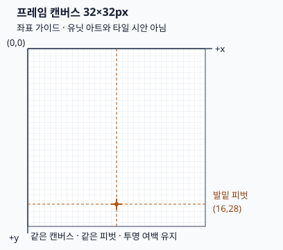

# 공통 유닛 이미지 납품 규격

이 문서는 외부 제작자에게 전달할 임시 유닛 이미지 규격이다.
기준은 [Issue #125](https://github.com/minjunkim-dev/BGLike/issues/125)와 [위임된 결정](https://github.com/minjunkim-dev/BGLike/issues/125#issuecomment-6296693719)이다.
캔버스·피벗·파일 형태·경로·납품 조건은 사용자의 선택 위임으로 채택한 초기 권장안이다. 기획자의 명시 수치와 구분한다.
화풍, 프레임 수와 재생 속도는 [#193의 실제 아트 제작 기준](PIXEL_ART.md)을 따른다.

## 프레임과 피벗

| 항목 | 규격 |
|---|---|
| 적용 대상 | 플레이어와 몬스터 공통 |
| 프레임 캔버스 | 64×64px. 모든 상태·방향·프레임이 같은 크기 |
| 좌표 | 왼쪽 위가(0,0). 오른쪽이+x, 아래가+y |
| 발밑 피벗 | (32,56). 모든 프레임에서 고정 |
| 상태 | `idle`(대기), `move`(이동), `attack`(공격) |
| 방향 | `left`(화면 왼쪽), `right`(화면 오른쪽). 각각 제작 |

캔버스는 이미지를 담는 사각 영역이다. 타일의 논리 모양이나 바닥 면적이 아니다.
바닥 폭32 논리px에64px 원본을 scale0.5로 표시한다. 논리 피벗은(16,28)이다.
그림의 내용에 맞춰 캔버스를 잘라내거나 프레임마다 피벗을 옮기지 않는다.
발을 드는 자세에서도 피벗은 같은 바닥 기준점을 유지한다.
좌우 이미지를 각각 제작한다. 엔진의 좌우 반전으로 한쪽 납품을 대체하지 않는다.



위 그림은 좌표 가이드다. 제작할 유닛의 모습·비율·화풍이나 최종 아트 시안이 아니다.

## 파일과 위치

개별 PNG 프레임으로 받는다. 여러 프레임을 한 이미지 시트로 합치지 않는다.
PNG는64×64px, RGBA8, 투명 배경을 사용한다.
픽셀 좌표와 파일 크기를 정수로 유지한다. 투명 여백도 캔버스에 포함한다.

```text
scenes/combat/art/units/<unit_id>/<state>/<direction>/000.png
```

예: `scenes/combat/art/units/warrior/idle/left/000.png`.
Godot 리소스 경로는 앞에 `res://`를 붙인다.
프레임 번호는000부터 연속으로 붙인다. 001·002 순으로 이어가며 중간 번호를 비우지 않는다.
대기·이동·공격과 좌·우의 여섯 조합을 모두 납품한다.
프레임 수와 재생 속도는 제작 후 테스트나 레퍼런스 조사로 정한다. 여섯 조합의 프레임 수가 같아야 한다는 규칙은 두지 않는다.

`unit_id`는 기존 개별 기획 문서 파일명의 하이픈을 밑줄로 바꾼 값이다.
파일·폴더는 소문자 `snake_case`를 쓴다.
화면 표시이름은 가칭이므로 경로의 식별자로 사용하지 않는다. 코드의 임시 `Kind`도 자산 식별자가 아니다.

| unit_id | 현재 표시이름 | 기준 문서 |
|---|---|---|
| `warrior` | 전사 | [캐릭터](characters/warrior.md) |
| `archer` | 궁수 | [캐릭터](characters/archer.md) |
| `spiderling` | 새끼 거미 | [몬스터](monsters/spiderling.md) |
| `mother_spider` | 엄마 거미 | [몬스터](monsters/mother-spider.md) |
| `novice_barbarian` | 풋내기 야만인 | [몬스터](monsters/novice-barbarian.md) |
| `novice_archer` | 풋내기 궁수 | [몬스터](monsters/novice-archer.md) |
| `scrap_robot_1000` | 고철로봇-1000 | [몬스터](monsters/scrap-robot-1000.md) |
| `scrap_robot_2000` | 고철로봇-2000 | [몬스터](monsters/scrap-robot-2000.md) |
| `scrap_robot_3000` | 고철로봇-3000 | [몬스터](monsters/scrap-robot-3000.md) |

이 표는 현재9개 문서의 대응표다. 최종 세계관 이름을 승인한 표가 아니다.
현재 로더는 위9개 식별자의 경로를 읽는다. 새 유닛을 추가할 때는 문서·식별자 대응·실제 프레임을 함께 연결한다.

## 납품 확인

1. 여섯 상태·방향 조합의 파일과 연속 프레임 번호를 확인한다.
2. 모든 PNG의 크기·색상 모드·투명 배경과 고정 피벗을 확인한다. 프레임마다 투명 여백을 잘라낸 파일은 받지 않는다.
3. 배경·이름·HP 바·선택 표시를 이미지에 넣지 않는다. 피격·기절·사망 이펙트는 Godot에서 처리한다.
4. 제작자·출처·사용 권한을 확인한다. 실제 자산을 받을 때 [외부 자산 기록](../THIRD_PARTY_NOTICES.md)에 남긴다. 레퍼런스 게임의 이미지를 복제하지 않는다.
5. 이미지를 게임에 연결할 때 [해상도 ADR](adr/0002-resolution.md#결정)의 검증 해상도에서 움직임·발밑 정렬·가독성을 확인한다. 클릭 영역·HP·가림 윤곽·화살 출발점도 실제 이미지에 맞춰 확인한다.

## 현재 구현과 후속 범위

`unit.gd`는9종의64×64 도트 프레임을 읽는다. 각 상태·방향은2프레임이다.
대기는3fps, 이동은24fps, 공격은12fps다. 이동은 반복하고 공격은 한 번 재생한 뒤 대기로 돌아간다.
선택·가림은 실제 프레임의 윤곽으로 표시한다. 클릭은 현재 프레임의 불투명 픽셀을 따른다. HP·상태는 몸통 위에 표시한다. 턴 순서 초상도 같은 대기 프레임을 사용한다.
유닛의 깊이 정렬 원점은 바닥에 둔다. 높이와 이동 연출은 그림의 위치만 바꾼다.
실제 이미지 통합도 발밑 기준점과 이 분리를 유지해야 한다.

현재 논리 레이아웃640×360·기본 창1280×720·아이소메트릭 바닥32×16·높이당8px는 유지한다.
[#194의 선명도 결정](https://github.com/minjunkim-dev/BGLike/issues/194#issuecomment-6305982882)에 따라64px 원본을 절반 크기로 표시한다. `canvas_items`로 실제 창 해상도에서 렌더한다. 최소 창1280×720에서64px 디테일을 보존한다. 초기32px 규격은 이 결정으로 대체한다. #125의 과거 타일20×20 설명을 현재 소스값으로 읽지 않는다.
바닥32×16과 높이8은 #170의 교정 시안에서 출발했다. [#136 검수 결정](GAME_STRUCTURE.md#6-1-타일과-맵)은 사용자 선택 위임과 실제 렌더 검수로 이 값을 구현용 V1에 채택했다. 별도 기획자의 열람이나 최종 아트 승인을 뜻하지 않는다.

실제 제작 원본과 프롬프트·추출 규격은 [도트 아트 제작 기준](PIXEL_ART.md)을 따른다.
가독성·HUD 겹침과 두 정수 배율의 실제 입력 근거는 #194의 최종 검수 기록을 따른다. 지형과9개 맵의 검수는 #195에서 구분한다. 유닛 프레임을 확인한 결과를 지형 검수로 사용하지 않는다.
