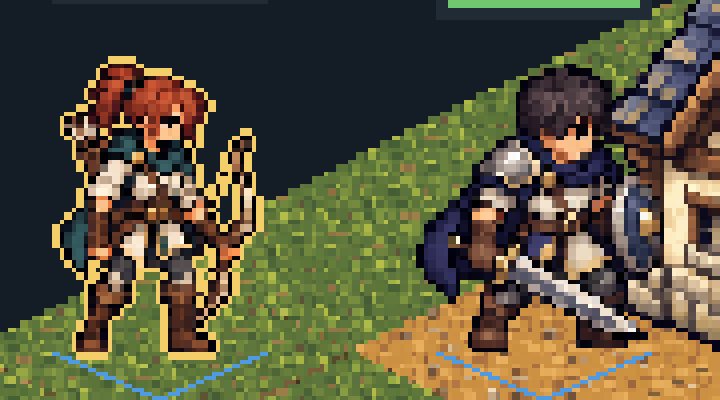
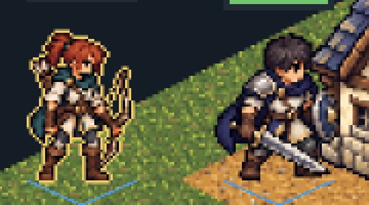
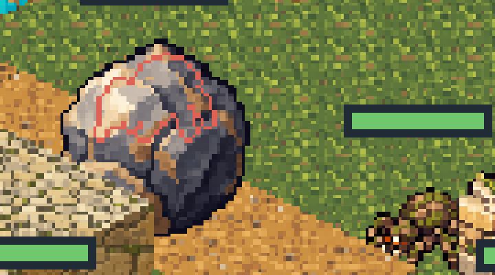
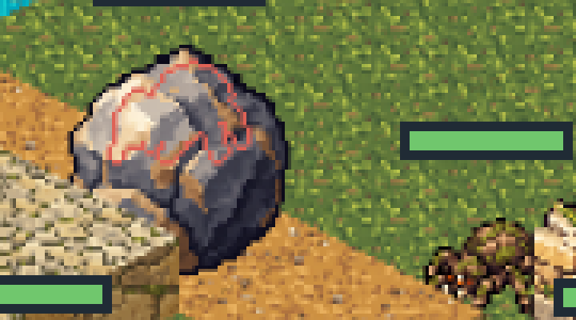
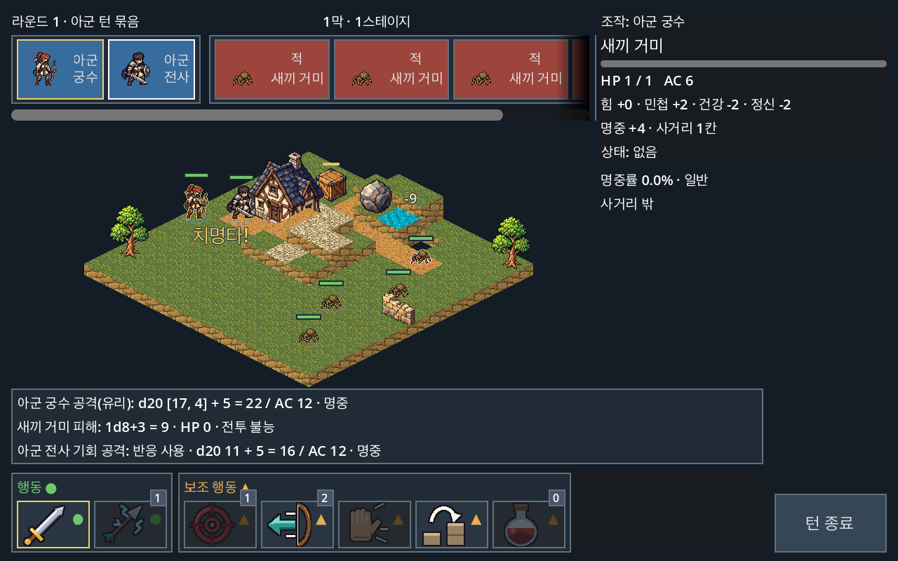
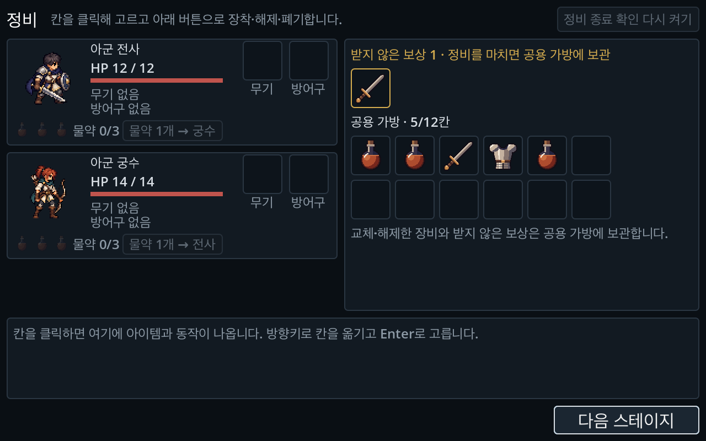

# 0002. 기준 화면 640×360을 유지하고 최소 창을 1280×720으로 올린다

- 상태: 채택 (2026-10-22)
- 구분: 개발 결정. 표시와 기술 선택이며 게임 규칙은 그대로다. 기획자가 나중에 바꿀 수 있다.
- 관련: [Issue #263](https://github.com/minjunkim-dev/BGLike/issues/263), [#264](https://github.com/minjunkim-dev/BGLike/issues/264), [#265](https://github.com/minjunkim-dev/BGLike/issues/265), 근거는 2026-10-22 해상도 검토(사용자 승인)

## 맥락

화면 배치의 기준은 640×360 논리 화면이다. `canvas_items`는 2D와 글꼴을 실제 창 해상도에서 그린다. 유닛·지형·사물·아이콘은 64px 원본을 0.5배로 쓴다([도트 아트 기준](../PIXEL_ART.md)). 그래서 그림 1텍셀은 논리 화면의 0.5px이다.

[Godot 4.7 다중 해상도 문서](https://docs.godotengine.org/en/4.7/tutorials/rendering/multiple_resolutions.html)에 따르면 `integer` 배율은 자동 배율을 정수로 내린다. 남는 자리는 검은 테두리가 된다. 2026-10-22 Godot 4.7.2 Forward+ 창의 원본 Viewport에서 다음 값을 측정했다. 640×360 행만 계산값이다.

| 창 (실제 픽셀) | 정수 배율 | 논리 화면 (`expand`) | 원본 Viewport | 그림 1텍셀 |
| --- | --- | --- | --- | --- |
| 640×360 | 1 | 640×360 | 640×360 | 0.5px |
| 1280×720 | 2 | 640×360 | 1280×720 | 1px |
| 1920×1080 | 3 | 640×360 | 1920×1080 | 1.5px |
| 2560×1440 | 4 | 640×360 | 2560×1440 | 2px |
| 1440×900 | 2 | 640×400 | 1280×800 | 1px |
| 2560×1600 | 4 | 640×400 | 2560×1600 | 2px |

1920×1080은 테두리 없이 3배로 채운다. 최종 변환 배율은 3.0이고 유닛 그림 1텍셀은 1.5화면 px이다. 16:10 창은 `expand`가 논리 높이를 400으로 늘린다. 1440×900은 2배인 1280×800을 가운데에 두고 좌우 80px·위아래 50px의 검은 테두리를 둔다. macOS Retina에서도 창 크기는 실제 픽셀로 센다. 1280×720 포인트 창은 2560×1440 픽셀이다.

## 결정

1. 기준 화면 640×360, `canvas_items`, `expand`, `integer` 배율, Nearest 필터를 유지한다.
2. 최소 창을 1280×720으로 올린다(`display/window/size/min_width`·`min_height`). 640×360 창은 지원하지 않는다. 그 창에서는 그림 1텍셀이 0.5px이라 64px 세부의 절반이 사라진다. 실제 PC 화면은 1280×720 이상이다.
3. 1920×1080처럼 그림 1텍셀이 정수 화면 픽셀이 아닌 창은 [#264](https://github.com/minjunkim-dev/BGLike/issues/264)에서 처리한다. 픽셀 경계만 `fwidth` 폭으로 보간하는 sharp bilinear 셰이더를 유닛·지형·사물·아이콘에 쓴다. 정수 배율 창의 모양은 지금과 같아야 한다.
4. 16:10 화면(1440×900, 2560×1600)은 [#265](https://github.com/minjunkim-dev/BGLike/issues/265)에서 확인한다. `expand`로 맵이 위아래로 조금 더 보인다. HUD 배치가 깨지면 고친다.
5. 직접 확인 해상도는 1280×720, 1920×1080, 2560×1440, 1440×900, 2560×1600(실제 픽셀)이다. 에이전트는 [화면 밖 실행](../CAPTURE_VERIFICATION.md#화면-밖-실행-기본)에서 이 크기의 가상 화면과 창을 연다([#277](https://github.com/minjunkim-dev/BGLike/issues/277)). Retina의 포인트·픽셀 배율(1440×900 포인트 = 2880×1800 픽셀)은 화면 밖에서 재현하지 않는다. 같은 실제 픽셀 크기의 창으로 대신하고, Retina 창은 사람의 macOS 확인으로 남긴다. 레이아웃 자동 검사는 이 목록의 1280×720, 1920×1080, 1440×900, 2560×1600과 넓은 비율 창(2560×1080), 비정수 배율 창(1366×768)을 쓴다. 2560×1440은 1280×720과 논리 화면이 같다.

## 1080p 도트 표시 (#264)

2026-10-22 [#264](https://github.com/minjunkim-dev/BGLike/issues/264)에서 결정 3을 적용했다. 공용 샘플은 `scenes/combat/art/pixel_art.gdshaderinc`의 `SHARP_TEXTURE`다.

- 텍셀 경계 `seam`에서 화면 픽셀 중심까지의 거리를 `fwidth`로 나눠 섞는 비율을 정한다. 텍셀 안쪽 픽셀은 한 텍셀만 읽어 Nearest와 같다. 네 텍셀을 Nearest로 읽고 알파를 곱한 색으로 섞는다. 그래서 투명 가장자리가 어둡게 번지지 않는다.
- 1텍셀이 1화면 픽셀 이하면(`fwidth` 0.9 이상) 섞지 않고 원래 샘플을 쓴다. 버튼의 글꼴 글리프도 같은 재질로 그리지만 1:1이라 바뀌지 않는다.
- 내장 `TEXTURE`를 함수 인자로 넘기면 headless 셰이더 컴파일이 `custom_samplers` 오류를 낸다. 그래서 텍셀 읽기는 매크로다.
- 적용 대상: 유닛 `AnimatedSprite2D`, 사물·풍경 `Sprite2D`, 초상·스킬·아이템 아이콘 `Button`·`TextureRect`(`pixel_art.tres`), 가림·선택 윤곽(`unit_outline.gdshader`), 지형 칸(`terrain_detail.gdshader`). `tests/combat_loot_test.gd`의 `_check_pixel_art`가 실제 1-1 전투와 정비 화면에서 누락을 검사한다.

원본 Viewport 측정(Godot 4.7.2 Forward+, 같은 1-1 장면, 애니메이션 첫 프레임 고정):

| 창 | 변경 전후 | 그림 1텍셀 |
| --- | --- | --- |
| 1280×720 | 픽셀 단위로 같음(1-1, 2-1 가림 윤곽 모두 차이 0) | 1px |
| 2560×1440 | 픽셀 단위로 같음 | 2px. 같은 색 가로 연속의 96.5%가 2px |
| 1920×1080 | 1-1 약 15만 픽셀 변경 | 1.5px |

1920×1080의 유닛 영역(180×100px)에서 같은 색 가로 연속 길이를 셌다. 변경 전은 1px 50.0%, 2px 47.1%로 두 도트 크기가 섞였다. 변경 후는 97.5%가 1px이다. 텍셀 경계의 화면 픽셀 절반이 두 텍셀의 중간색이 되어 모든 도트가 같은 1.5px 폭으로 보인다.

| 1920×1080 4배 확대 | 변경 전 (Nearest) | 변경 후 |
| --- | --- | --- |
| 1-1 궁수(선택 윤곽)·전사 |  |  |
| 2-1 바위 뒤 새끼 거미 윤곽(#256) |  |  |

윤곽의 두께(1텍셀과 1화면 픽셀 중 큰 쪽)와 팀색은 그대로다. 윤곽 안쪽 경계도 그림과 같은 샘플을 써서 틈이 생기지 않는다.

캡처 경로: macOS `open -g` 창이 2026-10-22 두 번 맨 앞으로 올라왔다. 그 뒤 측정은 Docker(OrbStack) 안의 Xvfb와 Mesa lavapipe Vulkan에서 Linux용 Godot 4.7.2 Forward+로 했다. 한글 글꼴은 macOS의 Apple SD Gothic Neo를 읽기 전용으로 연결했다. 변경 전후를 같은 경로에서 찍었다. 이 경로는 뒤에 `scripts/manual_qa.py`의 화면 밖 실행으로 정식화했다. 정식 경로의 한글은 Noto Sans CJK다. lavapipe는 Mesa의 Vulkan 드라이버 이름이고, 로그의 장치 이름은 llvmpipe다. 같은 경로다.

한계:

- 1텍셀이 1화면 픽셀보다 큰 창(1920×1080, 2560×1440 등)에서 정수가 아닌 위치로 움직이는 그림(이동 연출)은 경계가 부드럽게 섞인다. Nearest처럼 한 픽셀씩 튀지 않는다. 멈춘 화면은 위 표와 같다. 1280×720은 섞지 않아 그대로다.
- 3840×2160은 계산값이다. 배율 6이라 0.5배 그림의 1텍셀은 3px이고 Nearest와 같다. 정비 화면의 물약 칸 표시(64px를 16 논리px, 0.25배)는 1텍셀이 1.5px라 1080p처럼 섞인다.
- 지형은 8개 칸을 한 줄로 붙인 원본을 읽는다. 지금은 카메라와 칸 위치가 정수라 칸 경계에서 이웃 칸을 섞지 않는다. 카메라를 소수 위치로 옮기거나 확대하면 칸 좌우 끝 1px에 이웃 칸 색이 섞일 수 있다. 그때 원본에 여백을 둔다.
- Compatibility 렌더러와 실제 Metal 창의 1920×1080 화면은 확인하지 않았다.

## 16:10 화면 (#265)

2026-10-22 [#265](https://github.com/minjunkim-dev/BGLike/issues/265)에서 결정 4를 확인했다. 결과: HUD 배치가 깨지지 않아 코드를 고치지 않았다. `expand`를 유지한다.

- 16:10 창의 논리 화면은 640×400이다. HUD는 위·아래·오른쪽 끝에 붙어 있어 늘어난 40 논리px는 맵 둘레에 생긴다. 카메라가 맵을 가운데에 두므로 맵은 위아래로 20 논리px씩 여유가 생긴다. 640×360에서는 맵 아래 끝 일부가 전투 로그에 가려진다. 640×400에서는 맵 전체가 로그 위에 보인다.
- 1440×900은 정수 배율 2라 1280×800을 가운데에 그리고 좌우 80px·위아래 50px를 검은 테두리로 둔다(결정 1의 정수 배율). 2560×1600은 4배로 창을 채운다. Retina 1440×900 포인트(2880×1800)는 계산상 4배 2560×1600에 좌우 160px·위아래 100px 테두리다.
- 원본 Viewport 캡처(#264와 같은 Xvfb·lavapipe 경로): 1440×900, 2560×1600과 비교용 1280×720, 1920×1080, 2560×1440. 전투 HUD(턴 순서 바, 적 조회 정보 패널과 공격 예측, 스킬 바, 로그 3줄, 유닛 위 팝업 `치명타!`·`-9`), 반응 창, 승리 창, 정비 화면(보상 1개, 가방 5칸)을 찍었다. 겹치거나 화면 밖으로 나간 영역이 없다.

| 1440×900 원본 Viewport (1280×800) | |
| --- | --- |
| 전투 HUD |  |
| 정비 화면 |  |

자동 검사: `tests/combat_hud_test.gd`의 레이아웃 검사에 2560×1600을 더했다(1440×900은 #263에서 넣었다). 스킬 포커스 설명과 소환 초상 검사에 1440×900을 더했다. `tests/combat_loot_test.gd`의 `_check_preparation_layout`이 1280×720, 1440×900, 2560×1600에서 정비 화면이 논리 화면을 채우는지, 다섯 영역이 화면 안에 있고 서로 겹치지 않는지 검사한다. 칸을 고르기 전과 고른 뒤(상세 패널에 동작 버튼이 있는 상태)를 모두 검사한다.

## 대안

- 640×360 창을 계속 지원: 1텍셀 윤곽([#256](https://github.com/minjunkim-dev/BGLike/issues/256))처럼 가독성 작업이 계속 든다([#223](https://github.com/minjunkim-dev/BGLike/issues/223)). 실제 사용자가 거의 없다. 택하지 않았다.
- 그림을 32px로 다시 만든다: [#194](https://github.com/minjunkim-dev/BGLike/issues/194)에서 고른 64px 세부를 잃는다. 택하지 않았다.
- 1080p에서 1280×720 화면에 테두리를 둔다: 화면이 작아진다. 택하지 않았다.
- `keep` 비율(16:10의 위아래 검은 띠): 화면을 버린다. 택하지 않았다.

## 한계와 후속

- 지난 문서와 Issue의 640×360 캡처는 당시 기록으로 남긴다.
- 최소 창은 운영체제가 창 크기를 줄일 때만 막는다. 화면 자체가 1280×720보다 작은 기기는 검증 범위 밖이다.
