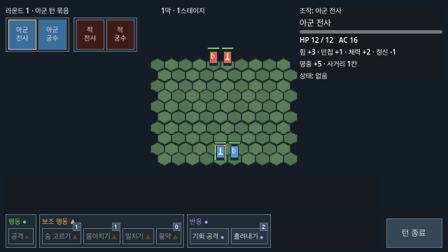
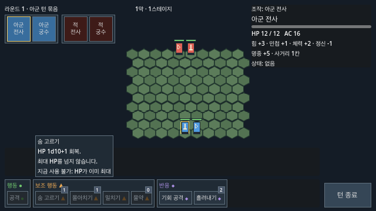

# 전투 화면 정보 정리

[Issue #58](https://github.com/minjunkim-labs/BGLike/issues/58)의 [기획자 코멘트](https://github.com/minjunkim-labs/BGLike/issues/58#issuecomment-6100264025)와 [사용자 구현 결정](https://github.com/minjunkim-labs/BGLike/issues/58#issuecomment-6137867077)을 반영한다. 전투 규칙과 클릭 입력은 유지한다. 상세 표시 규칙은 [전투 시스템 기획서9장](combat.md#9-화면과-조작)을 따른다.

호버 내용은 2026-10-21 회의에서 정한 [Issue #226](https://github.com/minjunkim-labs/BGLike/issues/226)을 따른다. [Issue #68](https://github.com/minjunkim-labs/BGLike/issues/68)의 "이름·효과·사용 불가 이유만"을 넓혔다. 스킬 버튼은 이름 대신 아이콘을 보인다([#225](https://github.com/minjunkim-labs/BGLike/issues/225), 도트 이미지는 [#384](https://github.com/minjunkim-labs/BGLike/issues/384)). 공격·스킬 호버는 아래 순서로 표시한다. [#620](https://github.com/minjunkim-labs/BGLike/issues/620)에서 [#555 명세](#호버-설명의-정보-순서와-강조)대로 사용 불가 이유를 효과 바로 뒤로 옮기고 줄 역할별 색을 나눴다.

1. 이름
2. 효과
3. 쓸 수 없을 때만 그 이유
4. `사거리:` 인접1칸·1~4칸·1~2칸·자신·정면 반달 5칸(휩쓸기)
5. `피해:` 피해 능력치 주사위와 장비를 포함한 현재 피해 보정(공격·기회 공격·활 후려치기·십자 베기·강철 돌진. 예: 무기 피해 +2를 낀 전사 `피해: 힘 d20+2`. 강철 돌진은 기타 가산치를 더하지 않음. 휩쓸기는 `피해: 힘 d20 ÷2 올림`), `회복:` 회복량(물약), `방어막:`(성스러운 장막) 또는 `명중 보너스:`(전투의 함성)의 주사위. 스킬이 피해 능력치를 명중 능력치와 다르게 지정하면 `피해: 명중 민첩 d20 → 피해 힘 d8+3`처럼 둘을 함께 보인다([능력치 기획서 4-9](ability.md#4-9-피해와-회복))
6. `판정:` 공격 능력치 주사위와 공격 가산 대 AC(명중굴림. 휩쓸기는 `판정: 대상마다 힘 d20 +0 대 AC`), 회전회오리의 대상 내성 대 DC(`판정: 대상의 민첩 내성 대 DC 10, 성공하면 피해 절반`), 밀치기·만능팔의 대상 내성 대 DC(궁수의 밀치기 `판정: 대상의 힘 내성 대 DC 4, 성공하면 버팀`, 고철로봇-2000의 만능팔은 DC 10). 명중 가산에는 전투의 함성 보너스를 더한다. 판정이 없으면 `없음`. 회전회오리는 다음 줄에 살아 있는 반대편 유닛마다 실제 내성 성공률을 보인다(장비 없는 전사·궁수: `내성 성공률: 아군 전사 0.0% · 아군 궁수 25.0%`)
7. 둘 이상의 자원을 모두 쓰는 동작의 `비용:` 줄(십자 베기, 강철 돌진, 점프), 전투마다 횟수 스킬의 `전투마다 n회 · n회 남음` 줄 ([#423](https://github.com/minjunkim-labs/BGLike/issues/423))

예 (보조 행동을 쓴 뒤의 십자 베기):

```
십자 베기
인접한 적 1명을 기본 공격 2회.
첫 타격으로 쓰러지면 둘째는 취소.
지금 사용 불가: 자원을 이미 씀
사거리: 인접1칸
피해: 힘 d20
판정: 힘 d20 +0 대 AC
비용: 행동 1 + 보조 행동 1
전투마다 1회 · 1회 남음
```

비용은 버튼 오른쪽 아래에 자원 색의 마크로 표시한다([#517](https://github.com/minjunkim-labs/BGLike/issues/517), [전투 설계](combat.md)의 스킬 바 절). 남은 스킬 횟수와 물약 개수는 숫자 배지로 표시한다. 호버에 비용·횟수·개수와 조작법·기호 설명을 반복하지 않는다. 위 7번의 복합 비용과 전투마다 횟수는 예외다.

[#182](https://github.com/minjunkim-labs/BGLike/issues/182)의 회전회오리 효과 설명은 `상하좌우1칸·높이 차이1 이하`를 표시한다. 실제 대상 수는 기존 전투 로그에 표시한다. 새 범위 패널·빈 바닥 시전 입력은 추가하지 않는다.

## 이동 범위와 바닥 가독성

[#347](https://github.com/minjunkim-labs/BGLike/issues/347): 파랑은 이동 가능, 초록은 이동 후 기본 공격 가능한 칸이라는 기존 의미를 유지한다. 면 채움을10%/12%로 낮추고 바닥 마름모의 얇은 윤곽을 함께 표시해 길·석재·물과 높이 측면을 읽을 수 있게 한다. 노란 미리보기 경로·도착점과 실제 이동/공격 판정은 그대로다. 진한 면만 낮추면 이동 범위가 사라져 보이므로 윤곽을 택했다. 전체 팔레트·색약 대응의 최종 기획을 대신하지 않는다.

[#556](https://github.com/minjunkim-labs/BGLike/issues/556), 2026-11-16: 면 채움 10%/12%는 그대로 두고 칸 윤곽을 0.5px에서 1.5px로 1px 굵게 하며 칸의 네 꼭짓점에 짧은 꺾쇠 표시를 더한다. 꺾쇠는 바닥 마름모 안쪽에만 그려 측면을 칠하지 않는다. 근거: 1280×720에서 풀·물 위의 파랑이 거의 구분되지 않았다. 색에만 기대지 않게 선 굵기와 모양을 더한다([#306](https://github.com/minjunkim-labs/BGLike/issues/306) 11번 결정과 같은 방향). 도약·조준·휩쓸기·반사신경 후보 칸도 같은 함수로 그려 똑같이 바뀐다. 대안: 밝기가 천천히 바뀌는 표시.

### 적 위협 범위

[#556](https://github.com/minjunkim-labs/BGLike/issues/556), 2026-11-16: `T`(자판 위치)로 켜고 끈다. 기본은 꺼짐이고 저장하지 않는다. 켜면 보이는 살아 있는 적 전체의 위협 범위를 겹쳐 보인다. 적 몸통이나 턴 순서 바의 초상에 마우스를 올리면 켜짐 여부와 관계없이 그 적의 범위만 보이고, 떠나면 원래 상태로 돌아간다. 정비 화면에서는 T를 받지 않는다.

- 계산(`CombatActions.threat_cells`): 그 적이 한 턴의 전체 이동력(남은 이동력이 아니다)으로 걸어 설 수 있는 칸과 지금 서 있는 칸에서 기본 공격 거리 안에 있는 바닥 칸이다. 걷기와 공격 거리는 실제 판정과 같은 규칙(높이 차 1 이하, 다른 유닛 칸은 지나가지 못함, 사거리 1은 인접)이다.
- 표시: 붉은 면과 윤곽만 그린다. 이동 범위와 달리 꼭짓점 꺾쇠가 없어 모양으로도 구분되고, 겹친 칸에서는 이동 범위가 위에 그려진다.
- 적 AI의 행동을 예고하지 않는다. 도약, 끌어당기기·회전 같은 스킬의 사거리, 넘어짐·기름 같은 상태, 은신한 적은 넣지 않는다. 엄폐·직사 차단([#358](https://github.com/minjunkim-labs/BGLike/issues/358), [#353](https://github.com/minjunkim-labs/BGLike/issues/353)) 규칙이 정해지면 계산을 고친다.
- 근거: 격자 택티컬 장르의 표준 정보이고 주사위 운이 큰 이 게임에서 예측 가능성을 높인다. 대안: 넣지 않음.

## 정보의 표시 목적

| 표시 시점 | 정보 | 목적 |
| --- | --- | --- |
| 상시 | 막·스테이지·라운드·턴 묶음, 초상, 조작·진행 유닛, HP 바, 스킬 아이콘·비용 마크·횟수 배지, 턴 종료 | 진행 위치와 조작할 유닛, 가능한 행동을 찾음 |
| 유닛 선택·조회 | 이름, HP, AC, 능력치 6종 주사위, 공격 가산, 사거리, 상태 | 행동 중인 유닛과 조회 대상을 구분. 초상 조회는 조작 유닛의 자원을 바꾸지 않음 |
| 상세 호버 | 초상의 이니셔티브 계산식, 공격·스킬의 이름·효과·사용 불가 이유·사거리·피해 또는 회복·판정 | 필요한 시점에 효과를 조회. 비활성 버튼과 키보드·컨트롤러 포커스도 조회 가능 |
| 미리보기·선택 대기 | 이동 칸 색·경로·도착 시 공격 대상 테두리, 공격 명중률·판정 조건·실행 불가 이유, 반응 확인 창 | 실행 전에 대상과 결과를 확인. 호버는 동작을 실행하거나 자원을 쓰지 않음 |
| 로그·결과 | 최근3줄의 실제 판정·피해·반응, 승리·패배·보상·재시작 | 실행 결과를 확인. 시작 이니셔티브 계산식은 로그에서 제외 |

[#388](https://github.com/minjunkim-labs/BGLike/issues/388): 피해 로그는 피해 능력치 주사위·굴린 값·피해 보정·합계를 보인다. 앞의 이름은 피해를 받은 대상이고, 주사위와 보정은 공격자의 것이다. 예시는 아군 전사가 풋내기 야만인을 맞힌 `풋내기 야만인 피해: 힘 d20 [7] +3 = 10 · HP 2`, 애기살을 쓴 아군 궁수가 풋내기 궁수를 맞힌 `풋내기 궁수 피해 (애기살, 높은 값): 솜씨 d20 [7, 12] +0 = 12 · HP 2`다(표식 추가 예시는 [#528](https://github.com/minjunkim-labs/BGLike/issues/528)에서 표식과 함께 없앰). 모든 명중이 능력치 주사위를 굴리므로 [#261](https://github.com/minjunkim-labs/BGLike/issues/261)의 주사위 없는 고정 피해 로그는 없어졌다. [#220](https://github.com/minjunkim-labs/BGLike/issues/220)에서 로그는 전체 수식을 유지하기로 정했다([팝업 문구 규칙](#팝업-문구-규칙)). 표시만 바뀌며 규칙은 그대로다.

[#262](https://github.com/minjunkim-labs/BGLike/issues/262): 확인 창은 프로젝트 공용 테마 `scenes/ui_theme.tres`를 쓴다. 테마는 Godot 기본 회색 대신 정비 패널의 짙은 배경(`121a22`)과 둥근 모서리3, 전투 패널의 회색 테두리(`61717e`), 12px 글자, 정비 화면의 낮은 버튼 모양과 흰 포커스 테두리를 담는다. 체크박스는 어두운 배경에서 보이도록 테두리 있는 상자를 쓴다. 지금 이 테마를 쓰는 창은 반응 확인 창(기회 공격)과 정비 확인 창(정비 종료 확인·가방 아이템 폐기)이다. 테마는 각 확인 창에 직접 지정한다. 다른 버튼과 패널은 지금 모양을 그대로 쓴다. [#537](https://github.com/minjunkim-labs/BGLike/pull/537)부터 이 테마의 값은 Galmuri11 글꼴과 9-slice 틀로 바뀌었고, 타이틀·설정·일시정지·도움말·주사위 보기도 쓴다. 현재 값은 [도트 아트 기준](../pixel-art.md)을 따른다. [#553](https://github.com/minjunkim-labs/BGLike/issues/553)부터 전투 HUD·호버 설명·정비 패널도 이 테마의 `HudPanel` 변형을 쓴다. 기본 포커스, Enter·Esc·닫기 동작과 [#122](https://github.com/minjunkim-labs/BGLike/issues/122)의 포커스 수정은 그대로다. 표시만 바뀐다.

턴 순서 바 초상의 상태(현재 묶음·조작 중·조작 대기·턴 종료)는 [전투 시스템 기획서 9-3](combat.md#9-3-영역별-내용)의 초상 상태 표를 따른다([Issue #140](https://github.com/minjunkim-labs/BGLike/issues/140)).

[#180](https://github.com/minjunkim-labs/BGLike/issues/180)의 전투 불능 초상은 즉시 제거한다. 남은 초상은 새 묶음 위치로0.25초 동안 이동한다. 묶음의 빈 배경은 이동하는 초상의 클릭을 가로채지 않는다. 초상 선택과 기존 전투 입력은 유지한다. 턴 시작·효과·자원 갱신을 이동이 끝날 때까지 미루지 않는다. 이동 중 순서 변경은 현재 표시 위치에서 최신 배치로 이어 간다. 스테이지 초기화는 진행 중이거나 예약된 이전 이동을 취소한다. 최초 표시와 전투 불능 없는 일반 소환은 기존 동작을 유지한다.

[#255](https://github.com/minjunkim-labs/BGLike/issues/255): 턴 순서 바의 오른쪽 끝과 정보 패널 사이에 1 논리px 회색 구분선을 둔다. 오른쪽에 가린 초상이 남아 있으면 바 끝 24 논리px를 화면 배경색으로 흐리게 한다. 끝까지 스크롤하거나 초상이 넘치지 않으면 흐림을 숨긴다. 흐림은 Godot `ScrollContainer`의 스크롤 힌트(`scroll_hint_mode`)를 쓴다. 흐림과 구분선은 입력을 받지 않는다. 가로 스크롤과 초상 상태 표시 규칙은 그대로다. 넘치는 가로 목록의 끝을 표시하는 흔한 UI 관행을 택했다.

자원 제목의 채운/빈 모양은 색 없이도 남은 자원을 구분한다. 자원 제목에는 호버 설명을 표시하지 않는다. 유닛의 자원 최대 개수를 기준으로 채운 마크와 빈 마크를 함께 표시한다. 예를 들어2개 중1개를 쓰면●○다. 전부 쓰면○○다. 자기 턴 묶음이 확정되면 같은 개수의 마크를 다시 채운다. 적 턴에는 아군의 마크가 가득 찬 채로 보이며, 적이 자원을 없애면 그 마크가 비어 보인다. 현재 게임의 턴 자원 최대 개수는 모두1이다. 실제 캐릭터의 수치와 자원당1개 소비 규칙은 유지한다.

우측 유닛 패널의 이동·턴 자원 줄을 제거한다. 남은 이동 칸 수는 표시하지 않는다. 좌측 동작·이동 설명과 우측 조작 안내를 제거한다. 좌측 공간은 비운다. 조작 방법은 이후 튜토리얼 단계에서 다룬다. 이번 변경에는 튜토리얼을 넣지 않는다.

호버 설명은0.5초 뒤에 HUD의 앞쪽에 표시한다. 키보드·컨트롤러 포커스를 받은 버튼도 같은 설명을 띄우고 포커스 테두리를 그린다. [#565](https://github.com/minjunkim-labs/BGLike/pull/565), 2026-11-15: 포커스 테두리 색은 [도트 아트 기준](../pixel-art.md#ui)의 `#EBBA84`로 통일한다. 스킬 버튼·정비 칸과 공용 테마의 버튼이 모두 이 색을 쓴다([#553](https://github.com/minjunkim-labs/BGLike/issues/553)에서 HUD 테마 적용). 근거는 한 화면 안에서 포커스 색이 하나여야 한다는 것이다. 대안은 흰색으로 통일하는 것이다. 클릭으로 받은 포커스의 설명은 포인터가 떠나면 숨긴다. 설명은 왼쪽 열(x 8, 최대 폭 240, 넘는 줄은 줄바꿈)에 띄운다. 스킬·패시브 설명은 아래 끝을 스킬 패널 위 끝 − 4에, 초상 설명은 위 끝을 턴 순서 바 아래 끝 + 4에 둔다. 전투 로그는 오른쪽 열이라 자리만으로 가리지 않는다. 설명 전체를 화면 안에 배치한다. 설명은 포인터 입력을 가로막지 않는다. 포인터가 버튼을 벗어나거나 반응·결과 창이 열리면 설명을 숨긴다. 초상도 같은 표시 방식을 쓴다. 설명 자리는 [#555 명세](#전투-화면-배치-555)대로 [#619](https://github.com/minjunkim-labs/BGLike/issues/619)에서 왼쪽 열로 바꿨다.

[#343](https://github.com/minjunkim-labs/BGLike/issues/343): 키보드로 띄운 설명이 전투판 클릭 뒤에도 남을 때 판정 로그를 읽을 수 있도록 설명의 아래 끝을 전투 로그 위에 둔다. [#438](https://github.com/minjunkim-labs/BGLike/issues/438)부터는 전투 로그와 스킬 패널 중 더 높은 쪽 위였다. [#619](https://github.com/minjunkim-labs/BGLike/issues/619)부터는 설명을 왼쪽 열(스킬 패널 위 끝 − 4)에 두어 오른쪽 열의 전투 로그를 자리만으로 가리지 않는다. 마우스 호버와 포커스에 같은 배치를 사용한다. 설명을 없애거나 포커스를 강제로 해제하는 대신 배치만 바꿔 키보드·컨트롤러 조회를 유지한다. 내용·표시 지연·정비 설명·전투 규칙은 그대로다. 설명 자리는 [#555 명세](#전투-화면-배치-555)대로 #619에서 왼쪽 열로 바꿨다.

[Issue #166](https://github.com/minjunkim-labs/BGLike/issues/166)의 점프는 공용 보조 행동 버튼으로 고른다. 첫 우클릭에 선택한 경로와 착지 칸을 표시한다. 대상 미리보기에는 이동 비용, 보조 행동1, 출발 시 기회 공격 인원과 착지 시 낙하 피해를 표시한다. 같은 착지 칸을 다시 우클릭하면 실행한다. 필드 좌클릭과 유닛 전환은 점프 미리보기를 취소한다. 조건에 맞지 않는 착지와 취소는 자원을 쓰지 않는다. 호버에는 효과·사용 불가 이유·사거리·판정을 표시한다. 점프 연출 중에는 턴 종료와 유닛 전환을 잠근다.

[#188](https://github.com/minjunkim-labs/BGLike/issues/188)의 나무 상자는 유닛과 별도인 환경 오브젝트다. 기본 공격을 고른 뒤 상자 몸통을 좌클릭하면 내구도와 현재 피해 범위(피해 능력치 주사위 + 피해 보정)를 미리 보여 준다. 같은 상자를 다시 누르면 행동1로 자동 명중 공격을 실행한다. 기본 공격 외의 유닛 스킬은 상자에 적용하지 않는다. 행동 없음·기절·사거리/높이 조건을 안내한다. 우클릭·동작 전환·전투 초기화는 상자 미리보기를 지운다. 선택 테두리와 HP 막대, 피해·파괴 로그로 결과를 알린다. 파괴 즉시 물체 표시를 지우고 열린 바닥을 기존 이동 미리보기에 반영한다. 기존 높이·물·장판 표시는 유지한다. 상자를 부수면 그 칸에 아이템 아이콘이 떨어지고(종류별 무기·방어구·물약), 마우스를 올리면 `바닥 아이템 · 종류 · 수치`를 보인다. 이동·점프 미리보기는 줍게 될 아이템을 `줍기: 종류`로 안내한다. 승리 보상 확인에는 줍지 않아 사라진 아이템 수를 `줍지 않은 아이템 N개가 사라졌습니다` 한 줄로 알린다([환경요소 3장](environment.md#3-박스-드랍과-줍기), [#529](https://github.com/minjunkim-labs/BGLike/issues/529)). 9개 전투에 상자1개씩을 둔다. 좌표는 [접근로 배치](../stages/terrain-maps.md#접근로와-물체-배치-347)를 따른다. 표시는 #195의 상자 PNG다. 수치와 배치 근거는 [게임 구조6-8](../game-structure.md#6-8-환경-오브젝트와-나무-상자)을 따른다.

[#189](https://github.com/minjunkim-labs/BGLike/issues/189)의 바위는 같은 몸통 선택·재클릭 확정·취소 흐름을 쓴다. 바위 PNG와 선택 테두리로 상자와 구분한다. 바위에는 상자 내구도 막대를 그리지 않는다. 기존 대상 안내에 행동1·주사위 없음·방향·예상 경로 길이·정지/소멸/파괴 사유를 표시한다. 충돌할 유닛을 나열하고 아군 피해4를 명시한다. 주황 화살표는 같은 실제 충돌 계산의 굴림 경로다. 붉은 원은 충돌과 정지 위치를 표시한다. 다른 동작·우클릭·초기화는 이 표시도 지운다. 행동 없음/기절/사거리·높이 사유는 확정 전에 다시 안내한다. 로그는 이동·대상당1회 충돌피해·정지·파괴를 알린다. 최종 정지·파괴 로그에도 대상별 충돌피해를 요약한다. 이동·장판 로그가 피해 안내를 밀어내지 않게 한다. 실제 첫 전투에는 바위(9,8)([#347](https://github.com/minjunkim-labs/BGLike/issues/347) 재배치 뒤 [#612](https://github.com/minjunkim-labs/BGLike/issues/612) 14×14 재배치), 물(7,2)·(8,2), 낭떠러지(9,2), 서쪽 가장자리 언덕을 둔다. 표시는 #195의 바위 PNG다.

[#236](https://github.com/minjunkim-labs/BGLike/issues/236): 강제 이동 미리보기에 착지 결과를 보인다. 밀치기 대상 안내는 밀려날 칸 뒤 같은 줄에 `낙사`, `낙하 피해 N`, 화상인 대상이 물에 떨어지면 `물: 화상 해제`를 붙인다. 결과가 없으면 칸만 보인다. 끝에는 실제 밀칠 확률(`밀칠 확률 30.0%`, 대상 내성 실패율)을 붙이고, 아군·기절한 대상은 판정이 없어 `100.0%`다([#391](https://github.com/minjunkim-labs/BGLike/issues/391)). 바위 안내의 충돌 대상에는 그 대상이 밀려서 받는 `낙사`나 `낙하 피해 N`을 붙인다. 값은 실제 처리와 같은 낙하 계산과 바위 경로 계산을 쓴다. 점프 미리보기의 낙하 안내와 같은 이유다. 장판 부여는 진입 기록과 중첩 상한에 따라 달라서 표시하지 않는다([#207](https://github.com/minjunkim-labs/BGLike/issues/207) 뒤 다시 본다). 대안인 바닥 위험 색 칸은 이동 미리보기 색과 겹쳐 문구 안내를 먼저 택했다. 규칙은 바꾸지 않는다.

[#221](https://github.com/minjunkim-labs/BGLike/issues/221): 적 턴 중 Space를 누르고 있는 동안 적 행동 간 대기와 이동·공격 연출을4배로 빠르게 보여 준다. 손을 떼면 보통 속도로 돌아온다. 적 턴의 첫 이동·공격 연출 전에0.35초 멈춰 행동할 적을 보여 준다. 이동·공격 연출 뒤에도0.35초 기다린다. 이 기본 대기 시간은 [#516 명세](#턴-강조카메라전체-속도-516)의 전체 속도 계수(0.7)로 늘어나 실제로는 0.5초다. 이동도 공격도 하지 않은 적 행동 뒤에는 기다리지 않는다. 반응 확인 창이 열리면 가속을 멈추고 선택을 기다린다. 적 턴에는 라운드 표시에 `Space: 빠르게`를 붙인다. 전투 중 Space는 포커스된 버튼을 누르지 않는다. 규칙과 판정은 바꾸지 않는 표시 속도 조절이다. 당시 설정 화면이 없어서 누르고 있는 동안 가속을 택했다([#209](https://github.com/minjunkim-labs/BGLike/issues/209)). 대안인 설정의 적 턴 속도 옵션은 설정 화면이 생긴 뒤 추가할 수 있다.

[#248](https://github.com/minjunkim-labs/BGLike/issues/248): 아군 턴에 숫자 키1~9는 스킬 바에 보이는 버튼을 왼쪽부터 순서대로 고른다. 반응 버튼도 순서에 들어간다. 고른 버튼에 포커스를 주고 상세 설명을 띄운다. 활성 버튼은 클릭과 같이 선택한다. 비활성 버튼은 포커스와 사용 불가 이유만 보이고 선택하지 않는다. 포커스가 스킬 바에 있으면 좌우 방향키·컨트롤러 D-pad로 버튼 사이를 옮긴다. 끝에서는 멈춘다. 숫자 키는 자판 배열과 관계없이 윗줄 숫자 자리를 쓴다. 키패드 숫자는 쓰지 않는다. Enter·컨트롤러 확인(A) 버튼은 포커스된 활성 버튼을 선택한다. 컨트롤러는 숫자 키가 없어서 포커스가 없을 때 좌우 방향키·D-pad가 첫 버튼에 포커스만 준다. 적 턴, 연출 중, 반응 확인 창, 결과 창, 정비 화면에서는 숫자 키와 이 진입 입력이 스킬을 고르지 않는다. Tab 아군 전환, Space 적 턴 가속과 포커스 버튼 누름 방지, Esc 반응 넘기기는 그대로다. 턴제 전술 게임의 흔한 방식을 택했다. 키 변경 설정은 범위 밖이다([#209](https://github.com/minjunkim-labs/BGLike/issues/209) 4번).

[#426](https://github.com/minjunkim-labs/BGLike/issues/426): 휩쓸기를 더해 전사의 스킬 버튼이 10개가 됐다. 숫자 키는 1~9라 열 번째 버튼(기회 공격)은 방향키·D-pad로만 고른다. 반격([#435](https://github.com/minjunkim-labs/BGLike/issues/435))을 더해 11개가 됐고, 열한 번째 버튼(반격)도 방향키·D-pad로만 고른다.

[#438](https://github.com/minjunkim-labs/BGLike/issues/438)의 스킬 바 배치는 [#407 기획자 답](https://github.com/minjunkim-labs/BGLike/issues/407#issuecomment-6568715948)을 따른다. 행동·보조 행동·반응 컨테이너를 왼쪽 아래에 위에서 아래로 한 줄씩 쌓는다. 한 줄은 왼쪽의 자원 제목과 오른쪽의 버튼이다. 제목 폭을 맞춰 세 줄의 첫 버튼을 같은 세로선에 둔다. 버튼이 줄을 넘치면 줄바꿈하지 않고 칸 폭을 줄여 한 줄을 지킨다([#554](https://github.com/minjunkim-labs/BGLike/issues/554), 2026-11-02의 #407 답은 줄바꿈이었다). 숫자 키·좌우 방향키·D-pad 순서는 지금처럼 행동 → 보조 행동 → 반응, 왼쪽부터다. 위아래 방향키는 Godot 기본 포커스 이동을 쓴다.

[#438](https://github.com/minjunkim-labs/BGLike/issues/438): 스킬 바가 세로로 높아져 나머지 아래 HUD를 다시 배치했다. 턴 종료 버튼은 #426 전의 오른쪽 아래 모서리로 돌아간다. 전투 로그는 턴 종료 위, 스킬 바 오른쪽으로 옮겨 폭 245 논리px에서 긴 줄을 줄바꿈하고 위로 자란다. 오른쪽 위 유닛 정보 영역의 예약 높이는 측정한 최대 내용(공격 예측 3줄)까지인 182 논리px로 줄여, 세 줄이 모두 줄바꿈된 로그와도 겹치지 않는다. 지도 가운데를 가리지 않도록 아래 HUD는 화면 아래 절반 안에 둔다. 640×360 논리 화면(1280×720 창)에서 스킬 패널 높이는 전사(3줄, 버튼 11개) 126 논리px, 궁수는 2줄 83 논리px였고, [#528](https://github.com/minjunkim-labs/BGLike/issues/528)부터 반사신경 버튼이 있는 반응 줄을 다른 줄과 같은 높이로 더해 전사와 같은 3줄이다(높이는 다시 측정하지 않음). 궁수의 패시브 칸에는 무빙샷이 있고, 도약할 수 있는 동안 켜짐 점을 보이며 눌러 도약 선택으로 돌아간다. 반격(#435)은 반응 줄에 들어가 줄 수가 늘지 않으며, 반격을 더한 뒤 다시 측정해도 값이 같다. 이전 배치의 왼쪽 아래 묶음(로그와 한 줄 스킬 바)은 111 논리px였다.

[#554](https://github.com/minjunkim-labs/BGLike/issues/554), 2026-11-16: 스킬 패널은 컨테이너마다 한 줄 높이로 고정하고, 한 줄이 넘치면 칸 폭을 줄인다. [#407 기획자 답 4번](https://github.com/minjunkim-labs/BGLike/issues/407#issuecomment-6568715948)(2026-11-02)의 줄바꿈을 이 결정이 바꾼다. 근거: 줄바꿈하면 보이는 아군에 따라 패널 높이가 달라져, 물약과 기름병을 가진 궁수의 보조 행동 줄(8개)이 두 줄이 되는 순간 패널 윗변이 한 줄(37 논리px)만큼 올라가 맵 아래쪽을 가렸다(측정: 전사 126, 궁수 163 논리px). 적 턴에는 마지막 아군의 패널을 회색으로 남기므로 턴이 바뀔 때 HUD가 움직였다. 칸 폭은 52에서 최소 28까지 줄이고(칸 간격 3), 버튼 높이 34와 아이콘 24는 그대로다. 아이콘을 줄이지 않아 32×32 유닛 도트와 같은 논리px 배율(1280×720은 2배, 1920×1080은 3배)로 읽힌다. 줄인 칸은 좌우 여백을 4에서 2로 줄여 아이콘이 들어가게 하고, 줄 제목에 이미 있는 하나뿐인 비용 기호(예: 보조 행동 줄의 `▲`)는 숨긴다. 복합 비용(`●▲`)과 횟수 배지는 그대로 보인다. 한 줄에는 8개까지 들어간다(패널 폭 371에서 패시브 열 25, 줄 여백 8, 제목 65와 간격 1을 뺀 약 272 논리px, 28폭 8개는 245, 9개는 276). 지금 가장 긴 줄은 8개다. 9개 이상이 되면 칸이 최소 폭 28에서 더 줄지 않아 패널이 넓어지므로 그때 배치를 다시 정한다. 어떤 아군의 줄이든 9개 이상이 되면 회귀 검사(`tests/combat_hud_test.gd`의 `_test_slot_row_max`)가 실패한다. 대안: 줄바꿈(패널이 위로 자라 맵을 가린다), 스크롤(숨은 스킬이 생기고 숫자 키·방향키 순서와 어긋난다), 칸 폭을 줄이지 않고 패널을 넓히기(로그·턴 종료와 겹친다).

[#500](https://github.com/minjunkim-labs/BGLike/issues/500) 2a, 2026-11-15 문서화: 넘어진 아군의 자기 턴에는 턴 종료 버튼 바로 위에 `일어나기 · 이동력 N` 버튼이 보인다. N은 최대 이동력의 절반(올림)이고, 남은 이동력이 N보다 적으면 버튼이 꺼진다. 일어서는 규칙은 [궁수 문서의 넘어짐](../characters/archer.md)을 따른다. 근거는 이동 없이 공격만 하려는 유닛도 일어설 방법이 필요하다는 것이다. 대안은 스킬 바의 보조 행동 줄에 두는 것이다.

[#395](https://github.com/minjunkim-labs/BGLike/issues/395): 전투 전 지도 준비([#345](https://github.com/minjunkim-labs/BGLike/issues/345))의 아래 막대는 안내 `전투 준비 · 지형과 적을 확인하고 전투를 시작합니다.`와 `전투 시작` 버튼 하나다. `정비` 버튼과 `지도로 돌아가기`는 없다. 정비는 승리 뒤 보상 확인 다음에만 연다. 지도 준비가 열리면 `전투 시작`에 포커스를 두어 Enter·컨트롤러 A로 바로 시작한다. 시작 전에는 적 선공·턴 종료·스킬을 잠그고 초상·유닛 조회만 받는다. 일시정지 메뉴는 열리지만 `전투 포기`는 숨긴다.

## 팝업 문구 규칙

**결정됨, 구현됨.** 2026-10-22 [#220 기획자 답](https://github.com/minjunkim-labs/BGLike/issues/220#issuecomment-6331002448) 4번(개정 후 채택)이다. [전투 팝업 문구 정리](https://github.com/minjunkim-labs/BGLike/issues/289)에서 구현했다.

팝업은 결과 중심이고, 로그는 전체 수식을 유지한다. 팝업에 판정 수식을 넣지 않는다. 팝업은 필드 위, 동작과 관련된 유닛 머리 위에 뜬다. 위치와 쌓이는 방식은 지금 그대로이고 바꾸는 것은 문구다.

| 상황 | 팝업 |
| --- | --- |
| 공격 명중 | 피해 합계만(예: `5`). 앞에 `-`를 붙이지 않음 |
| 공격 빗나감 | `빗나감`. 능력치 주사위의 최솟값·최댓값에 별도 팝업을 붙이지 않음 |
| 치명타 | 현재 비활성. 팝업 없음 |
| 공격자 머리 위 `공격 N` | **없앰.** 유리/불리의 공격 주사위 두 개 표시도 이 팝업에 붙어 있어 함께 사라짐. 유리/불리는 명중률 미리보기, 로그, 아군 굴림의 [주사위 연출](dice-presentation.md)(두 주사위)에서 확인 |
| 밀치기 | `밀치기 성공` / `밀치기 실패` |
| 독 제거 성공 | 이름만, 수치 없음(예: `독 제거`) |
| 상태 효과 | 효과 이름. 독·화상 틱 피해는 `독 1`, `화상 3`처럼 원인 이름 + 피해 수치 |
| 성스러운 장막 | `방어막 N`(유지되는 방어막 양) |
| 전투의 함성 | 받은 아군마다 `명중 +N` |
| 회복 | 수치만, **초록색.** 앞의 `+`도 없앰 |

- [#456](https://github.com/minjunkim-labs/BGLike/issues/456): 능력치 가감은 가산 표기를 확장해 유닛 패널·호버에 `힘 d20+2`로 보인다(`CombatUnit.ability_text`). 판정 줄은 `힘 d20 +3 대 AC`처럼 가산과 가감을 합친 값이고, 굴림 로그·연출의 `+n`도 같은 합이다.
- [#457](https://github.com/minjunkim-labs/BGLike/issues/457): 유닛 패널·호버의 수치 가감(`힘 d20+2`, `공격 -1`)은 이로우면 초록(회복과 같은 색), 해로우면 빨강으로 칠하고 부호(+/-)를 함께 써서 색만으로 구분하지 않는다. `+0`은 칠하지 않는다. 팝업·로그는 이 규칙을 쓰지 않는다. 반응 확인 창 문구에는 부호 있는 수치 가감이 없어 칠할 곳이 없다(명중률과 피해 주사위뿐). 정비 화면의 설명은 원문 그대로다. 전체 색 규칙은 아직 정하지 않았다.
- 색만으로 구분하면 색약 플레이어가 회복과 피해를 가리기 어려울 수 있다. [#565](https://github.com/minjunkim-labs/BGLike/pull/565), 2026-11-15: 색에 뜻을 담을 때는 부호(+/-), 글자, 모양 중 하나를 함께 둔다. #457의 수치 가감 표기가 첫 사례다. 근거는 접근성 지침의 "색만으로 정보를 전달하지 않는다"이다. 대안은 색약 모드를 따로 두는 것이다. 회복·피해 팝업(회복은 초록 수치만, 피해는 합계만)은 아직 이 규칙을 따르지 않으며, 색 단서는 미정이다.
- 로그는 지금처럼 전체 수식을 유지한다(예: `아군 전사 공격(일반): 힘 d20 [11] +0 = 11 / AC 10 · 명중`). 유리·불리 요인이 붙은 굴림은 방식 괄호에 이유를 적는다(예: `아군 궁수 공격(불리: 산만함): 솜씨 d20 [16, 1] +0 = 1 / AC 5 · 빗나감`, #500).

[#289](https://github.com/minjunkim-labs/BGLike/issues/289): 표에 없는 경우는 같은 원칙으로 맞췄다.

- 낙하 피해도 피해 합계만 보인다. 과부하 자해는 틱과 같이 `과부하 2`다.
- 기절 부여는 효과 이름 `기절`이다. 독 제거 실패는 따로 팝업을 띄우지 않고, 뒤따르는 `독 1` 틱이 효과 이름을 보인다.
- 방어막이 받은 피해는 따로 팝업을 띄우지 않고 피해 합계 팝업만 뜬다. 로그는 `방어막: N 흡수 · 남은 방어막 M`을 남긴다.
- 밀치기 결과는 대상 위에 뜬다. 기절한 대상·아군을 판정 없이 밀 때도 `밀치기 성공`이다.
- 표에 없는 `끌어옴`·`만능팔 저항`, `기절 면역`, `물: 화상 해제`, `낙사`는 이미 결과만 보이므로 그대로 둔다.
- 회복 초록색은 HP 막대와 같은 색이다.

## 설정 화면

**결정됨, 구현됨.** [#209 기획자 답](https://github.com/minjunkim-labs/BGLike/issues/209#issuecomment-6330756631) 4번을 [#285](https://github.com/minjunkim-labs/BGLike/issues/285)에서 구현했다. 마스터·배경음·효과음 음량 슬라이더, 창 모드(`전체 화면` 칸, 끄면 창), 화면 맞춤(`꽉 채우기` 칸, 끄면 정수 배율)만 있다. 음소거 버튼, 키 변경, 언어 선택은 없다. 화면 맞춤은 [ADR 0002](../../adr/0002-resolution.md#설정의-화면-맞춤-2026-11-03)를 따른다.

- 음량은 0–100%이고 한 단계는 10%다. 처음 값은 80%다. 첫 실행부터 최대 음량으로 놀라지 않게 조금 낮췄다. 방향키·D-pad 좌우 한 번이 한 단계다. 0은 Master 버스를 끄는 음소거이며 값 자리에 `음소거`를 보인다.
- 음량은 Master 버스의 선형 크기(`AudioServer.set_bus_volume_linear`)다. 50%는 약 -6dB다.
- 배경음·효과음 음량([#558](https://github.com/minjunkim-labs/BGLike/issues/558))은 BGM·SFX 버스의 선형 크기이고 마스터와 같이 0–100%, 10% 단계, 0은 `음소거`다. 처음 값은 100%다. 마스터 80%가 이미 첫 실행 음량을 낮추기 때문이다. 버스는 `default_bus_layout.tres`에서 BGM·SFX가 Master로, UI가 SFX로 간다. 효과음(피격음, 주사위 소리, 발소리, 전투 환경음 등)은 SFX다. 전투 환경음은 아래 「전투 환경음」을 따른다. 배경음은 BGM 버스로 나가 배경음 음량이 그대로 조절한다([#629](https://github.com/minjunkim-labs/BGLike/issues/629), 아래 「배경음」). BGM 버스의 0번 효과(`AudioEffectAmplify`)는 중요한 순간의 배경음 낮추기 전용이다([#632](https://github.com/minjunkim-labs/BGLike/issues/632), 아래 「중요한 순간의 배경음 낮추기」). 자주 나는 효과음(타격 넷·빗나감·발소리 셋·점프·착지·주사위 굴림·UI 호버와 클릭)은 같은 소리의 갈래 3개 중 하나를 연속 반복 없이 고르고 높낮이를 ±5~10% 무작위로 낸다(실제 소리·잡음 합성은 약 −7%~+8%, 칩튠 음은 약 ±6%, [#630](https://github.com/minjunkim-labs/BGLike/issues/630)). 턴·결과음·치명타·전투 불능·회복·방어막·함성·취소·사용 불가 같은 신호음은 뜻을 전하므로 바꾸지 않는다.
- 같은 소리의 동시 재생 상한([#631](https://github.com/minjunkim-labs/BGLike/issues/631)): 소리(cue)마다 플레이어 하나가 `max_polyphony`로 겹쳐 나는 수를 제한한다. 전투 효과음(`CombatSounds.MAX_POLYPHONY`)과 주사위 소리(`SOUND_POLYPHONY`)는 4개, UI 소리(`UiSounds.MAX_POLYPHONY`)는 2개다. 상한을 넘으면 Godot가 가장 먼저 시작한 소리를 끊고 새 소리를 낸다. 서로 다른 소리끼리는 제한하지 않는다. 새 소리 플레이어를 만들면 이 상한 중 하나를 준다. 값은 임시이며 사람이 듣고 조정한다. 4배속에서 소리를 줄이는 규칙은 아래 항목이다.
- 적 턴 4배속의 효과음([#633](https://github.com/minjunkim-labs/BGLike/issues/633)): 적 턴 4배속(Space, `Engine.time_scale` > 1)에서는 갈래가 있는 전투 효과음(타격 넷·빗나감·발소리 셋·점프·착지)이 같은 소리끼리 실제 시간 `CombatSounds.FAST_MIN_INTERVAL`(0.13초) 안에 다시 오면 그 재생을 건너뛴다(`CombatSounds.fast_skips`, `play`가 부른다). 건너뛴 재생은 `played` 신호도 내지 않고 마지막 재생 시각도 고치지 않는다. 0.13초는 1배속 한 칸 이동 시간(약 0.129초)이라, 4배속에서 걸음 간격은 약 0.032초라 발소리는 4~5걸음에 한 번 난다(0.13초가 한 칸 시간보다 근소하게 길어 5걸음째에 나는 때가 많다). 턴·전투 불능·회복·방어막·함성·치명타 신호음과 환경음, 주사위 소리, UI 소리, 1배속의 모든 소리, 위 동시 재생 상한은 바꾸지 않는다. 소리를 끄거나 음량을 낮추는 방식은 적의 행동을 귀로 알 수 없게 하거나 쌓이는 소리를 그대로 두어 택하지 않았고, 4배속에서 상한을 낮추는 방식은 앞 소리를 끊어 끊김이 들려 택하지 않았다. 값은 임시이며 사람이 듣고 조정한다. 검사는 `tests/combat_sound_test.gd`가 규칙표(`fast_skips`)와 실제 `play`·`played`(4배속과 1배속)를 본다. 4배속에서 충분히 줄었는지, 어색하지 않은지는 headless(Dummy 오디오)로 확인하지 못해 사람이 직접 듣는다.
- 처음 창 모드는 창이다. 전체 화면은 `DisplayServer.WINDOW_MODE_FULLSCREEN`(경계 없는 전체 화면)이다. 창으로 돌아갈 때 최대화한 창은 건드리지 않는다.
- 값을 바꾸는 즉시 설정 파일(`user://settings.cfg`, [ADR 0003](../../adr/0003-save-files.md))에 쓰고 적용한다. `저장`·`취소` 버튼은 없다. 파일을 쓰지 못하면 경고를 남기고 바꾼 값은 그대로 적용한다. 그 값은 다음 실행에 남지 않는다. 게임을 시작할 때 타이틀 화면이 저장한 값을 적용한다. 새 게임과 졸업은 게임 저장만 지운다.
- 모양([#557](https://github.com/minjunkim-labs/BGLike/issues/557)): 내용 전체를 공용 테마의 `MenuPanel` 프레임(`panel.png`, 면 #21223D)이 감싸고, 볼륨 슬라이더 셋의 막대·손잡이는 도트 그림이다([도트 아트 기준](../pixel-art.md#ui)). 노드 이름·포커스 이웃·음량 동작은 그대로다.
- 설정 화면은 `scenes/settings.tscn`(`SettingsScreen`) 하나다. 타이틀이 자식으로 두고 `open()`으로 연다. 닫히면 `closed`를 보낸다. 일시정지 메뉴([#286](https://github.com/minjunkim-labs/BGLike/issues/286))도 같은 장면을 쓴다.
- 조작: 열면 음량 슬라이더에 포커스가 간다. 위아래 방향키·D-pad로 마스터 → 배경음 → 효과음 → `전체 화면` → `꽉 채우기` → `뒤로`를 오가고 끝에서 멈춘다. 포커스가 설정 화면 밖으로 나가지 않는다. Enter·컨트롤러 A가 `전체 화면`과 `꽉 채우기`를 켜고 끄며 `뒤로`를 누른다. Esc도 닫는다.

자동 검사: `tests/title_test.gd`가 타이틀에서 키보드·컨트롤러로 설정을 열고 바꾸고 닫는 흐름, 즉시 쓰기와 Master 버스 적용, 새 게임 뒤 유지, 타이틀을 새로 열 때의 적용, 화면 맞춤 칸의 포커스·저장과 1440×900에서 창 전체를 그리는지를 검사한다. 1280×720, 1920×1080, 1440×900 실제 창(논리 640×360, 640×360, 640×400)과 ADR 0002의 나머지 레이아웃 창에서 설정 화면이 화면 안에 겹치지 않고 들어가는지 검사한다. `tests/save_test.gd`는 처음 값(마스터 80%, 배경음·효과음 100%), 손으로 고친 음량의 보정, 저장 삭제 뒤 유지와 버스 배치를 검사한다. 실제 전체 화면 전환은 headless에서 일어나지 않아 사람의 확인으로 남긴다.

### 배경음 (#629)

화면마다 곡 하나다. 스테이지마다 바꾸지 않는다. 재생기는 `GameMusic`(`scenes/audio/game_music.gd`)이고 BGM 버스로 내보낸다. 장면이 바뀌어도 이어지도록 root 아래에 노드를 하나 두고, 일시정지 메뉴가 열려 있어도 계속 나온다. 같은 곡을 다시 고르면 다시 시작하지 않는다. 음원과 출처는 [외부 자산 기록](../../../THIRD_PARTY_NOTICES.md#현재-추적된-배경음)에 있다.

| 화면 | 곡 |
| --- | --- |
| 타이틀(설정·도움말·출처 포함) | 차분한 판타지 모험(반복 약 1분 43초) |
| 보상 확인·정비 | 차분한 곡(타이틀과 같은 곡, 이어서 나옴) |
| 전투 준비(지도 보기)와 전투 | 긴장감 있는 중간 템포(반복 약 1분 54초) |
| 승리 결과(졸업 포함) | 짧은 승리 곡(4.9초, 한 번) |
| 패배 결과(전멸·전투 포기) | 짧은 패배 곡(7.7초, 한 번) |

- 전투 준비(지도 보기)는 전투 곡이다. 정비는 승리 뒤에만 열리고([#395](https://github.com/minjunkim-labs/BGLike/issues/395)) 지도 준비는 적을 보는 전투 화면이기 때문이다. 대안은 `전투 시작`까지 차분한 곡이다.
- 승리·패배 곡은 반복하지 않고 한 번 울린 뒤 조용하다. 결과 화면은 버튼 하나를 기다리는 짧은 화면이기 때문이다. 대안은 짧은 곡 뒤에 차분한 곡을 잇는 것이다.
- 곡은 페이드 없이 바로 바꾼다. 대안은 0.3~0.5초 크로스페이드다. 중요한 순간의 배경음 낮추기([#632](https://github.com/minjunkim-labs/BGLike/issues/632))는 곡 전환과 따로 돌아 이 과제에서 크로스페이드를 넣지 않았다.
- 곡마다 크게 들리는 정도(ebur128, -13~-21 LUFS)가 달라 재생기가 곡별 음량(dB)을 준다. 파일은 다시 인코딩하지 않는다.

### 중요한 순간의 배경음 낮추기 (#632)

중요한 순간에 배경음을 잠깐 낮춰 효과음이 들리게 한다. 구현은 `GameMusic.duck`(`scenes/audio/game_music.gd`)이다.

- 순간: 명중굴림이 절대성공 또는 절대실패로 멈춰 결과를 보이고 성공·실패음을 내는 때 한 번이다(`CombatDiceRollView.ducks_music`). 결과를 오래 보이는 규칙(`hold_time`, #488)과 같은 조건이다. 보통 굴림, 내성굴림(절대면 포함), 턴·전투 불능·회복·방어막·함성 신호음, 타격·발소리, 승리·패배, UI 소리는 낮추지 않는다. 적 턴 4배속에서도 같은 조건이면 낮춘다.
- 정도: −8dB(`GameMusic.DUCK_DB`)다. 0.05초에 내려가(`DUCK_ATTACK`) 1.5초 머물고(`DUCK_HOLD`) 0.5초에 돌아온다(`DUCK_RELEASE`). 모두 dB 직선이고 실제 시간이라 4배속에서도 같다. 1.5초는 멈춘 순간의 성공·실패음(약 0.3초), 결과 표시(0.9초), 곧바로 나는 타격음을 덮는 길이다. 값은 임시이며 사람이 듣고 조정한다.
- 낮추는 중에 다시 오면 −8dB보다 깊어지지 않고 머물기를 새로 시작한다. 이미 −8dB면 그대로 머물고, 내려가는 중이나 돌아오는 중이면 지금 깊이에서 −8dB까지 이어 내려간 뒤 머문다.
- 방식: BGM 버스의 0번 `AudioEffectAmplify`(`default_bus_layout.tres`, 쉬는 값 0dB)의 음량만 움직인다. 버스 음량은 배경음 슬라이더가, 재생기 음량은 곡별 음량이 쓰므로 쓰지 않았다. 낮추는 동안 곡이 바뀌어도(마지막 적을 절대성공으로 쓰러뜨려 승리곡이 나올 때) 낮춘 값이 이어지다 돌아온다.
- 대안: 전투 불능 같은 다른 순간도 낮출 수 있다. 적을 쓰러뜨릴 때마다 나서 배경음이 자주 오르내려 이번에는 넣지 않았다. 사람이 듣고 정한다.
- 검사: `tests/music_test.gd`가 곡선(`duck_db`)과 실제 BGM 버스 효과(실제 시간, 다른 음량이 그대로인지, 다시 부르기, 곡 바꾸기, 4배속)를, `tests/combat_dice_roll_test.gd`가 낮추는 굴림의 조건과 뷰가 실제로 부르는지를, `tests/save_test.gd`가 버스 배치를 본다. 실제로 들었을 때 알맞은지는 headless(Dummy 오디오)로 확인하지 못해 사람이 직접 듣는다.

### 전투 환경음 (#628)

전투 동안 한 가지 소리가 반복된다. 배경음(BGM)과 따로, SFX 버스로 나간다(`scenes/combat/combat_sounds.gd`).

- 고르는 기준: 전투 지도에 물 칸(`water_cells`)이 하나라도 있으면 물소리(`ambient_water`), 없으면 바람소리(`ambient_wind`)다(`CombatSounds.ambient_cue`). 지도가 없으면 바람소리다. 전투 중에 물 칸이 바뀌어도 다시 고르지 않는다.
- 음량: −20dB(`AMBIENT_VOLUME_DB`)다. 다른 전투 효과음(타격 −12dB, 발소리 −14dB, 그 밖 −9dB)보다 작다. 값은 임시이며 사람이 듣고 조정한다.
- 반복: 8초짜리 자체 합성 순환 잡음이다(음원 `scenes/combat/audio/ambient_water.ogg`·`ambient_wind.ogg`, 출처는 [외부 자산 기록](../../../THIRD_PARTY_NOTICES.md)에 있다). 끝없이 반복하고 갈래·높낮이 흔들기는 없다.
- 시작: `전투 시작`을 누를 때 한 번 난다(`battle.gd` `start_battle`). 첫 턴 신호음보다 먼저 난다. 전투 준비(지도 보기) 중에는 나지 않는다. 진행 중인 전투를 이어하면(`restore_combat`) 시작하지 않아, 이어한 전투에서는 환경음이 나지 않는다. 다음 스테이지의 `전투 시작`부터 다시 난다. 코드의 현재 동작이며 바꿀지는 사람이 정한다.
- 멈춤: 전투가 끝나는 순간(승리·패배), 다음 스테이지 준비를 시작할 때(`_start_stage`), 전투 장면이 트리에서 빠질 때(전투 포기·나가기 포함, `_exit_tree`)다. 환경음은 배경음 재생기와 따로 멈추므로 환경음을 멈춘다고 배경음이 멈추지는 않는다. 다만 전투 결과가 나오면 배경음이 위 「배경음」 표대로 승리곡이나 패배곡으로 바뀐다(`_sync_music`).

## 도움말 탭 (#557)

[#557](https://github.com/minjunkim-labs/BGLike/issues/557): 도움말 화면(`scenes/help.tscn`, `HelpScreen`)은 본문 문구를 그대로 두고 주제별 섹션 탭 8개로 나눈다. 마우스, 키보드·컨트롤러, 정비, 유리 / 불리, 능력치 주사위와 AC, 반응, 전사 스킬, 궁수 스킬이다. 한 번에 한 섹션만 보이고 탭을 바꾸면 맨 위부터 읽는다. 열 때는 첫 탭(마우스)과 맨 위, 포커스는 `뒤로`다. 좌우 방향키·D-pad가 이전·다음 탭으로 옮기고 끝에서 멈추며 마우스는 탭을 누른다. 위아래 입력은 글 스크롤, Esc·`뒤로`는 닫기로 그대로다. 일시정지 메뉴의 도움말도 같은 장면이라 게임을 멈춘 동안에도 같다. 본문 Keys2에는 좌우 탭 이동을 적지 않는다(문구를 바꾸지 않는 범위).

## 일시정지 메뉴

**결정됨, 구현됨.** [#209 기획자 답](https://github.com/minjunkim-labs/BGLike/issues/209#issuecomment-6330756631) 3번과 [3번 정정](https://github.com/minjunkim-labs/BGLike/issues/209#issuecomment-6331003204), [#220 기획자 답](https://github.com/minjunkim-labs/BGLike/issues/220#issuecomment-6331002448) 3번을 [#286](https://github.com/minjunkim-labs/BGLike/issues/286)에서 구현했다. 버튼은 `계속`, `설정`, `도움말`, `전투 포기`(전투 중에만), `타이틀로`, `종료`다. `설정`·`도움말`은 타이틀과 같은 장면(`SettingsScreen`, `HelpScreen`)이다. `전투 포기`의 효과는 [게임 구조 2-5](../game-structure.md#전투-포기)를 따른다.

- 여는 키: `Esc`와 컨트롤러 Start. 입력 맵의 `pause` 동작이다. 같은 키로 닫는다. 컨트롤러 B는 지금처럼 `ui_cancel`에 넣지 않았다.
- 열 수 있는 순간: 전투 화면이 떠 있는 동안 언제나 연다. 아군 턴, 아군·적의 이동·공격 연출 중, 적 턴 진행 중, 승리·패배 결과 화면, 보상 확인·정비 화면이다. 결과·보상·정비 화면에서는 `전투 포기`를 숨긴다.
- 열 수 없는 순간: 반응 확인 창과 정비 확인 창(정비 종료 확인·가방 아이템 폐기)이 떠 있을 때다. 그 창이 키를 먼저 받는다. `Esc`는 지금처럼 반응을 넘기거나 그 창을 닫는다. 결정을 기다리는 창이라 그동안 흐르는 것이 없다.
- 멈춤: 메뉴를 여는 동안 게임 트리를 멈춘다(`SceneTree.paused`). 전투 입력(클릭·숫자 키·Tab·Space), 이동·공격 연출, 적 행동 사이의 기다림 타이머가 모두 멈춘다. 닫으면 멈춘 자리에서 이어 간다. 메뉴·설정·도움말·확인 창만 움직인다.
- 조작: 열면 `계속`에 포커스가 간다. 위아래 방향키·D-pad와 Tab으로 보이는 버튼 사이를 옮기고 끝에서 멈춘다. 포커스가 멈춘 HUD로 나가지 않는다. Enter·컨트롤러 A로 누른다. `계속`이나 `Esc`로 닫으면 열기 전의 포커스로 돌아간다. 설정·도움말을 닫으면 메뉴의 그 버튼으로 돌아간다.
- 확인 창은 공용 테마(`scenes/ui_theme.tres`)를 쓴다. 정비 확인 창처럼 연속 Enter로 확정하지 않게 `취소`가 기본 선택이다. `Esc`는 확인 창만 닫고 메뉴로 돌아간다.

| 버튼 | 확인 창 제목 | 문구 | 확인 버튼 |
|---|---|---|---|
| `전투 포기` | 전투 포기 | 전투를 포기하면 패배로 처리되고, 이 막을 처음부터 다시 합니다. | `포기` |
| `타이틀로` | 타이틀로 | 타이틀 화면으로 돌아가시겠습니까? | `타이틀로` |
| `종료` | 종료 | 게임을 종료하시겠습니까? | `종료` |

- `타이틀로`·`종료` 문구에는 자동 저장이 있으므로 "진행이 저장되지 않습니다" 안내를 넣지 않는다.
- `전투 포기`를 확정하면 메뉴를 닫고 남은 아군을 모두 전투 불능으로 만든다. 전멸과 같은 상태라 그 뒤는 전멸과 같은 길이다. 패배 결과 화면의 `이 막 다시 시작`이 현재 막의 1스테이지로 돌아가며 HP·전투 불능·스킬 횟수를 회복하고 장비·공용 가방·물약을 유지한다. 전투 기록에 `전투 포기`를 남긴다. 적 턴 중에 포기하면 진행 중인 적 행동이 끝날 때까지 결과 버튼을 잠근다. 전멸과 같다.
- 포기한 순간의 저장: 자동 저장이 켜져 있으면([#281](https://github.com/minjunkim-labs/BGLike/issues/281), `GameSave.autosave`) 포기를 확정한 즉시 전멸 상태의 전투 전체를 저장한다. 적 턴·연출 중에도 기다리지 않는다. 그때 진행 중이던 적 행동이 끝나도 적 턴 시작 상태로 덮어쓰지 않는다. 그래서 강제 종료로 포기를 되돌릴 수 없고, 이어하기는 패배 결과 화면에서 시작한다.

자동 검사: `tests/pause_test.gd`가 실제 게임 장면에서 `Esc`·Start로 열고 닫기, 메뉴가 열린 동안 숫자 키·Tab·클릭 무시와 적 턴 정지(유닛 위치·이동 상태·HP·턴), 키보드·D-pad 포커스 이동, 메뉴에서 연 설정·도움말, 세 확인 창의 문구·기본 선택·`Esc`, 반응·정비 확인 창의 `Esc`·Start, 2-2에서 포기한 뒤 2-1 재시작과 자원 처리, 포기한 순간의 저장, 적 턴 중 포기와 그 저장이 남은 적 행동에 덮이지 않음, 그 저장의 복원(패배 결과), 결과·정비 화면의 버튼, `타이틀로` 전환을 검사한다. 1280×720, 1920×1080, 1440×900 실제 창(논리 640×360, 640×360, 640×400)과 ADR 0002의 나머지 레이아웃 창에서 메뉴·설정·도움말·확인 창이 화면 안에 겹치지 않고 들어가는지 검사한다.

## 전투 화면 배치 (#555)

**명세, 일부 구현(#618: 맵 기준점·턴 순서 바, #619: 호버 설명 자리, #620: 호버 줄 순서·색).** [#555](https://github.com/minjunkim-labs/BGLike/issues/555)의 배치 명세다. 기준은 [#515 명세](../stages/terrain-maps.md#14x14와-북고남저-배치-515)의 14×14 맵이다. 아직 구현하지 않은 부분은 위의 [#438](https://github.com/minjunkim-labs/BGLike/issues/438)·[#343](https://github.com/minjunkim-labs/BGLike/issues/343) 배치 그대로다. 바꾸는 것은 위치·순서·글자 색뿐이다. HUD에 정보를 더하거나 빼지 않는다(정보의 가감은 기획자 확인).

[#555](https://github.com/minjunkim-labs/BGLike/issues/555), 2026-11-16: 배치는 장르 관행이 뚜렷한 UI라 구현에서 정한다([#200](https://github.com/minjunkim-labs/BGLike/issues/200) Notes). 방향 참고는 Into the Breach, Fell Seal, Wargroove이고 자산·화면은 복제하지 않는다.

### 맵 영역과 HUD 영역

14×14 바닥은 448×224 논리px이고 북쪽이 높아 위 꼭짓점이 더 올라간다. 640×360에서 위 띠와 아래 HUD를 모두 비우면 세로 약 140 논리px만 남아 맵 전체를 HUD 밖에 둘 수 없다. 그래서 맵은 화면 전체에 그리고 HUD는 네 모서리에 맵 위로 겹쳐 둔다. 아이소메트릭 마름모의 네 모서리 삼각형은 원래 비어 있어 겹침이 적다. 대신 아래 **맵 중앙 영역**은 어떤 HUD도 가리지 않는다.

- **맵 기준점** F: 화면 가운데에서 위로 20 논리px(640×360에서 (320, 160), 640×400에서 (320, 180)). 카메라의 기준점이며, 처음 화면과 C 되돌리기에서 맵 가운데 칸이 이 점에 온다. #618 전에는 "오른쪽 정보 패널만큼 왼쪽 위로 옮긴 가운데"(−100, −12)였다. 위로 20은 위 띠 아래 끝(86)과 스킬 패널 위 끝(약 228)의 중간(약 157, 위로 약 23)을 반올림한 값이다.
- **맵 중앙 영역** C: F를 가운데로 한 128×64 논리px 사각형(640×360에서 x 256~384, y 128~192). 1배에서 맵 가운데 4×4칸 넓이다. 턴 순서 바·유닛 정보·공격 예측·전투 로그·스킬 패널·턴 종료·일어나기 버튼·모든 호버 설명은 화면 좌표에서 C와 겹치지 않는다. 화면을 가리는 창(반응 확인·결과·정비·일시정지)과 맵 좌표에 그리는 것(팝업·상태 글자)은 이 규칙 밖이다. 머리 위 주사위는 맵 위치를 따르는 표시라 이 규칙 밖이고, 유닛이 화면 밖일 때의 주사위 자리(가운데 위, y 90~126 논리px)는 C와 겹치지 않는다([#625](https://github.com/minjunkim-labs/BGLike/issues/625), [DICE_PRESENTATION](dice-presentation.md#유닛-위-표시-625)).
- 마름모의 네 끝은 1배에서 모서리 HUD 아래로 들어갈 수 있다. 북쪽 끝(고지)은 위 띠 사이의 빈 가운데, 동쪽 끝은 유닛 정보 아래, 남쪽 끝은 스킬 패널 오른쪽 끝(379)에서 오른쪽으로 37 떨어진 전투 로그 왼쪽 가장자리 안쪽이다([#621](#14x14-화면-기록-621)이 행동 유닛이 F에 있는 처음 화면에서 쟀다). 카메라 기준점은 맵 칸 범위 안 어디든 갈 수 있으므로([#393](#맵-카메라-393)) 어느 칸이든 C로 옮겨 볼 수 있다.
- 16:10(640×400)과 넓은 창에서 늘어난 자리는 맵 몫이다. HUD는 지금처럼 화면 끝에 붙는다.

### 영역별 자리

| 영역 | 자리 | 지금과 다른 점 |
| --- | --- | --- |
| 라운드·진행 글자, 턴 순서 바 | 왼쪽 위. 바는 x 8에서 C 왼쪽 끝(F.x − 64, 640×360에서 256)까지, y 25~86 | 바 오른쪽 끝이 화면 오른쪽 기준(−220)에서 F 기준으로 바뀌어 짧아졌다(#618, 구분선은 F.x − 65~F.x − 64). 북쪽 끝(고지)을 가리지 않기 위해서다. 넘치면 지금처럼 가로 스크롤과 끝 흐림([#255](https://github.com/minjunkim-labs/BGLike/issues/255)). 1 논리px 구분선은 바 오른쪽 끝에 붙는다 |
| 유닛 정보 패널(+공격 예측) | 오른쪽 위, 폭 204, 오른쪽 여백 8. **맵 위 오버레이다.** 맵은 이 패널을 피해 옮기지 않는다 | 맵 기준점이 패널만큼 왼쪽으로 비켜 있지 않다. 예약 높이 182(아래 끝 190)는 그대로다 |
| 전투 로그 | 오른쪽 아래, 턴 종료 바로 위. 폭 245, **최근 3줄**, 긴 줄은 줄바꿈하고 위로 자람 | 그대로 |
| 턴 종료 | 오른쪽 아래 모서리(80×42, 여백 8·6). 넘어진 아군의 일어나기 버튼은 그 바로 위([#500](https://github.com/minjunkim-labs/BGLike/issues/500)) | 그대로 |
| 스킬 패널 | 왼쪽 아래, 아래 끝 고정. 줄 규칙은 [#554](https://github.com/minjunkim-labs/BGLike/issues/554) | 그대로 |
| 호버 설명 | **왼쪽 열**: 왼쪽 끝 x 8, 최대 폭 240 논리px(=C 왼쪽 끝 − 16, 640×360 기준 고정값). 넘는 줄은 줄바꿈. 스킬·패시브 버튼의 설명은 아래 끝을 스킬 패널 위 끝 − 4에 둔다. 초상의 설명은 위 끝을 턴 순서 바 아래 끝 + 4에 둔다. 화면 위·아래 끝을 넘으면 화면 안으로 민다 | 지금은 버튼·초상의 x에서 시작해 맵 가운데로 나왔고, 자동 줄바꿈을 끄고 `tooltip_text`의 줄 그대로 그렸다. 2026-11-15 관찰(9줄 스킬 설명이 맵 한가운데를 가림)을 고친다. [#619](https://github.com/minjunkim-labs/BGLike/issues/619)에서 구현했다 |

- 로그 3줄: 지금 줄 수다. 판정·피해·반응이 한 동작에 최대 3줄이고, 4줄 이상이면 오른쪽 아래 열이 유닛 정보 패널(아래 끝 190)에 닿는다. 전체 기록 보기는 범위 밖이다.
- 턴 종료를 오른쪽 아래 모서리에 두는 근거: 고정 자리라 손이 기억하고, 스킬 패널 폭이 유닛·[#554](https://github.com/minjunkim-labs/BGLike/issues/554) 축소에 따라 바뀌어도 움직이지 않는다. 대안(스킬 패널 오른쪽에 붙이기)은 행동 바와 가깝지만 유닛마다 자리가 바뀌고 맵 남쪽 끝을 더 가린다.
- 로그를 턴 종료 위에 두는 근거: 결과를 확인하고 턴을 끝내는 순서가 한 열에 있다. 왼쪽 열은 호버 설명이 쓰므로 로그를 두지 않는다. 그래서 설명이 로그를 가리지 않는다는 [#343](https://github.com/minjunkim-labs/BGLike/issues/343) 조건은 자리만으로 지켜진다.
- 호버 설명을 왼쪽 열에 두는 근거: 스킬 패널이 왼쪽 아래라 눈을 적게 옮기고, 맵 마름모의 서쪽 모서리 삼각형이 원래 비어 있다. 대안: 오른쪽 열(유닛 정보와 로그 사이)은 높이가 모자라 9줄 설명이 유닛 정보나 로그를 가린다.
- 호버 설명은 지금처럼 0.5초 뒤 뜨고, 포인터 입력을 막지 않으며, 마우스 호버와 키보드·컨트롤러 포커스에 같은 자리를 쓴다. 정비 화면의 설명 자리는 바꾸지 않는다.

### 호버 설명의 정보 순서와 강조

공격·스킬 호버의 줄 순서를 아래로 바꾼다. 줄 내용과 각 줄의 형식은 위 1~7번 그대로이고 순서와 색만 바뀐다.

1. 이름 — 강조 글자 `#EBBA84`
2. 효과 — 본문 글자 `#F5EBDB`
3. 쓸 수 없을 때만 `지금 사용 불가: 이유` — 해로운 수치 색(`#FF8A80`, [#457](https://github.com/minjunkim-labs/BGLike/issues/457)의 빨강). 문구가 함께 있어 색만으로 구분하지 않는다(2026-11-15 색 규칙)
4. `사거리:`
5. `피해:`·`회복:`·`방어막:`·`명중 보너스:`
6. `판정:`과 회전회오리의 `내성 성공률:`
7. `비용:`과 `전투마다 n회 · n회 남음`

4~7번은 보조 글자 `#C5B29F`다. 그 안의 수치 가감 색(#457)은 그대로 쓴다. 초상과 패시브의 설명도 첫 줄은 강조 글자, 나머지는 본문 글자다. [#620](https://github.com/minjunkim-labs/BGLike/issues/620)에서 구현했다(`TurnHud.action_tooltip`, `HoverTooltip.headed`).

- 근거: 2026-11-15 관찰에서 모든 줄이 같은 무게라 무엇을 하는 스킬인지가 먼저 읽히지 않았다. 이름·효과를 먼저 밝게 두고 세부를 한 단계 어둡게 해 무게를 나눈다. 사용 불가 이유는 끝에 있으면 9줄을 다 읽어야 보이므로 효과 바로 뒤로 올린다.
- 글자 크기는 모두 11이다. [도트 아트 기준](../pixel-art.md#ui)이 Galmuri11 기본 크기 11을 쓰고 그 밖의 크기는 정해 둔 14 예외만 두기 때문이다. 대안(이름만 22)은 설명 상자가 커져 맵을 더 가린다.

### 카메라 (#516 결정 반영)

[#516](https://github.com/minjunkim-labs/BGLike/issues/516)(턴 강조와 카메라 이동)이 정했다. 아래 1절의 결정을 따른다. 구현됨([#624](https://github.com/minjunkim-labs/BGLike/issues/624), 직접 플레이 확인 전)이다.

1. 카메라는 [#393](#맵-카메라-393) 위에 행동 유닛 따라가기를 더한다. 1배·2배만 있고, 기준점은 맵 칸 범위 안에 묶인다. 행동 유닛이 C 밖이면 F로 옮긴다([#516 명세](#턴-강조카메라전체-속도-516)의 2~3절).
2. 처음 화면과 C 되돌리기는 맵 가운데 칸을 기준점 F에 둔다.
3. 1배에서 마름모의 네 끝이 모서리 HUD 아래로 들어가는 것은 플레이어가 카메라로 옮겨 본다.

#516이 정한 것:

- 따라갈 목표 점은 F다. 행동 유닛이 C 안에 오도록 한다. 플레이어가 옮긴 화면은 그 유닛의 턴이 끝날 때까지 두고, 다음 턴에 다시 따라간다.
- 1배·2배 밖의 배율(예: 1.5배)은 더하지 않았다. 1배보다 작은 배율은 [해상도 ADR](../../adr/0002-resolution.md#맵-카메라-393)이 막는다.
- 턴 강조는 HUD에 더하지 않는다. 행동 유닛의 발밑 칸 표시는 맵 좌표에 그려 C 규칙 밖이다.
- 주사위를 유닛 위에 띄우는 것은 [#625](https://github.com/minjunkim-labs/BGLike/issues/625)에서 구현했다. 주사위 보기 예외는 지웠다.

### 검사

하위 티켓이 `tests/combat_hud_test.gd`의 레이아웃 검사에 더한다. 아래 앞의 세 줄은 이미 더했다.

- 1280×720, 1920×1080, 1440×900, 2560×1600, 2560×1080, 1366×768에서 위 HUD 요소가 C와 겹치지 않는다(#618에서 더함. 호버 설명은 제외).
- 같은 해상도에서 모든 아군 스킬 버튼과 초상의 호버·포커스 설명이 C와 겹치지 않고 화면 안에 있으며 스킬 패널·전투 로그와 겹치지 않는다. (#619에서 더함. 포커스는 여섯 해상도, 마우스 호버와 초상은 1280×720)
- 쓸 수 없는 스킬의 설명에서 `지금 사용 불가:` 줄이 효과 바로 다음 줄이다. (#620에서 더함)
- 사람 확인: 하위 티켓이 끝난 뒤 1280×720·1920×1080에서 14×14 맵으로 직접 본다(#555 마지막 완료 조건).

### 14x14 화면 기록 (#621)

[#621](https://github.com/minjunkim-labs/BGLike/issues/621), 2026-11-21: 14×14인 1막 1스테이지에서 에이전트가 원본 화면을 남기고 위 명세의 수치를 쟀다. 사람의 직접 확인과 #555 닫기는 남아 있다.

- 실행: [화면 밖 실행](../../process/capture-verification.md#화면-밖-실행-기본)(Docker, Linux Godot 4.7.2 Forward+ llvmpipe)으로 `tests/layout_qa.gd`를 해상도마다 한 번씩 돌렸다. 아군 전사 차례만 고정했고 카메라는 턴이 시작될 때 행동 유닛을 F로 옮기는 것까지 끝난 뒤의 처음 화면이다. 원본 Viewport를 저장했고 PNG 크기는 요청 해상도와 같다. 입력은 스크립트이고 OS 입력은 아니다.
- 원본: 처음 화면 [1280×720](images/layout_555_initial_1280x720.png)·[1920×1080](images/layout_555_initial_1920x1080.png), 가장 긴 스킬 설명(강철 돌진) 호버 [1280×720](images/layout_555_skill_hover_1280x720.png)·[1920×1080](images/layout_555_skill_hover_1920x1080.png), 초상 호버 [1280×720](images/layout_555_portrait_hover_1280x720.png)·[1920×1080](images/layout_555_portrait_hover_1920x1080.png).
- 측정은 논리 px다. 1280×720과 1920×1080은 논리 화면이 모두 640×360이고 모든 값이 같다.

| 항목 | 명세 | 측정 | 결과 |
| --- | --- | --- | --- |
| 맵 기준점 F | (320, 160) | 행동 유닛이 (320, 160)에 섬 | 같음 |
| 맵 중앙 영역 C | (256, 128, 128, 64) | HUD 열 개 모두 겹치지 않음 | 같음 |
| 턴 순서 바 | x 8~255, y 25~86, 구분선 255~256 | 같음 | 같음 |
| 유닛 정보 | 폭 204, 오른쪽 8, 아래 끝 190(높이 182) | x 428~632, y 8~190 | 같음 |
| 전투 로그 | 폭 245, 3줄, 턴 종료 위 | x 387~632, y 258~306 | 같음 |
| 턴 종료 | 80×42, 여백 8·6 | x 552~632, y 312~354 | 같음 |
| 스킬 패널 | 왼쪽 아래, 위 끝 약 228 | x 8~379, y 228~354 | 같음 |
| 호버 설명 | 왼쪽 x 8, 폭 240 이하, 스킬은 아래 끝이 패널 위 −4 | 스킬 x 8~248·y 62~224(아래 끝 224), 초상 y 90~109(위 끝 = 바 아래 끝 86 + 4) | 같음, C와 겹치지 않음 |
| 14×14 바닥 | 448×224 | 가로 448, 세로 224, 화면 안 | 같음 |
| 마름모 네 끝 | 북쪽 빈 가운데, 동쪽 유닛 정보 아래, 남쪽 스킬 패널 오른쪽 끝 근처 | 북쪽 (416, 80)은 가려지지 않음, 동쪽 (624, 184)는 유닛 정보 아래, 남쪽 (416, 288)은 스킬 패널 오른쪽 끝에서 37 떨어진 전투 로그 왼쪽 안쪽 | 남쪽 문장만 고침 |

관찰(명세를 고치지 않음):

- 처음 화면은 맵 가운데 칸이 아니라 행동 유닛이 F에 온다. 맵 가운데 칸 (7, 7)은 (416, 192)에 있다. 턴이 시작되면 카메라가 행동 유닛을 F로 옮기는 [#516](#턴-강조카메라전체-속도-516) 규칙이 가운데 칸을 F에 두는 `frame()` 직후에 돈다. 위 「처음 화면과 C 되돌리기에서 맵 가운데 칸이 이 점에 온다」는 C 되돌리기에 해당한다. 플레이어가 보는 첫 화면이 어느 쪽이어야 하는지는 사람이 정한다.
- 아홉 줄 스킬 설명(강철 돌진)은 아래 끝을 패널 위에 두므로 위 끝이 y 62까지 올라와 턴 순서 바의 아래쪽(y 62~86)을 가린다. 명세는 설명이 C·스킬 패널·전투 로그를 가리지 않는 것만 요구하고 바는 말하지 않는다. 가려져도 되는지는 사람이 본다.
- 증거의 한계: 글꼴이 Noto Sans CJK 대체라 macOS와 줄바꿈·글리프 폭이 다를 수 있고, Mesa llvmpipe라 Metal과 픽셀이 다를 수 있다. Retina와 실제 키보드·마우스 입력은 보지 못했다([증거의 한계](../../process/capture-verification.md#화면-밖-실행-기본)).

## 턴 강조·카메라·전체 속도 (#516)

**명세.** [#516](https://github.com/minjunkim-labs/BGLike/issues/516)의 명세다. 5절 전체 속도는 구현됨(시작값 0.7, [#622](https://github.com/minjunkim-labs/BGLike/issues/622), 직접 플레이 확인 전)이다. 1절 턴 강조는 구현됨([#623](https://github.com/minjunkim-labs/BGLike/issues/623), 직접 플레이 확인 전)이다. 2~4절(카메라)은 구현됨([#624](https://github.com/minjunkim-labs/BGLike/issues/624), 직접 플레이 확인 전)이다.

[#516](https://github.com/minjunkim-labs/BGLike/issues/516), 2026-11-16: 턴 강조·카메라 따라가기와 전체 속도(5절의 0.7과 `PRESENTATION_SPEED` 방식)는 장르 관행이 뚜렷한 연출·표시 속도라 구현에서 정한다. 0.7은 Issue가 정한 0.5~0.75 안의 처음 값이고 플레이로 조정한다. 방향 참고는 다키스트 던전(누구 턴인지 분명하게 보여 주기), Fell Seal·Into the Breach(발밑 칸 표시, 행동 유닛으로 옮겨 가는 카메라)다. 자산과 화면은 복제하지 않는다.

### 1. 턴 강조

- 유지: 행동 유닛의 금색(`#f4cf69`) 몸 윤곽, 턴 순서 바의 흰·금색 테두리. 금색은 "지금 행동하는 유닛" 하나를 뜻한다.
- 더함: 행동 유닛(턴 묶음에서 지금 조작하는 유닛 하나)이 선 칸의 윗면 마름모에 금색 1 논리px 테두리와 같은 색 알파 0.25 채움을 그린다. 맵 좌표에 그려 카메라와 함께 움직이고 확대된다. 유닛 그림보다 아래에 그린다. 아군·적 모두 같다. 이동 중에는 한 칸 도착할 때마다 도착한 칸으로 옮긴다.
- 움직임: 깜빡이거나 맥동하지 않는다. 턴이 그 유닛으로 넘어오는 순간에만 0.2초 동안 알파 0에서 기본값으로 나타난다. 이 시간에는 전체 속도 계수(5절)를 적용한다.
- 근거: 몸 윤곽은 1배나 가림 윤곽과 섞이면 약하다. 칸 표시는 위치를 한 번에 보여 준다. 머리 위는 HP 막대와 [#519](https://github.com/minjunkim-labs/BGLike/issues/519) 주사위 자리라 쓰지 않는다. 맥동은 4배속에서 번쩍임이 된다. 맵에는 이미 미리보기와 위협 범위가 있어 더 두면 산만하다.
- 대안(택하지 않음): (a) 머리 위 화살표는 #519 주사위와 겹친다. (b) 화면 고정 "적 차례: ○○" 띠는 HUD에 정보를 더하는 일이라 기획자 확인이 필요하고, C 규칙에 새 요소가 는다. (c) 행동하지 않는 유닛을 어둡게 하면 위협·미리보기 판독을 해친다.
- HUD에는 아무것도 더하지 않는다. 그래서 「카메라 (#516 결정 반영)」 절은 턴 강조를 C 규칙 밖(맵 좌표)으로 둔다.
- 구현 결정(#623): 전투 시작 전 지도 준비 중과 전투가 끝난 뒤, 행동 유닛이 전투 불능일 때는 그리지 않는다. 같은 칸의 위협·이동 범위·장판·바닥 아이템 위, 유닛 아래에 그린다. 나타남은 표시하는 유닛이 바뀔 때만 돈다.

### 2. 카메라 따라가기

- 정의: 행동 유닛의 칸 윗면 가운데 점이 맵 중앙 영역 C([#555](#전투-화면-배치-555)) 밖에 있으면, 카메라가 그 점을 맵 기준점 F에 두도록 옮긴다. C 안이면 움직이지 않는다. 배율은 바꾸지 않는다. 1배·2배 그대로이고 자동으로 확대하지 않는다.
- 언제: (1) 턴이 다른 유닛으로 넘어갈 때. 전투의 첫 턴(전투 전 지도 준비([#345](https://github.com/minjunkim-labs/BGLike/issues/345))의 아래 막대에서 `전투 시작`을 눌러 `start_battle`이 돈 뒤의 첫 행동 유닛), 아군 턴 묶음 안에서 Tab이나 초상으로 조작 유닛을 바꿀 때, 이어하기로 전투를 다시 열 때도 포함한다. 첫 턴은 처음 화면(1배 맵 가운데)에서 출발한다. (2) 행동 유닛이 이동·점프·밀려나기로 C 밖으로 나갈 때. 이때는 카메라가 F에 닿을 때까지 매 프레임 따라잡는다. 이동이 끝나도 F에 닿기 전이면 계속한다. 목표는 (1)과 같은 점, 곧 유닛이 지금 지나는 칸 위치의 윗면 가운데 점이다. 점프로 그림이 뜨는 높이(`body_offset_y`)는 넣지 않아 카메라가 위아래로 출렁이지 않는다. 카메라는 목표로 바로 옮기지 않고 남은 거리의 일정 비율씩 다가간다(지수 감쇠, 게임 시간 기준). 그래서 C를 벗어나는 순간에도 튀지 않고, 걸음이 이어지면 조금 뒤에서 따라오다가 이동이 끝난 뒤 곧 F에 닿는다. 남은 거리가 1 논리px보다 작으면 F로 맞추고 멈춘다. 걸음은 카메라를 기다리지 않는다. 비율 값은 초당 10(`CombatCamera.FOLLOW_RATE`)에서 시작하고 플레이로 조정한다.
- 넘겨받기: (1)의 0.4초 이동 중에 행동 유닛이 움직이기 시작하면 (1)을 그 자리에서 멈추고 (2)가 지금 카메라 위치에서 이어 따라잡는다. 화면이 되돌아가거나 두 움직임이 겹치지 않는다.
- 움직임: (1)은 게임 시간 0.4초, ease-out(사인)으로 옮긴다. (2)는 0.4초를 쓰지 않고 위의 따라잡기로 움직인다. 한 칸 이동(약 0.13초)이 카메라 0.4초보다 짧아, 칸마다 0.4초로 옮기면 여러 칸 이동에서 카메라가 유닛보다 늦기 때문이다. 이동 중에도 화면 원점은 지금처럼 정수 논리 px로 반올림한다([ADR 0002](../../adr/0002-resolution.md)). 0.4초는 전체 속도 계수를 적용하지 않는다. 카메라 상수 하나로 따로 둔다.
- 2026-11-16 프로젝트 소유자, [PR #609](https://github.com/minjunkim-labs/BGLike/pull/609) 리뷰 1·2라운드: 이동 중에는 카메라가 칸 윗면 가운데 점을 부드럽게 따라잡고, 걸음은 기다리지 않는다. (1) 도중에 이동이 시작되면 (2)가 이어받는다. 근거: 장르에서 흔한 방식이고 이동이 느려지지 않는다. 칸 점을 따르면 점프 높이에 흔들리지 않고, 따라잡기라 C를 벗어날 때 튀지 않는다. 대안(택하지 않음): (a) 칸마다 다음 걸음이 카메라 도착을 기다리면 이동이 눈에 띄게 느려진다. (b) 칸마다 0.4초로 옮기면 여러 칸 이동에서 카메라가 늦는다. (c) 유닛을 C 가장자리에 붙여 화면만 미는 방식은 유닛을 화면 가운데로 데려오지 않아, 유닛이 가는 쪽 앞이 덜 보인다. (d) 그림 위치를 따르면 점프 때 화면이 출렁인다.
- [#624](https://github.com/minjunkim-labs/BGLike/issues/624): (a) 따라가는 대상은 `Battle._acting_unit()`(발밑 칸 표시와 같은 조건)이고, 유닛이 바뀌거나 같은 유닛이 다음 순환에 다시 턴을 받을 때만 (1)을 새로 연다. 전투 시작 전·전투 끝·전투 불능이면 따라가지 않고 진행 중인 따라가기도 멈춘다. (b) 따라잡기(2)는 손 조작이 없는 한 유닛이 C 밖일 때마다 시작하고, F에 닿기 전에는 C 안에 들어와도 계속한다. 그래서 창 크기가 바뀌어 유닛이 C 밖이 되어도 따라잡는다. (c) 북쪽 끝 같은 높은 칸이 묶인 기준점에서도 C 밖이면, 남은 거리가 1 논리px보다 작을 때 곧 멈춘다. (d) 손 조작으로 끈 (2)는 유닛이 바뀌거나(Tab·초상 포함) 같은 유닛이 다음 순환에 다시 턴을 받으면 다시 켠다.
- 기다림: 적 턴에서는 첫 이동·공격 연출 전의 멈춤(`_show_enemy_action`)이 (1)의 카메라 도착도 기다린다. 멈춤과 카메라 시간 중 긴 쪽만큼 멈춘다. 멈춤(0.35÷0.7=0.5초)이 0.4초보다 길어 지금은 멈춤 시간 그대로다. 아군 턴에서는 입력을 막지 않는다.
- 맵 끝: 기준점은 맵 칸 범위에 묶인다. 모든 유닛이 칸 위에 있으므로 어느 유닛이든 F에 둘 수 있다.

### 3. 플레이어가 옮긴 화면을 되돌리는 시점

- 플레이어가 카메라를 직접 움직이면(가운데 버튼 드래그, WASD, 휠·집기 확대, 트랙패드 이동, C) 진행 중인 따라가기를 바로 멈춘다. 그 유닛의 턴이 끝날 때까지 (2)를 끈다. 화면은 플레이어가 둔 곳에 남는다.
- (1)은 끄지 않는다. 다음 유닛의 턴이 시작되거나 같은 아군 턴 묶음에서 Tab·초상으로 유닛을 바꾸면, 플레이어가 화면을 옮겨 두었어도 (1)이 돈다. 행동 유닛이 이미 C 안에 있으면 움직이지 않으므로 플레이어가 둔 화면이 그대로 남는다.
- 2026-11-16 프로젝트 소유자 위임, [PR #609](https://github.com/minjunkim-labs/BGLike/pull/609) 리뷰 4라운드: 첫 턴에도 (1)이 돌고, 손으로 옮긴 화면은 (2)만 끈다. 근거: 유닛을 바꾸는 것은 그 유닛을 보겠다는 뜻이고, 첫 턴에 행동 유닛을 놓치지 않는다. 장르 관행이다. 대안(택하지 않음): (a) 손으로 옮기면 그 아군 턴 묶음이 끝날 때까지 (1)도 끄면 Tab으로 바꾼 유닛이 화면 밖에 남는다. (b) 첫 턴에 움직이지 않으면 시작 유닛이 C 밖일 때 화면 밖에서 시작한다.
- 근거: 플레이어가 무언가를 보려고 옮긴 동안 카메라가 화면을 빼앗지 않는다. 새 차례에는 누가 행동하는지 놓치지 않는다. 장르 관행이다.
- 대안(택하지 않음): (a) 손으로 옮기면 전투 끝까지 따라가기를 끄면 적 턴의 화면 밖 행동을 놓친다. (b) 몇 초 뒤 되돌리기는 보던 것을 빼앗는다. (c) 설정의 켜고 끄기는 플레이 뒤 필요하면 하위 티켓 밖에서 더한다.
- C 키는 지금처럼 1배와 맵 가운데로 되돌린다. 행동 유닛으로 가는 키는 만들지 않는다. 턴이 시작될 때마다 자동으로 간다.

### 4. 적 턴 4배속의 카메라

- 4배속(Space, `Engine.time_scale` 4)에서도 같은 규칙으로 따라간다. 카메라의 0.4초는 게임 시간이라 4배속에서 실제 약 0.1초가 된다. (1)은 첫 연출 전 멈춤이 카메라를 기다리고, (2)는 매 프레임 따라잡으므로 이동이 끝난 뒤 곧 F에 닿는다.
- WASD 이동 속도는 지금처럼 실제 시간 기준이다. 바꾸지 않는다.
- 근거: 4배속은 플레이어가 고른 빠른 보기다. 카메라도 같이 빨라야 연출과 어긋나지 않는다. 짧은 정수 px 이동이라 번짐이 없다.
- 대안(택하지 않음): (a) 실제 시간 0.4초는 4배속에서 적이 먼저 움직이고 카메라가 뒤쫓는다. (b) 4배속에서 따라가지 않으면 2배 확대에서 화면 밖 적 행동을 못 본다. (c) 4배속에서 순간 이동하면 방향 감각을 잃는다.

### 5. 전체 속도

- 계수 `PRESENTATION_SPEED`를 하나 둔다. 처음 값은 **0.7**이다. 유닛 이동·연출 시간은 `기본값 ÷ 0.7`(약 1.43배 길게)이 된다. 플레이로 조정하는 곳은 이 상수 하나(`CombatPresentation.PRESENTATION_SPEED`, `scenes/combat/presentation.gd`)다. Issue가 정한 범위는 0.5~0.75다.
- 적용: 이동 한 칸 0.09초(약 0.129초), 점프(한 칸의 2배), 화살 0.16초(약 0.229초), 근접 공격 대기 1/6초(약 0.238초), 적 행동 전후 멈춤 0.35초(0.5초), 바위 굴림의 이동 0.14초·기울기 0.07초·흔들림 0.035초, 사물 충격 페이드 0.3초, 행동 유닛 강조 0.2초(발밑 칸 표시의 나타남, `CombatMap.TURN_TILE_FADE_TIME`). 전투 불능 효과([#636](https://github.com/minjunkim-labs/BGLike/issues/636))의 폭발 fps 12→8.4와 잔상 사라짐 0.35초(0.5초)도 곱한다. 스프라이트 move·attack fps도 곱한다(24→16.8, 12→8.4). idle 3fps는 그대로다.
- 적용하지 않음: 피해 팝업 0.8초([#151](https://github.com/minjunkim-labs/BGLike/issues/151)), 주사위 시간([#488](https://github.com/minjunkim-labs/BGLike/issues/488)·[#514](https://github.com/minjunkim-labs/BGLike/issues/514)·[#519](https://github.com/minjunkim-labs/BGLike/issues/519) 결정), 턴 순서 바 재배열 0.25초와 호버 0.5초(HUD), 카메라 따라가기 0.4초(2절), WASD(4절).
- 4배속은 그 위에 곱한다. 적 턴 4배속은 지금 원래 속도의 약 2.8배가 된다.
- 방식: `Engine.time_scale`을 0.7로 낮추지 않는다. 4배속과 WASD 보정이 이미 `Engine.time_scale`을 쓰므로, 그러면 팝업·주사위·호버 시간까지 함께 느려진다([dice-presentation.md](dice-presentation.md)의 "전역 시간을 바꾸지 않는다"와 같은 이유). 시간마다 따로 값을 두는 방식은 조정할 곳이 여러 개라 택하지 않았다.
- 플레이로 볼 것: 0.7에서 아군 턴이 답답하지 않은지, 0.5·0.6·0.75와 비교한다. 적 턴은 4배속으로 줄일 수 있다.

### 하위 티켓 제안

1. 전체 속도 계수: `PRESENTATION_SPEED`와 적용 상수·fps 변경, [combat.md](combat.md) 9-7·[pixel-art.md](../pixel-art.md)·#221 단락 수치 갱신은 구현됨. 플레이로 값 확정이 남았다. 막힘 없음.
2. 발밑 칸 표시(1절). 구현됨(#623, 직접 플레이 확인 전). 막힘 없음.
3. 카메라 따라가기(2~4절). 구현됨(#624, 직접 플레이 확인 전). 막힘 없음.
4. 직접 플레이로 확인하고 상태를 구현됨으로 바꾸고 #516을 닫는다. 1~3번 뒤에 한다.

[#519](https://github.com/minjunkim-labs/BGLike/issues/519)의 다음 과제(유닛 위 주사위)와의 관계: 아군 턴의 굴림은 보통 행동 유닛이 C 안에 있어 화면에 보인다. 다만 플레이어가 카메라를 직접 옮기면(3절) 행동 유닛이 화면 밖에 있을 수 있다. 2026-11-16 프로젝트 소유자 결정([PR #609](https://github.com/minjunkim-labs/BGLike/pull/609) 리뷰 P2, [#519 댓글](https://github.com/minjunkim-labs/BGLike/issues/519#issuecomment-6914385770)): 이 경우도 그 과제의 화면 밖 주사위 범위에 넣는다. 근거: 화면 밖 굴림을 한 과제에서 같은 방식으로 처리한다. 3절이 플레이어가 옮긴 화면을 지키므로 이 명세가 카메라를 강제로 되돌리지 않는다. 대안(택하지 않음): 이 경우만 따로 티켓으로 두기. 적 턴에 아군이 굴리는 내성 주사위(회전회오리·만능팔)는 굴리는 유닛이 행동 유닛이 아니라 화면 밖일 수 있다. 이 명세는 그 유닛을 따라가지 않으므로, 그 과제가 화면 밖 주사위를 처리해야 했고, [#625](https://github.com/minjunkim-labs/BGLike/issues/625)가 구현했다(굴림 때문에 카메라를 옮기지 않고 화면 안의 정해진 자리에 이름과 함께 보인다). 발밑 칸 표시는 머리 위 주사위와 겹치지 않는다. 막힘 관계는 두지 않지만, 3번을 먼저 하면 그 과제의 확인이 쉬워진다.

### 검사

- 자동 검사: 전체 속도 계수의 범위·환산, 스프라이트 fps, 한 칸 이동 시간은 `tests/combat_hud_test.gd`가 본다. 턴 강조(발밑 칸 표시의 모양·따라가기·나타남·숨김)는 `tests/combat_hud_test.gd`가 본다. 카메라 따라가기(턴 이동·따라잡기·손 조작·적 턴 기다림·따라가지 않는 조건·이어하기)는 `tests/combat_hud_test.gd`의 `_test_camera_follow_*`가 본다. 카메라는 `CombatCamera.advance(delta)`로 직접 진행시켜 프레임 시간에 기대지 않고, 적 턴만 실제 시간으로 본다.
- 사람 확인: 하위 티켓이 끝난 뒤 1280×720·1920×1080에서 실제 행동 유닛을 따라가는지, 0.7 속도가 아군 턴에 맞는지, 4배속에서 카메라가 적 행동을 놓치지 않고 이동이 끝난 뒤 곧 따라잡는지 직접 본다.

## 맵 카메라 (#393)

**구현됨.** [#393](https://github.com/minjunkim-labs/BGLike/issues/393)에서 전투 맵을 옮기고 확대할 수 있게 했다. 전에는 카메라가 맵 가운데에 고정이었다.

[#393](https://github.com/minjunkim-labs/BGLike/issues/393): 기획 문서에 없는 장르 표준 조작이다.

| 입력 | 동작 |
| --- | --- |
| 휠 위·아래 | 포인터 아래 맵 자리를 그대로 둔 채 2배로 확대하거나 1배로 줄인다 |
| 가운데 버튼 드래그 | 맵을 포인터와 함께 옮긴다. HUD 위로 지나가거나 HUD 위에서 놓아도 이어서 받는다 |
| 트랙패드 두 손가락 이동 · 집기 | 맵을 옮긴다 · 집기 배율이 1.25배 쌓이면 한 단계 확대·축소한다 |
| WASD(자판 위치) | 맵을 초당 240 논리 px로 옮긴다. 적 턴 가속(Space) 중에도 같은 속도다 |
| C(자판 위치) | 1배로 줄이고 처음 가운데로 되돌린다 |

- 기존 입력과 겹치지 않는다. 좌클릭 선택, 우클릭 이동·점프, 숫자 키, 방향키 스킬 바 포커스, Tab, Space, Esc는 그대로다. 위협 범위 토글 T([#556](https://github.com/minjunkim-labs/BGLike/issues/556))는 이 키들과 겹치지 않는다. 휠·가운데 버튼·트랙패드 제스처는 HUD 패널(턴 순서 바 초상, 정보 패널, 전투 로그, 스킬 바, 턴 종료) 위에서는 맵에 가지 않는다. 턴 순서 바가 넘칠 때의 휠 스크롤은 그대로다.
- 확대 단계는 1배와 2배뿐이다. 정수 배율이라 [해상도 ADR](../../adr/0002-resolution.md#맵-카메라-393)의 도트 기준을 지킨다. 1배보다 줄이면 1280×720에서 그림 1텍셀이 0.5px가 되어 세부가 사라진다.
- 이동 범위: 맵 기준점 F(화면 가운데에서 위로 20 논리px, [#555](#전투-화면-배치-555))에 놓인 맵 자리가 맵 칸 범위(첫 칸~마지막 칸의 가운데) 밖으로 나가지 않는다. 그래서 어느 쪽으로 끝까지 끌어도 칸이 화면에 남는다.
- 화면 고정: HUD·전투 로그·턴 순서 바·스킬 바는 화면에 고정이다. 유닛·HP 막대·상태 글자·피해 팝업·이동/공격 미리보기·가림 윤곽은 맵 좌표에 그리므로 맵과 함께 움직이고 확대된다. 클릭 판정은 화면 좌표를 카메라 변환으로 맵 좌표로 바꾼다. 피해 팝업의 HUD 피하기도 화면 좌표로 계산한다.
- 적 턴: [#516 명세](#턴-강조카메라전체-속도-516)대로 카메라가 행동 유닛을 따라간다(#624). 적 턴에도 플레이어가 옮기고 확대할 수 있고, 손으로 옮기면 그 유닛의 턴 동안 따라잡기만 멈춘다.
- 저장: 카메라 위치·배율은 저장하지 않는다. 스테이지를 새로 만들거나 이어하기로 전투를 다시 열면 1배 가운데로 돌아간다. 저장 형식은 그대로다.
- 일시정지 메뉴가 열린 동안에는 게임 트리가 멈춰 카메라도 움직이지 않는다. 정비 화면·반응 확인 창·결과 창이 떠 있어도 WASD·C는 뒤의 맵을 옮긴다. 화면을 가리는 창이라 해가 없고, 다음 스테이지에서 1배 가운데로 돌아간다. 컨트롤러로 카메라를 움직이는 입력은 없다.
- 트랙패드 이동량(1단위 40 논리 px)과 집기 단계(1.25배)는 실제 Mac 트랙패드로 확인하지 않은 값이다. Godot 4.7.2의 `Input.parse_input_event`는 제스처 이벤트를 두 번 보내므로 자동 검사는 창 입력 경로(`push_input`)로 한 번만 넣는다. 실제 기기에서도 두 번 오면 이동이 두 배, 집기가 반만 모아도 바뀐다. 사람 확인으로 남긴다.

자동 검사: `tests/combat_hud_test.gd`의 `_test_camera`가 1280×720, 1440×900, 1920×1080 실제 창에서 실제 입력 이벤트로 확인한다. 처음 화면과 C 되돌리기에서 맵 가운데가 기준점 F(화면 가운데에서 위로 20)에 오는지도 검사한다. 턴 순서 바 초상·전투 로그 위 휠·트랙패드 이동 무시, 확대·이동 전후 HUD 자리 유지, 휠 확대 뒤 포인터 아래 칸 유지, 2배 상한과 1배 하한, 가운데 버튼 드래그 방향과 HUD 위로 끌어 놓기, 확대·이동 뒤 우클릭 이동 미리보기·적 몸통 좌클릭 공격 미리보기·상자와 바위 몸통 좌클릭 미리보기, 피해 팝업의 2배 크기와 위치, 끝까지 끌어도 칸이 화면에 남는지, C로 되돌리기, 트랙패드 두 손가락 이동과 집기, 화면 원점이 정수 논리 px인지 검사한다. D를 누르는 동안의 이동은 1920×1080에서, 창 크기를 바꾼 뒤 원점을 다시 맞추는지는 논리 폭이 홀수(853)인 2560×1080에서 검사한다. `_test_zoomed_occlusion`은 1280×720에서 2배로 확대·이동한 뒤 바위 뒤 적의 가림 윤곽이 유닛 그림과 같은 자리·같은 2배 크기인지, 바위 그림이 가린 몸통 점을 좌클릭하면 바위가 아닌 그 유닛을 고르는지 검사한다. HP 막대는 유닛이 자기 캔버스에 그리므로 그 캔버스가 2배인지로만 확인한다. 화면 픽셀은 읽지 않는다. `_test_camera_during_enemy_turn`은 실제 적 턴 중 가운데 버튼 드래그와 D 이동, 카메라를 옮겨도 적 턴이 끝까지 진행해 아군 차례로 돌아오는지 검사한다. Space로 가속하는 동안(`Engine.time_scale` 4배) 첫 적의 턴 안에서 약 0.1초 잰 D 이동량은 실제 시간 기준(초당 240 논리 px의 0.5~1.5배)이어야 한다. 가속에 끌려가면 약 4배가 되어 실패한다. 조작감(이동 속도, 트랙패드 감도)은 사람이 판단한다.

## #58 적용 화면 기록

#58 당시 실제 Godot4.7.2의 Metal 렌더링을 캡처했다. 기본 화면과 비활성 스킬의 호버를 보여 준다. 캡처는 고정한 턴 상태에서 만들었다. 현재 맵 투영은 #170의 아이소메트릭 교정과 [게임 구조6장](../game-structure.md#6-사각-높이-격자)을 따른다. #178의 화상·독·물과 #180의 초상 합류 표시는 각 검증 기록에서 확인한다.





## 검증과 후속 확인

비활성 창 캡처와 게임 진행 보존 검사는 [캡처 검증](../../process/capture-verification.md)을 따른다.

[Issue #151](https://github.com/minjunkim-labs/BGLike/issues/151)의 연속 공격 팝업은 다른 유닛의 팝업과 HUD 영역을 함께 피한다. 위로 뜨는 전체 연출 경로를 확보한다. 유닛과 가까운 빈 위치를 사용한다. 표시 내용, 피해 판정과 0.8초의 표시 시간은 유지한다.

[#260](https://github.com/minjunkim-labs/BGLike/issues/260): 유닛이 붐벼도 팝업을 대상 가까이에 둔다. 기준 자리는 대상 상태 줄이다. 같은 대상의 이전 팝업이 떠 있으면 새 팝업은 그 팝업보다 위에 둔다. 그래서 같은 대상의 팝업은 순서대로 위로 쌓인다. 같은 대상의 팝업은 같은 속도로 떠오르므로 서로의 상승 경로는 비우지 않는다. 찾는 순서는 다음과 같다. 먼저 기준 자리 40 논리px 안에서 모든 유닛의 새 기절 자리를 비워 두고 찾는다. 없으면 같은 범위에서 다른 유닛의 상태 자리 예약을 풀고 찾는다. 그래도 없으면 기준 자리 위쪽 띠(가로 ±40 논리px)로 쌓는다. 위도 막히면 순서를 포기하고 대상 기준점 40 논리px 안에서 찾는다. 이 단계까지 모두 막힌 경우에만 화면 전체에서 대상에 가장 가까운 빈 자리를 쓴다. 팝업끼리의 겹침, 화면 밖 이탈, HUD 침범, 지금 보이는 상태 글자와 대상 자신의 상태 자리는 모든 단계에서 피한다. 표시 방식만 바꾸며 규칙은 그대로다.

[#321](https://github.com/minjunkim-labs/BGLike/issues/321)에서 d20의 치명타·자동 실패를 비활성화했다. #222의 금색 치명타 팝업도 생성하지 않는다. 재도입은 #322의 기획 결정 이후다. 공격자는 능력치 주사위를 굴린다. 광역(회전회오리)은 공통 공격 굴림 없이 대상마다 내성 굴림과 DC를 기록한다([#389](https://github.com/minjunkim-labs/BGLike/issues/389)). 내성에 성공한 대상의 피해 팝업은 절반으로 줄인 피해 합계만 보이고, 로그는 굴린 합계와 절반을 함께 보인다(`… 피해 (내성 성공 절반): 힘 d12 [9] +2 = 11 → 5 · HP 7`).

[#178](https://github.com/minjunkim-labs/BGLike/issues/178)의 화상·독은 필드의 기존 상태 줄과 우측 유닛 정보에 이름·중첩 수를 표시한다. 예시는 `화상2 독1`이다. 기절과 함께 표시한다. 로그와 팝업은 틱별 피해·건강 내성굴림의 독 제거(`아군 전사 독 제거(건강 내성): 건강 d12 [4] +0 = 4 / DC 4 · 성공`)·물의 화상 해제를 알린다. 건강 내성굴림의 독 제거 팝업은 성공할 때만 뜬다. 팝업은 현재 화상·독 상태 줄과 이후 생길 기절의 영역을 피한다. 유닛이 붐벼 근처에 자리가 없으면 [#260](https://github.com/minjunkim-labs/BGLike/issues/260)에 따라 다른 유닛의 이후 기절 자리 예약은 푼다. 새 표시 패널은 만들지 않는다. 물은 #189에서 첫 전투(5,1)에 배치했고 #195에서9전투 모두의 실제 물길·도트 지형으로 확장했다. 현재 배치는 TERRAIN_MAPS.md와 스테이지 자원을 따른다. 새 효과 공급원과 그에 맞춘 재배치는 #207·#208의 기획 답을 기다린다.

[#503](https://github.com/minjunkim-labs/BGLike/issues/503): 고철로봇의 과부하와 물 칸의 화상 규칙을 플레이어가 겪기 전에 읽게 한다. 새 패널·도감·튜토리얼은 만들지 않고 기존 유닛 패널·초상 호버·미리보기 안내만 쓴다. 문구 기준은 [고철로봇 과부하 행](../monsters/scrap-robot-1000.md#스킬)과 [전투 기획서 6-3](combat.md#6-3-화상과-독)이다. 규칙과 수치는 바꾸지 않는다.

| 위치 | 문구 | 이유 |
| --- | --- | --- |
| 유닛 패널 상태 줄(로봇 조회) | 켜지기 전 `과부하 대기(HP 20 이하)`, 켜진 뒤 지금처럼 `과부하`. 숫자는 최대 HP의 절반(1000은 20, 2000은 22, 3000은 25)으로 실제 켜짐 조건과 같다 | 조회는 유닛 패널이 맡는다. 효과 전체를 넣으면 유닛 정보가 길어져 1280×720에서 전투 로그와 겹칠 위험이 커서 조건만 짧게 둔다 |
| 턴 순서 바 로봇 초상 호버 | 이니셔티브 줄 아래 `과부하 (꺼짐): HP 20 이하가 되면 켜짐` / `· 턴마다 행동 2` / `· 턴 시작에 자기 피해 2` / `· 턴 시작에 반경 1(상하좌우, 높이 차 1 이하)의` / `  모든 유닛에게 화상 1, 판정 없음` / `물 칸에 선 유닛은 화상이 걸리지 않고 해제됨`. 켜진 뒤는 `(켜짐)` | 상세 설명은 초상 호버가 맡는 기존 역할 분담을 따른다. 전투 HUD 호버는 #619부터 폭 240을 넘는 줄을 자동으로 줄바꿈하지만 이 줄은 직접 나눈 그대로 둔다. 대응책인 물 칸 규칙을 함께 둔다 |
| 걷기·점프 첫 우클릭 미리보기(도착 칸이 물) | `물 칸: 화상 해제 · 새 화상 걸리지 않음`과 다음 줄 `물: 명중굴림 불리`([#532](https://github.com/minjunkim-labs/BGLike/issues/532)). 걷기는 공격 예측 자리에 이 두 줄을 보이고, 점프는 기존 점프 안내 끝에 붙인다. 물 칸에 선 유닛이 공격하면 명중률 미리보기의 요인 목록에 `물 위: 불리`가 붙는다 | 칸을 고르는 순간이 그 칸에 서기 전에 가장 가깝다. 물이 아닌 칸의 걷기 미리보기는 지금처럼 안내를 숨기고, 밀치기의 `물: 화상 해제`는 그대로다 |

로봇의 몸통 호버와 전투 준비 화면의 우클릭에는 새 입력을 만들지 않았다.

자동 HUD 검사는 기본 상태, 유닛 조회, 이동·공격 미리보기, 반응·결과 창과 실제 포인터 입력을 확인한다. 이동 첫 우클릭은 미리보기다. 같은 칸의 두 번째 우클릭은 이동한다. 공격과 자기 대상 스킬의 두 번 클릭도 유지한다. 제거한 설명 패널의 빈 자리는 지도 입력을 막지 않는다. 숫자 키·방향키·D-pad·Enter·컨트롤러 확인 입력과 잠긴 화면의 숫자 키 무시도 실제 입력 이벤트로 검사한다.

[해상도 ADR](../../adr/0002-resolution.md)의 1280×720, 1920×1080, 16:10 1440×900·2560×1600과 넓은 비율 창(2560×1080), 비정수 배율 창(1366×768)에서 화면 영역과 버튼 배지의 겹침, 스킬 컨테이너의 세로 쌓기, 스킬 바·전투 로그·턴 종료·유닛 정보의 겹침, 아래 HUD가 화면 아래 절반 안에 있는지를 검사한다. 측정한 가장 긴 로그 줄 세 개로 로그가 가장 높아진 상태를 쓰고, 상태 줄과 공격 예측 원인 줄이 길어진 유닛 정보와도 겹치지 않는지 본다. 줄마다 첫 버튼이 같은 세로선에 서는지도 검사한다. 1280×720과 1920×1080에서 전사·궁수의 아군 턴과 적 턴 모두 스킬 패널의 위치와 크기가 같은지, 물약과 기름병을 가진 궁수의 보조 행동 줄 8개가 한 줄에 폭 28 이상 52 미만으로 서고 아이콘이 24인지 검사한다([#554](https://github.com/minjunkim-labs/BGLike/issues/554)). 활성·비활성 버튼 모두 실제 호버로 툴팁이 나타나는지 검사한다. 비용 기호가 칸 오른쪽 아래에 기호마다 제 자원 색으로 서고 아이콘 영역을 덮지 않는지, 횟수 배지와 4 논리px 이상 떨어지는지, 쓸 수 있는 칸의 면이 `#365D61`이고 쓸 수 없는 칸이 `#242a30`이며 비활성 아이콘 색이 불투명인지 검사한다([#517](https://github.com/minjunkim-labs/BGLike/issues/517)). 1280×720, 1920×1080, 1440×900, 2560×1600, 2560×1080, 1366×768에서 모든 아군 스킬 버튼의 포커스 설명이 화면과 HUD 안의 왼쪽 열(x 8, 폭 240 이하)에 있고 맵 중앙 영역·스킬 패널·전투 로그와 겹치지 않으며 아래 끝이 스킬 패널 위 끝 − 4인지 검사한다([#619](https://github.com/minjunkim-labs/BGLike/issues/619)). 마우스 호버, 초상(위 끝이 턴 순서 바 아래 끝 + 4)과 패시브, 긴 설명의 줄바꿈과 짧은 설명의 폭도 본다. 네이티브 실행은 기본 상태, 조회, 이동·공격 미리보기, 반응 창,2배 창의 호버를 별도로 캡처한다.

기획자 코멘트를 채택안으로 구현했다. 새 결과물의 기획자 재검수와 사람 플레이는 완료했다고 기록하지 않는다. 사람의 최종 가독성과 조작감 검수는 사용자의 결정대로 후속으로 남긴다.

1. Godot 편집기에서 메인 장면을 실행한다.
2. [해상도 ADR](../../adr/0002-resolution.md#결정)의 검증 해상도에서 초상·HP·자원 마크·버튼의 가독성을 확인한다.
3. 활성·비활성 스킬과 초상에 마우스를 올린다. 숫자 키나 방향키·컨트롤러로 스킬 바에 들어가 포커스를 옮기고 Enter·확인 버튼으로 고른다. 아이콘 구분과 이름·효과·사용 불가 이유·사거리·피해 또는 회복·판정의 잘림과 줄 역할별 색을 확인한다. 자원 제목에 호버가 없는지 확인한다. 버튼의 비용 마크와 횟수 배지를 확인한다.
4. 유닛 조회와 이동·공격 미리보기를 확인한다. 클릭 실행 방식이 유지되는지 확인한다.
5. 반응 창에서 사용·넘기기를 고른다. 로그와 결과를 확인한다.

[#349](https://github.com/minjunkim-labs/BGLike/issues/349): 정비 버튼은 실제 결과에 따라 장착·교체·가방으로 해제·물약 받기·물약 넘기기를 구분한다. 버리기는 별도 위치의 위험 색 테두리 버튼과 영구 제거 안내를 쓰며 취소를 기본 선택한다. 드래그 중 목적지의 동작과 기존 장비의 가방 복귀를 상단에 표시한다. 기존 아이템 제한·교체·폐기 확인·키보드 경로는 유지한다. 상자 피격과 바위 경로 연출 중 입력·자동 저장을 잠그고 끝난 뒤 기존 판정을 실행한다. 충돌/파괴 표시는 짧게 사라지며 피해량·굴림·밀치기·파괴 규칙은 바꾸지 않는다.

#349의 맵 재구축은 직전 충돌 효과를 즉시 제거한다. 진행 중 연출은 숨긴 뒤 대기를 정상 종료하고, 이전 맵의 호출이 새 맵의 입력 잠금이나 선택을 바꾸지 않게 한다. 전투 포기 시 남은 바위 연출·피해를 진행하지 않으며 같은 전투의 잠금은 해제한다.

## 일반 안내 문구 (#361)

[#361](https://github.com/minjunkim-labs/BGLike/issues/361): 일반 안내는 `~합니다`, 확인 질문은 `~하시겠습니까?`를 쓴다. 버튼·짧은 상태와 전투 로그는 용도에 맞는 기존 형식을 유지한다. `행동` 자원, `동작` 분류, 스킬·시전·발동과 고유 이름·능력치·공식은 바꾸지 않는다. 새 동작 유형 기획의 미구현 규칙은 도움말에 추가하지 않는다.

아래 `\n`은 의도한 줄바꿈이다. 그 밖의 줄바꿈은 기존 라벨 폭에 맞춘다.

| 위치 | 최종 문구 | 이유 |
| --- | --- | --- |
| 가방 공간 부족 | `가방 공간이 %d칸 부족합니다.\n장착·물약 분배 또는 가방 아이템의 ‘버리기’로 공간을 확보합니다.` | 실제 버튼 이름과 연결하고 부족 칸 수를 먼저 읽게 한다. |
| 정비 상단 | `아이템을 끌거나, 선택 후 아래 버튼으로 옮깁니다.` | 드래그와 버튼 경로를 함께 유지하고 문장을 줄인다. |
| 보상 목록 제목 | `받지 않은 보상 %d개` | 개수만 표시하고 보관 설명의 반복을 줄인다. |
| 가방 아래 | `남은 보상은 정비를 마칠 때 공용 가방에 보관합니다.` | 보상 보관 시점은 이 한 줄에 남기고, 장비 안내는 상세 패널에서 설명한다. |
| 보상 선택 상세 | `받지 않은 보상 · 교체한 장비는 가방에 보관합니다.` | 장비 교체 시 기존 장비의 행방을 설명한다. 해제 안내와 수치·장착·교체·물약 받기 버튼은 유지한다. |
| 바위 미리보기 | `행동1 · 피해 굴림 없음\n%s · %d칸 · %s\n%s\n같은 바위를 다시 좌클릭하면 굴립니다.` | 벡터 대신 화면 방향을 쓰며 거리·정지 원인·충돌 대상·피해·착지 결과와 확정 입력을 보존한다. |
| 바위 방향 | `(1,0)` → `오른쪽 아래`, `(0,1)` → `왼쪽 아래`, `(-1,0)` → `왼쪽 위`, `(0,-1)` → `오른쪽 위` | 현재 아이소메트릭 투영에 맞춘다. 즉시 막혀도 굴리려는 방향은 표시한다. |
| 상자 미리보기 | `피해 %d~%d · 행동1 · 자동 명중\n같은 상자를 다시 좌클릭하면 공격합니다.` | 같은 상자와 좌클릭이라는 확정 대상을 명시한다. |
| 휩쓸기 선택 | `휩쓸기 · 정면으로 삼을 인접한 칸을 좌클릭합니다.\n같은 칸을 다시 좌클릭하면 실행합니다.` | 고를 수 있는 인접 칸을 칠한다. 정면을 고르면 영향 칸을 칠하고 `휩쓸기 · 행동1 · 시계방향 명중률\n대상 n% → …\n같은 칸을 다시 좌클릭하면 실행합니다.`를, 영향 칸에 적이 없으면 `휩쓸기 · 행동1 · 영향 칸에 적이 없음\n같은 칸을 다시 좌클릭하면 실행합니다.`를 보이고, 같은 칸을 다시 좌클릭하면 빈 반달도 실행해 행동을 소비한다(#426, [#436](https://github.com/minjunkim-labs/BGLike/issues/436)). 맵 안의 인접 4칸을 모두 고를 수 있다. |
| 점프 선택 | `점프 · 착지할 칸을 우클릭합니다.\n같은 칸을 다시 우클릭하면 확정합니다.` | 첫 입력과 확정 입력의 버튼을 모두 명시한다. 착지 미리보기의 비용·기회 공격·낙하 안내는 유지한다. |
| 이어하기 실패 | `저장 파일을 읽을 수 없어\n게임을 이어서 할 수 없습니다.` | 자연스러운 문장으로 실패 이유를 설명한다. 저장 호환성·제한은 유지한다. |
| 초상 도움말 | `초상: HP·AC·6능력치 주사위·상태를 봅니다. 현재 턴 묶음에서 조작 가능한 아군 초상을 누르면 해당 유닛을 조작합니다.` | 정보 조회와 조작 유닛 전환의 대상을 구분한다. |
| 전사 스킬 도움말 | `십자 베기는 행동과 보조 행동, 강철 돌진은 보조 행동과 이동력 1을 모두 써야 쓸 수 있습니다. …` | 흘려내기 도움말을 대신한다(#423). 복합 비용, 전투마다 횟수, 방어막, 시전자 시계, 팔랑크스를 한 곳에 설명한다. |

정비 종료 확인·생략 복구 버튼·보상→정비 단계·상세 패널·버리기 확인과 취소 기본 선택을 유지한다. 비용·횟수·전체 주사위 로그도 유지한다. POT와 한국어 카탈로그는 위 원문과 동기화하며 기존 과거 항목은 일괄 삭제하지 않는다.

## 미정

| 항목 | 임시 규칙 | 결정 Issue |
|---|---|---|
| 주사위 시스템의 정리와 명칭(자동 실패 등) | 지금 쓰는 용어와 표기를 그대로 씀 | Issue 없음. 기획자가 직접 정립 |
| 이로운/해로운 수치의 색 전체 규칙 | 수치 가감에만 초록·빨강과 부호를 함께 씀([#457](https://github.com/minjunkim-labs/BGLike/issues/457)). 색약 대응은 색에 뜻을 담을 때 부호·글자·모양을 함께 두는 원칙을 따름([#565](https://github.com/minjunkim-labs/BGLike/pull/565)) | Issue 없음. 기획자 합의 전 |
| 회복·피해 팝업의 색 단서(색에 뜻을 담을 때 부호·글자·모양을 함께 둔다는 #565 규칙과의 정합) | 회복 팝업은 초록 수치만(`+` 없음), 피해 팝업은 합계 숫자만(`-` 없음) | Issue 없음. 기획자 합의 전 |
