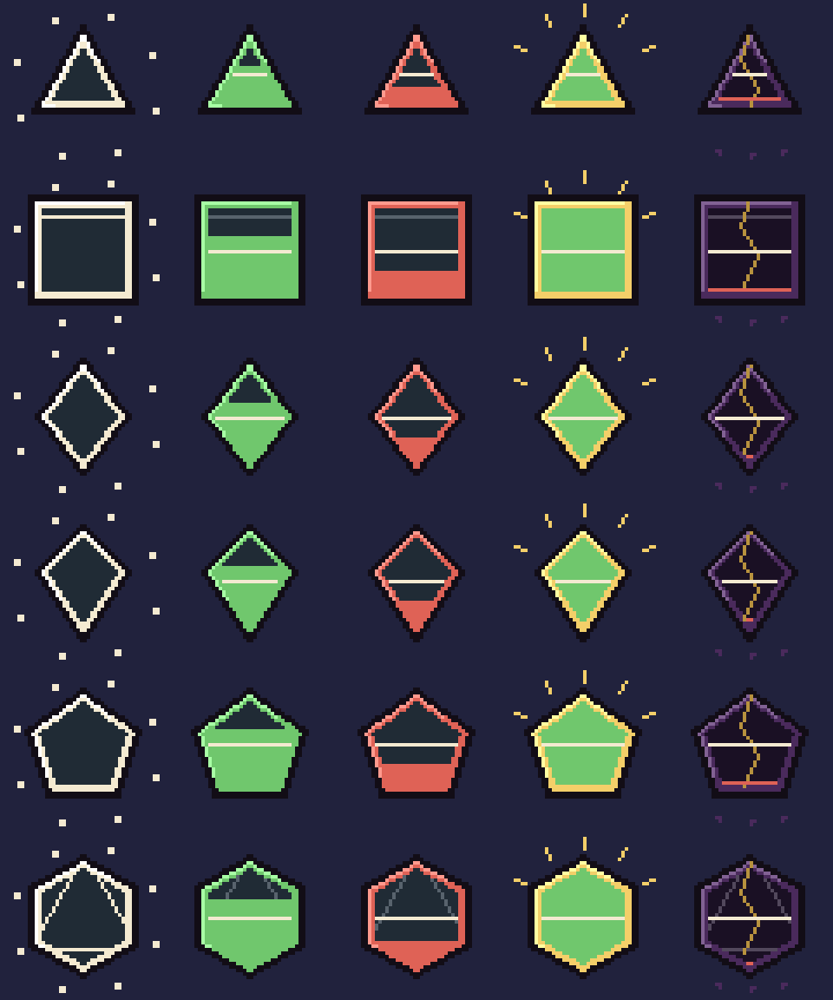

# 주사위 굴림 연출 기본값

[Issue #306](https://github.com/minjunkim-labs/BGLike/issues/306)의 [기획자 답변](https://github.com/minjunkim-labs/BGLike/issues/306#issuecomment-6406245423)에서 시작한 주사위 연출 기획이다. 굴림의 종류별로 연출 기본값을 정한다. 2026-10-31 기획자와 개발 논의 결과를 기록한다. 기획자가 구현 착수를 허용했고, 아래 [구현 상태](#구현-상태)대로 만들었다.

흘려내기는 [#423](https://github.com/minjunkim-labs/BGLike/issues/423)에서 전사 재디자인으로 폐지해 이 문서의 굴림 목록에서 뺐다. 성스러운 장막과 전투의 함성의 굴림은 피해·회복과 같이 연출 없이 팝업·로그만 보인다.

## 시점과 범위

- M6 범위다. #419에서 먼저 구현했다.
- 전투 중 굴림이 대상이다. 전투 밖 보상 추첨(`loot.gd`)은 이번 범위가 아니다.
- 기획자 후보 8개 연출 유형 중 이번에 쓰는 것은 아래다.

| 유형 | 내용 | 이번 사용 |
|---|---|---|
| 1 | 아무 연출 없음 | 사용 |
| 2 | 굴림 사운드 | 사용 |
| 3 | 성공/실패 애니메이션 | 사용 (숫자 + 색상) |
| 4 | 성공/실패 사운드 | 사용 |
| 5 | 굴림 애니메이션 | 사용 |
| 6 | n회 굴림 애니메이션 | 사용 (유리·불리) |
| 7·8 | 굴림 대결 애니메이션·승패 사운드 | 보류 |

## 굴림 카테고리와 기본값

굴림을 스킬 이름이 아니라 성격으로 나눈다. 새 스킬은 카테고리를 고르면 연출이 정해진다.

| 카테고리 | 성격 | 현재 굴림 | 연출 |
|---|---|---|---|
| 명중 | 공격 굴림 대 AC | 일반 공격, 기회 공격 등 | 애니메이션 + 굴림음 + 결과음 |
| 내성 | 굴림 대 정해진 기준값 | 독 제거, 회전회오리, 만능팔, 기름 미끌거림, 독안개, 바위 충돌 기절, 밀치기(몬스터만 굴려 지금은 연출 없음) | 애니메이션 + 굴림음 + 결과음 |
| 대결 | 양쪽이 굴려 총합 비교 | 없음 | **보류** |
| 피해 | 피해량 주사위 | 무기 피해, 상자 피해, 화상 틱 (표식 d6은 #528에서 폐지) | 없음(유형 1) |
| 회복 | 회복량 주사위 | 숨 고르기, 물약 | 없음(유형 1) |
| 이니셔티브 | 턴 순서 | 전투 시작 굴림 | 없음(유형 1) |
| 무작위 선택 | 후보 중 하나 고르기 | 소환 칸, 착지 칸 | 없음(유형 1) |

- 회전회오리([#389](https://github.com/minjunkim-labs/BGLike/issues/389))와 만능팔·밀치기([#391](https://github.com/minjunkim-labs/BGLike/issues/391))는 대결에서 대상의 내성굴림으로 옮겨져 내성 기본값을 따른다. 지금 대결 굴림은 없다.
- [#306](https://github.com/minjunkim-labs/BGLike/issues/306), PR #419: 회전회오리는 대상마다 연출이 끝난 뒤 피해를 낸다. 만능팔과 독 제거는 AI가 기다리지 않고 부르는 동작과 턴 시작 처리를 멈추지 않도록, 연출을 기다리지 않는다. 그래서 만능팔은 주사위가 구르는 동안 끌려온다. 굴림이 이어지면 먼저 온 굴림부터 결과까지 하나씩 보인다([#420](https://github.com/minjunkim-labs/BGLike/issues/420)).
- 피해·회복·이니셔티브·무작위 선택은 애니메이션도 사운드도 없다. 기존 팝업·로그와 재질별 타격음(`CombatSounds`, #628)은 그대로다.
- 명중·내성의 연출은 **굴리는 주체가 아군일 때만** 보인다(아래 [굴리는 주체](#굴리는-주체)).

## 연출 규칙

### 굴림음과 결과음

굴림음(2)과 결과음(4)은 **누적**한다. 굴림이 시작될 때 굴림음, 결과가 확정될 때 결과음이 난다.

### 굴리는 주체

주사위 연출은 **아군이 굴릴 때만** 보인다. 몬스터의 굴림은 연출 없이 기존 팝업과 로그만 남긴다.

| 굴림 | 아군이 굴림 | 몬스터가 굴림 |
|---|---|---|
| 명중 | 연출 | 팝업·로그만 |
| 독 제거 | 연출 | 팝업·로그만 |

- 몬스터가 아군을 공격할 때의 명중굴림도 연출하지 않는다.
- 이 규칙으로 적 턴의 연출이 줄어 4배속 빠르게 보기에서 읽히는지 걱정이 줄어든다.

### 주사위 모양

면 수에 맞는 다면체 모양을 살려서 굴린다. 멈춘 윗면에 결과 숫자를 보인다. 절대성공면·절대실패면이 나오면 그 면에 강조를 더한다. 3D 모델이나 2D 스프라이트 중 무엇으로 만들지, 면 수별 자산은 개발자가 정한다.

### 기준값 표기

기준값(명중의 AC, 내성의 기준)은 **굴리기 전부터 주사위 왼쪽, 가로선 높이에 고정으로 보인다.** 굴림이 끝나도 그대로이고, 합계는 주사위 오른쪽, 액체 표면 높이에 나타난다. 식(`9 +3 = 12 < AC 13`)은 화면에 보이지 않는다. [도트 디자인](#도트-디자인-519)에서 정하고 [#625](https://github.com/minjunkim-labs/BGLike/issues/625)에서 구현했다: 멈춘 뒤 합계 옆에 `합계 = 눈+보정`(예: `17 = 14+3`)만 보인다. 비교식 전체는 계속 보이지 않는다. 합계는 주사위 안 액체 표면 높이, 기준값은 가로선 높이에 있다.

- [#519](https://github.com/minjunkim-labs/BGLike/issues/519): 식 대신 판정 단어·여유·게이지로 결과를 보인다. 근거는 플레이어가 알고 싶은 것이 "얼마나 아슬아슬했나"라는 점이다. 대안은 식을 그대로 두는 것이다.
- 기준의 이름을 붙인다. 명중은 `AC`, 내성굴림(독 제거·회전회오리·만능팔·기름 미끌거림·독안개·바위 충돌 기절)은 `DC`로 표기한다.
- 절대성공·절대실패면은 기준과 상관없이 결정되므로 여유와 관계없이 절대성공은 액체를 꼭대기까지, 절대실패는 바닥 한 줄로 채운다.

### 결과 표시

- 판정 단어와 여유(합계 − 기준값)를 보인다. 예: `성공  +2`, `아깝게 실패  -1`. 여유가 0이면 `±0`이다. 절대면은 단어만 보인다.
- 성공과 실패는 색상과 단어로 구분한다. 색에만 기대지 않는다. 기존 글자 팝업(`빗나감` 등)도 함께 쓴다.
- 게이지는 주사위 안의 액체다([#625](https://github.com/minjunkim-labs/BGLike/issues/625)·[#626](https://github.com/minjunkim-labs/BGLike/issues/626)). 기준값은 가로선이고, 멈추면 액체 표면이 여유만큼 가로선 위(성공)나 아래(실패)에 선다. 여유가 ±6을 넘으면 끝에 붙는다. 절대성공은 가득, 절대실패는 바닥이다.
- 절대성공면·절대실패면은 일반 성공/실패와 같은 색에 **강조**(절대성공은 금색 띠와 빛줄기, 절대실패는 보라 띠와 금 간 선·파편 그림)를 더한다. [#625](https://github.com/minjunkim-labs/BGLike/issues/625)부터 주사위를 키우지 않는다(아래 [유닛 위 표시](#유닛-위-표시-625)).

| 등급 | 조건 | 단어 |
|---|---|---|
| 절대성공 | 절대성공면 | 절대성공 |
| 큰 성공 | 성공, 여유 +5 이상 | 큰 성공 |
| 성공 | 성공, 여유 +2 ~ +4 | 성공 |
| 아슬아슬한 성공 | 성공, 여유 0 ~ +1 | 간신히 성공 |
| 아슬아슬한 실패 | 실패, 여유 −1 | 아깝게 실패 |
| 실패 | 실패, 여유 −2 ~ −4 | 실패 |
| 큰 실패 | 실패, 여유 −5 이하 | 큰 실패 |
| 절대실패 | 절대실패면 | 절대실패 |

- 등급은 규칙의 성공/실패를 바꾸지 않고 여유로만 세분한다. 경계값과 게이지 범위는 임시이며 플레이로 정한다(`BIG_MARGIN`, `NARROW_SUCCESS_MARGIN`, `NARROW_FAILURE_MARGIN`, `GAUGE_RANGE`).
- 등급 단어(큰 성공, 간신히 성공, 아깝게 실패, 큰 실패)도 임시다. 치명타·절대성공 규칙(#321, #322)을 정할 때 어휘가 겹치면 기획자 확인이 필요하다.

### 명중

공격 모션 → 주사위 굴림(굴림음) → 결과 확정(결과음) → 명중이면 피해와 재질별 타격음(`hit_*.ogg`, #628) 순서다. 명중 성공 시 결과음과 타격음이 연달아 난다. 빗나가면 실패 결과음과 빗나감 휘두름 소리(`miss.ogg`)가 난다. 명중굴림은 연출이 끝난 뒤 피해를 내므로, 절대면이 나오면 결과를 더 오래 보인 만큼(약 0.4초) 뒤따르는 처리가 늦는다. 절대성공은 피해와 타격음이, 절대실패는 빗나감 표시와 반격이 늦다.

### 절대면 연출

[#488](https://github.com/minjunkim-labs/BGLike/issues/488)에서 정했다([결정 기록](https://github.com/minjunkim-labs/BGLike/issues/488#issuecomment-6738857891)).

- 카메라는 움직이지 않는다는 #488 결정은 2026-11-11 프로젝트 소유자 결정(주사위는 유닛 위에 띄우고 카메라 이동을 허용한다)으로 바뀌었다. 2026-11-16 [#516 명세](combat-ui.md#턴-강조카메라전체-속도-516)는 카메라가 행동 유닛이 C 밖에 있을 때 따라가도록 정했다. #516 명세는 굴림 때문에 카메라를 옮기지 않는다. 화면 밖 주사위는 카메라가 아니라 화면 안의 정해진 자리에 보인다([#625](https://github.com/minjunkim-labs/BGLike/issues/625), 아래 [유닛 위 표시](#유닛-위-표시-625)). 정수 배율([ADR 0002](../../adr/0002-resolution.md))은 그대로다. 구현 상태: 행동 유닛이 맵 중앙 영역 C 밖에 있으면 카메라가 따라간다([#624](https://github.com/minjunkim-labs/BGLike/issues/624), [전투 화면](combat-ui.md#턴-강조카메라전체-속도-516)). 주사위를 유닛 위에 띄우는 것은 [#625](https://github.com/minjunkim-labs/BGLike/issues/625)에서 구현했다.
- 슬로모션은 넣지 않는다. 적 턴 4배속이 `Engine.time_scale`을 쓰므로 전역 시간을 바꾸지 않는다.
- 아군의 명중굴림에서 절대면이 나오면 결과 표시 시간만 일반 0.8초에서 약 1.1초로 늘린다([#727](https://github.com/minjunkim-labs/BGLike/issues/727)에서 0.5초·0.9초를 늘림). 기본값(아래 [속도](#속도))이며 플레이 피드백으로 조정한다. 구현은 [#491](https://github.com/minjunkim-labs/BGLike/issues/491)·[#727](https://github.com/minjunkim-labs/BGLike/issues/727)이다.
- 독 제거·회전회오리·만능팔 내성의 절대면은 위 「결과 표시」의 강조만 쓴다.
- 지금 절대성공에 붙는 공통 추가 이점은 없다([#322](https://github.com/minjunkim-labs/BGLike/issues/322)에서 치명타 전역 규칙을 만들지 않기로 함). 그래서 위 강도를 전역으로 다시 보지 않는다. 어떤 스킬이 절대성공 추가 효과를 가지면 그 스킬 기획에서 연출을 함께 정한다([질문 4 정리](https://github.com/minjunkim-labs/BGLike/issues/488#issuecomment-6765872690)).

### 유리·불리

- 주사위 2개를 **동시에** 굴린다.
- 적용되는 쪽을 강조하고 버려지는 쪽은 흐리게 한다.
- 굴림음은 주사위가 2개여도 한 번만 낸다. (임시 결정, 플레이 확인 뒤 조정한다.)

### 내성

- 내성굴림은 아군이 굴릴 때만 연출한다.
- 독 제거는 턴 시작에 자동으로 굴린다. 아군에 독이 겹쳐 걸렸을 때 턴 시작 연출이 길어질 수 있어 플레이 확인 항목으로 둔다.

### 빠르게 보기·건너뛰기

- 빠르게 보기(적 턴 `Space` 4배속, [#221](https://github.com/minjunkim-labs/BGLike/issues/221))는 `Engine.time_scale`을 쓴다. 주사위 애니메이션도 같은 방식으로 빨라지게 만든다.
- 건너뛰기를 쓰면 굴림 애니메이션과 굴림음은 생략한다. 결과 숫자·색상·결과음은 짧게 남긴다.
- 건너뛰기 기능은 아직 없다. 주사위 연출을 위해 먼저 만들지 않고, 그 기능을 개발할 때 함께 만든다.

### 속도

굴림 UX는 빠르게 끝나되 판정 결과를 읽을 수 있어야 한다. [#565](https://github.com/minjunkim-labs/BGLike/pull/565)(2026-11-15)에서 굴림 0.45초 + 결과 0.5초(절대면 명중 0.9초) + 페이드 0.3초로 두었으나, [#727](https://github.com/minjunkim-labs/BGLike/issues/727)에서 결과를 읽을 시간을 확보하기 위해 결과 표시 시간을 일반 0.8초, 절대면 명중 결과 1.1초로 늘렸다(굴림 0.45초, 페이드 0.3초 유지). 플레이 피드백이 오면 바꾼다.

## 구현 길잡이

- 굴림 결과는 `CombatChecks`가 즉시 확정한다. 연출은 확정된 `RollResult`를 보여 주기만 한다. 규칙과 연출을 섞지 않는다.
- `attack_animation`처럼 `await` 훅을 두어 연출이 끝난 뒤 다음 단계로 넘어가게 한다. 훅이 없으면 즉시 넘어가므로 테스트는 연출 없이 돌린다.
- 카테고리를 호출 지점에 코드로 박지 않고 한 곳에서 카테고리별 연출을 정한다. 대결이 확정될 때 한 곳만 고치면 된다.

## 구현 상태

| 항목 | 상태 |
|---|---|
| 명중·내성굴림(독 제거·회전회오리·만능팔·기름 미끌거림·독안개·바위 충돌 기절) 연출 | 구현. 바위 충돌 기절은 기다리지 않는다(바위 처리를 멈추지 않는다). 아군이 굴릴 때만 보인다. |
| 연출 지점 | `CombatActions.roll_animation` 훅. 명중·회전회오리는 연출이 끝나길 기다린 뒤 로그와 피해를 낸다. 기다리는 동안 전투가 끝나면(전투 포기 등) 결과를 적용하지 않는다. 독 제거와 만능팔은 처리를 멈추지 않는다. |
| 이어지는 굴림 | 먼저 온 굴림부터 결과가 닫힐 때까지 하나씩 보인다. 기다리지 않는 굴림이 짧은 간격으로 이어져도 앞 결과의 숫자·색·결과음이 모두 나온다. 기다리는 굴림(명중·회전회오리)이 보이던 굴림 뒤에 오면 그 결과가 닫힌 뒤 굴리고, 자기 연출을 마친 뒤 돌아온다([#420](https://github.com/minjunkim-labs/BGLike/issues/420)). |
| 화면 | `CombatDiceRollView`(HUD 위, 입력을 막지 않음). 굴리는 유닛 머리 위에 [도트 그림](#도트-디자인-519) 주사위를 두고, 기준값은 왼쪽 가로선 높이, 합계 식은 오른쪽 액체 표면 높이, 판정 단어와 여유는 아래에 두며 주사위·글자 전체를 어두운 반투명 배경 패널로 감싼다([#727](https://github.com/minjunkim-labs/BGLike/issues/727)). 유닛이 화면 밖이면 정해진 자리에 이름과 함께 보인다([#625](https://github.com/minjunkim-labs/BGLike/issues/625), 아래 [유닛 위 표시](#유닛-위-표시-625)). |
| 시간 | 굴림 0.45초(회전 프레임 4장이 도는 동안) + 결과 0.8초(`TUMBLE_TIME`, `HOLD_TIME`, [#727](https://github.com/minjunkim-labs/BGLike/issues/727)). 결과 효과는 0.25초 안에 끝난다(`EFFECT_TIME`, [#626](https://github.com/minjunkim-labs/BGLike/issues/626)). 명중굴림의 절대성공·절대실패면은 결과를 1.1초 보인다(`ABSOLUTE_HIT_HOLD_TIME`, [#488](https://github.com/minjunkim-labs/BGLike/issues/488) 결정, [#491](https://github.com/minjunkim-labs/BGLike/issues/491)·[#727](https://github.com/minjunkim-labs/BGLike/issues/727)). 내성굴림의 절대면은 강조만 두고 시간은 그대로다. 결과 표시가 끝나면 0.3초 동안 페이드아웃하며 2 논리px 떠오르고 숨는다(`FADE_TIME`, [#514](https://github.com/minjunkim-labs/BGLike/issues/514), 2026-11-11 플레이 피드백). 차례는 페이드를 기다리지 않고 넘겨, 다음 굴림과 피해 표시가 늦어지지 않는다. 페이드 중에 다음 굴림이 오면 페이드를 끊고 새 굴림을 보인다. 기본값(위 [속도](#속도))이며 플레이 피드백으로 조정한다. |
| 소리 | 칩튠풍 자체 합성음 3종(`dice_roll`은 갈래 3개, `roll_success`, `roll_fail`, [#627](https://github.com/minjunkim-labs/BGLike/issues/627), `make_sfx.py`). 세 소리는 SFX 버스로 나간다. 같은 소리가 앞 소리가 끝나기 전에 다시 나도(4배속 등) 끊지 않고 겹쳐 재생한다(최대 4개, [#631](https://github.com/minjunkim-labs/BGLike/issues/631)). |
| 이어하기 재실행 | 연출하지 않는다. |
| 굴림·결과·사라짐 애니메이션 | 구현([#626](https://github.com/minjunkim-labs/BGLike/issues/626)). 아래 [굴림·결과·사라짐](#굴림결과사라짐-626). |
| 건너뛰기 | 건너뛰기 기능이 없어 아직 연결하지 않았다. 나중에 붙일 때 굴림 프레임·튀기를 생략하고 결과 효과는 짧게 남기도록 효과는 `_settle`에서 시작한다. |

독 제거를 기다리지 않는 이유: 턴 시작 처리는 저장과 턴 전환 사이에서 한 번에 끝나야 한다. 굴림은 이미 확정돼 있어 연출만 늦게 보여도 규칙은 달라지지 않는다.

## 도트 디자인 (#519)

[Issue #519](https://github.com/minjunkim-labs/BGLike/issues/519)의 첫 완료 조건(위치, 상태별 모양, 게이지 방식, 기준값 표기, 판정 단어)을 정한다. 아래는 모두 2026-11-16에 정했다. 출처는 프로젝트 소유자의 2026-11-16 답과 [#516 댓글](https://github.com/minjunkim-labs/BGLike/issues/516#issuecomment-6797626606)의 요청("레퍼런스 이미지 느낌으로", "수치를 더 명확하게", "주사위는 유닛 위")이다. 유닛 위 표시는 [#625](https://github.com/minjunkim-labs/BGLike/issues/625)에서 구현했고([유닛 위 표시](#유닛-위-표시-625)), 굴림·결과·사라짐 애니메이션은 [아래 절](#굴림결과사라짐-626)에서 구현했다. 이 절은 그림 단계의 결정이다.

방향 참고: #516 댓글의 레퍼런스 이미지 정리와 Baldur's Gate 3(BG3)의 판정 주사위 표시(DC 숫자, 크게 보이는 굴린 눈, 성공·실패 글자, 치명 결과의 별도 강조)다. 방향 참고로만 쓰고 자산과 화면 배치는 복제하지 않는다. 그림은 스크립트로 직접 찍었다.

1. **위치**: 굴리는 유닛의 머리 위. 유리·불리면 두 주사위를 가로로 나란히 두고 적용한 쪽을 강조하며 버린 쪽을 흐리게 한다(지금 규칙 그대로). 근거: "주사위는 유닛 위"라는 요청이다. 화면 위치는 [#625](https://github.com/minjunkim-labs/BGLike/issues/625)에서 구현했고, 행동 유닛을 따라가는 카메라 이동은 [#624](https://github.com/minjunkim-labs/BGLike/issues/624)에서 구현했다. 「절대면 연출」의 카메라 줄은 [#516 명세](combat-ui.md#턴-강조카메라전체-속도-516)가 이미 고쳤다.
2. **상태 다섯 개**: 굴리는 중, 성공, 실패, 절대성공, 절대실패. 주황 「아깝게」 같은 새 색·새 등급·새 주사위는 만들지 않는다. 근거: BG3도 성공·실패·대성공·대실패 넷이다. 대안은 주황 등급을 더하는 것이다. 기존 여유 등급 단어(큰 성공·간신히 성공·아깝게 실패·큰 실패)는 단어로만 남고, 색과 그림은 성공·실패 둘 중 하나를 쓴다. 이것으로 #516 댓글의 주황 주사위 질문을 닫는다. 화면 단어는 이 저장소의 절대성공·절대실패다.
3. **상태별 모양**:
   - 굴리는 중: 중립색(`#f4ead1`) 띠와 어두운 유리, 몸체 둘레의 회전 잔상 픽셀. 액체 없음.
   - 성공·실패: 띠가 성공색(`#70c76d`)·실패색(`#df6256`). 안은 어두운 유리이고 액체가 찬다.
   - 절대성공: 금색(`#f4cf69`) 띠와 위쪽 빛줄기 픽셀. 액체는 가득 찬 성공색.
   - 절대실패: 어두운 보라 띠, 금빛 금 간 선, 아래 파편 픽셀. 액체는 바닥에 고인 실패색 한 줄.
   - 레퍼런스의 왕관·피 웅덩이·불꽃은 베끼지 않고 같은 뜻(빛·금·파편)만 우리 팔레트로 찍는다.
4. **게이지 방식**: 주사위 안 액체 높이와 기준값 가로선. 가로선은 몸체 안쪽 가운데 높이에 고정하고, 액체 높이는 여유(합계 − 기준값)를 지금 게이지 범위(±6)로 바닥~꼭대기에 옮긴다. 넘으면 끝에 붙는다. 액체 색은 성공·실패색이다. 절대성공은 가득, 절대실패는 바닥 한 줄이다(지금 규칙 「게이지 전체를 결과 색으로」와 같은 뜻). 굴리는 동안은 액체 없이 회전만 한다. 근거: 요청의 「수치를 더 명확하게」와 지금 가로 게이지를 주사위 안으로 모아 시선을 한 곳에 둔다. 지금 주사위 아래 가로 게이지는 구현 과제에서 액체로 바꾼다.
5. **숫자 배치**: 그림 안에는 숫자를 넣지 않는다. 숫자는 모두 런타임 글자(Galmuri11 11px)로 주사위 옆에 둔다.
   - 기준값(`AC 13`·`DC 9`): 주사위 왼쪽, 가로선 높이. 굴리기 전부터 보인다.
   - 합계: 주사위 오른쪽, 액체 표면 높이. 굴리는 동안은 이 자리에 바뀌는 눈이 돈다.
   - 멈춘 뒤에는 합계 옆에 굴린 눈과 보정을 함께 보인다: `17 = 14+3`. 눈은 `RollResult.selected_roll`, 보정은 `RollResult.added()`다. 보정이 음수면 `9 = 11-2`, 0이면 `14 = 14+0`으로 늘 같은 꼴이다. 근거: BG3도 굴린 눈을 크게 보이고, 요청이 「수치를 더 명확하게」다. 대안인 합계만 보이는 것은 사람이 고쳤다.
   - 절대성공·절대실패면은 오른쪽에 굴린 눈만 보인다(예: `20`). 합계와 보정이 판정에 쓰이지 않기 때문이다.
   - 유리·불리의 버린 주사위 눈은 화면 식에 넣지 않는다. 흐린 주사위와 로그로만 남긴다.
   - 판정 단어와 여유(`성공  +2`, 절대면은 단어만)는 주사위 아래에 둔다. 지금 규칙 그대로다.
   - 위 「기준값 표기」의 식 숨김(#519)은 이 결정으로 일부 바뀐다. 비교식 전체(`… < AC 13`)는 계속 보이지 않고 `합계 = 눈+보정`만 보인다.

```text
 AC 13 ┤┈┈┈┈┈┈ [ 주사위 ] ── 17 = 14+3
                 성공  +4
```

6. **면 수별 모양**: 지금 `CombatDiceRollView.shape_points`와 같은 실루엣 계열이다. d4 삼각형, d6 정사각형에 윗면 선 한 줄, d8 마름모(지금 `shape_points`는 폭과 높이가 같고, 그림은 폭 28·높이 36으로 더 길쭉하다), d10 연, d12 오각형, d20 육각형에 가운데 삼각면 선. 면 수가 달라도 액체·가로선·숫자 배치는 같다. 이 밖의 면 수는 그림이 없고 구현 과제가 지금의 벡터 그림으로 남긴다.
7. **규격**: 48×48 RGBA 원본을 0.5배로 써 24 논리px(아이콘과 같은 [표시 크기 규칙](../pixel-art.md#표시-크기-362), 배율 2·4는 정수). 몸체는 가운데 36×36 안, 효과 픽셀은 48 캔버스 안이다. 2px 어두운 윤곽(`#120d16`), 왼쪽 위 광원, 안티앨리어싱 없음. 근거: 32 논리px 유닛 위에 얹어도 유닛보다 작고, 액체 13단계(±6)를 d6~d12는 원본 2px 간격(유리 높이 24px), d20은 약 2px(28px)로 가를 수 있는 가장 작은 크기다. 가장 작은 d4는 유리 높이가 15px라 약 1px 간격이다. 대안인 32×32 원본(16 논리px)은 13단계가 1px 간격이라 배율 2에서 뭉개진다.
8. **파일**: `scenes/combat/art/dice/d{4,6,8,10,12,20}_{rolling,success,failure,absolute_success,absolute_failure}.png` 30개와 액체 마스크 `d{N}_liquid.png` 6개(몸체 안쪽 유리의 흰 실루엣. 액체 높이가 굴림마다 달라 그림에 굽지 않고, 런타임이 높이로 자르고 색을 곱한다). 생성은 `python3 scenes/combat/art/sources/dice/draw_dice.py scenes/combat/art/dice`이고 규격 기록은 `dice_generation.json`이다. 굴림 프레임 `d{N}_rolling_{1,2,3}.png` 18개를 [#626](https://github.com/minjunkim-labs/BGLike/issues/626)에서 더했다(`rolling`이 프레임 0). `CombatDiceRollView`가 이 그림을 읽는다.



## 유닛 위 표시 (#625)

[#625](https://github.com/minjunkim-labs/BGLike/issues/625)에서 [도트 디자인](#도트-디자인-519)을 구현하며 명세가 정하지 않은 것을 정했다. 모두 2026-11-17에 정했다.

1. **화면 좌표에 두고 위치만 따라간다.** 뷰는 HUD 계층(`UI`)에 두고, 보이는 동안(페이드 포함) 매 프레임 굴리는 유닛의 머리 위 점을 화면 좌표로 바꿔 패널 원점을 정수 논리 px로 반올림한다. 카메라가 1배든 2배든 주사위는 24 논리px, 글자는 11px로 같다. 근거: 정수 배율([ADR 0002](../../adr/0002-resolution.md))이 원점 반올림 하나로 지켜지고, 2배 확대에서 주사위와 글자가 맵을 두 배로 가리지 않는다. 대안: 맵 좌표에 두면 2배에서 48 논리px 그림과 22px 글자가 되고 화면 밖 처리가 따로 필요하다.
2. **머리 위 점**: 상태 글자 자리 윗변에서 2 논리px 위가 패널 아랫변이다. 주사위(들) 가운데가 유닛 x에 온다. HP 막대와 상태 글자를 덮지 않는다. 패널은 위에서 아래로 주사위 줄(24), 판정 단어 줄(12)이다.
3. **그림과 강조**: 굴리는 중 `rolling`, 멈추면 `success`·`failure`·`absolute_success`·`absolute_failure`. 0.5배(24 논리px)로 그리고 `pixel_art.tres`를 쓴다. 회전은 그림 프레임으로 한다([#626](https://github.com/minjunkim-labs/BGLike/issues/626), [굴림·결과·사라짐](#굴림결과사라짐-626)). 적용한 주사위와 절대면도 키우지 않는다. 0.5배 그림을 키우면 텍셀이 정수 화면 px에 놓이지 않기 때문이다. 절대면의 강조는 그림(금색 띠·빛줄기, 보라 띠·금·파편)이 맡는다. 그림이 없는 면 수는 같은 24 논리px 칸에 벡터 윤곽으로 그리고 액체는 없다.
4. **액체와 가로선**: 가로선은 적용한 주사위에만 굴리기 전부터 중립색 1 원본 행으로 그린다. 액체는 멈춘 뒤 마스크 행 범위에서 여유(±6)로 표면을 옮겨 성공·실패색으로 채우고(`draw_dice.py`의 `sheet_cell`과 같은 식), 절대성공은 가득, 절대실패는 바닥 한 줄이다. 굴리는 동안은 액체가 없고 가로선 높이에 바뀌는 눈이 돈다.
5. **유리·불리**: 두 주사위를 4 논리px 간격으로 가로로 둔다. 기준값은 왼쪽 주사위 왼쪽, 합계는 오른쪽 주사위 오른쪽이다. 버린 주사위는 같은 상태 그림을 흐리게(0.35) 하고 액체와 가로선을 넣지 않는다.
6. **글자와 배경 패널**: 테마의 Galmuri11 11px에 유닛 팝업과 같은 어두운 윤곽(2px)을 두고, 주사위·기준값·합계·판정 단어 줄 전체를 감싸는 어두운 반투명 배경 패널과 얇은 테두리를 함께 그린다([#727](https://github.com/minjunkim-labs/BGLike/issues/727)). 판정 단어는 13px(절대면 16px)다.
7. **화면 밖 주사위**: 머리 위 패널이 양옆의 기준값·합계 글자 폭(각 60 논리px)까지 포함해 화면 안에 다 들어가지 않으면 화면 밖으로 본다. 글자가 화면 가장자리에서 잘리지 않게 하려는 것이다. 이때 패널을 가운데 위, 턴 순서 막대 아래(윗변 y 90 논리px)에 두고 판정 단어 줄 앞에 유닛 이름을 붙이며(`이름 · 성공  +2`), 패널 가장자리에서 유닛 쪽을 가리키는 작은 삼각형을 그린다. 보이는 동안 매 프레임 다시 판정하므로 유닛이 들어오면 머리 위로 간다. 적 턴의 아군 내성 굴림과 아군 턴에 플레이어가 카메라를 옮겨 행동 유닛이 화면 밖이 된 경우([#516 명세](combat-ui.md#턴-강조카메라전체-속도-516))가 같은 규칙이다. 카메라는 굴림 때문에 움직이지 않는다([#624](https://github.com/minjunkim-labs/BGLike/issues/624) 따라가기는 별개). 근거: 이 자리는 HUD 배치 검사가 이미 비워 둔 곳이라 맵 중앙 영역 C(y 128~)와 턴 순서 막대와 겹치지 않는다. 대안: 화면 가장자리에 붙이기(네 가장자리에 HUD가 있어 겹침), 카메라를 유닛으로 옮기기(플레이어가 옮긴 화면을 빼앗음), 숨기기(적 턴 내성 결과를 놓침).
8. **플레이로 확인할 것**: 머리 위 패널이 화면 안이지만 HUD 패널 아래에 걸리는 경우(HUD 위에 잠깐 그린다), 유닛 위 가독성, 4배속에서 읽히는지.

## 굴림·결과·사라짐 (#626)

[#626](https://github.com/minjunkim-labs/BGLike/issues/626)에서 [도트 디자인](#도트-디자인-519)의 굴림·결과 확정·사라짐 애니메이션을 구현하며 정한 것이다. 모두 2026-11-18에 정했다. 움직임은 정수 논리 px 이동, 원본 행 단위 자르기, 미리 찍은 프레임 바꾸기만 쓰고 회전·확대·부드러운 이동은 쓰지 않는다([ADR 0002](../../adr/0002-resolution.md), #625 결정 3).

1. **굴리는 동안의 회전**: 그림 프레임 4장(`rolling`, `rolling_1`~`rolling_3`). 프레임마다 몸체 둘레 잔상 8개를 11.25°씩 더 돌리고 띠의 밝은 자리를 왼쪽 위 → 오른쪽 위 → 오른쪽 아래 → 왼쪽 아래로 옮긴다. 눈 바꾸기 단계(`FACE_CHANGES` 8)와 함께 `단계 % 4`로 넘긴다. 굴리는 동안 주사위 칸은 홀수 단계에 1 논리px 위로 튄다. 기준값 가로선과 글자는 튀지 않는다. 근거: 0.5배 그림을 런타임에 돌리면 텍셀이 어긋난다. 대안: 90° 회전(가로선과 어긋남), 8장(0.45초에 다 보이지 않음). 그림이 없는 면 수는 튀기만 한다.
2. **결과 효과**(`EFFECT_TIME` 0.25초, 결과음과 같은 때 시작): 성공은 액체가 바닥에서 결과 표면까지 0.12초(`RISE_TIME`) 동안 차오른다. 실패는 차오름에 더해 주사위가 가로로 +1, −1, +1, 0 논리px(각 0.03초) 흔들린다. 절대성공은 가득 차오르고 금색 불티 5개가 위쪽 다섯 방향으로 반지름 14에서 20 논리px까지 나가며 사라진다. 절대실패는 바닥 한 줄을 바로 보이고 보라(`#7a4a94`) 파편 3개가 4 논리px 떨어지며 사라지며 주사위가 1 논리px 내려앉았다(0.06초) 돌아온다. 글자는 흔들리지 않는다. 버린 주사위는 효과가 없다. 근거: 성공·실패는 색·단어로 이미 구분돼 효과는 짧은 움직임 하나씩만 더한다. 결과 표시(0.5초) 안에 끝나 4배속에서도 다음 굴림을 늦추지 않는다.
3. **사라짐**: [#514](https://github.com/minjunkim-labs/BGLike/issues/514) 페이드(0.3초)와 같은 Tween 안에서 주사위·글자 묶음이 0에서 2 논리px(0.1초마다 1, 마지막 0.1초는 2) 위로 떠오른다. 차례는 페이드를 기다리지 않고, 새 굴림이 오면 페이드와 함께 떠오름도 0으로 돌린다. 대안: 아래로 떨어뜨리기(HP 막대·상태 글자를 덮음), 페이드를 늘리기(속도 결정과 어긋남).
4. **시간과 빠르게 보기**: 새 움직임은 모두 `_process`의 게임 시간이나 Tween으로 돌아 4배속(`Engine.time_scale`)에서 같은 비율로 빨라진다. `TUMBLE_TIME`·`HOLD_TIME`·`ABSOLUTE_HIT_HOLD_TIME`·`FADE_TIME`과 차례 줄([#420](https://github.com/minjunkim-labs/BGLike/issues/420))·절대면 표시 시간([#491](https://github.com/minjunkim-labs/BGLike/issues/491))은 바꾸지 않는다.
5. **화면용 상태**: 프레임·튀기·흔들림·불티·파편·떠오름은 화면에만 있고 게임의 주사위 순서와 저장 상태에 영향이 없다.
6. **플레이로 확인할 것**: 회전이 돌아 보이는지, 흔들림·불티·파편이 거슬리는지, 4배속에서 효과가 읽히는지, 효과 시간·크기 값.

## 미정

| 항목 | 임시 규칙 | 결정 Issue |
|---|---|---|
| 대결 연출 | 지금 대결 굴림은 없음 | Issue 없음. 새 대결이 생기면 유형 7·8을 쓸지 정함 |
| 등급 경계값(여유 ±5, +1, −1)과 게이지 범위(±6), 등급 단어 | 지금 값을 씀 | [#565](https://github.com/minjunkim-labs/BGLike/pull/565). 플레이 피드백이 오면 정함 |
| 기준값·게이지 패널이 지형을 가리는 정도 | 구현한 크기 그대로 | Issue 없음. 플레이로 확인 |
| 적 턴 4배속에서 결과가 읽히는지(적 턴의 아군 굴림: 회전회오리·만능팔 내성) | 지금 연출 그대로 | Issue 없음. 플레이로 확인 |
| 소리가 겹쳐도 거슬리지 않는지(명중 성공, 4배속의 이어지는 굴림) | 지금 소리 그대로 | Issue 없음. 청취로 확인 |
| 배경 굴림 뒤의 명중굴림 대기 | 보이던 독 제거·만능팔 굴림 뒤에 오면 앞 굴림 하나당 최대 약 1초 늦게 굴림 | Issue 없음. 거슬리는지 플레이로 확인 |
