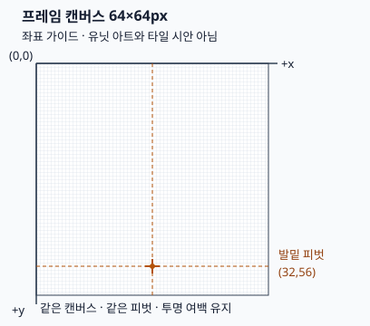
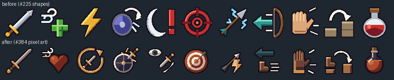
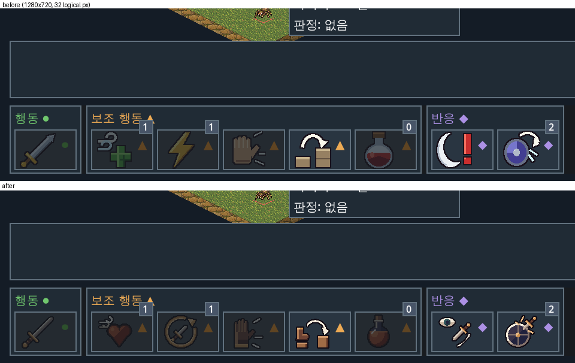
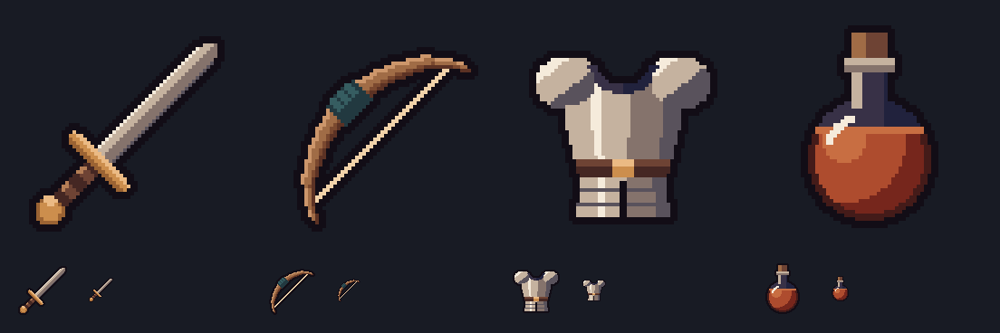
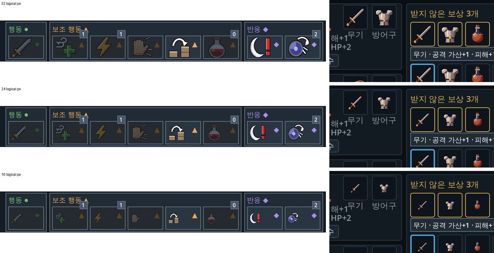
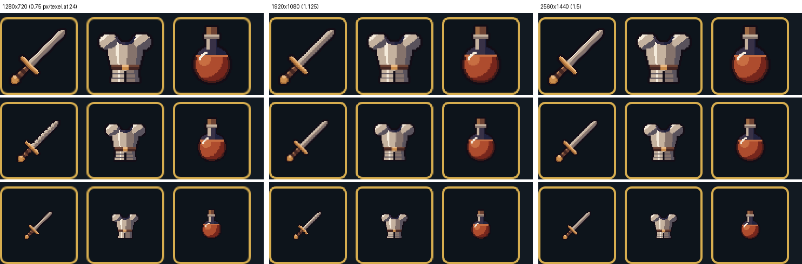
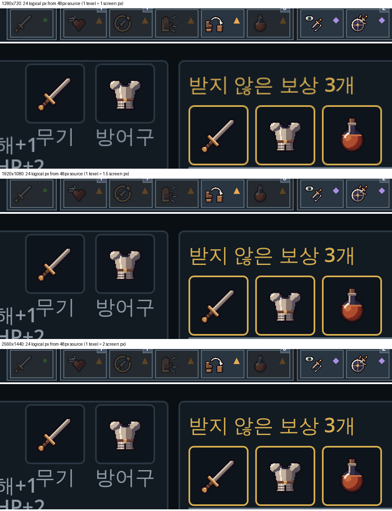

# 도트 아트와 지형 제작

기준 작업은 [#193](https://github.com/minjunkim-dev/BGLike/issues/193)이다. 2026-10-21 사용자가 실제 도트 에셋과9개 지형 맵을 요청했다. 사용자는 필요한 선택을 에이전트의 권장안으로 위임했다. 이 문서는 그 위임에 따른 아트 방향과 제작 기준을 기록한다. 구현·검증 결과는 각 티켓과 아래 상태에 구분해 기록한다.

## 방향

따뜻한 석재, 황토 길, 이끼와 초록 식생, 청록 물을 사용한다. 레퍼런스는 소드 오브 콘발라리아의 아이소메트릭 지형과 도트 밀도다. 바닥과 높이 측면을 구분한다. 유닛이 서 있는 층과 접근 가능한 경로를 읽을 수 있어야 한다. 원본 게임의 캐릭터·지형 이미지를 복제하지 않는다.

유닛의 기능을 실루엣으로 구분한다. 전사는 검·방패·인디고 망토를 쓴다. 궁수는 활·화살통·청록 망토를 쓴다. 풋내기 야만인은 도끼·털 어깨띠·적갈색 옷을 쓴다. 풋내기 궁수는 작은 활·황토 옷·적갈색 후드를 쓴다. 거미는8개 다리와 몸통 크기로 구분한다. 고철로봇1000/2000/3000은 짧은 집게·긴 만능팔·넓은 회전 날 팔로 구분한다. 이는 표시를 위한 권장 선택이다. 이름·세계관·전투 수치를 새로 정한 내용이 아니다.

## 제작과 납품

런타임 파일은 아래 [유닛 이미지 납품 규격](#유닛-이미지-납품-규격)을 따른다. 각 유닛은 idle/move/attack과 left/right의 여섯 조합을 가진다. 첫 납품은 조합마다2프레임이다. idle은3fps, move는24fps, attack은12fps가 기본값이다. 전체 속도 0.7([#516](https://github.com/minjunkim-dev/BGLike/issues/516))에서는 move 16.8fps, attack 8.4fps로 재생하고 idle은 그대로다. 이동 한 칸의 기본 0.09초(0.7 기준 약 0.129초) 안에 두 보행 자세를 표시한다. 공격은 한 번 재생하고 대기로 돌아간다. 실제 이동은 기존 이동 연출의 위치와 높이를 따른다. 턴 순서의 초상은 같은64×64 대기 이미지를32 논리px 폭으로 표시한다.

궁수의 화살 출발점은 발밑에서 화면 방향8 논리px·위16 논리px다. 64px 원본의 오른쪽 프레임(48,24), 왼쪽 프레임(16,24)에 해당한다. 높이를 더한 뒤 실제 활 위치에서 발사한다. 유닛의 깊이 정렬 원점은 바닥에 유지한다. 기본 공격은 유닛뿐 아니라 상자·바위에도 같은 방향·공격 자세와 궁수 화살을 표시한다.

HP·상태·피해 팝업은 그 유닛의 실제 그림 높이를 기준으로 배치한다. 작은 거미에 사람 크기의 빈 여백을 적용하지 않는다. 유닛의 모든 프레임 중 가장 높은 그림을 사용하므로 프레임 교체만으로 표시 위치는 흔들리지 않는다. 걷기와 점프에서는 몸통의 수직 이동을 함께 따른다.

아군은 오른쪽, 적은 왼쪽을 보며 시작한다. 실제 이동·공격 때는 목적지의 화면 방향을 본다.

원본은 내장 `image_gen`으로 제작한다. 기준 시안을 고른 뒤 같은 유닛의 전체 상태·방향 시트를 한 번에 생성한다. 좌우 프레임을 따로 그리도록 요청한다. 개별 프레임을 엔진의 좌우 반전으로 대체하지 않는다. 시트는4열×3행이다. 행은 idle/move/attack이다. 열은 right000/right001/left000/left001이다.

시트를 자르고 공통 배율로 nearest-neighbor 축소한다. 픽셀을 새로 그리는 후처리는 하지 않는다. 최종 프레임은64×64 RGBA다. 발밑 기준점은(32,56)이다. 새끼 거미는 최대48×30, 다른 유닛은 최대60×56 안에 들어간다. 같은 유닛은 모든 프레임에 같은 축소 배율을 쓴다. 개별 캔버스를 잘라내서 납품하지 않는다.

사용자는2026-10-21에32px 결과의 가독성과 선명도 개선을 요청했다. [#194 결정](https://github.com/minjunkim-dev/BGLike/issues/194#issuecomment-6305982882)에 따라 원본에서64px로 재추출한다. 32px를 두 배로 확대한 파일을 납품하지 않는다. Sprite scale0.5로 기존 논리 표시 크기와 피벗(16,28)을 유지한다. 기본 레이아웃640×360, 창1280×720, Nearest와 정수 배율을 유지한다. `canvas_items`는2D와 글꼴을 실제 창 해상도에서 렌더한다. 따라서1280×720에서64px 이미지의 세부를 보존한다. 640×360의 축소 화면에서는 같은 세부를 모두 구분할 수 없다. 그래서 `개발 결정`([#263](https://github.com/minjunkim-dev/BGLike/issues/263))으로 최소 창은1280×720이다([해상도 ADR](../adr/0002-resolution.md)). [Godot 공식 렌더 설명](https://docs.godotengine.org/en/stable/tutorials/rendering/multiple_resolutions.html)을 따른다.

`개발 결정`([#256](https://github.com/minjunkim-dev/BGLike/issues/256)): 유닛 윤곽 셰이더(`unit_outline.gdshader`)는 이웃 픽셀을 1텍셀과 1화면 픽셀 중 큰 간격으로 샘플한다. 640×360에서는 1텍셀이 0.5화면 픽셀이라 1텍셀 윤곽이 픽셀 사이로 빠져 끊긴 점으로 보였다. 이제 윤곽은 2텍셀(1화면 픽셀) 두께로 이어진다. 1280×720 이상에서는 1텍셀이 1화면 픽셀 이상이라 모양이 그대로다. 가림·선택·미리보기 윤곽과 사물 미리보기 윤곽이 같은 셰이더를 쓴다. 팀색과 윤곽 클릭 규칙은 바꾸지 않는다. 표시 두께만 화면 배율에 맞춘다. 기획자가 나중에 바꿀 수 있다.

`개발 결정`([#264](https://github.com/minjunkim-dev/BGLike/issues/264)): 유닛·지형·사물·아이콘은 sharp bilinear 셰이더로 그린다. 원본을 0.5배로 쓰므로(유닛·지형·사물 64px, 아이콘 48px) 1920×1080(정수 배율3)에서는 1텍셀이 1.5화면 px이다. Nearest만 쓰면 1px과 2px 도트가 섞인다. 셰이더는 텍셀 안쪽을 Nearest처럼 한 색으로 칠하고, 텍셀 경계만 화면 1픽셀(`fwidth`) 폭으로 섞는다. 1텍셀이 1화면 픽셀 이하면 섞지 않는다. 그래서 1280×720과 2560×1440의 모양은 그대로다. 공용 샘플은 `scenes/combat/art/pixel_art.gdshaderinc`의 `SHARP_TEXTURE`다. `pixel_art.tres`(유닛·사물 Sprite, 초상·스킬·아이템 아이콘), `unit_outline.gdshader`(#256 윤곽), `terrain_detail.gdshader`(지형 칸)가 함께 쓴다. 윤곽도 같은 샘플의 알파를 읽어 그림 가장자리와 맞는다. 두께(1텍셀과 1화면 픽셀 중 큰 쪽)와 팀색은 그대로다. `tests/combat_loot_test.gd`가 실제 전투·정비 화면에서 도트 아트를 그리는 노드와 지형 칸의 셰이더를 검사한다. 측정과 캡처는 [해상도 ADR](../adr/0002-resolution.md#1080p-도트-표시-264)에 있다. 도트 경계가 조금 부드러워지므로 기획자가 나중에 바꿀 수 있다.

1920×1080 원본 Viewport의 4배 확대: [변경 전(Nearest)](images/pixel_art_1080p_before.png), [변경 후](images/pixel_art_1080p_after.png).

제작 원본과 프롬프트는 `scenes/combat/art/sources/`에 보존한다. 이 폴더는 Godot 리소스 가져오기에서 제외한다. `unit_generation.json`은 원본·프롬프트·가공 규격을 기록한다. `normalize_units.py`는 Pillow가 있는 Python에서 시트를 추출한다. 시스템 Python에 Pillow가 없으면 기존 Codex 번들 Python을 사용한다. 프로젝트의 실행 의존성을 추가하지 않는다. 런타임에는 개별 PNG 프레임을 연결한다. 생성 도구와 원본·가공 기록은 [자산 고지](../../THIRD_PARTY_NOTICES.md)에 기록한다.

## 유닛 이미지 납품 규격

플레이어와 몬스터가 함께 쓰는 유닛 이미지의 규격이다. 외부 제작자에게 이 절을 전달한다.
기준은 [Issue #125](https://github.com/minjunkim-dev/BGLike/issues/125)와 [위임된 결정](https://github.com/minjunkim-dev/BGLike/issues/125#issuecomment-6296693719)이다.
이 규격은 임시 규격이다. 캔버스·피벗·파일 형태·경로·납품 조건은 사용자의 선택 위임으로 채택한 초기 권장안이다. 기획자의 명시 수치와 구분한다.
#125에는 과거의 타일 20×20 설명이 있다. 지금 소스값은 64px 원본과 바닥 폭 32 논리px이므로 그 설명을 현재 값으로 읽지 않는다.
화풍, 프레임 수와 재생 속도는 위 절의 제작 기준을 따른다.

### 프레임과 피벗

| 항목 | 규격 |
|---|---|
| 적용 대상 | 플레이어와 몬스터 공통 |
| 프레임 캔버스 | 64×64px. 모든 상태·방향·프레임이 같은 크기 |
| 좌표 | 왼쪽 위가(0,0). 오른쪽이+x, 아래가+y |
| 발밑 피벗 | (32,56). 모든 프레임에서 고정 |
| 상태 | `idle`(대기), `move`(이동), `attack`(공격) |
| 방향 | `left`(화면 왼쪽), `right`(화면 오른쪽). 각각 제작 |

캔버스는 이미지를 담는 사각 영역이다. 타일의 논리 모양이나 바닥 면적이 아니다.
바닥 폭32 논리px에64px 원본을 scale0.5로 표시한다. 논리 피벗은(16,28)이다.
그림의 내용에 맞춰 캔버스를 잘라내거나 프레임마다 피벗을 옮기지 않는다.
발을 드는 자세에서도 피벗은 같은 바닥 기준점을 유지한다.
좌우 이미지를 각각 제작한다. 엔진의 좌우 반전으로 한쪽 납품을 대체하지 않는다.



위 그림은 좌표 가이드다. 제작할 유닛의 모습·비율·화풍이나 최종 아트 시안이 아니다.

### 파일과 위치

개별 PNG 프레임으로 받는다. 여러 프레임을 한 이미지 시트로 합치지 않는다.
PNG는64×64px, RGBA8, 투명 배경을 사용한다.
픽셀 좌표와 파일 크기를 정수로 유지한다. 투명 여백도 캔버스에 포함한다.

```text
scenes/combat/art/units/<unit_id>/<state>/<direction>/000.png
```

예: `scenes/combat/art/units/warrior/idle/left/000.png`.
Godot 리소스 경로는 앞에 `res://`를 붙인다.
프레임 번호는000부터 연속으로 붙인다. 001·002 순으로 이어가며 중간 번호를 비우지 않는다.
대기·이동·공격과 좌·우의 여섯 조합을 모두 납품한다.
프레임 수와 재생 속도는 제작 후 테스트나 레퍼런스 조사로 정한다. 여섯 조합의 프레임 수가 같아야 한다는 규칙은 두지 않는다.

`unit_id`는 기존 개별 기획 문서 파일명의 하이픈을 밑줄로 바꾼 값이다.
파일·폴더는 소문자 `snake_case`를 쓴다.
화면 표시이름은 가칭이므로 경로의 식별자로 사용하지 않는다. 코드의 임시 `Kind`도 자산 식별자가 아니다.

| unit_id | 현재 표시이름 | 기준 문서 |
|---|---|---|
| `warrior` | 전사 | [캐릭터](characters/warrior.md) |
| `archer` | 궁수 | [캐릭터](characters/archer.md) |
| `spiderling` | 새끼 거미 | [몬스터](monsters/spiderling.md) |
| `mother_spider` | 엄마 거미 | [몬스터](monsters/mother-spider.md) |
| `novice_barbarian` | 풋내기 야만인 | [몬스터](monsters/novice-barbarian.md) |
| `novice_archer` | 풋내기 궁수 | [몬스터](monsters/novice-archer.md) |
| `scrap_robot_1000` | 고철로봇-1000 | [몬스터](monsters/scrap-robot-1000.md) |
| `scrap_robot_2000` | 고철로봇-2000 | [몬스터](monsters/scrap-robot-2000.md) |
| `scrap_robot_3000` | 고철로봇-3000 | [몬스터](monsters/scrap-robot-3000.md) |
| `fog_spider` | 독안개 거미 | [몬스터](monsters/fog-spider.md) |

이 표는 이 열 유닛의 대응표다. 최종 세계관 이름을 승인한 표가 아니다.
독안개 거미는 [#462](https://github.com/minjunkim-dev/BGLike/issues/462)에서 더한 열 번째 유닛이다. 새 유닛을 추가할 때는 문서·식별자 대응·실제 프레임을 함께 연결한다.

### 납품 확인

1. 여섯 상태·방향 조합의 파일과 연속 프레임 번호를 확인한다.
2. 모든 PNG의 크기·색상 모드·투명 배경과 고정 피벗을 확인한다. 프레임마다 투명 여백을 잘라낸 파일은 받지 않는다.
3. 배경·이름·HP 바·선택 표시를 이미지에 넣지 않는다. 피격·기절·사망 이펙트는 Godot에서 처리한다.
4. 제작자·출처·사용 권한을 확인한다. 실제 자산을 받을 때 [외부 자산 기록](../../THIRD_PARTY_NOTICES.md)에 남긴다. 레퍼런스 게임의 이미지를 복제하지 않는다.
5. 이미지를 게임에 연결할 때 [해상도 ADR](../adr/0002-resolution.md#결정)의 검증 해상도에서 움직임·발밑 정렬·가독성을 확인한다. 클릭 영역·HP·가림 윤곽·화살 출발점도 실제 이미지에 맞춰 확인한다. 유닛 프레임을 확인한 결과를 지형 검수로 쓰지 않는다.

선택·가림은 실제 프레임의 윤곽으로 표시한다. 클릭은 현재 프레임의 불투명 픽셀을 따른다. 유닛의 깊이 정렬 원점은 바닥에 둔다. 높이와 이동 연출은 그림의 위치만 바꾼다. 실제 이미지 통합도 발밑 기준점과 이 분리를 유지해야 한다.

## 스킬 아이콘

스킬 아이콘은 아군 스킬과 공용 동작11종이다. [#225](https://github.com/minjunkim-dev/BGLike/issues/225)의 임시 도형 아이콘을 [#384](https://github.com/minjunkim-dev/BGLike/issues/384)에서 도트 이미지로 다시 그렸다. 런타임 파일은 `scenes/combat/art/icons/skills/<동작 id>.png`다. 동작 id는 `CombatActionRules.NAMES`의 키다. `CombatActionRules.icon_of(id)`로 찾는다. 적 전용 스킬은 아이콘이 없어 null을 돌려준다. HUD 배치는 [#226](https://github.com/minjunkim-dev/BGLike/issues/226)에서 한다.

개발 결정: 48×48 RGBA 원본을 0.5배로 쓴다. 유닛과 같은 2배 원본 규칙이다. 표시 크기는 아래 [표시 크기](#표시-크기-362)를 따른다. 테두리에 비용 자원 색을 넣지 않는다. 배경은 투명하다. 기획자가 나중에 바꿀 수 있다.

`개발 결정`([#384](https://github.com/minjunkim-dev/BGLike/issues/384)): `scenes/combat/art/sources/icons/draw_skill_icons.py`가 [아이템 아이콘](#아이템-아이콘)과 같은 방식으로 픽셀을 찍는다. 팔레트·2px 어두운 윤곽·윤곽 함수를 `draw_item_icons.py`에서 가져오고, 광원은 왼쪽 위다. 안티앨리어싱·축소·생성 모델을 쓰지 않으며 같은 명령은 같은 파일을 만든다. 공격과 물약은 장비의 검·물약과 같은 그림이다. 나머지는 효과를 그림으로 옮긴다.

| 동작 | 효과 | 그림 |
|---|---|---|
| 숨 고르기 | HP 회복 | 붉은 하트와 흰 숨결 |
| 휩쓸기 | 정면 반달 5칸 공격 | 오른쪽 위로 든 짧은 검과 왼쪽에서 넘어오는 흰 반달 궤적 |
| 십자 베기 | 기본 공격 2회 | 엇갈린 두 짧은 검 |
| 강철 돌진 | 공격 뒤 밀치고 전진 | 오른쪽으로 찌르는 짧은 검과 흰 속도선 |
| 성스러운 장막 | 방어막 | 강철 테두리의 남색 방패와 금색 십자 |
| 전투의 함성 | 아군 명중 보너스 | 나무 깃대의 붉은 깃발과 흰 함성선 |
| 기회 공격 | 떠나는 적을 침 | 지켜보는 눈과 내리치는 검 |
| 애기살 급조 | 기본 공격 피해 굴림 2번 중 높은 값 | 나란히 날아가는 짧은 화살 두 발과 금색 통아 |
| 활 후려치기 | 인접한 적을 쳐서 1칸 밀침 | 금색 손잡이의 활 몸체와 흰 타격선 |
| 밀치기 | 1칸 밀기 | 펼친 장갑 손바닥과 미는 선 |
| 점프 | 1~2칸의 빈 바닥으로 점프 | 낮은 단의 장화에서 높은 단으로 가는 호 |
| 기름병 던지기 | 칸 하나에 기름 장판 생성 | 기울어져 기름이 흐르는 유리병, 떨어지는 기름 줄기와 바닥의 기름 얼룩 |
| 반격 | 빗나간 기회 공격에 되받아침 ([#435](https://github.com/minjunkim-dev/BGLike/issues/435)) | 붉은 손잡이의 검과 되돌아오는 흰 화살표 |

아이콘별 설명은 `skill_icon_generation.json`에 기록한다. 기획자가 나중에 바꿀 수 있다. [#528](https://github.com/minjunkim-dev/BGLike/issues/528)의 궁수 재디자인으로 표식·충격 화살·물러서며 쏘기 아이콘을 지우고 애기살 급조·활 후려치기를 더했다(풋내기 궁수의 물러서며 쏘기는 적 전용이라 아이콘이 없다). 아래 두 그림은 #384 당시의 11종이다.

2026-11-15 현재 아이콘 파일은 18개다(위 표의 12종과 공격·물약, 기름병 던지기, 장난스러운 화살, 폭죽 화살, 효시). 숨 고르기는 #528 뒤 풋내기 야만인 전용이 되었지만 파일을 남긴다. `개발 결정`(2026-11-15, [#560](https://github.com/minjunkim-dev/BGLike/issues/560)): 적 동작을 HUD에 보일 때 다시 쓰므로 지우지 않는다. 대안은 적 전용 아이콘을 모두 지우는 것이다. `개발 결정`(2026-11-15, [#560](https://github.com/minjunkim-dev/BGLike/issues/560)): 궁수의 기름병 던지기는 전용 아이콘(기름이 흐르는 병과 바닥의 기름 얼룩)을 그린다. `oil_throw.png`로 그렸고 물약 아이콘 대체(`CombatActionRules.ICON_ALIASES`)는 지웠다. 기름병 아이템(#500 4단계)도 같은 그림을 쓴다. 근거는 동작마다 아이콘이 하나라는 이 절의 원칙이다. 대안은 물약 아이콘을 계속 쓰는 것이다. 기획자가 나중에 바꿀 수 있다.





## 패시브 아이콘

`개발 결정`([#517](https://github.com/minjunkim-dev/BGLike/issues/517)): 전투 HUD 패시브 칸은 이름 첫 글자 대신 32×32 RGBA 원본을 0.5배로 쓴 16 논리px 아이콘을 보인다. 칸이 22×34라 스킬 아이콘(24)은 들어가지 않는다. 칸 크기와 위치는 그대로 두고 좌우 여백만 4에서 3으로 줄여 내용 폭을 16으로 만든다. 같은 0.5배 규칙이라 배율 2·4에서 텍셀이 1·2 화면 px이고 배율 3은 #264 셰이더가 처리한다([표시 크기](#표시-크기-362)의 정비 물약 칸과 같다). 런타임 파일은 `scenes/combat/art/icons/passives/<패시브 id>.png`이고 `CombatActionRules.passive_icon_of(id)`로 찾는다. 파일이 없으면 null이라 칸은 이름 첫 글자로 돌아간다. 꺼짐·조건 미충족도 어둡게 하지 않는다.

`scenes/combat/art/sources/icons/draw_passive_icons.py`가 [아이템 아이콘](#아이템-아이콘)과 같은 방식으로 픽셀을 찍는다(팔레트·2px 윤곽·왼쪽 위 광원, 안티앨리어싱·축소·생성 모델 없음, Pillow 필요). 같은 명령은 같은 파일을 만든다. 아이콘별 설명과 명령은 `passive_icon_generation.json`에 기록한다. 기획자가 나중에 바꿀 수 있다.

| 패시브 | 효과 | 그림 |
|---|---|---|
| 팔랑크스 | 인접 아군이 있으면 전사와 그 아군의 AC +1 | 겹친 방패 둘(앞 남색, 뒤 청록, 강철 테) |
| 괴력의 사내 | 기회 공격이 명중하면 대상의 이동력을 0으로 | 황동 소맷부리 아래 쥔 가죽 장갑 주먹과 흰 충격선 셋 |
| 무빙샷 | 행동 원거리 공격 뒤 1칸 도약 | 오른쪽으로 나는 화살(청록 깃, 강철 촉)과 그 아래 흰 도약 호 |

방패 둘(성스러운 장막은 방패 하나), 쥔 주먹(밀치기는 편 손바닥), 화살과 호(점프는 장화)로 스킬 아이콘과 구분한다. 1280×720(배율 2)과 1920×1080(배율 3)의 실제 HUD 캡처는 [passive_icons_hud.png](images/passive_icons_hud.png)에 있다.

## 아이템 아이콘

`개발 결정`([#224](https://github.com/minjunkim-dev/BGLike/issues/224)): 임시 아이템 아이콘은48×48 RGBA 원본을 0.5배로 쓴다. 표시 크기는 [표시 크기](#표시-크기-362)를 따른다. 유닛 프레임과 같은 팔레트·어두운2px(논리1px) 윤곽·왼쪽 위 광원을 쓴다. 도형은 64px 설계 격자에 두고 48px 캔버스의 픽셀 중심에서 찍는다. 그림은 가운데44×44 안에 둔다. 기획자가 나중에 바꿀 수 있다.

`개발 결정`([#224](https://github.com/minjunkim-dev/BGLike/issues/224)): 무기 아이템은 하나이고 직업 제한은 보류다. 그래서 같은 무기에 공용·전사 `sword`와 궁수 `bow`를 연결한다. 대안인 직업 전용 무기 아이템은 아이템 규칙을 바꾸므로 택하지 않았다. 제작은 생성 모델 대신 코드로 픽셀을 찍는다. 같은 결과를 다시 만들 수 있고 외부 권리 조건이 없다. 대안인 내장 `image_gen`은 이 작업 환경에 없었다.

아이콘은 `scenes/combat/art/icons/items/<icon_id>.png`에 둔다. 무기는 `sword`(공용·전사)와 `bow`(궁수), 방어구는 `armor`, 회복 물약은 `potion`이다. `item_data.json`의 `icon`과 `unit_icons`가 파일을 정한다. `CombatLoot.icon_path(item, unit_id)`로 경로를 얻는다. 정비 화면은 장착 칸에 `unit.get_art_id()`를 넘기고 보상·가방 칸은 소유자 없이 부른다([정비 화면 배치](growth/items-loot.md#정비-화면-배치)).

생성 모델 대신 `sources/icons/draw_item_icons.py`가 설명문대로 픽셀을 찍는다. 같은 명령은 같은 파일을 만든다. 설명문·팔레트·규격은 `sources/icons/item_icon_generation.json`에 기록한다. 유닛 시트처럼 축소하지 않으므로 별도 정규화 단계가 없다. 원본 폴더는 Godot 가져오기에서 제외한다.



2026-10-21 실제 1-1 전투 위에 아이콘을 놓고 원본 Viewport를 저장했다. [1280×720](images/item_icons_capture_1280x720.png)에서는 네 아이콘이 윤곽과 색으로 구분된다. [640×360](images/item_icons_capture_640x360.png)에서도 구분되지만 활시위와 1px 하이라이트 일부가 사라진다. 캡처의 글자 행은 검수용 배치다. 제품 화면 배치가 아니다.

## 타격 이펙트 (#559)

`개발 결정`(2026-11-15 프로젝트 소유자 위임, [#559](https://github.com/minjunkim-dev/BGLike/issues/559)): 이펙트는 1 타격 섬광·빗나감 잔상, 2 스킬별 효과, 3 상태 이상, 4 전투 불능 순서로 만든다. 이번에는 1순위만 구현한다. 타격감은 히트스톱만 쓰고 화면 흔들림은 넣지 않는다(#306 결정 유지). 1순위 섬광은 스크립트로 직접 찍었다. 대안은 화면 흔들림을 절대성공에만 넣는 것이다. 기획자가 나중에 바꿀 수 있다.

`개발 결정`(2026-11-17 프로젝트 소유자 결정, [PR #639](https://github.com/minjunkim-labs/BGLike/pull/639)): 외부 에셋(pixelfx 같은 이펙트 모음, 도트 이미지, 사운드)은 이 게임의 장르(2D 도트 SRPG)와 방향에 맞으면 쓸 수 있다. 억지로 쓰지 않는다. 쓸 때는 라이선스가 상업 배포를 허락하는지 확인하고 [외부 자산 기록](../../THIRD_PARTY_NOTICES.md)에 출처와 조건을 남긴다. 이 결정은 외부 무료 에셋을 들이지 않던 [#193](https://github.com/minjunkim-dev/BGLike/issues/193)의 출처 규칙을 대체한다. 2~4순위 이펙트는 이 규칙으로 외부 에셋과 직접 제작을 비교해 고른다(2순위 결론은 [스킬 효과](#스킬-효과-634)).

`개발 결정`(#559): 구현 세부는 아래와 같다.

| 항목 | 값 |
|---|---|
| 타격 섬광 | 48×48 RGBA 3프레임을 0.5배(24 논리px)로 12fps에 한 번(0.25초) 재생한다. `pixel_art.tres`(#264)로 그린다. 위치는 화살이 닿는 점과 같은 대상 몸통, 나무 상자는 상자 칸 표면 −8 |
| 히트스톱 | 명중 순간 대상 그림 애니메이션을 0.05초(60fps의 3프레임) 멈춘다. 그 뒤 공격자 반대쪽으로 2 논리px 밀렸다(0.04초) 돌아온다(0.04초). 그림만 옮기고 `position`·칸은 바꾸지 않는다. 전투 진행은 기다리지 않는다 |
| 빗나감 잔상 | 새 그림 없이 대상의 현재 프레임을 복제해 알파 0.55 푸른 기로, 공격자 반대쪽 3 논리px에 놓고 0.25초에 걸쳐 사라지게 한다. 대상은 움직이지 않는다 |
| 대상 | 피해를 주는 모든 공격: 기본·스킬·반응·내성굴림형·장난스러운 화살·폭죽 화살·나무 상자. 화상 틱·낙하·밀치기·반사신경 회피는 공격이 아니라 보이지 않는다 |
| 빠르게 보기 | 모든 시간이 게임 시간(`Engine.time_scale`을 따른다)이라 4배속에서 1/4로 준다. 히트스톱 0.05초는 사실상 사라진다 |
| 건너뛰기 | 건너뛰기 기능은 아직 없다. 이어하기 재실행(`_replaying()`)에서는 피해 팝업·피격음과 같이 이펙트를 만들지 않는다. 건너뛰기를 만들면 `battle.gd`의 같은 조건에 더한다 |

섬광은 `scenes/combat/art/sources/effects/draw_hit_effects.py`가 코드로 픽셀을 찍는다. 표준 라이브러리만 써서 Pillow 없이 같은 명령이 같은 파일을 만든다(`hit_effect_generation.json`에 규격 기록). 팔레트는 `draw_item_icons.py`의 값이다. 안티앨리어싱이 없고 알파는 0 또는 255다.

```sh
python3 scenes/combat/art/sources/effects/draw_hit_effects.py scenes/combat/art/effects
```

2026-11-16 실제 3-3 전투에서 명중 섬광(고철로봇 3000)과 빗나감 잔상(궁수)이 겹친 순간을 Linux Godot 4.7.2 Forward+(llvmpipe) 화면 밖 실행으로 저장했다. 화면 일부가 아니라 원본 Viewport다. [1280×720](images/hit_effects_1280x720.png), [1920×1080](images/hit_effects_1920x1080.png). 섬광 모양과 시간이 보기 좋은지는 사람이 판단한다.

## 스킬 효과 (#634)

`개발 결정`(2026-11-18, [#634](https://github.com/minjunkim-dev/BGLike/issues/634)): 스킬 효과는 pixelfx(MIT)와 직접 찍기를 비교해 **직접 찍기**로 만들었다. pixelfx는 30fps·88×84 같은 큰 캔버스에 반투명과 별도 빛 층을 쓰고 Node로 시트를 뽑는다. 이 게임의 12fps·유닛과 같은 64px 캔버스·알파 0/255·게임 팔레트로 줄이면 원래 장점이 대부분 사라지고, Node 의존과 출처 화면 수정이 따라온다. 직접 찍으면 표준 라이브러리 Python 하나로 같은 바이트를 다시 만들 수 있고 외부 권리 조건이 없다. 외부 자산을 쓰지 않으므로 Credits와 번역 파일은 바꾸지 않았다. 대안인 pixelfx 효과 가공은 택하지 않았다. 나중에 다시 비교할 수 있다.

모든 효과는 `pixel_art.tres`로 0.5배, 12fps로 한 번 재생한다. 시간이 게임 시간이라 4배속에서 1/4로 줄고, 이어하기 재실행(`_replaying()`)에서는 만들지 않는다. 전투 진행은 기다리지 않는다.

| 효과 | 언제 | 캔버스·프레임 | 놓는 곳 |
|---|---|---|---|
| 방어막 `shield` | 성스러운 장막 | 64×64, 4 | 시전자. 유닛 프레임과 같은 기준(발 기준점 (32, 56)) |
| 회복 `heal` | 숨 고르기·물약(`healed`) | 64×64, 4 | 회복한 유닛, 위와 같음 |
| 버프 `buff` | 전투의 함성 | 64×64, 4 | `battle_cry_source`가 시전자인 살아 있는 유닛마다 |
| 궤적 `sweep_front`·`sweep_back` | 휩쓸기 시작(`CombatActions.swept`) | 128×64, 3 | 시전자 발 기준. 정면 칸이 화면 아래면 앞, 위면 뒤 그림이고 왼쪽이면 좌우를 뒤집는다. 회전하지 않는다(최근접 샘플링에서 깨진다) |

팔레트는 타격 섬광(윤곽·흰색·놋)과 `draw_item_icons.py`(RED·STEEL), `CombatUnit.HEAL_COLOR`(초록)에서 가져왔다. 규격은 `skill_effect_generation.json`에 기록한다.

```sh
python3 scenes/combat/art/sources/effects/draw_skill_effects.py scenes/combat/art/effects
```

모양·길이·색이 보기 좋은지, 실제 플레이에서 겹침이 거슬리지 않는지는 사람이 판단한다. 이 작업에서는 원본 화면 캡처를 만들지 못했다.

## 주사위

`개발 결정`([#519](https://github.com/minjunkim-dev/BGLike/issues/519)): 판정 주사위 그림은 48×48 RGBA 원본을 0.5배로 쓴다(24 논리px). 2px 어두운 윤곽과 왼쪽 위 광원을 쓰고 그림 안에는 숫자를 넣지 않는다. 면 수(d4~d20)×다섯 상태 그림과 액체 마스크를 `scenes/combat/art/dice/`에 둔다. `python3 scenes/combat/art/sources/dice/draw_dice.py scenes/combat/art/dice`가 같은 파일을 만들고, 규격은 `sources/dice/dice_generation.json`에 있다. 상태·게이지·숫자 배치의 결정은 [주사위 굴림 연출](combat/dice-presentation.md#도트-디자인-519)에 있다.

## 표시 크기 (#362)

`개발 결정`([#362](https://github.com/minjunkim-dev/BGLike/issues/362), 2026-10-27 사용자 위임): 스킬·아이템 그림은48×48 원본을 0.5배로 써서24 논리px로 표시한다. 전투 HUD 스킬 버튼, 정비의 장비·보상·가방 칸, 선택 상세, 드래그 미리보기가 `CombatActionRules.ICON_SIZE` 하나를 쓴다. 입력 영역은 줄이지 않는다. 스킬 버튼은52×34, 정비 칸은36×36이다. 턴 순서 초상(32)과 정비 카드 초상(64)은 이 범위 밖이다. 전투 HUD 패시브 칸(22×34)도 같은 16 논리px·32px 원본이다([패시브 아이콘](#패시브-아이콘)). 정비 카드의 작은 물약 칸(그림 16)은 크기를 그대로 두고, 같은 0.5배 규칙으로 물약류마다 32px 원본 `<icon>_pip.png`(`potion_pip.png`, `oil_bottle_pip.png`)를 함께 찍는다. 칸의 입력 영역은 20×20이다([#577](https://github.com/minjunkim-dev/BGLike/issues/577)). 기획자가 나중에 바꿀 수 있다.

원본을 48로 줄여 기존 0.5배 규칙과 [해상도 ADR](../adr/0002-resolution.md#결정) 결정3을 지킨다. 두 생성기는 64px 설계 격자의 도형을 48px 캔버스에서 다시 찍는다. 64px 그림을 줄이지 않는다.

후보는 Issue에 적힌32·24·16이다. 실제1-1 전투 HUD와 정비 화면을 Linux Godot 4.7.2 Forward+(llvmpipe) 원본 Viewport로 1280×720, 1366×768, 1440×900, 1920×1080, 2560×1440, 2560×1600에서 저장했다. 64px 원본일 때 1텍셀이 차지하는 화면 px는 다음과 같았다.

| 표시 | 배율2 (1280×720·1366×768·1440×900) | 배율3 (1920×1080) | 배율4 (2560×1440·2560×1600) |
|---|---|---|---|
| 32 | 1 (Nearest와 같음) | 1.5 (#264 셰이더) | 2 (Nearest와 같음) |
| 24 | 0.75 (Nearest 축소) | 1.125 (#264 셰이더) | 1.5 (#264 셰이더) |
| 16 | 0.5 (Nearest 축소) | 0.75 (Nearest 축소) | 1 (Nearest와 같음) |

#264 셰이더는 1텍셀이 화면 1px보다 클 때만 섞는다. 1px 이하로 줄어들면 Nearest로 텍셀 일부를 건너뛴다.

- 32: 정비 칸36에서 그림과 칸 테두리 사이가 논리1px(1280×720의 화면2px)이다. 스킬 버튼에서도 그림이 비용 마크에 붙는다.
- 24(64 원본): 배율2에서 텍셀4줄 중1줄을 건너뛴다. 2텍셀 윤곽은 남지만 검날 가장자리 계단이 고르지 않고 방어구 줄무늬 일부가 빠진다. 그래서 원본을48로 바꿨다. 48 원본은 32 원본과 같이 배율2·4에서 정수(1px·2px), 배율3에서 1.5px다.
- 16: 배율2에서 위 [아이템 아이콘](#아이템-아이콘)의640×360 캡처처럼 활시위, 방어구 무늬, 숨 고르기의 바람 선, 밀치기 손가락이 뭉개진다.





채택 후 같은 화면을48 원본으로 다시 저장했다. 배율2·4에서 도트 크기가 고르고, 배율3은 유닛·지형과 같이 셰이더가 처리한다.



## UI

`개발 결정`: 화면 UI도 도트 기준을 따른다. 테마 값의 원본은 `scenes/ui_theme.tres`다.

- 글꼴: Galmuri11 하나(`scenes/ui/fonts/Galmuri11.ttf`, OFL-1.1). 테마 기본 크기 11. 11px 격자라 창 배율 2·3에서 정수 배율이 된다. 9·14는 쓰지 않는다. 값을 유지한 14 예외는 `scenes/ui_theme.tres`의 `Window/font_sizes/title_font_size`, `scenes/main.tscn` 출처 소제목(`FontHeading`과 같은 화면의 게임 규칙·엔진·그림·효과음), `scenes/help.tscn` 도움말 소제목, `scenes/combat/battle.gd`의 전투 시작 버튼이다. 라이선스 고지는 [THIRD_PARTY_NOTICES](../../THIRD_PARTY_NOTICES.md#현재-추적된-글꼴)에 있다.
- UI 색: 아이템 팔레트(`draw_item_icons.py`)에서 고른다. 패널 면 `#21223D`, 강조 외곽선 `#CC8E4D`, 버튼 기본 `#223940`·호버 `#365D61`·눌림 `#18292D`·비활성 `#464254`, 본문 글자 `#F5EBDB`, 보조 글자 `#C5B29F`, 강조 글자 `#EBBA84`, 비활성 글자 `#85736C`, 포커스 테두리 `#EBBA84`. 본문 글자와 패널 면은 약 13:1이다.
- 9-slice 프레임: 16×16 RGBA 3종(`scenes/ui/art/frames/panel.png`, `accent_panel.png`, `button.png`). 바깥 1px 외곽선, 안쪽 1px 면, 왼쪽 위 1px 밝은 모서리, 모서리 2×2 깎기, 여백 4px. 원본은 회색조이고 색은 `StyleBoxTexture.modulate_color`로 정한다. 같은 명령은 같은 파일을 만든다(`scenes/ui/art/sources/draw_ui_frames.py`, 설명은 `ui_frame_generation.json`).
- 1배 예외: `StyleBoxTexture`에는 0.5배 축척이 없어 프레임은 텍셀과 논리 px가 1:1이다. 배율 2·3에서 정수로 찍혀 셰이더가 필요 없다. 유닛·지형의 0.5배 규칙(#264)과 다른 예외다.
- HUD 패널 변형: 공용 테마에 `HudPanel`(`panel.png`, 면 #21223D, 여백 4/3)과 `HudAccentFrame`(`accent_panel.png`, #CC8E4D, 면을 칠하지 않는 선택 표시)이 있다. 전투 HUD(로그·스킬 묶음·순서 묶음·유닛 정보·결과)·호버 설명·정비 패널이 쓴다. 체크박스는 UI 팔레트 색이다. 전투 HUD는 `scenes/ui_theme.tres`를 직접 지정하고, `CanvasLayer` 아래의 정비 화면도 `theme`을 직접 준다.
- `StyleBoxFlat`로 남긴 것: 초상·스킬·패시브 칸·횟수 배지(테두리 색이 차례·선택·켜짐을 뜻한다), 정비 아이템 칸·빈 가방 칸·드래그 강조(보상·선택·놓을 수 있음), 5px 높이의 HP 바, 포커스 테두리. 9-slice 한 장은 면과 테두리를 따로 칠하지 못한다. 스킬·패시브 칸의 모양은 #517 몫이라 칸 안 기호 크기(10·12·8·6)도 그때까지 둔다. 패시브 칸은 그림이 있으면 글자 대신 [아이콘](#패시브-아이콘)을 쓰고, 12는 그림이 없을 때의 첫 글자다. 정비 제목 16과 결과 글자 20도 14 예외와 같이 남긴다.
- 메뉴 화면(#557): 설정은 `MenuPanel`(`PanelContainer` 변형, `panel.png`, 면 #21223D, 여백 좌우 12·위아래 10)이 내용 전체를 감싼다. 볼륨 슬라이더(`HSlider`)는 막대(`slider_track.png`, 8×8 회색조 9-slice 여백 2, 안쪽 윗줄 밝은 가장자리)와 손잡이(`slider_grabber.png`·`slider_grabber_highlight.png`, 8×12 색 포함)를 쓴다. 막대 면 #18292D, 채운 부분 #365D61, 포커스·호버로 강조한 채운 부분 #CC8E4D이고 색은 `StyleBoxTexture.modulate_color`다. 손잡이는 아이콘이라 modulate가 없어 색을 원본에 넣는다(외곽선 #18292D, 면 #C5B29F, 밝은 가장자리 #F5EBDB, 강조 손잡이 면 #EBBA84). 도움말 탭(`TabBar`)은 버튼 규칙을 따른다. 고르지 않은 탭은 버튼 기본색, 호버와 고른 탭은 버튼 호버색이고 고른 탭 글자만 강조 글자색 #EBBA84다. 모두 텍셀이 논리 px와 1:1이다.
- 타이틀(#557): 로고는 `scenes/ui/art/title/logo.png`(108×24)다. 5×7 칸 글자 `BGLike`를 칸당 3×3 px로 찍고 1px 외곽선과 오른쪽 아래 1px 그림자를 둔다. 면 #EBBA84, 윗변 #F5EBDB, 외곽선 #18292D, 그림자 #0B1215다. 임시 이름이라 정식 이름이 정해지면 바꾼다. 배경은 새 그림 없이 `scenes/title_backdrop.gd`가 1막 1스테이지의 실제 맵(`CombatMap`)과 전사·궁수 오른쪽 대기 그림 한 장씩을 2배로 키워 어둡게(`modulate` `Color(0.38, 0.38, 0.48)`) 깐 정지 그림이다. 지형·유닛 원본이 0.5배라 2배면 텍셀이 논리 px와 1:1이다. 맵 칸 표면의 가운데를 논리 화면 가운데에 두고 정수 논리 px로 반올림한다.
- 생성: `python3 scenes/ui/art/sources/draw_menu_art.py scenes/ui/art`가 슬라이더 그림 셋과 로고를 만든다(표준 라이브러리만, 같은 명령은 같은 파일). 규격은 `scenes/ui/art/sources/menu_art_generation.json`에 있다.
- 버튼 상태: 기본·호버·눌림·비활성은 같은 `button.png`를 쓰고 색만 바꾼다. 눌림은 면만 어둡게 하고 내용물을 밀지 않는다. 선택은 강조 프레임으로 나타내고 버튼 테두리에 색을 더하지 않는다. 포커스는 빈 중앙의 테두리(`StyleBoxFlat`)다.

## 검증과 현재 상태

#194의 유닛9종과108개 프레임(독안개 거미는 [#462](https://github.com/minjunkim-dev/BGLike/issues/462)에서 더해 지금은 10종)·애니메이션·초상 연결을 포함한다. #195의 [실제 도트 지형과9개 맵](stages/terrain-maps.md)을 함께 통합한다. 각 티켓의 최종 Evidence가 직접 확인·독립 리뷰·CI·병합의 근거다. 파일 존재만으로 그 절차를 완료했다고 판단하지 않는다.

자동 검사는 실제 로드한 프레임 크기·투명 여백·서로 다른 애니메이션 프레임과 실제 전투 동작을 확인한다. 직접 검수는 [해상도 ADR](../adr/0002-resolution.md#결정)의 검증 해상도에서 수행한다. #194·#195의640×360 캡처는 당시 기록이다. 비활성 Godot 창에 연결한 입력만 보낸다. 원본 Viewport를 `RenderingServer.frame_post_draw` 뒤에 저장한다. 움직임·발밑·선택·HP·가림 윤곽·화살을 확인한다. 9개 맵의 표시와 이동·점프·환경 상호작용도 확인한다. 자동 검사 성공을 시각 검수로 대신하지 않는다.

최종 head·직접 확인 기록·대표 캡처는 [#194 최종 검증 근거](https://github.com/minjunkim-dev/BGLike/issues/194#issuecomment-6315983770)에 있다. 9개 맵의 근거는 [#195 최종 검증 근거](https://github.com/minjunkim-dev/BGLike/issues/195#issuecomment-6315984269)에 있다. 찾지 못한 근거는 각 코멘트에 "근거 없음"으로 적었다.
